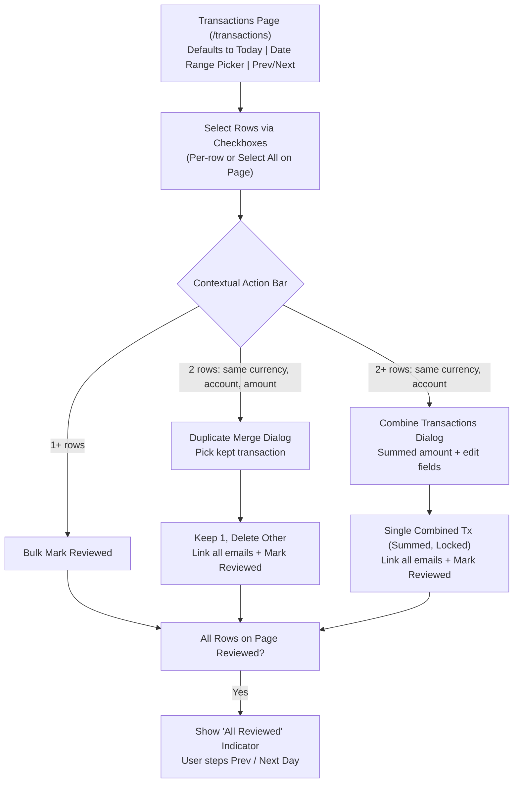
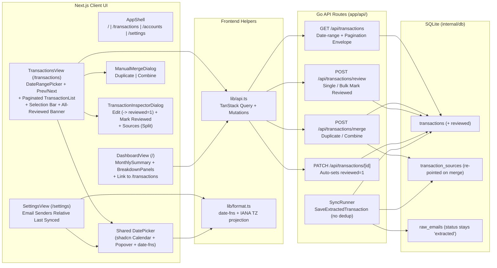

# Manual Transaction Merge, Review Workflow, and Transactions Page - Plan

## Goal Capsule

- **Objective:** Give the user full, predictable control over reconciling daily spending — manually deduplicating or combining related transactions without losing linked email evidence, and tracking which transactions have been reviewed day by day.
- **Means:** Remove automatic deduplication and merge suggestions, move the transaction list to a dedicated `/transactions` page with day-defaulted date-range filtering, pagination, Gmail-style row selection, manual Duplicate and Combine merge dialogs, and a manual review workflow, while standardizing frontend date handling on `date-fns` and a shared shadcn Calendar/Popover date picker (KTD1–KTD7).
- **Product authority:** This Product Contract.
- **Product Contract preservation:** Product Contract unchanged.
- **Execution profile:** Single PR — all units build on one shared schema/API evolution and land together.
- **Stop conditions:** Stop and escalate if an existing SQLite database fails the startup migration or if `date-fns` date-range conversion drifts from `app_settings.timezone`.
- **Open blockers:** None.

---

## Product Contract

### Summary

Move the transaction list off the Spending dashboard into a dedicated **Transactions** page (`/transactions`) built for daily review and manual reconciliation. Replace automatic deduplication and merge suggestions with two explicit manual merge modes — **Duplicate merge** and **Combine transactions** — alongside a manual reviewed state, Gmail-style on-page bulk selection, a shared shadcn date/date-range picker, `date-fns`-based frontend date utilities, and human-readable relative sync times on email senders.

### Problem Frame

Automatic deduplication and merge suggestions during Gmail sync have proven unreliable in day-to-day use, including suggesting merges between unrelated amounts (such as an IDR 12,300 charge into an IDR 32,400 charge). At the same time, real spending often involves multiple related emails that should be summed into a single expense — such as a food delivery order and a separate driver tip — which the current system has no way to combine while keeping every source email linked.

Reviewing transactions is also cramped inside a month-long, unpaginated list on the Spending dashboard with no day-stepping, date-range filtering, multi-row selection, or explicit reviewed state to tell the user when a day is done. Across the frontend, date formatting and date inputs are handled ad-hoc, and email sender sync timestamps render as raw timestamps rather than quick-to-scan relative durations.

### Key Decisions

- **Remove automatic deduplication and merge suggestions completely** — All transaction merging becomes explicitly user-initiated, eliminating silent auto-merges and unreliable suggestion noise. (session-settled: user-directed — chosen over keeping tightened exact-match merge suggestions or retaining exact-match auto-dedup: user decided after review to remove merge suggestions altogether) Governs R1, R2.
- **Strict eligibility rails for manual merges** — Both merge modes require matching currency and account, and Duplicate merge additionally requires equal amounts, preventing accidental cross-currency, cross-account, or mismatched-amount merges. (session-settled: user-directed — chosen over relaxed matching across accounts or amounts: user prioritized strict guardrails) Governs R4, R5, R6.
- **Confirmation dialog for merge resolution** — Duplicate merge lets the user pick which of the two transactions to keep, and Combine lets the user review or edit the resulting merchant, category, account, and date before committing. (session-settled: user-approved — chosen over immediate one-click automatic defaults) Governs R7, R8.
- **Dedicated Transactions page with lean Spending dashboard** — The full transaction list moves to `/transactions`, leaving `/` focused on Monthly Summary, Breakdown Panels, and a link to `/transactions`. (session-settled: user-approved — chosen over keeping a recent-transactions preview or read-only list on `/`) Governs R10, R11.
- **Today-default date controls plus page-size pagination** — `/transactions` opens on the current date, steps by day or by active range span with Previous/Next controls, and paginates rows within the active range. (session-settled: user-approved — chosen over disabling Previous/Next on ranges or omitting page-size pagination) Governs R12, R13, R14.
- **Clean review queue baseline for existing records** — Pre-existing transactions default to reviewed, and manually added or newly merged/combined transactions start reviewed, so the unreviewed queue tracks newly synced items requiring attention. (session-settled: user-approved — confirmed in scoping synthesis) Governs R16, R17.
- **On-page selection scope** — Row checkboxes and the Gmail-style select-all header apply to the active page only and clear on date, filter, or page changes to prevent merging off-screen transactions. (session-settled: user-approved — confirmed in scoping synthesis) Governs R15.
- **Standardized frontend date stack** — All frontend date formatting and date math standardize on `date-fns`, and all date/date-range inputs share one shadcn Calendar/Popover picker component; Go backend time handling stays in Go. (session-settled: user-directed — requested during synthesis review) Governs R20, R21, R22.

### Requirements

**Deduplication removal**

- R1. Email sync saves each extracted transaction individually without performing automatic deduplication.
- R2. Merge suggestion generation, pending suggestion counts, quick-filter chips, and suggestion accept/dismiss UI are removed across sync, account merging, dashboard, and transaction inspection.

**Manual merging (Duplicate & Combine)**

- R3. Selecting one or more transactions on `/transactions` surfaces a contextual action bar offering **Mark reviewed**, **Duplicate merge**, and **Combine transactions**.
- R4. **Duplicate merge** is enabled only when exactly 2 transactions are selected and both share the same currency, same account, and equal amount; otherwise the action is disabled with clear feedback explaining why.
- R5. **Combine transactions** is enabled when 2 or more transactions are selected and all share the same currency and same account; otherwise the action is disabled with clear feedback explaining why.
- R6. Executing a **Duplicate merge** keeps one transaction and deletes the other, transferring all linked email IDs from both transactions onto the kept transaction without marking any transferred email as dismissed.
- R7. Triggering **Duplicate merge** opens a confirmation dialog where the user chooses which of the 2 transactions to keep before committing.
- R8. Triggering **Combine transactions** opens a confirmation dialog showing the summed amount and letting the user review or edit the resulting merchant, category, account, and date before committing.
- R9. Executing **Combine transactions** produces a single transaction with the summed amount locked against automatic recomputation from individual source emails, deletes the absorbed transactions, and links all associated email IDs from every selected transaction onto the resulting transaction without marking any transferred email as dismissed.

**Dedicated Transactions page & Dashboard split**

- R10. Navigation includes a top-level **Transactions** item routing to `/transactions`, which hosts the full transaction list, existing filters (search, category, account, and Needs review), Add transaction action, and Transaction Inspector.
- R11. The Spending dashboard (`/`) displays only the monthly period selector, Monthly Summary, Breakdown Panels, and a link to `/transactions`, without rendering the transaction list.
- R12. `/transactions` defaults to the current local date (single-day range) on load and provides a shadcn Calendar/Popover date-range filter to pick a single day or custom date range.
- R13. `/transactions` provides **Previous** and **Next** navigation buttons that shift a single-day selection by 1 day and shift a multi-day range by its span length.
- R14. `/transactions` paginates transactions within the active date range and filters using page-size pagination (default 25 rows per page) with page navigation controls.
- R15. Each transaction row includes a shadcn checkbox for selection that does not trigger opening the Transaction Inspector when toggled, paired with a Gmail-style header checkbox that selects or deselects all rows on the current page; selection clears whenever the date range, filters, or page changes.

**Manual review workflow**

- R16. Every transaction has an explicit reviewed state: newly synced Gmail transactions start unreviewed, while pre-existing transactions, manually added transactions, and transactions resulting from a Duplicate or Combine merge start reviewed.
- R17. Editing a transaction automatically marks it as reviewed.
- R18. Users can mark an individual transaction as reviewed (via a "Mark reviewed" button) or mark multiple selected transactions as reviewed in bulk from the `/transactions` selection bar, and the "Needs review" filter filters to unreviewed transactions.
- R19. When the active page on `/transactions` contains at least one transaction and every transaction on that page is reviewed, the page displays a clear "all reviewed" status indicator prompting the user that they can move on to another day (Previous / Next).

**Date standardization & Email Senders relative time**

- R20. All frontend date formatting and date calculations are refactored to use `date-fns`.
- R21. All date and date-range inputs across the application use a shared shadcn Calendar/Popover date picker / date-range picker component.
- R22. On **Settings → Email Senders**, each sender row displays its last sync time as a human-readable relative duration string (for example, `Last synced 2 mins ago`).

### Key Flows

- F1. Duplicate merge
  - **Trigger:** User sees two duplicate transactions on the same day on `/transactions` and selects both via row checkboxes.
  - **Steps:** Contextual bar enables **Duplicate merge**; user clicks it, picks which transaction to keep in the confirmation dialog, and confirms.
  - **Outcome:** Kept transaction retains all email IDs from both records and is marked reviewed; the other transaction is deleted without dismissing its linked emails; selection clears.
  - **Covers:** R3, R4, R6, R7, R15, R16.

- F2. Combine transactions (e.g., food delivery + tip)
  - **Trigger:** User selects 2 or more same-currency, same-account transactions on `/transactions`.
  - **Steps:** Contextual bar enables **Combine transactions**; user clicks it, reviews the summed amount and adjusts merchant, category, account, or date in the dialog, and confirms.
  - **Outcome:** A single reviewed transaction holds the locked summed amount and all linked email IDs from every selected transaction; absorbed transactions are deleted without dismissing their emails; selection clears.
  - **Covers:** R3, R5, R8, R9, R15, R16.

- F3. Daily review sweep
  - **Trigger:** User opens `/transactions` (defaults to today) to review newly synced charges.
  - **Steps:** User inspects or edits individual transactions (auto-marking them reviewed), clicks **Mark reviewed** on single items, or checks the select-all-on-page header box and clicks bulk **Mark reviewed**.
  - **Outcome:** Once every transaction on the active page is reviewed, the "all reviewed" indicator appears so the user can step to the previous or next day.
  - **Covers:** R12, R13, R15, R16, R17, R18, R19.

### Acceptance Examples

- AE1. Duplicate merge disabled on mismatched amount
  - **Covers:** R4.
  - **Given:** Two selected transactions on the same account and currency with amounts IDR 12,300 and IDR 32,400.
  - **When:** The contextual selection bar renders.
  - **Then:** **Duplicate merge** is disabled with an explanation that amounts must match, while **Combine transactions** is enabled.

- AE2. Combine blocked across accounts or currencies
  - **Covers:** R5.
  - **Given:** Two selected transactions on different accounts (or different currencies).
  - **When:** The contextual selection bar renders.
  - **Then:** Both **Duplicate merge** and **Combine transactions** are disabled with an explanation that currency and account must match, while **Mark reviewed** remains enabled.

- AE3. Emails survive absorption without dismissal
  - **Covers:** R6, R9.
  - **Given:** Transaction A (linked to email E1) and Transaction B (linked to email E2) are merged via Duplicate merge or Combine transactions.
  - **When:** The merge completes and a subsequent Gmail sync runs.
  - **Then:** The resulting transaction references both E1 and E2, neither E1 nor E2 is marked `dismissed`, and neither email is re-imported as a new transaction.

- AE4. Combined amount stays locked
  - **Covers:** R9.
  - **Given:** Two transactions of IDR 50,000 and IDR 10,000 are combined into IDR 60,000.
  - **When:** The combined transaction is viewed or inspected later.
  - **Then:** Its amount remains IDR 60,000 rather than reverting to a single source email's amount, while both source emails remain visible in the inspector.

- AE5. Multi-day range stepping
  - **Covers:** R12, R13.
  - **Given:** The user selects a 3-day range (e.g., Nov 18–Nov 20) in the date-range picker on `/transactions`.
  - **When:** The user clicks **Previous**.
  - **Then:** The active range shifts by 3 days to Nov 15–Nov 17, pagination resets to page 1, and any row selection clears.

- AE6. Page-reviewed completion state
  - **Covers:** R18, R19.
  - **Given:** `/transactions` shows 4 transactions for today, 2 unreviewed and 2 reviewed.
  - **When:** The user selects all rows on the page via the header checkbox and clicks **Mark reviewed** (or edits the remaining 2 transactions).
  - **Then:** All 4 rows show as reviewed and the page displays the "all reviewed" indicator; on an empty day with 0 transactions, the "all reviewed" indicator does not appear.

- AE7. Relative last-synced display on Email Senders
  - **Covers:** R22.
  - **Given:** An email sender in **Settings → Email Senders** was last synced 2 minutes ago.
  - **When:** The user opens the Email Senders list.
  - **Then:** The row displays a human-readable relative duration such as `Last synced 2 mins ago` formatted via `date-fns`.

### Scope Boundaries

- **Cross-currency or cross-account merges** — Excluded by strict matching rules (R4, R5).
- **Bulk delete and bulk field editing** — Deferred; checkboxes and the selection bar support Duplicate merge, Combine transactions, and bulk Mark reviewed only.
- **Cross-page persistent selection** — Deferred; selection is scoped to the active page (R15).
- **Undo / un-combine history** — Deferred beyond existing per-email split inspection behavior.
- **Go backend time refactor** — Out of scope; `date-fns` applies to frontend date utilities and components only (R20).
- **Frontend JS unit test runner** — Not built in this plan; the repo currently tests backend Go packages via `go test ./...` and validates frontend via `bun run typecheck`, `bun run lint`, and `bun run build`. Adding Vitest/Playwright is separate tooling work unless frontend regressions justify it later.

### Dependencies / Assumptions

- **Same-day duplicate assumption:** Duplicate emails for the same purchase always arrive on the same day, making today-defaulted single-day viewing effective for spotting duplicates without wide multi-day scans.
- **Installed UI primitives:** `components/ui/calendar.tsx`, `components/ui/popover.tsx`, `components/ui/checkbox.tsx`, `components/ui/dialog.tsx`, `date-fns` (`^4.4.0`), and `react-day-picker` (`^10.0.2`) are already installed in the repository; a shadcn pagination component is not yet installed.
- **Existing email-linking model:** `transaction_sources` already supports multiple `email_id` rows per transaction with unique `email_id` foreign keys to `raw_emails`.

### Sources / Research

- `internal/domain/dedup.go` — Current `DeduplicateAndSaveTransaction`, `RunPostMergeDedupForAccount`, `RecomputeTransactionFromSources`, and `SplitTransactionSource`.
- `internal/domain/accounts.go` — `MergeAccounts` call to `RunPostMergeDedupForAccount`.
- `internal/domain/transactions.go` — `ListTransactions`, `GetMonthlySpendingSummary`, `GetTransactionDetail`, `CreateManualTransaction`, `UpdateTransaction`, and `DeleteTransaction`.
- `internal/domain/time.go` — `GetMonthUtcBounds`, `GetCurrentMonthInTimezone`, and UTC ISO-8601 helpers.
- `internal/db/db.go` — `OpenDatabase`, `schemaSQL`, `transactions`, `transaction_sources`, `merge_suggestions`, `rejected_merges`, and `raw_emails`.
- `internal/syncrunner/runner.go` & `internal/syncrunner/runner_test.go` — Gmail extraction loop and in-memory SQLite Go test pattern.
- `docs/solutions/ui-bugs/base-ui-button-render-link-semantics.md` — Standing rule to style `<Link>` with `buttonVariants(...)` instead of `<Button render={<Link />}>`.
- `docs/solutions/logic-errors/gmail-sync-sender-cursor-and-timestamp-null.md` — Guarantees `senders.last_sync_at_utc` updates on every completed sender fetch.
- `components/app-shell.tsx`, `components/dashboard-view.tsx`, `components/monthly-summary.tsx`, `components/transaction-list.tsx`, `components/transaction-inspector-dialog.tsx`, `components/settings-view.tsx`, `components/sync-toast.tsx`, `components/merge-account-dialog.tsx` — Current UI surfaces and date inputs.

---

## Planning Contract

### Key Technical Decisions

- KTD1. **Idempotent startup schema migration for `transactions.reviewed` and retirement of `merge_suggestions` / `rejected_merges`** — `OpenDatabase` checks `PRAGMA table_info(transactions)` and runs `ALTER TABLE transactions ADD COLUMN reviewed INTEGER NOT NULL DEFAULT 1 CHECK (reviewed IN (0, 1))` when missing, creates any index referencing `reviewed` *after* that migration (never inside `schemaSQL`), and runs `DROP TABLE IF EXISTS merge_suggestions` and `DROP TABLE IF EXISTS rejected_merges`. In `internal/db/models.go`, `Transaction.Reviewed` omits `default:1` from its GORM tag (`gorm:"column:reviewed;not null" json:"reviewed"`) so GORM `Create` always writes explicit `0` for newly synced/split rows instead of falling back to SQLite's `DEFAULT 1` (governs R2, R16).
- KTD2. **Strict atomic SQL ordering for manual Duplicate merge and Combine transactions** — Both `DuplicateMergeTransactions` and `CombineTransactions` execute inside one `gorm.DB.Transaction` that updates `transaction_sources SET transaction_id = ?, match_state = 'confirmed'` for absorbed rows *before* deleting the absorbed `transactions` rows, and never invokes `DeleteTransaction`. This avoids `ON DELETE CASCADE` wiping transferred sources and preserves `raw_emails.status = 'extracted'` so emails are never dismissed or re-imported (governs R6, R9, AE3).
- KTD3. **Nullable account matching, `manual_override = 1` locking, and `SplitTransactionSource` safety** — Two `NULL` (`Unassigned`) `account_id` values match for R4/R5 while `NULL` vs a concrete account does not; Combine sets `manual_override = 1` so `RecomputeTransactionFromSources` cannot overwrite the summed amount; `TransactionList` displays linked email counts whenever `sourceCount > 0` even if a manual transaction was merged with Gmail sources; `SplitTransactionSource` drops `rejected_merges` writes, marks detached transactions `reviewed = 0`, and `TransactionInspectorDialog` shows a warning note when splitting from a `manual_override = 1` transaction so the user knows to adjust the remaining locked amount (governs R4, R5, R6, R9, R16, AE4).
- KTD4. **Timezone-consistent date-range bounds and paginated API envelope** — `GET /api/transactions` accepts `startDate=YYYY-MM-DD`, `endDate=YYYY-MM-DD`, `page`, `pageSize` (default 25, max 100), `category`, `accountId`, `search`, and `unreviewedOnly=true` (retiring `unmergedOnly`), converting `[startDate 00:00:00, (endDate + 1 day) 00:00:00)` in `app_settings.timezone` to UTC bounds via a new `GetDateRangeUtcBounds` helper in `internal/domain/time.go`. The endpoint returns `{ items, totalCount, page, pageSize, totalInRangeCount, unreviewedInRangeCount }` so the UI can clamp empty trailing pages and render the "all reviewed" prompt accurately even when `Needs review` is active or multiple pages exist (governs R12, R13, R14, R18, R19, AE5, AE6).
- KTD5. **Dedicated Go endpoints for manual merge and review mutations** — Add `POST /api/transactions/merge` (`mode: "duplicate" | "combine"`) and `POST /api/transactions/review` (`{ transactionIds: string[] }` for both single and bulk review), have `PATCH /api/transactions/[id]` always set `reviewed = 1`, and delete `app/api/merge-suggestions/[id]/route.go`. Reuses the existing `app/api/transactions/[id]/split/route.go` pattern under Next.js `goRoutes` (governs R2, R3–R9, R17, R18).
- KTD6. **`date-fns` frontend standardization with IANA timezone projection and shared `DatePicker`** — Refactor `lib/format.ts` and `components/dashboard-view.tsx` onto `date-fns` (`parseISO`, `format`, `addDays`, `subDays`, `addMonths`, `differenceInCalendarDays`, `formatDistanceToNow`) while preserving IANA `app_settings.timezone` projection (since `@date-fns/tz` is not installed). Introduce `components/date-picker.tsx` wrapping `components/ui/calendar.tsx` and `components/ui/popover.tsx` with single-date (optional clearable) and date-range modes, replacing all 5 native `<Input type="date">` sites across the app (governs R12, R13, R20, R21, R22, AE7).
- KTD7. **Accessible sibling checkbox layout and Base UI link semantics** — Refactor `components/transaction-list.tsx` rows from whole-row `<Button>` elements into flex containers with `<Checkbox>` as a sibling to the row's inspect `<Button>`, prune `selectedIds` against rendered page items on query refresh (e.g., background sync invalidation), and render `/transactions` nav and dashboard links as `<Link className={buttonVariants(...)}>` per `docs/solutions/ui-bugs/base-ui-button-render-link-semantics.md` (governs R10, R11, R15).

### High-Level Technical Design

### System-Wide Impact

- **Database schema & live upgrades:** Existing `data/spender.db` files migrate automatically in `OpenDatabase` (`transactions.reviewed` added with `DEFAULT 1`, `merge_suggestions` and `rejected_merges` dropped; any index referencing `reviewed` is created after the migration runs).
- **API response contract change:** `GET /api/transactions` changes from returning a bare JSON array `TransactionListItem[]` to a paginated object `{ items, totalCount, page, pageSize, totalInRangeCount, unreviewedInRangeCount }`. All frontend consumers (`lib/api.ts`) update in the same PR.
- **Removed suggestion touchpoints:** `MonthlySpendingSummary.pendingMergeSuggestionsCount`, `TransactionListItem.pendingSuggestionCount`, `TransactionDetailView.mergeSuggestions`, `app/api/merge-suggestions/[id]/route.go`, `SyncToast` `Merged` stat, and `MergeAccountDialog`'s post-merge dedup notice are all removed together so no dead UI or 404 calls remain.

### Risks & Dependencies

- **Timezone drift on "Today" and date-range boundaries:** `date-fns` `v4.4.0` operates in browser local time without `@date-fns/tz`. Computing today's `YYYY-MM-DD` string in `app_settings.timezone` and sending calendar date strings (`startDate`, `endDate`) to Go's `GetDateRangeUtcBounds` keeps frontend and backend aligned even when browser timezone differs from Settings timezone.
- **`SplitTransactionSource` on combined transactions:** Because Combine sets `manual_override = 1`, splitting an email out later will not automatically reduce the combined amount. Surfacing an explicit warning in `TransactionInspectorDialog` when splitting a `manual_override = 1` transaction avoids silent double-counting.

---

## Implementation Units

### U1. Schema migration, auto-dedup removal, and merge-suggestion retirement

- **Goal:** Add the `reviewed` column via an idempotent SQLite startup migration, remove automatic deduplication during sync and account merging, and retire `merge_suggestions` and `rejected_merges`.
- **Requirements:** R1, R2, R16.
- **Dependencies:** None.
- **Files:**
  - Modify: `internal/db/db.go`
  - Modify: `internal/db/models.go`
  - Modify: `internal/domain/dedup.go`
  - Modify: `internal/domain/transactions.go`
  - Modify: `internal/domain/accounts.go`
  - Modify: `internal/syncrunner/runner.go`
  - Delete: `app/api/merge-suggestions/[id]/route.go`
  - Create: `internal/domain/dedup_test.go` (catches sync-save, split, and migration invariants against in-memory SQLite; does not cover HTTP routing)
  - Modify: `internal/syncrunner/runner_test.go` (verifies runner still updates sender sync state cleanly)
- **Approach:**
  1. In `internal/db/db.go`, add `reviewed INTEGER NOT NULL DEFAULT 1 CHECK (reviewed IN (0, 1))` to `transactions` in `schemaSQL`, remove `merge_suggestions` and `rejected_merges` table/index creation from `schemaSQL`, and add an idempotent startup migration helper in `OpenDatabase` per KTD1 (creating any index referencing `reviewed` only *after* the column migration).
  2. In `internal/db/models.go`, add `Reviewed int` (`gorm:"column:reviewed;not null" json:"reviewed"`, omitting `default:1` per KTD1) to `Transaction` and remove `MergeSuggestion` and `RejectedMerge` structs.
  3. In `internal/domain/transactions.go`, remove `PendingMergeSuggestionsCount`, `PendingSuggestionCount`, `MergeSuggestionView`, `MergeSuggestions`, and all `merge_suggestions` SQL queries so `internal/domain` compiles cleanly with U1.
  4. In `internal/domain/dedup.go`, replace `DeduplicateAndSaveTransaction` with a direct save function (`SaveExtractedTransaction`) that inserts `email_extractions`, inserts one `transactions` row with `source_type = 'gmail'` and `reviewed = 0`, and inserts one `transaction_sources` row (`match_state = 'single'`), without scanning for duplicates or creating suggestions. Remove `RunPostMergeDedupForAccount`, `ConfirmMergeSuggestion`, `DismissMergeSuggestion`, `insertRejectedPair`, and `loadRejectedEmailIDs`. Update `SplitTransactionSource` to drop `rejected_merges` writes and set the detached transaction's `reviewed = 0` per KTD3.
  5. In `internal/syncrunner/runner.go`, call `SaveExtractedTransaction` and always increment `imported_count` (never `merged_count`).
  6. In `internal/domain/accounts.go`, remove the `RunPostMergeDedupForAccount` call and `suggestionIds` field from `MergeAccounts`.
  7. Delete `app/api/merge-suggestions/[id]/route.go`.
- **Patterns to follow:** `db.OpenDatabase(":memory:", false)` in `internal/syncrunner/runner_test.go`; transactional writes in `internal/domain/transactions.go`.
- **Test scenarios:**
  - Startup migration on a legacy SQLite schema lacking `transactions.reviewed` adds the column with `DEFAULT 1`, backfills existing rows to `reviewed = 1`, drops `merge_suggestions` / `rejected_merges`, and is idempotent on re-open.
  - Calling `SaveExtractedTransaction` twice with identical amount, currency, account, and timestamp creates 2 separate `transactions` rows, both persisted with `reviewed = 0` (verifying GORM does not fall back to `DEFAULT 1`) and 1 `transaction_sources` row each (no auto-merge, no suggestions).
  - `MergeAccounts` moves transactions and identifiers without attempting to write to `merge_suggestions`.
  - `SplitTransactionSource` detaches an email into a new transaction persisted with `reviewed = 0` without touching `rejected_merges`.
- **Verification:** `go test ./internal/db/... ./internal/domain/... ./internal/syncrunner/...` passes with zero references to `merge_suggestions` or `rejected_merges` remaining in Go packages.

### U2. Manual merge (Duplicate & Combine), review mutations, and paginated date-range query API

- **Goal:** Implement backend domain operations and Go API routes for Duplicate merge, Combine transactions, single/bulk mark-reviewed, auto-reviewed on edit, and timezone-aware date-range pagination.
- **Requirements:** R2, R4, R5, R6, R7, R8, R9, R12, R13, R14, R16, R17, R18, R19.
- **Dependencies:** U1.
- **Files:**
  - Modify: `internal/domain/time.go`
  - Modify: `internal/domain/transactions.go`
  - Modify: `app/api/transactions/route.go`
  - Create: `app/api/transactions/merge/route.go`
  - Create: `app/api/transactions/review/route.go`
  - Create: `internal/domain/transactions_test.go` (catches merge atomicity, email preservation, eligibility errors, review transitions, and date-range pagination against in-memory SQLite; does not cover browser UI)
- **Approach:**
  1. In `internal/domain/time.go`, add `GetDateRangeUtcBounds(startDateYYYYMMDD, endDateYYYYMMDD, tz string)` validating `YYYY-MM-DD`, ensuring `startDate <= endDate`, and returning `[start 00:00:00 local -> UTC, (end + 1 day) 00:00:00 local -> UTC)` mirroring `GetMonthUtcBounds` per KTD4.
  2. In `internal/domain/transactions.go`:
     - Add `Reviewed int` (`json:"reviewed"`) to `TransactionListItem`.
     - Update `ListTransactionsParams` and `ListTransactions` to support `StartDate`, `EndDate`, `Page` (default 1), `PageSize` (default 25, capped at 100), and `UnreviewedOnly` (replacing `UnmergedOnly`), returning `PaginatedTransactionsResponse` with `items`, `totalCount`, `page`, `pageSize`, `totalInRangeCount`, and `unreviewedInRangeCount` per KTD4.
     - Update `CreateManualTransaction` to insert `reviewed = 1`, and `UpdateTransaction` to always set `reviewed = 1` per R16–R17.
     - Add `MarkTransactionsReviewed(gdb, transactionIDs)` validating non-empty IDs and updating `reviewed = 1, updated_at_utc = now`.
     - Add `DuplicateMergeTransactions(gdb, keepID, dropID)` validating 2 distinct existing transactions with matching currency, matching nullable `account_id`, and equal `amount_minor` (R4, KTD3), transferring all `transaction_sources` from `dropID` to `keepID` before deleting `dropID` (KTD2), setting `reviewed = 1`, and returning the updated kept transaction.
     - Add `CombineTransactions(gdb, input)` validating ≥2 distinct existing transactions with matching currency and matching nullable `account_id` (R5, KTD3), summing `amount_minor`, applying user-confirmed `merchant`, `category`, `account_id`, `occurred_at_utc`, and optional `note`, setting `manual_override = 1` and `reviewed = 1`, transferring all `transaction_sources` from every absorbed row before deleting absorbed rows (KTD2), and returning the combined transaction.
  3. Wire `GET /api/transactions` in `app/api/transactions/route.go` to the new query params and paginated envelope, and add `app/api/transactions/merge/route.go` and `app/api/transactions/review/route.go` per KTD5.
- **Patterns to follow:** `app/api/transactions/[id]/split/route.go` and `app/api/accounts/merge/route.go` for Go route decoding and error responses.
- **Test scenarios:**
  - `Covers AE1.` `DuplicateMergeTransactions` rejects two same-account, same-currency transactions with mismatched amounts (`12300` vs `32400`) and leaves both untouched.
  - `Covers AE2.` `DuplicateMergeTransactions` and `CombineTransactions` reject selections with mismatched accounts or mismatched currencies (including `NULL` vs concrete account), while allowing two `NULL` (`Unassigned`) accounts to match.
  - `Covers AE3.` After `DuplicateMergeTransactions` and `CombineTransactions`, all `transaction_sources` from absorbed rows point to the surviving transaction with `match_state = 'confirmed'`, absorbed rows are deleted, and every linked `raw_emails.status` remains `'extracted'` (not `'dismissed'`).
  - `Covers AE4.` `CombineTransactions` sums `50000 + 10000` into `60000`, sets `manual_override = 1` and `reviewed = 1`, and a subsequent `RecomputeTransactionFromSources` call leaves `amount_minor` at `60000`.
  - Merging or combining a manual transaction (0 emails) with a Gmail transaction (1 email) preserves the linked email and sets `reviewed = 1`.
  - `CreateManualTransaction` sets `reviewed = 1`; `UpdateTransaction` flips an unreviewed (`reviewed = 0`) Gmail transaction to `reviewed = 1`; `MarkTransactionsReviewed` updates multiple IDs in bulk.
  - `ListTransactions` with `StartDate`/`EndDate` in a non-UTC timezone (e.g. `Asia/Jakarta`) includes transactions at local day boundaries, paginates accurately with `page`/`pageSize`, filters `unreviewedOnly=true`, and reports accurate `totalInRangeCount` and `unreviewedInRangeCount`.
- **Verification:** `go test ./...` passes across all Go packages and Go API routes compile cleanly.

### U3. Frontend `date-fns` refactor, shared shadcn DatePicker/DateRangePicker, Checkbox indeterminate state, and API client updates

- **Goal:** Standardize frontend date utilities on `date-fns`, build a shared shadcn Calendar/Popover date and date-range picker component, add indeterminate visual support to `Checkbox`, replace all native date inputs across the app, update `lib/api.ts` for the new endpoints/shapes, and display human-readable relative sync times on Email Senders.
- **Requirements:** R12, R15, R20, R21, R22.
- **Dependencies:** U2.
- **Files:**
  - Modify: `components/ui/checkbox.tsx`
  - Create: `components/date-picker.tsx`
  - Modify: `lib/format.ts`
  - Modify: `lib/api.ts`
  - Modify: `components/account-form-dialog.tsx`
  - Modify: `components/add-transaction-dialog.tsx`
  - Modify: `components/transaction-inspector-dialog.tsx`
  - Modify: `components/settings-view.tsx`
- **Approach:**
  1. In `components/ui/checkbox.tsx`, add `data-indeterminate:border-primary data-indeterminate:bg-primary data-indeterminate:text-primary-foreground` to `CheckboxPrimitive.Root` and render `<MinusIcon />` instead of `<CheckIcon />` in `CheckboxPrimitive.Indicator` when `props.indeterminate` is true.
  2. Refactor `lib/format.ts` onto `date-fns` per KTD6: keep IANA `timeZone` projection for UTC timestamps, add `getTodayDateString(timeZone)`, `shiftDateRange(startDate, endDate, direction)` (shifting single day by ±1 day and multi-day range by ±span days using `differenceInCalendarDays` + `addDays`), `shiftYearMonth(yearMonth, delta)` using `addMonths`, and `formatRelativeUtc(utcIso)` using `formatDistanceToNow(parseISO(utcIso), { addSuffix: true })`.
  3. Build `components/date-picker.tsx` exporting `DatePicker` (single `YYYY-MM-DD` value; optional `clearable` button rendered as a sibling outside `PopoverTrigger` or in the `PopoverContent` footer so buttons never nest) and `DateRangePicker` (`{ from: string; to: string }`, holding local draft `DateRange | undefined` while open so clicking day 1 sets `{ from: d, to: undefined }`, clicking day 2 completes `{ from, to }` and commits + closes, and closing with only `from` commits `{ from: d, to: d }`, formatted via `date-fns`).
  4. Replace all 5 native `<Input type="date">` inputs in `components/account-form-dialog.tsx`, `components/add-transaction-dialog.tsx`, `components/transaction-inspector-dialog.tsx`, and `components/settings-view.tsx` (both add-sender and inline edit-sender rows) with `DatePicker`.
  5. In `components/settings-view.tsx`, display `sender.last_sync_at_utc` using `formatRelativeUtc` (e.g., `Last synced 2 minutes ago`, preserving `Never synced` when `null` and full formatted timestamp in `title` tooltip).
  6. Update `lib/api.ts`: remove `MergeSuggestionView`, `acceptMergeSuggestionApi`, `rejectMergeSuggestionApi`, `pendingMergeSuggestionsCount`, and `pendingSuggestionCount`; add `reviewed: 0 | 1` to `TransactionListItem`; update `transactionsQuery` to accept `startDate`, `endDate`, `page`, `pageSize`, `unreviewedOnly` and return `PaginatedTransactionsResponse`; add `duplicateMergeTransactionsApi`, `combineTransactionsApi`, and `markTransactionsReviewedApi`.
- **Patterns to follow:** `@base-ui/react` `Popover` trigger pattern (`PopoverTrigger` with `render={<Button ... />}` — native `<button>` only); TanStack Query helpers in `lib/api.ts`.
- **Test scenarios:**
  - `Covers AE7.` Email Senders row renders relative duration via `formatRelativeUtc` when `last_sync_at_utc` is set and `Never synced` when `null`.
  - Selecting a date in `DatePicker` across Add Transaction, Transaction Inspector, Account Form, and Settings Email Senders submits valid UTC ISO-8601 timestamps in `app_settings.timezone`.
  - In `DateRangePicker`, clicking a single date and closing commits `[d, d]`; clicking a first date then a second date commits the full multi-day range `[d1, d2]`.
  - `shiftDateRange` shifts a 1-day range by 1 day and a 3-day range (`2026-11-18`–`2026-11-20`) backward to `2026-11-15`–`2026-11-17`.
- **Verification:** `grep -rn 'type="date"' components/ app/` returns zero matches; full-repo `bun run typecheck`, `bun run lint`, and `bun run build` are gated at U6 once downstream legacy consumers in U4–U6 finish updating.

### U4. Manual merge confirmation dialogs (Duplicate & Combine) and Transaction Inspector updates

- **Goal:** Build the confirmation dialogs for Duplicate merge and Combine transactions, and update `TransactionInspectorDialog` to remove merge suggestions, add a single "Mark reviewed" action, and warn when splitting a `manual_override = 1` transaction.
- **Requirements:** R2, R6, R7, R8, R9, R17, R18.
- **Dependencies:** U3.
- **Files:**
  - Create: `components/manual-merge-dialog.tsx`
  - Modify: `components/transaction-inspector-dialog.tsx`
- **Approach:**
  1. Create `components/manual-merge-dialog.tsx` handling both modes via shadcn `Dialog`:
     - **Duplicate merge mode** (receives 2 `TransactionListItem`s): displays a keyboard-accessible radio group (`role="radiogroup"` / `role="radio"` with `aria-checked`, or styled native radio inputs) comparing merchant, category, account, formatted timestamp, linked email count, and note so the user picks which transaction to keep; disables confirm until a kept transaction is selected and while `isPending`; submitting calls `duplicateMergeTransactionsApi`, invalidates `['transactions']`, `['spending']`, and `['accounts']`, clears selection, and closes.
     - **Combine transactions mode** (receives 2+ `TransactionListItem`s): displays the read-only summed `amount_minor` (formatted in shared currency) and editable fields for `merchant`, `category`, `account_id`, `date` (via shared `DatePicker`), and `note` (pre-filled from the latest selected transaction, preserving its time component when date is unchanged); disables submit when `merchant.trim()` or `date` is empty or while `isPending`; submitting calls `combineTransactionsApi`, invalidates queries, clears selection, and closes.
     - Both modes surface backend errors inside `<Alert variant="destructive">` (e.g., if a selected row was deleted concurrently).
  2. Update `components/transaction-inspector-dialog.tsx`:
     - Remove `pendingSuggestions` section, `acceptMergeMutation`, `rejectMergeMutation`, `onSelectTransaction` prop, and merge-suggestion copy from `DialogDescription`.
     - Add a **Mark reviewed** button when `tx.reviewed === 0` (calling `markTransactionsReviewedApi([tx.id])`) and show a reviewed badge when `tx.reviewed === 1`.
     - When `tx.manual_override === 1` and `detail.sources.length > 1`, show a brief inline note beside `Split email` noting that splitting detaches the email without changing this transaction's locked amount (KTD3).
- **Patterns to follow:** `components/add-transaction-dialog.tsx` and `components/merge-account-dialog.tsx` for dialog form state, error alerts, and TanStack Query invalidation.
- **Test scenarios:**
  - `Covers F1.` Duplicate merge dialog lists both transactions' metadata as accessible radio options, keeps confirm disabled until one is chosen, and submits `keepTransactionId` + `dropTransactionId`.
  - `Covers F2.` Combine dialog displays the exact summed amount, pre-fills editable metadata from the selected rows, disables submit on empty merchant/date, and submits the edited values.
  - Clicking **Mark reviewed** in `TransactionInspectorDialog` marks the transaction reviewed without modifying its other fields; saving edits also leaves it reviewed.
  - No merge-suggestion UI or API calls exist in `TransactionInspectorDialog`.
- **Verification:** `components/manual-merge-dialog.tsx` and `components/transaction-inspector-dialog.tsx` have zero references to merge-suggestion APIs; full-repo `bun run typecheck`, `bun run lint`, and `bun run build` are verified at U6.

### U5. Dedicated Transactions page (`/transactions`) with date stepping, pagination, Gmail-style selection, and all-reviewed indicator

- **Goal:** Create the `/transactions` page and upgrade `TransactionList` with today-defaulted date-range controls, Prev/Next stepping, page-size pagination, Gmail-style row selection, contextual action bar, inline "Mark reviewed", and the "all reviewed" completion indicator.
- **Requirements:** R3, R4, R5, R10, R12, R13, R14, R15, R16, R18, R19.
- **Dependencies:** U3, U4.
- **Files:**
  - Create: `app/transactions/page.tsx`
  - Create: `components/transactions-view.tsx`
  - Modify: `components/transaction-list.tsx`
- **Approach:**
  1. Create `app/transactions/page.tsx` rendering `<TransactionsView />` (mirroring `app/page.tsx` and `app/accounts/page.tsx`).
  2. Create `components/transactions-view.tsx`:
     - Guard unconfigured settings with the same `"Finish initial setup"` alert and `<Link href="/settings" className={buttonVariants({ size: 'sm' })}>` pattern used in `DashboardView`.
     - Default date range to today in `settings.timezone` (`getTodayDateString(timezone)`).
     - Render header toolbar with **Previous**, shared `DateRangePicker`, **Next** (using `shiftDateRange`), and **Add transaction** button (`AddTransactionDialog`).
     - Manage `search`, `category`, `accountId`, `unreviewedOnly` ("Needs review"), `page` (resetting to 1 on date/filter change, clamping to `Math.max(1, totalPages)` when rows shrink), and `selectedIds` (clearing on date, filter, or page change, and pruning any ID not present in current page `items` after background sync invalidation per KTD7).
     - Render `<Skeleton>` loading placeholders while `transactionsQuery.isLoading`, and `<Alert variant="destructive">` when `transactionsQuery.isError` or a `Mark reviewed` mutation fails.
     - Render the "all reviewed" banner with quick **Previous** / **Next** guidance when `totalInRangeCount > 0 && unreviewedInRangeCount === 0` (or when the active page has ≥1 row and all rows on the page are reviewed, distinguishing "page reviewed — next page" when `unreviewedInRangeCount > 0` on later pages per KTD4).
     - Host `ManualMergeDialog` (Duplicate / Combine) and `TransactionInspectorDialog`.
  3. Upgrade `components/transaction-list.tsx`:
     - Replace `unmergedOnly` prop/label with `unreviewedOnly` ("Needs review") and remove `pendingSuggestionCount` badge; update `sourceBadgeLabel` to show email count whenever `tx.sourceCount > 0` (KTD3).
     - Refactor each row into a flex container with `<Checkbox aria-label="Select <merchant> (<amount>)">` as a sibling to the inspect `<Button>` (KTD7), plus a compact inline **Mark reviewed** button (`aria-label="Mark <merchant> as reviewed"`, disabled while review mutation is pending) on unreviewed rows (`tx.reviewed === 0`) and a subtle reviewed indicator on reviewed rows.
     - Add a Gmail-style header bar with a select-all-on-page `<Checkbox aria-label="Select all transactions on this page">` (checked when all rows on page are selected, `indeterminate` when partially selected) and, whenever `selectedIds.length >= 1`, the contextual action bar with **Mark reviewed** (disabled while pending), **Duplicate merge**, and **Combine transactions** plus inline disabled-reason text wired via `aria-describedby` (R3, R4, R5).
     - Add page-size pagination controls (`Previous page` / `Page X of Y` / `Next page` + total count) at the bottom of the card.
- **Patterns to follow:** `components/accounts-view.tsx` for page layout and unconfigured alert; `components/ui/checkbox.tsx` and `components/ui/button.tsx` for Base UI primitives.
- **Test scenarios:**
  - `Covers AE1, AE2.` Selecting 2 mismatched-amount rows disables **Duplicate merge** with inline reason linked by `aria-describedby` while enabling **Combine transactions**; selecting mismatched-account or mismatched-currency rows disables both merge actions while keeping **Mark reviewed** enabled.
  - `Covers AE5.` Clicking **Previous** on a 3-day range shifts the range backward by 3 days, resets to page 1, and clears selection.
  - `Covers AE6.` Marking the remaining unreviewed rows on the active page reviewed via select-all + bulk **Mark reviewed** (or inline buttons / inspector edit) shows the "all reviewed" indicator; an empty day with 0 transactions does not show it.
  - Toggling a row checkbox selects/deselects without opening `TransactionInspectorDialog`; clicking the row content opens the inspector.
  - Loading state renders `<Skeleton>` placeholders (no empty-state flash); query or `Mark reviewed` errors render `<Alert variant="destructive">`.
  - Background sync refresh that shifts page contents prunes stale IDs from `selectedIds`.
- **Verification:** `/transactions` page and upgraded `TransactionList` implement all interactive states; full-repo `bun run typecheck`, `bun run lint`, and `bun run build` are verified at U6 once `DashboardView` detaches from `TransactionList`.

### U6. Navigation, lean Spending dashboard (`/`), and secondary UI cleanup

- **Goal:** Add **Transactions** to top-level navigation, remove the transaction list and merge-suggestion controls from `/` (leaving Monthly Summary, Breakdown Panels, and a link to `/transactions`), and clean up obsolete merge-suggestion UI in `SyncToast` and `MergeAccountDialog`.
- **Requirements:** R2, R10, R11, R20.
- **Dependencies:** U3, U5.
- **Files:**
  - Modify: `components/app-shell.tsx`
  - Modify: `components/dashboard-view.tsx`
  - Modify: `components/monthly-summary.tsx`
  - Modify: `components/sync-toast.tsx`
  - Modify: `components/merge-account-dialog.tsx`
- **Approach:**
  1. In `components/app-shell.tsx`, add `{ href: '/transactions', label: 'Transactions' }` to `NAV_ITEMS` (rendered via `<Link className={buttonVariants(...)}>` per KTD7).
  2. In `components/dashboard-view.tsx`, remove `TransactionList`, `AddTransactionDialog`, `TransactionInspectorDialog`, `transactionsQuery`, and `unmergedOnly` state; replace manual `shiftMonth` date math with `shiftYearMonth` from `lib/format.ts` (R20); add a **View transactions** `<Link href="/transactions" className={buttonVariants({ variant: 'outline', size: 'sm' })}>` button in the header (KTD7).
  3. In `components/monthly-summary.tsx`, remove `unmergedOnly`, `onQuickFilterUnmerged`, and the `pendingMergeSuggestionsCount` button.
  4. In `components/sync-toast.tsx`, remove the `Merged` counter cell from the sync summary grid.
  5. In `components/merge-account-dialog.tsx`, remove the sentence stating that duplicate detection will re-run on the destination account.
- **Patterns to follow:** `docs/solutions/ui-bugs/base-ui-button-render-link-semantics.md` for all button-styled `<Link>` elements.
- **Test scenarios:**
  - Navigation displays `Spending`, `Transactions`, `Accounts`, and `Settings` with active styling and native link semantics (no Base UI `nativeButton` console errors).
  - Spending (`/`) renders only the month/year period selector, `MonthlySummary`, `BreakdownPanels`, and a working link to `/transactions` (no transaction list or pending merge suggestion button).
  - `SyncToast` and `MergeAccountDialog` show no references to automatic merging or post-merge duplicate suggestions.
- **Verification:** `bun run typecheck`, `bun run lint`, and `bun run build` pass with zero errors.

---

## Verification Contract

| Check | Command / Action | Covers |
|---|---|---|
| Go unit & integration tests | `go test ./...` | U1, U2 (migration, no auto-dedup, Duplicate merge, Combine, email preservation, review states, timezone date-range pagination; AE1–AE4) |
| TypeScript typecheck | `bun run typecheck` | U3–U6 (paginated API envelope, `date-fns` helpers, shared `DatePicker`, merge dialogs, `/transactions` page) |
| ESLint check | `bun run lint` | U3–U6 (code quality and React/Next rules) |
| Production build | `bun run build` | U1–U6 (full Next.js + Go route compilation) |
| Native date input audit | `grep -rn 'type="date"' components/ app/` returns empty | U3, R21 |
| Interactive UI smoke pass | Verify `/`, `/transactions` (today default, range picker, Prev/Next, pagination, checkboxes, Duplicate & Combine dialogs, single/bulk Mark reviewed, all-reviewed banner), `/settings` (Email Senders relative `Last synced` + backfill `DatePicker`), and `/accounts` (Account Form `DatePicker`, Merge Account copy) | U3–U6, F1–F3, AE1–AE7 |

---

## Definition of Done

- All 6 implementation units (`U1`–`U6`) are implemented and verified against the Verification Contract (`go test ./...`, `bun run typecheck`, `bun run lint`, and `bun run build` all pass).
- Every Product Contract requirement (`R1`–`R22`), flow (`F1`–`F3`), and acceptance example (`AE1`–`AE7`) is satisfied with no regressions to existing Gmail sync, account balance/reconciliation, or monthly spending summary calculations.
- All obsolete merge-suggestion routes, domain functions, DB table creation statements, UI badges, and any abandoned/experimental code are removed cleanly from the diff.
