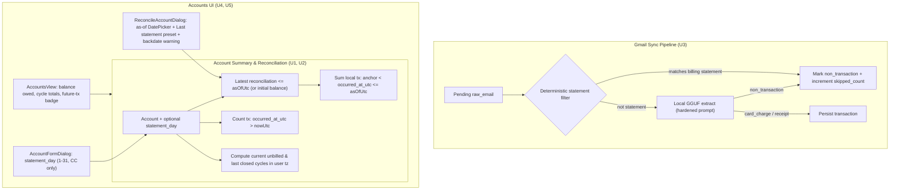

# Credit Card Billing-Cycle Reconciliation - Plan

## Goal Capsule

- **Objective:** Credit card users can trust their displayed balance owed across monthly billing cycles, see current unbilled spending separately from last cycle spending, and reconcile cleanly as of today or their last statement date without billing-statement emails or future-dated imports corrupting the balance.
- **Means:** Extend the existing SQLite `accounts` schema, Go domain balance/reconciliation engine, Gmail sync extraction pipeline, and Accounts UI in place (KTD1–KTD5).
- **Authority hierarchy:** Product Contract requirements (`R1`–`R9`) govern product behavior; Planning Contract decisions (`KTD1`–`KTD5`) govern implementation mechanisms within those constraints; Implementation Units (`U1`–`U5`) execute both without altering either.
- **Execution profile:** Single pull request (`execution: code`), 5 dependency-ordered units (`U1`–`U5`); `ce-work` or the implementing developer executes and verifies all units.
- **Stop conditions:** Stop and escalate if schema migration conflicts with existing `STRICT` SQLite constraints, if timezone handling cannot resolve `app_settings.timezone`, or if statement-email filtering causes false positives on legitimate card charge alerts.

---

## Product Contract

### Summary

Add an optional monthly statement day to credit card accounts so the Accounts view surfaces current unbilled cycle spending alongside last cycle spending, and let users choose an "as of" date when reconciling (defaulting to today with a one-click last-statement preset). In parallel, harden email extraction to reject billing statements and guard balance calculation so future-dated transactions cannot inflate the live balance owed.

### Problem Frame

Credit card balances in PortSpenderNote currently rely on a single "as of now" reconciliation anchor plus every transaction whose timestamp is later than that anchor. When a monthly credit card billing statement email arrives, extraction can misclassify it as a card charge and use the payment due date—weeks in the future—as the transaction date. Because balance calculation has no upper time bound, reconciling the account to the true balance owed immediately snaps back to an inflated total on the next load (for example, reconciling to IDR 9,882,004 immediately jumped to IDR 19,021,553 because a Nov 22 billing statement was imported as a Dec 8 charge of IDR 9,139,549). Even without bad imports, credit card users have no way to anchor a reconciliation to their statement cut-off date or see how much spending belongs to the current unbilled cycle versus the previous closed cycle.

### Key Decisions

- **Cycle-aware view with manual statement reconciliation** — Chosen over automatic statement-email capture and full statement lifecycle tracking to keep carrying cost low while giving users clear cycle visibility and statement-date anchoring. Governs R1, R2, R3, R4, R7.
- **Reconcile after paying instead of bill-payment transactions** — Credit cards stay spending-only without a separate payment transaction type; users reconcile to their banking app's current balance owed after paying a bill. Governs R4, R5.
- **Statement day closes the cycle at end of day in the user's timezone** — Transactions on the statement day belong to the closing cycle and the new unbilled cycle begins the next morning, matching how bank statements cut off. Governs R2, R3, R5.
- **Latest reconciliation timestamp always remains the active anchor** — Backdating a reconciliation earlier than an existing newer reconciliation does not silently override the newer anchor; the UI warns the user up front. Governs R6.
- **Exclude future-dated transactions from live balance and surface a warning** — Prevents mis-dated imports from silently corrupting balances while keeping the bad row visible for user cleanup. Governs R8, R9.

### Requirements

**Credit card billing cycle configuration**

- R1. Credit card accounts accept an optional monthly statement day between 1 and 31 when created or edited, and non-credit-card accounts do not expose this setting.
- R2. For a credit card with a configured statement day, each billing cycle runs from 00:00:00 on the day after the previous statement day through 23:59:59 on the statement day in the user's configured timezone; in months shorter than the configured statement day, the statement date clamps to the last day of that month.

**Accounts view visibility**

- R3. On the Accounts page, a credit card with a configured statement day displays its total balance owed, its current unbilled cycle spend (from the day after the most recent statement date through today), and its last closed cycle spend, each in the account's currency with the cycle date range shown.

**Date-aware reconciliation**

- R4. The Reconcile dialog lets users choose an "as of" date for any account, defaulting to today.
- R5. When reconciling a credit card that has a configured statement day, the Reconcile dialog offers a one-click preset for the most recent statement date; selecting today anchors at the current timestamp, while selecting any past date anchors at 23:59:59 of that date in the user's configured timezone so transactions from the next day onward add on top.
- R6. If the user selects an "as of" date earlier than the account's latest existing reconciliation, the Reconcile dialog warns that the newer reconciliation will remain the active balance anchor.

**Statement-email and future-date protection**

- R7. Gmail sync extraction strictly rejects credit card and bank billing statement emails as non-transactions so statement summaries, total billing amounts, and due dates are never imported as spending transactions.
- R8. Live account balance calculation counts only transactions occurring after the active anchor and at or before the current time, excluding future-dated transactions from the balance owed or available balance.
- R9. When an account has one or more future-dated transactions, the Accounts card displays a clear indicator showing how many future-dated transactions are excluded from the balance so the user can inspect and fix or delete them.

### Key Flows

- F1. Configure statement day and inspect credit card cycles
  - **Trigger:** User opens Add or Edit Account for a credit card.
  - **Steps:** User enters a monthly statement day (e.g. 22) and saves; user views the card on the Accounts page.
  - **Outcome:** Card displays total balance owed, current unbilled cycle spend (since the day after the last statement date), and last closed cycle spend.
  - **Covered by:** R1, R2, R3.

- F2. Reconcile a credit card to its last statement balance
  - **Trigger:** User clicks Reconcile on a credit card with a configured statement day after their statement arrives (e.g. on Nov 25 for a Nov 22 statement).
  - **Steps:** Dialog opens with "as of" defaulting to today; user clicks the "Last statement (Nov 22)" preset and enters the statement total; user saves.
  - **Outcome:** Reconciliation anchors at Nov 22 23:59:59 in the user's timezone, and the displayed balance owed equals the statement total plus unbilled transactions from Nov 23 through now.
  - **Covered by:** R4, R5, R8.

- F3. Sync receives a monthly billing statement email
  - **Trigger:** Gmail sync fetches a bank billing statement email containing Total Billing and a future Due Date.
  - **Steps:** Extraction classifies the email as a non-transaction and skips creating a transaction row.
  - **Outcome:** No fake charge is created and the account's reconciled balance remains intact.
  - **Covered by:** R7.

### Acceptance Examples

- AE1. Statement-date reconciliation preserves subsequent unbilled spending
  - **Covers R2, R4, R5, R8.**
  - **Given:** A credit card in `Asia/Jakarta` with statement day 22, no newer reconciliation, and IDR 742,455 of transactions dated Nov 23–25.
  - **When:** On Nov 25, the user opens Reconcile, chooses the "Last statement (Nov 22)" preset, and enters IDR 9,139,549.
  - **Then:** The reconciliation is recorded at Nov 22 23:59:59 WIB, and the card's computed balance owed is IDR 9,882,004 (IDR 9,139,549 + IDR 742,455).

- AE2. Future-dated transaction cannot inflate reconciled balance
  - **Covers R8, R9.**
  - **Given:** Today is Nov 22, a credit card has a reconciliation of IDR 9,882,004 recorded today, and an existing mis-dated transaction of IDR 9,139,549 dated Dec 8.
  - **When:** The user views the Accounts page.
  - **Then:** The card shows a balance owed of IDR 9,882,004 (not IDR 19,021,553) and displays an indicator that 1 future-dated transaction is excluded.

- AE3. Short-month statement day clamping
  - **Covers R2.**
  - **Given:** A credit card with statement day 31 during a non-leap February.
  - **When:** Cycle boundaries are computed for February and March.
  - **Then:** The February statement date clamps to Feb 28 (23:59:59 in the user's timezone) and the March cycle begins on Mar 1 (00:00:00).

- AE4. Backdating earlier than an existing reconciliation warns the user
  - **Covers R6.**
  - **Given:** An account whose latest reconciliation is recorded on Nov 25.
  - **When:** The user opens Reconcile and selects Nov 22 as the "as of" date.
  - **Then:** The dialog warns that the Nov 25 reconciliation will remain the active balance anchor.

- AE5. Billing statement email is rejected during sync
  - **Covers R7.**
  - **Given:** A synced email titled "Billing Statement of Jenius Credit Card Platinum d-Card" listing Total Billing and a future Due Date.
  - **When:** Sync runs extraction on the email.
  - **Then:** The email is classified as a non-transaction and no transaction is created.

### Scope Boundaries

- **Deferred for later:**
  - Auto-capturing billing statement emails into structured statement records (Total Billing, Minimum Payment, Due Date) or surfacing one-click "Reconcile to statement" prompts from synced emails.
  - Recording credit card bill payments as ledger entries or linking payments from debit/bank accounts.
  - Tracking per-statement paid/unpaid status or payment due-date reminders.
- **Out of scope:**
  - Automatically deleting already-imported bad statement transactions via a database migration.
  - Adding billing-cycle settings to debit cards or digital wallets.
  - Adding a frontend test runner (the repository only maintains a Go test suite; UI changes are verified via typecheck, lint, and production build).

### Dependencies / Assumptions

- **Manual cleanup of existing bad row:** Already-imported misclassified statement transactions (such as the Dec 8 IDR 9,139,549 row on `Smbci ••6039`) will be deleted manually by the user from Transactions; R8 and R9 ensure such rows no longer corrupt the balance in the meantime.
- **Timezone source:** Billing cycle cut-offs and date-only reconciliation anchors rely on the app's configured timezone in Settings (already required before managing accounts).
- **Statement-day inclusivity:** Transactions timestamped on the statement day itself belong to the closing cycle; if a bank posts a late-evening charge to the next cycle instead, the user's next reconciliation absorbs the minor boundary drift.

### Sources / Research

- `internal/domain/accounts.go` — Current balance computation (`computeAccountBalance`), reconciliation creation (`ReconcileAccount`), and account CRUD.
- `internal/domain/time.go` — Existing timezone-aware date/month UTC bound helpers (`LoadTimezone`, `GetMonthUtcBounds`, `GetDateRangeUtcBounds`).
- `internal/db/db.go` — `STRICT` SQLite schema and idempotent `migrateSchema` column migration pattern (`PRAGMA table_info` + `ALTER TABLE`).
- `app/api/accounts/[id]/route.go` — Presence-flag JSON patch decoding (`HasInitialBalance`, `HasLast4`, `HasIdentifiers`) for nullable account fields.
- `components/reconcile-account-dialog.tsx` — Current Reconcile dialog (no date picker yet).
- `components/account-form-dialog.tsx` — Account create/edit form where credit-card-only statement day belongs.
- `components/accounts-view.tsx` — Accounts card layout showing balance owed, foreign-currency exclusion badge, and reconciliation history.
- `lib/llm/types.ts` — Extraction prompt rules (`non_transaction` classification) and date/amount parsing.
- `internal/syncrunner/runner.go` — Sync extraction pipeline where statement emails are processed.
- `docs/solutions/ui-bugs/base-ui-select-items-label-resolution.md` — Any `@base-ui/react` `<Select>` must pass an `items` array; a numeric `<Input>` for statement day avoids Select label pitfalls altogether.

---

## Planning Contract

### Product Contract Preservation

Product Contract unchanged.

### Key Technical Decisions

- KTD1. **Nullable `statement_day` column on `accounts` via idempotent `migrateSchema` migration** — Add `statement_day INTEGER CHECK (statement_day IS NULL OR (statement_day >= 1 AND statement_day <= 31))` in `internal/db/db.go` (both `schemaSQL` and `migrateSchema`) and track patch presence via `HasStatementDay` in `UpdateAccountInput`, matching the existing `reviewed` migration and nullable field patch pattern. Enforces R1.
- KTD2. **Timezone-aware cycle and balance computation in `internal/domain` with injectable clock** — Extract `computeAccountBalanceAsOf(..., asOfUtc, nowUtc)` and billing-cycle bound helpers in `internal/domain/time.go` so `ListAccounts` computes total balance owed (bounded by `occurred_at_utc <= nowUtc`), `future_transaction_count` (`occurred_at_utc > nowUtc`), and for credit cards with `statement_day`, a `billing_cycle` summary (current unbilled spend + date range, last closed cycle spend + date range, and last statement date) deterministically without flakiness in tests. Enforces R2, R3, R8, R9.
- KTD3. **Historical as-of balance evaluation during `ReconcileAccount`** — When `ReconcileAccount` receives a `recorded_at_utc` in the past, compute `computed_balance_minor` as of `recorded_at_utc` (using the latest reconciliation at or before `recorded_at_utc`, or `initial_balance_minor` if none) so `adjustment_minor` reflects the actual discrepancy at the statement date rather than today's balance, while keeping `ListAccounts` anchored to the latest `recorded_at_utc DESC, rowid DESC`. Enforces R4, R5, R6.
- KTD4. **Two-layer billing statement rejection (deterministic pre-filter + LLM prompt hardening)** — Add a deterministic billing-statement detector in `internal/syncrunner` that classifies unmistakable credit card / bank statement emails (subject/body patterns such as "billing statement", "e-statement", "credit card statement", "tagihan kartu kredit", or "total billing" paired with "minimum payment" / "due date") as `non_transaction` before invoking the local GGUF model, and reinforce `lib/llm/types.ts` prompt rules to explicitly reject billing statements and due dates. Enforces R7 without relying solely on small local LLMs.
- KTD5. **Plain numeric input for statement day and existing `DatePicker` for reconciliation date** — Use a constrained numeric `<Input type="number" min={1} max={31}>` (only rendered when `type === "credit_card"`) in `AccountFormDialog` and reuse `components/date-picker.tsx` plus a "Last statement" preset button in `ReconcileAccountDialog`, converting today to current UTC ISO seconds and past dates to `23:59:59` in `settings.timezone` via `lib/format.ts`. Enforces R1, R4, R5, R6 while avoiding unnecessary UI dependencies.

### High-Level Technical Design

### System-Wide Impact

- **Database schema:** Adding nullable `statement_day` to `accounts` is backward-compatible for existing `data/spender.db` databases via `migrateSchema`; existing accounts default to `NULL` and keep current behavior until configured.
- **API contract:** `AccountSummary` gains `statement_day`, `future_transaction_count`, and optional `billing_cycle` (`current_cycle`, `last_cycle`, `last_statement_date`); `CreateAccountInput` and `UpdateAccountInput` accept optional `statement_day`. All additions are backward-compatible.
- **Sync performance:** Deterministic statement filtering runs in Go before HTTP/GGUF extraction, reducing unnecessary LLM calls on monthly statement emails.

### Risks & Dependencies

- **False positives in deterministic statement filter:** Overly broad keyword matching (e.g., matching the word "statement" or "due" alone) could skip legitimate receipts. Mitigation: require strong multi-word statement phrases (e.g., "billing statement", "e-statement", "credit card statement", "tagihan kartu kredit", "lembar tagihan") or co-occurring statement fields ("total billing" / "minimum payment" + "due date"), and cover both positive and negative cases in `runner_test.go`.
- **Reconciliation timestamp timezone alignment:** If the client computes `23:59:59` in `settings.timezone` while the user's browser is in a different timezone, naive `Date` constructors would drift. Mitigation: use the existing `dateTimeInputToUtcIso(dateStr, "23:59:59", timezone)` helper in `lib/format.ts`, which already performs IANA timezone conversion without relying on browser local timezone.
- **Adjustment preview in Reconcile dialog when backdating:** When the user switches the "as of" date from today to a past statement date, showing an adjustment preview computed against *today's* `computed_balance_minor` would be misleading. Mitigation: only show the live adjustment preview when the selected "as of" date is today; for past dates, show a concise note that the server will compute the adjustment as of end of day on the selected date.

---

## Implementation Units

### U1. Add `statement_day` schema, migration, and account CRUD validation

- **Goal:** Persist optional `statement_day` (1–31) on credit card accounts and expose it through create, update, and list account endpoints.
- **Requirements:** R1
- **Dependencies:** None
- **Files:**
  - `internal/db/db.go` (modify)
  - `internal/db/models.go` (modify)
  - `internal/domain/accounts.go` (modify)
  - `app/api/accounts/[id]/route.go` (modify)
  - `internal/domain/accounts_test.go` (create — tests account CRUD validation, balance computation, cycle math, and reconciliation in-memory with SQLite; catches schema/SQL/domain regressions, misses HTTP JSON wiring which is thin pass-through)
- **Approach:**
  1. Add `statement_day INTEGER CHECK (statement_day IS NULL OR (statement_day >= 1 AND statement_day <= 31))` to `accounts` in `schemaSQL` and add an idempotent `PRAGMA table_info(accounts)` + `ALTER TABLE` step in `migrateSchema` (`internal/db/db.go`, per KTD1).
  2. Add `StatementDay *int` (`gorm:"column:statement_day" json:"statement_day"`) to `db.Account` (`internal/db/models.go`).
  3. Add `StatementDay *int` to `CreateAccountInput` and `UpdateAccountInput` (with `HasStatementDay bool` populated from `rawMap` in `app/api/accounts/[id]/route.go`).
  4. Validate `statement_day` in `CreateAccount` and `UpdateAccount`: reject values `< 1` or `> 31`; reject non-nil `statement_day` when effective account `type != "credit_card"`; clear `statement_day` to `nil` if an unlocked account changes type away from `credit_card`.
- **Patterns to follow:** `migrateSchema` `transactions.reviewed` column check in `internal/db/db.go`; `HasInitialBalance` / `HasLast4` patch handling in `app/api/accounts/[id]/route.go` and `internal/domain/accounts.go`.
- **Test scenarios:**
  - Create a `credit_card` account with `statement_day = 22` -> persists and returns `statement_day: 22`.
  - Create a `credit_card` account with `statement_day = nil` -> succeeds and returns `nil`.
  - Update a `credit_card` account to set `statement_day = 15`, then explicitly clear it to `nil` (`HasStatementDay = true`) -> updates and clears properly; omitting `HasStatementDay` leaves existing value intact.
  - Create or update a `credit_card` with `statement_day = 0` or `32` -> returns validation error.
  - Create or update a `debit_card` or `digital_wallet` with `statement_day = 22` -> returns validation error.
  - Opening an existing database lacking `statement_day` runs `migrateSchema` cleanly and allows setting `statement_day`.
- **Verification:** `go test ./internal/domain/...` passes all CRUD and migration scenarios, and existing account creation/editing continues to work with `statement_day` omitted.

### U2. Implement timezone-aware billing cycle math, future-date balance guard, and historical reconciliation

- **Goal:** Compute bounded live balances (excluding future-dated transactions), `future_transaction_count`, credit card billing-cycle spend summaries, and accurate as-of historical reconciliations.
- **Requirements:** R2, R3, R4, R5, R6, R8, R9, AE1, AE2, AE3, AE4
- **Dependencies:** U1
- **Files:**
  - `internal/domain/time.go` (modify)
  - `internal/domain/accounts.go` (modify)
  - `internal/domain/accounts_test.go` (modify)
- **Approach:**
  1. In `internal/domain/time.go`, add timezone-aware billing-cycle calculation helpers per R2 and KTD2:
     - Clamp `statementDay` to the target month's last calendar day (`daysInMonth`).
     - Given `now` in user's `tz` and `statementDay`, derive:
       - `CurrentCycle`: starts at `00:00:00` the day after the most recent statement date strictly before today (or if today is on/before this month's statement date, the day after last month's clamped statement date; if today is after this month's statement date, the day after this month's clamped statement date), ends at `23:59:59` on the upcoming statement date (inclusive), with local `YYYY-MM-DD` start/end dates and UTC bounds `[startUtc, endExclusiveUtc)`.
       - `LastCycle`: the immediately preceding closed billing cycle with local `YYYY-MM-DD` start/end dates and UTC bounds `[startUtc, endExclusiveUtc)`.
       - `LastStatementDate`: `YYYY-MM-DD` of `LastCycle`'s closing statement date (the most recent statement date strictly before today in `tz`, used by the Reconcile preset per R5 so it never duplicates Today on the statement day itself).
  2. In `internal/domain/accounts.go`, refactor `computeAccountBalance` to call an internal `computeAccountBalanceAsOf(gdb, account, targetCurrency, asOfUtc, nowUtc)` (per KTD2, KTD3):
     - Select the latest reconciliation with `recorded_at_utc <= asOfUtc` (ordered `recorded_at_utc DESC, rowid DESC`), or fall back to `initial_balance_minor` / `initial_balance_as_of_utc` when `initial_balance_as_of_utc <= asOfUtc`.
     - Sum local-currency transactions with `occurred_at_utc <= asOfUtc` in both the anchored branch (`occurred_at_utc > anchorTime AND occurred_at_utc <= asOfUtc`, or `>=` for initial balance) and the unanchored `anchorBalance == nil` branch (`occurred_at_utc <= asOfUtc`), so future-dated rows (`> nowUtc`) are excluded from live balance and net flow on confirmed and provisional accounts alike (R8).
     - Count `future_transaction_count` as transactions for `account_id` with `occurred_at_utc > nowUtc` (R9).
  3. Extend `AccountSummary` with `FutureTransactionCount int64` (`json:"future_transaction_count"`) and `BillingCycle *CreditCardBillingCycleSummary` (`json:"billing_cycle"`), populated when `account.Type == "credit_card" && account.StatementDay != nil` by summing local-currency transactions in `CurrentCycle` (capped at `<= nowUtc`) and `LastCycle` (R3).
  4. Update `ReconcileAccount` so `computed_balance_minor` is evaluated as of `recordedAt` (via `computeAccountBalanceAsOf(..., recordedAt, nowUtc)`), while the returned `AccountSummary` still reflects the live balance as of `nowUtc` using the latest reconciliation anchor (KTD3, R6).
- **Patterns to follow:** `GetMonthUtcBounds` and `GetDateRangeUtcBounds` in `internal/domain/time.go`; `computeAccountBalance` SQL aggregation in `internal/domain/accounts.go`.
- **Test scenarios:**
  - Covers AE1: Credit card in `Asia/Jakarta` with `statement_day = 22`, transactions totaling IDR 742,455 on Nov 23–25; reconciling at Nov 22 23:59:59 WIB (`2026-11-22T16:59:59Z`) with IDR 9,139,549 yields live balance owed IDR 9,882,004 and current unbilled spend IDR 742,455.
  - Covers AE2: Account reconciled today to IDR 9,882,004 with a future-dated Dec 8 transaction of IDR 9,139,549 reports `computed_balance_minor = 9882004` and `future_transaction_count = 1`.
  - Covers AE3: `statement_day = 31` in non-leap February 2026 clamps to `2026-02-28` (`23:59:59` local) and March cycle starts `2026-03-01` (`00:00:00` local); leap year February 2028 clamps to `2028-02-29`.
  - Covers AE4 / R6: Reconciling on Nov 22 when a Nov 25 reconciliation already exists stores the Nov 22 row with an accurate Nov 22 `computed_balance_minor`, while `ListAccounts` keeps the Nov 25 reconciliation as the active anchor.
  - Statement day inclusivity: Transaction at `2026-11-22 23:30:00+07:00` counts in the Oct 23 – Nov 22 cycle; transaction at `2026-11-23 00:05:00+07:00` counts in the Nov 23 – Dec 22 cycle.
  - Credit card with `statement_day = nil` returns `billing_cycle = nil` and still enforces `future_transaction_count` and future-date exclusion.
- **Verification:** `go test ./internal/domain/...` passes all billing-cycle, future-date exclusion, and historical reconciliation tests.

### U3. Reject billing statement emails in sync pipeline and tighten LLM extraction prompt

- **Goal:** Ensure credit card and bank billing statement emails are classified as `non_transaction` and never create transactions during Gmail sync.
- **Requirements:** R7, F3, AE5
- **Dependencies:** None
- **Files:**
  - `internal/syncrunner/statement_filter.go` (create)
  - `internal/syncrunner/runner.go` (modify)
  - `internal/syncrunner/runner_test.go` (modify — tests deterministic statement filtering and extraction skip behavior against in-memory SQLite; catches filter precision/recall regressions, misses live GGUF inference behavior)
  - `lib/llm/types.ts` (modify)
- **Approach:**
  1. Create `IsBillingStatementEmail(subject, cleanedText string) bool` in `internal/syncrunner/statement_filter.go` (per KTD4):
     - Normalize text (lowercase, collapse whitespace).
     - Match unambiguous statement subject phrases (e.g., `billing statement`, `e-statement`, `credit card statement`, `monthly statement`, `account statement`, `tagihan kartu kredit`, `lembar tagihan`, `ringkasan tagihan`).
     - Also match body combinations where a statement summary heading/phrase (`billing statement`, `ringkasan tagihan`, `rincian tagihan`) or `total billing` / `total tagihan` co-occurs with `minimum payment` / `pembayaran minimum` or `due date` / `tanggal jatuh tempo`.
  2. In `internal/syncrunner/runner.go` (`runExtractionPhase`), check `IsBillingStatementEmail(email.Subject, email.CleanedText)` before calling `callNodeLlamaExtract`; when true, persist `email_extractions` (`email_kind = 'non_transaction'`, `extraction_model = 'rule:billing_statement'`, minimal JSON reason), mark `raw_emails.status = 'non_transaction'`, and increment `sync_runs.skipped_count`.
  3. In `lib/llm/types.ts` (`buildExtractionPrompt`), expand the `non_transaction` rule to explicitly call out credit card billing statements, e-statements, total billing summaries, minimum payment notices, and payment due dates so the LLM prompt backs up the deterministic filter.
- **Patterns to follow:** `non_transaction` handling branch in `runExtractionPhase` (`internal/syncrunner/runner.go:572-585`); `seedRawEmail` test helpers in `internal/syncrunner/runner_test.go`.
- **Test scenarios:**
  - Covers AE5: Email with subject `"Billing Statement of Jenius Credit Card Platinum d-Card"` and body containing `"Total Billing (IDR): 9,139,549.26"`, `"Minimum Payment (IDR): 456,977.00"`, `"Due Date: 08 Dec 2026"` -> `IsBillingStatementEmail` returns `true`, and extraction marks `raw_emails.status = 'non_transaction'`, writes `email_extractions` with `email_kind = 'non_transaction'`, increments `skipped_count`, and creates zero `transactions` rows.
  - Indonesian e-statement email (`"e-Statement Kartu Kredit BCA"` / `"Tagihan Kartu Kredit"` with `"Tanggal Jatuh Tempo"`) -> rejected as `non_transaction`.
  - Legitimate card charge alert (`"Transaksi Kartu Kredit berhasil di Tokopedia sebesar Rp 150.000"`) and merchant receipt mentioning `"billing address"` or `"payment due upon receipt"` -> `IsBillingStatementEmail` returns `false` (not falsely filtered).
- **Verification:** `go test ./internal/syncrunner/...` passes all positive and negative statement-filter tests, and `bun run typecheck` passes after `lib/llm/types.ts` changes.

### U4. Add statement day input and cycle/future-date display to Accounts UI

- **Goal:** Expose `statement_day` in the Add/Edit Account dialog for credit cards, and display current unbilled cycle spend, last closed cycle spend, and excluded future-dated transaction badges on the Accounts page.
- **Requirements:** R1, R3, R9, F1, AE2
- **Dependencies:** U1, U2
- **Files:**
  - `lib/api.ts` (modify)
  - `components/account-form-dialog.tsx` (modify)
  - `components/accounts-view.tsx` (modify)
- **Approach:**
  1. Update `AccountSummary`, `createAccountApi`, and `updateAccountApi` types in `lib/api.ts` to include `statement_day: number | null`, `future_transaction_count: number`, and `billing_cycle: CreditCardBillingCycleSummary | null`.
  2. In `components/account-form-dialog.tsx`, add an optional "Statement day (1–31)" numeric `<Input type="number" min={1} max={31}>` shown only when `type === "credit_card"` (per KTD5, R1), with helper text explaining monthly cycle cut-off (e.g., "Day of month your statement closes, e.g. 22"). Validate integer `1..31` client-side when non-empty and send `statement_day: null` when cleared.
  3. In `components/accounts-view.tsx`:
     - Show a badge when `account.future_transaction_count > 0` (e.g., `1 future-dated transaction excluded`) alongside the existing `uncounted_foreign_count` badge (R9, AE2).
     - For credit cards with `account.billing_cycle`, render a compact two-item cycle summary row inside the card showing **Unbilled (current cycle)** with its date range and formatted amount, and **Last cycle** with its date range and formatted amount (R3).
- **Patterns to follow:** `uncounted_foreign_count` badge in `components/accounts-view.tsx`; conditional form fields and validation in `components/account-form-dialog.tsx`; `formatMinorCurrency` and `formatDateRangeLabel` in `lib/format.ts`.
- **Test scenarios:**
  - `Test expectation: none -- repository has no frontend test runner; verified via TypeScript typecheck, ESLint, production build, and manual UI inspection against F1 and AE2.`
- **Verification:** `bun run typecheck`, `bun run lint`, and `bun run build` succeed cleanly, and the Accounts page renders statement day configuration, cycle totals, and the future-dated transaction badge without layout or hydration errors.

### U5. Add "as of" date picker, last-statement preset, and backdate warning to Reconcile dialog

- **Goal:** Enable date-aware reconciliation defaulting to today, with a one-click last-statement preset for credit cards and a clear warning when backdating before a newer reconciliation.
- **Requirements:** R4, R5, R6, F2, AE1, AE4
- **Dependencies:** U2, U4
- **Files:**
  - `lib/format.ts` (modify — only if a small helper such as `dateEndOfDayToUtcIso` improves clarity alongside `dateTimeInputToUtcIso`)
  - `components/reconcile-account-dialog.tsx` (modify)
  - `components/accounts-view.tsx` (modify — pass `timezone` prop to `ReconcileAccountDialog`)
- **Approach:**
  1. In `components/reconcile-account-dialog.tsx`, accept `timezone?: string | null` and add an `asOfDate` state (`YYYY-MM-DD`) initialized to `getTodayDateString(timezone)` whenever the dialog opens (R4).
  2. Render `DatePicker` for "As of date" and, when `account.type === "credit_card"` and `account.billing_cycle?.last_statement_date` is present, show quick preset buttons for **Today** and **Last statement (`MMM d`)** (R5).
  3. On submit, if `asOfDate === todayStr`, omit `recorded_at_utc` (server anchors at current timestamp); if `asOfDate < todayStr`, compute `dateTimeInputToUtcIso(asOfDate, "23:59:59", timezone)` and pass it as `recorded_at_utc` (R5, KTD5). Reject future dates (`asOfDate > todayStr`) with an inline validation message.
  4. Compare the target timestamp against `account.latest_reconciliation?.recorded_at_utc`: if earlier, render a warning `Alert` stating that the newer reconciliation will remain the active balance anchor (R6, AE4).
  5. Show the live adjustment preview only when `asOfDate === todayStr`; when backdating, show a brief note that the adjustment will be calculated against the balance as of end of day on the selected date.
- **Patterns to follow:** `DatePicker` usage in `components/account-form-dialog.tsx`; `getTodayDateString` and `dateTimeInputToUtcIso` in `lib/format.ts`; `Alert` component usage in `components/reconcile-account-dialog.tsx`.
- **Test scenarios:**
  - `Test expectation: none -- repository has no frontend test runner; verified via TypeScript typecheck, ESLint, production build, and manual UI inspection against F2, AE1, and AE4.`
- **Verification:** `bun run typecheck`, `bun run lint`, and `bun run build` succeed cleanly, and submitting a past statement date sends end-of-day UTC in the configured timezone and updates the card's computed balance owed accurately.

---

## Verification Contract

| Check | Command | Scope / What It Proves |
|---|---|---|
| Go unit & integration tests | `go test ./...` | Proves U1–U3: `statement_day` migration and validation, cycle clamping (AE3), future-date balance exclusion (AE2), historical reconciliation math (AE1, AE4), and billing-statement email rejection (AE5). |
| TypeScript typecheck | `bun run typecheck` | Proves U3–U5: `lib/llm/types.ts`, `lib/api.ts`, `lib/format.ts`, and Accounts/Reconcile React components type-check cleanly. |
| ESLint | `bun run lint` | Proves U3–U5: frontend and TS modules pass project lint rules. |
| Production build | `bun run build` | Proves full Next.js + Go route bundle compiles cleanly with no build regressions. |

---

## Definition of Done

- All 5 implementation units (`U1`–`U5`) are implemented with no changes to Product Contract scope (`R1`–`R9`).
- All checks in the Verification Contract (`go test ./...`, `bun run typecheck`, `bun run lint`, `bun run build`) pass with zero errors.
- All Acceptance Examples (`AE1`–`AE5`) are covered by passing Go tests (`AE1`–`AE5`) and verified UI behavior (`AE1`, `AE2`, `AE4`).
- No dead-end, experimental, or abandoned code remains in the diff.
