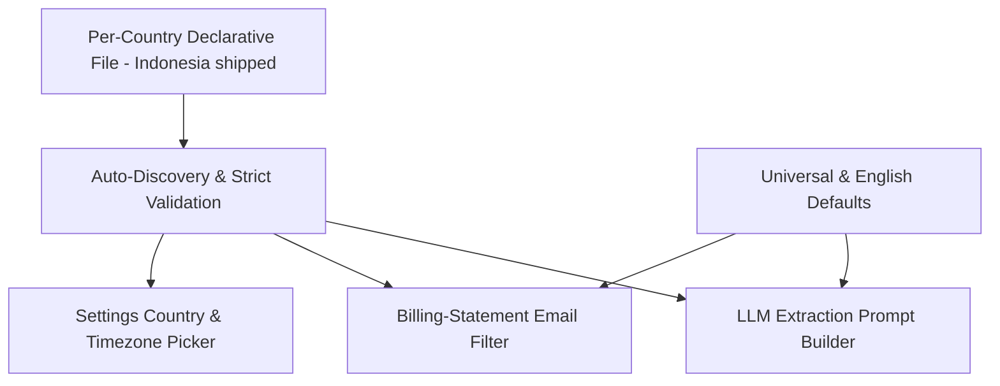

# Single-File Country Configuration - Plan

## Goal Capsule

- **Objective:** Enable a developer outside Indonesia who clones PortSpenderNote to add full support for their country by creating one self-contained country file modeled on Indonesia, with zero edits to core Go or TypeScript code.
- **Means:** Consolidate all country-specific configuration (locale metadata, LLM extraction rules, and local email filter phrases) into one declarative file per country, shipping only Indonesia out of the box and layering each country file over universal/English defaults.
- **Product authority:** This Product Contract governs product behavior, discovery/validation semantics, and scope boundaries.
- **Open blockers:** None.

---

## Product Contract

### Summary

PortSpenderNote will define each supported country in a single declarative file, shipping with Indonesia as the sole built-in country. Discovered country files become the exclusive source of truth for the Settings country picker and drive both the Go email sync pipeline and the TypeScript LLM extraction prompt, layered on top of shared universal and English defaults. Dropping a new country file into the country directory registers it automatically with strict fail-fast validation on startup.

### Problem Frame

Country-specific rules are currently split across both runtimes and mixed with global lists. Locale metadata for 18 countries lives in a Go catalog, Indonesian LLM prompt rules live in a TypeScript map, and Indonesian billing-statement phrases are interleaved with English phrases in a global Go slice that runs unconditionally for every user.

This layout creates two problems as the project opens up to self-hosters outside Indonesia. First, a cloner who wants to adapt the app for their own country cannot point an AI coding tool at a single reference file; they must hunt across Go and TypeScript modules to find every country hook. Second, adding more countries under the current structure will turn both the rule builders and the statement filter lists into hard-to-maintain spaghetti.

### Key Decisions

- **Country files are the sole source of truth for Settings** — Only countries with a discovered file appear in the Settings picker, keeping the repo focused on Indonesia while making new countries immediately selectable without touching core code. Governs R1, R3, R4.
- **Declarative data layered over universal defaults** — Country files hold pure declarative data rather than executable code, adding local rules and phrases on top of shared universal/English baselines so cloners do not duplicate common English rules. Governs R1, R5, R6.
- **Zero-touch auto-discovery with strict fail-fast validation** — Dropping a file into the country directory activates it with no central registry edit, while malformed files fail startup immediately with an actionable error so vibe-coded mistakes surface right away. Governs R3, R8.
- **Graceful handling for unrecognized saved countries** — Existing databases whose saved `country_code` no longer matches a discovered country file remain bootable and guide the user to re-select a valid country in Settings. Governs R7.
- **Currency decimal rules stay global** — ISO 4217 decimal exponents remain universal rather than moving into country files, because any user can receive transactions in foreign currencies. Governs R9.
- **Ship a self-documenting contract beside Indonesia** — Including a short contributor guide and field contract alongside the Indonesia file lets a cloner's AI tool see every supported field and what universal defaults already cover. Governs R10.

### Actors

- A1. **International cloner** — A developer or self-hoster outside Indonesia who clones the repository and uses an AI coding tool (or edits manually) to create one country file modeled on Indonesia.
- A2. **Indonesia / existing user** — A user running the default repository checkout (fresh install or upgraded existing SQLite database).
- A3. **App runtime** — The Go backend (settings API, sync runner, billing-statement filter) and the TypeScript LLM extraction layer consuming the active country configuration.

### Requirements

**Single-file country contract**

- R1. Every supported country is defined in one declarative file that owns all country-specific configuration: country code, display name, default currency, default timezone, supported timezones, LLM extraction prompt rules, and local billing-statement filter phrases (subject phrases, primary body cues, secondary body cues).
- R2. The repository ships with Indonesia (`ID`) as the sole country file out of the box, carrying the existing Indonesia locale metadata, IDR/timezone/wallet LLM prompt rules, and Indonesian billing-statement phrases.

**Discovery and Settings authority**

- R3. The app auto-discovers all country files from a single dedicated directory without requiring edits to any central registry or source code file.
- R4. Discovered country files are the sole source of truth for the Settings country catalog and locale validation; the hardcoded 18-country catalog is removed.

**Runtime behavior and layering**

- R5. Billing-statement email filtering evaluates universal English phrases for every email and appends the active user country's local phrases only when that country matches a discovered country file.
- R6. LLM transaction extraction emits universal date, time, and timezone rules for every email and appends the active user country's prompt rules from its discovered country file.
- R7. When a database contains an unrecognized or missing `country_code` (such as a previously selected country whose file is not present, or a retry run without a country set), the app boots normally, falls back to universal-only filter and prompt baselines where extraction runs, and prompts the user in Settings to select an available country before saving locale settings or starting a full sync.

**Validation and contributor ergonomics**

- R8. Startup validation fails fast with a clear error naming the offending file and field whenever any discovered country file is malformed, has duplicate country codes, or fails required field validation (including valid ISO country code, non-empty name, valid 3-letter ISO 4217 currency, valid IANA timezones with `defaultTimezone` present in `timezones`).
- R9. Universal currency formatting metadata (such as ISO 4217 decimal exponents) stays global and currency-scoped rather than country-scoped.
- R10. A concise contributor guide and field contract live alongside the Indonesia country file, documenting every supported field and noting what universal/English baselines already cover so cloners and AI coding tools do not duplicate them.

### Key Flows

- F1. **Cloner adds a new country**
  - **Trigger:** A1 clones the repo and wants support for their country (e.g., Japan or Germany).
  - **Actors:** A1, A3
  - **Steps:** A1 reads the Indonesia country file and accompanying field guide; A1 (or their AI tool) creates a new country file in the country directory with local locale metadata, LLM rules, and local billing-statement phrases; A1 starts or restarts the app.
  - **Outcome:** A3 validates and registers the new country automatically; the country appears in Settings and its rules and statement phrases become active once selected.
  - **Covered by:** R1, R3, R4, R5, R6, R8, R10

- F2. **Cloner introduces a malformed country file**
  - **Trigger:** A1 creates a new country file with a missing required field, invalid IANA timezone, or duplicate country code and starts the app.
  - **Actors:** A1, A3
  - **Steps:** A3 scans the country directory during startup and validates every discovered file.
  - **Outcome:** Startup fails fast with an error identifying the file path and exact field problem so A1 can fix it immediately.
  - **Covered by:** R3, R8

- F3. **Existing user upgrades with a non-Indonesia saved country**
  - **Trigger:** A2 starts the updated app against an existing SQLite database whose `country_code` was previously set to a country without a file (e.g., `US`).
  - **Actors:** A2, A3
  - **Steps:** A3 boots cleanly using only discovered country files (Indonesia); A2 opens Settings or triggers a sync.
  - **Outcome:** Settings shows only discovered countries and prompts A2 to pick a supported country (or add a file for their country); full sync refuses to run until a valid discovered country is selected, while any background retry without a matching country uses universal baselines only.
  - **Covered by:** R4, R5, R6, R7

### Acceptance Examples

- AE1. **Indonesia parity out of the box**
  - **Covers R1, R2, R4, R5, R6.**
  - **Given:** A fresh repository checkout with only the Indonesia country file present.
  - **When:** A2 opens Settings and syncs Indonesian credit-card and e-wallet emails.
  - **Then:** Settings lists only Indonesia (`ID`, `IDR`, `Asia/Jakarta` / `Asia/Makassar` / `Asia/Jayapura`); Indonesian billing-statement emails (e.g., `"tagihan kartu kredit"`, `"total tagihan"` + `"tanggal jatuh tempo"`) are skipped as `non_transaction`; and LLM extraction includes the IDR separator, WIB/WITA/WIT offset, and Indonesian wallet rules.

- AE2. **Zero-touch addition of a new country**
  - **Covers R1, R3, R4, R5, R6.**
  - **Given:** A1 adds a valid `JP` country file to the country directory without modifying any Go or TypeScript source files.
  - **When:** A1 restarts the app, selects Japan in Settings, and syncs emails.
  - **Then:** Japan appears in the Settings country picker with its currency and timezones; billing-statement filtering applies universal English phrases plus Japan's local phrases (and does not apply Indonesia's phrases); and LLM extraction includes universal date/time rules plus Japan's prompt rules.

- AE3. **Fail-fast validation on malformed country file**
  - **Covers R8.**
  - **Given:** A1 adds a country file with an invalid `defaultTimezone` (not in `timezones` or not a valid IANA zone) or a duplicate country code `ID`.
  - **When:** A1 starts the app.
  - **Then:** Startup aborts immediately with a clear error message naming the file and invalid field.

- AE4. **Unrecognized saved country does not crash the app**
  - **Covers R7.**
  - **Given:** An existing SQLite database has `country_code = "US"` saved, and only the Indonesia country file exists on disk.
  - **When:** The user starts the app and opens Settings.
  - **Then:** The app boots without crashing, Settings displays available discovered countries (`ID`) and prompts the user to select a supported country, and any retry path running without a matching country file falls back to universal-only baselines.

- AE5. **Foreign-currency formatting remains unaffected**
  - **Covers R9.**
  - **Given:** Only the Indonesia (`ID`) country file exists on disk.
  - **When:** A user records or views a transaction in `USD` or `JPY`.
  - **Then:** Currency exponent handling (`USD` = 2 decimals, `JPY` = 0 decimals) continues working identically to before.

### Scope Boundaries

- **Deferred for later:**
  - Shipping pre-built country files for countries other than Indonesia.
  - Executable or scripted per-country hooks (custom regexes, bank-specific parsers, or custom formatting functions).
  - Hot-reloading country files at runtime without restarting the app.
  - Removing or localizing minor UI example placeholders such as `"e.g. GoPay Coins"` in `components/account-form-dialog.tsx`.

### Dependencies / Assumptions

- Existing tests that seed `country_code: "ID"`, `IDR`, and `Asia/Jakarta` remain valid because Indonesia stays shipped out of the box; tests for `IsBillingStatementEmail` will need to cover country-scoped vs universal-only behavior.
- `RetryPendingAndFailedExtractions` in `internal/syncrunner/runner.go` can run without requiring a non-empty `CountryCode`, so both the statement filter and LLM prompt builder must treat an absent or unmatched country code as "universal defaults only."

### Outstanding Questions

**Resolve Before Planning**

- None.

**Deferred to Planning**

- Choose the exact declarative file format (e.g., JSON with a JSON Schema vs YAML), directory path, and filename convention.
- Decide how the TypeScript LLM layer obtains the active country's prompt rules (Go loading/validating once and forwarding rules in the extraction request vs both Go and TypeScript reading the same directory with shared schema validation).
- Confirm how Go embeds or locates the country directory in both local dev (`go run` / `next dev`) and compiled binary / production builds so dropping a new file works cleanly for cloners.

### Sources / Research

- `internal/domain/locale.go:20-57` — Current `CountryLocaleInfo`, 18-entry `CountryCatalog`, and `FindCountryByCode`.
- `internal/domain/settings.go:31,71,81-85` — `AppSettingsView.CountryCatalog` exposure and `UpdateLocaleSettings` country validation.
- `components/settings-view.tsx:126-146,388-431` — Settings Country and Timezone selects populated from `settings.data.countryCatalog`.
- `lib/llm/country-rules.ts:45-77` — Universal date/time/timezone prompt rules and `COUNTRY_RULE_BUILDERS.ID`.
- `lib/llm/types.ts:10,324-328,339` — `buildExtractionPrompt` calling `getCountryPromptRules`.
- `internal/syncrunner/statement_filter.go:10-39,57-70` — Mixed English and Indonesian billing-statement phrases applied unconditionally in `IsBillingStatementEmail`.
- `internal/syncrunner/runner.go:94-138,144,183,541-582` — `loadValidatedSettings` (`CountryCode` required on `TriggerSync`, optional on `RetryPendingAndFailedExtractions`), `IsBillingStatementEmail` call, and `callNodeLlamaExtract` passing `UserCountry`.
- `lib/format.ts:12-22,30-63` — Currency-scoped `CURRENCY_EXPONENTS` lookup.
