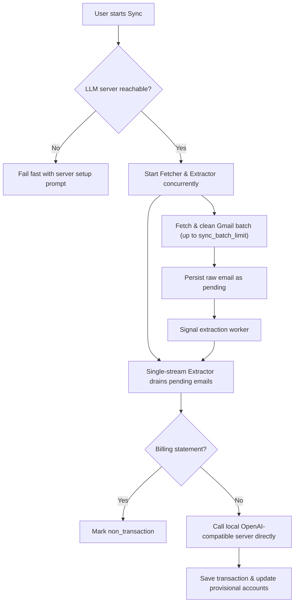
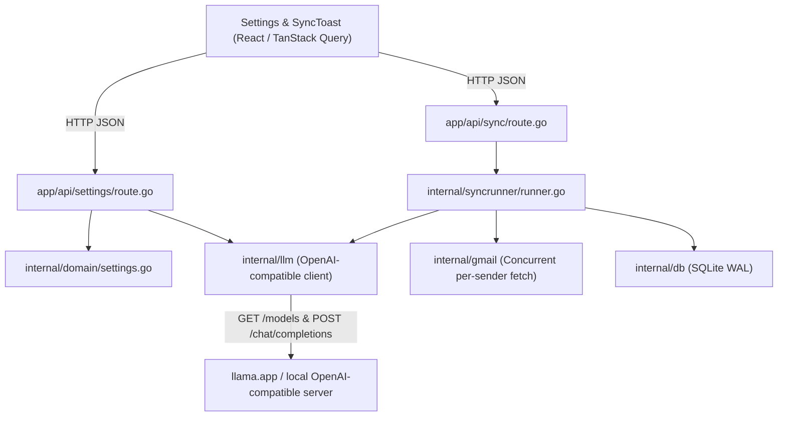
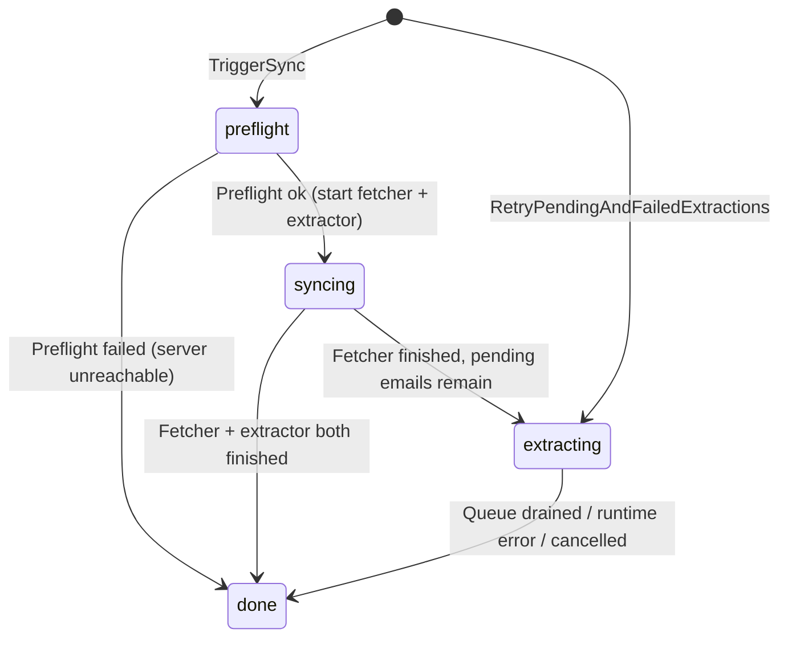

# Local LLM Server and Pipelined Email Sync - Plan

## Goal Capsule

- **Objective:** Self-hosting users can swap local LLM models freely without managing model files inside the repository, and email syncs finish faster by extracting cleaned emails as they arrive instead of waiting for every sender to finish fetching.
- **Means:** Replace the embedded `node-llama-cpp` runtime and internal Node bridge with a Go OpenAI-compatible local LLM client defaulting to `llama.app`, migrate SQLite settings and sync phases in place, and pipeline Gmail fetching with single-streamed extraction (KTD1–KTD5).
- **Authority hierarchy:** Product Contract requirements (`R1`–`R11`) govern user-facing behavior; Planning Contract decisions (`KTD1`–`KTD5`) govern implementation mechanisms within those constraints; Implementation Units (`U1`–`U5`) execute both without altering either. Surrounding audit areas (database query optimization, frontend caching, and general file cleanup) are not active scope.
- **Product Contract preservation:** Product Contract unchanged.
- **Execution profile:** Single PR — all five units share the settings schema, Go LLM client, and removal of the legacy Node bridge, and land together cleanly.
- **Stop conditions:** Stop and escalate if the SQLite table-rebuild migration fails on an existing `data/spender.db` with foreign keys enabled, or if `llama.app`'s live `/v1/chat/completions` endpoint diverges materially from OpenAI-compatible `response_format` behavior.
- **Ownership:** Implementing agent (`ce-work`) executes and verifies all units; user reviews and merges.

---

## Product Contract

### Summary

PortSpenderNote will drop its embedded `node-llama-cpp` runtime in favor of talking directly to an OpenAI-compatible local LLM server—defaulting to `llama.app` with a configurable URL and live model picker in Settings. During sync, fetched and cleaned Gmail messages will stream straight into a single-ordered extraction worker while remaining emails in the batch continue fetching concurrently.

### Problem Frame

Today, syncing emails pays two avoidable costs. First, every enabled Gmail sender must finish fetching before the first email is sent to the local LLM, leaving the model idle during network I/O and delaying the first imported transactions. Second, because local extraction relies on `node-llama-cpp` inside the Node/Bun runtime, Go's sync runner has to loop back over HTTP to Next.js for every email, re-evaluates the full prompt from scratch on each request, and forces users to manage `.gguf` files inside the app's own `models/` directory just to try a different model.

### Key Decisions

- **Replace embedded `node-llama-cpp` completely instead of keeping a fallback** — eliminates the native runtime dependency and the Go-to-Next.js loopback bridge, while letting users manage and swap models directly in `llama.app`. Governs R1, R2, R4.
- **Target any OpenAI-compatible local endpoint, defaulting to `llama.app` (`http://localhost:9931/v1`)** — gives a zero-guesswork default for `llama.app` while remaining compatible with `llama-server`, Ollama, or LM Studio without per-tool code. Governs R1, R2.
- **Keep extraction single-streamed while overlapping it with fetching** — delivers pipelined speedups without introducing concurrent provisional-account creation races, and keeps server-side prompt-prefix caching warm across the batch. Governs R5, R6.
- **Fail fast on unreachable LLM server at sync start, but preserve fetched emails on mid-run drops** — avoids wasting Gmail API calls when `llama.app` was never opened, while ensuring mid-run interruptions never lose fetched emails needed for Retry. Governs R9, R10.
- **Remove the embedded context-size setting and keep request timeout configurable** — `llama.app` owns model loading and context sizing, whereas per-request timeout remains an app-side safeguard. Governs R3.

<!-- ce-section: work-relationships -->
### How This Work Fits Together

This plan covers **Sync and Local LLM Speed** only. The broader optimization audit identified three additional areas as the current understanding, not a committed roadmap:

- **Database and API Query Performance** (N+1 account summaries, WAL read/write connection split, transaction list query indexes) — `Can proceed independently of` this plan; `Shares` SQLite write/read contention during active sync runs.
- **Frontend Responsiveness and Caching** (React Query stale times, client-only navigation waterfalls, sync completion invalidation) — `Can proceed independently of` this plan.
- **Maintainability and Codebase Cleanup** (splitting monolithic Go/React files, fixing ignored DB errors, tightening Go-to-TypeScript contracts) — `Can proceed independently of` this plan; this plan reduces sync/LLM maintenance surface on its own by removing the Node LLM bridge.

### Requirements

**Local LLM server integration**

- R1. Settings lets the user configure a local OpenAI-compatible LLM server base URL, defaulting to `http://localhost:9931/v1` for `llama.app`.
- R2. Settings fetches available model IDs from the configured server's models endpoint, lets the user pick or enter a model ID, and provides a connection test that verifies the server and selected model respond.
- R3. Settings retains the per-request LLM timeout setting and removes the local `.gguf` directory scanner, local model file picker, and embedded context-size setting.
- R4. Existing installations upgrading from the legacy embedded GGUF configuration migrate cleanly to the default `llama.app` URL with no selected server model, prompting the user to select a model in Settings before syncing.

**Pipelined fetch and extraction**

- R5. During a full sync, Gmail fetching and cleaning run concurrently with LLM extraction so cleaned emails begin extracting as soon as they are saved rather than waiting for all senders to finish fetching.
- R6. The extraction worker processes queued pending emails sequentially in arrival order so provisional accounts created by earlier emails remain immediately available to later emails in the same run.
- R7. Sync preserves existing batch-limit and cursor invariants: total fetched emails per run remain capped by `sync_batch_limit`, and a sender's high-water cursor advances only after that sender completes without hitting the cap.
- R8. Billing-statement filtering continues to run before LLM extraction so filtered statement emails never incur an LLM request.

**Sync lifecycle, errors, and progress**

- R9. Before fetching Gmail messages during a full sync, preflight verifies that the configured local LLM server is reachable and fails fast with an actionable message if it is not.
- R10. If the local LLM server becomes unreachable or returns a runtime error mid-sync, extraction stops and marks the run failed or partial-error while leaving all already-fetched emails persisted as pending so Retry processes them without re-fetching Gmail.
- R11. The sync status view reflects overlapping fetching and extracting progress with live counts, and cancelling an active sync stops both fetching and extraction cleanly.

### Key Flows

- F1. Configure local LLM server in Settings
  - **Trigger:** User opens Settings on a fresh or upgraded installation.
  - **Steps:** User keeps the default `llama.app` URL or enters another local OpenAI-compatible server URL, refreshes the model list from the server, selects a model, tests the connection, and saves.
  - **Outcome:** Settings stores the server URL, model ID, and timeout, and the app is ready to sync.
  - **Covered by:** R1, R2, R3, R4.

- F2. Pipelined email sync
  - **Trigger:** User starts a full sync with Gmail connected and a local LLM server configured.
  - **Steps:** Preflight confirms the local LLM server is reachable; the fetcher pulls and cleans messages across enabled senders up to `sync_batch_limit`, persisting each email as pending and notifying the extraction worker; the extraction worker drains pending emails one by one, skipping billing statements and calling the local LLM server directly while fetching continues.
  - **Outcome:** Transactions appear progressively as emails are extracted, sender cursors advance safely, and the run completes once both fetching and queued extraction finish.
  - **Covered by:** R5, R6, R7, R8, R9, R11.

- F3. Mid-run recovery and cancellation
  - **Trigger:** The local LLM server stops mid-sync, or the user clicks Cancel during an active sync.
  - **Steps:** On a server drop, extraction halts with a clear error while already-fetched emails stay saved as pending; on cancel, both fetcher and extractor stop at their next safe boundary and mark the run cancelled.
  - **Outcome:** No fetched emails are lost, sender cursors are not prematurely advanced for incomplete senders, and Retry can finish pending emails once the server is back.
  - **Covered by:** R7, R10, R11.

### Acceptance Examples

- AE1. **Covers R9.**
  - **Given** Settings points to `http://localhost:9931/v1` with a saved model, and `llama.app` is not running.
  - **When** the user starts a full sync.
  - **Then** the sync fails during preflight before fetching any Gmail messages and tells the user the local LLM server is unreachable.

- AE2. **Covers R5, R6.**
  - **Given** a batch of 10 new emails across enabled senders, with the first two from an unrecognized bank.
  - **When** the user starts a full sync.
  - **Then** extraction begins on the first saved emails before all 10 have finished fetching, and the second email sees the provisional account created by the first rather than creating a duplicate.

- AE3. **Covers R10.**
  - **Given** a full sync has fetched 6 emails and extracted 2 when `llama.app` shuts down.
  - **When** extraction hits the connection error on email 3.
  - **Then** the run finishes as `partial_error` with 2 imported transactions, emails 3–6 remain `pending`, and clicking Retry after restarting `llama.app` extracts emails 3–6 without re-fetching Gmail.

- AE4. **Covers R11.**
  - **Given** a full sync is actively fetching and extracting concurrently.
  - **When** the user clicks Cancel.
  - **Then** both Gmail fetching and in-flight LLM extraction are cancelled, the run settles as `cancelled`, and no background workers continue mutating the database.

- AE5. **Covers R4.**
  - **Given** an existing database whose settings still reference a legacy local `.gguf` model path.
  - **When** the app starts and the user opens Settings.
  - **Then** the server URL defaults to `http://localhost:9931/v1`, no stale `.gguf` file path blocks loading Settings, and syncing prompts the user to select a model from the running server.

### Scope Boundaries

- **No embedded `node-llama-cpp` fallback:** The embedded native runtime, `models/` GGUF directory workflow, and Next.js LLM proxy routes are removed rather than maintained alongside the new client.
- **No concurrent multi-slot LLM extraction:** Extraction remains single-streamed per run to preserve deterministic provisional account matching; parallel LLM slots are deferred.
- **No fair/round-robin per-sender batching:** Sender fetch ordering remains unchanged (tracked separately in `README.md` TODO #12).
- **No cloud or authenticated LLM providers:** Only unauthenticated local OpenAI-compatible endpoints are in scope; API keys and remote providers are deferred.

### Dependencies and Assumptions

- **External runtime dependency:** Users run `llama.app` (or another OpenAI-compatible local server such as `llama-server`, Ollama, or LM Studio) locally on their machine.
- **Structured output support:** The selected model and local server support OpenAI-compatible chat completions with JSON schema / structured output constraints (or JSON mode validated by the app's existing extraction validator).

### Sources

- `internal/syncrunner/runner.go` — current sequential fetch-then-extract flow, incremental `raw_emails` persistence, provisional account context propagation, and `RetryPendingAndFailedExtractions`.
- `internal/db/db.go` — `app_settings` and `sync_runs` schema constraints (`llm_provider`, `llm_model_path`, `llm_context_size`, `sync_runs.phase`).
- `internal/domain/settings.go` and `components/settings-view.tsx` — current Settings API and UI for GGUF model discovery and model check.
- `app/api/llm/extract/route.ts`, `lib/llm/index.ts`, `lib/llm/gguf.ts`, and `lib/llm/types.ts` — current embedded `node-llama-cpp` bridge, prompt builder, JSON schema, and extraction normalization.
- `components/sync-toast.tsx` — sync status polling and phase/progress display.
- `docs/solutions/logic-errors/gmail-sync-sender-cursor-and-timestamp-null.md` — sender cursor high-water-mark invariants under batch limits.
- `docs/solutions/ui-bugs/base-ui-select-items-label-resolution.md` — Base UI `Select` requires `items` prop for unfocused trigger labels.

---

## Planning Contract

### Key Technical Decisions

- KTD1. **Port the entire extraction engine into Go (`internal/llm`) and delete the Node LLM layer** — Moving prompt construction, JSON schema building, `<think>`-block stripping, strict validation, amount/currency/date normalization, and OpenAI-compatible HTTP calls into Go eliminates the Go-to-Next.js loopback, `app/api/llm/*`, `lib/llm/*`, `internal/domain/models.go`, `node-llama-cpp`, and `InternalBaseURL`. Advances R1–R4, R9.
- KTD2. **Use `response_format: { type: "json_schema" }` with `cache_prompt: true` and a `json_object` fallback** — `llama.app` (`llama-server`) natively enforces JSON schemas via GBNF grammar and caches matching system-prompt prefixes when `cache_prompt: true` is sent; if a non-`llama.cpp` local server returns HTTP 400 rejecting `json_schema`, retry once with `response_format: { type: "json_object" }` and rely on Go's strict parser/validator. Keep the system prompt invariant across a batch (derive timezone offset once per batch or per email without unnecessary churn) to maximize KV-cache hits. Advances R1, R2, R5.
- KTD3. **Rebuild `app_settings` and `sync_runs` transactionally in `migrateSchema` for SQLite `STRICT` constraints** — SQLite cannot alter inline `CHECK` constraints in place. `migrateSchema` inspects `sqlite_master` / `PRAGMA table_info`: when `app_settings` still has `llm_model_path` or `llm_provider IN ('gguf')`, rebuild it with `llm_provider = 'openai_compatible'`, `llm_base_url DEFAULT 'http://localhost:9931/v1'`, `llm_model TEXT` (cleared to `NULL` from legacy `.gguf` values), and no `llm_context_size`, preserving `country_code`, `timezone`, `currency`, `llm_timeout_ms`, and `sync_batch_limit`. When `sync_runs` lacks `'syncing'` in its `phase` CHECK constraint, rebuild `sync_runs` and recreate `idx_sync_runs_single_running`. Advances R3, R4, R11.
- KTD4. **Coordinate concurrent fetch and extraction through persisted `raw_emails` plus a buffered wake-up signal channel** — Instead of passing in-memory structs that could be lost on crash, `raw_emails` stays the durable queue: the fetcher persists each cleaned email with `status = 'pending'` and sends a non-blocking signal on a buffered `chan struct{}` (`cap 1`), while one extractor goroutine drains `SELECT ... FROM raw_emails WHERE status = 'pending' ORDER BY internal_date_ms ASC, rowid ASC` until the fetcher closes the done channel and no pending rows remain. This preserves crash/Retry durability, avoids duplicate provisional accounts, and guarantees deterministic ordering. Advances R5, R6, R7, R10, R11.
- KTD5. **Validate local server URLs in Settings and run live model discovery through `/api/settings`** — Restrict `llm_base_url` to valid `http://` or `https://` URLs with normalized trailing slashes (defaulting to `http://localhost:9931/v1`). `GET /api/settings` returns saved LLM settings plus live `availableModels` and `serverReachable` / `serverError` (with a short ~2s timeout so opening Settings never hangs when `llama.app` is closed), and `POST /api/settings` verifies both server reachability and a minimal completion against the configured model. Advances R1, R2, R9.

### High-Level Technical Design

#### Component Topology

#### Sync Phase State Machine

- During `syncing`, both `fetched_count` and `imported_count` / `skipped_count` / `failed_count` increment live in `sync_runs` as the fetcher and extractor work in parallel.
- If the extractor encounters a runtime/connection error while fetching is still active, extraction stops and records `runtimeErr`; the fetcher either finishes saving its in-flight page or stops cleanly on error/cancel without advancing incomplete sender cursors, leaving unsent/unextracted emails as `status = 'pending'` in `raw_emails` for Retry (R10).
- On `CancelSync`, the shared run context is cancelled, halting both the Gmail HTTP requests and the in-flight LLM HTTP request cleanly, and `finalizeCancelled` waits for both goroutines (`sync.WaitGroup`) before clearing the active sync handle so no goroutine writes after cancellation (AE4).

### System-Wide Impact

- **Database startup migration:** Existing `data/spender.db` files will run a one-time transactional table rebuild for `app_settings` and `sync_runs` on first boot. Neither table is referenced by foreign keys from other tables (`accounts`, `transactions`, `raw_emails`, `senders`), so rebuilding them inside a transaction is safe under `PRAGMA foreign_keys = ON`.
- **SQLite single-connection serialization:** `internal/db/db.go` uses `SetMaxOpenConns(1)` with `busy_timeout(5000)`. Because the fetcher and extractor both perform short transactions (single row insert/update) while spending the vast majority of wall-clock time waiting on Gmail HTTP or LLM inference, they interleave cleanly without deadlocks—avoid holding any SQLite transaction open across network/LLM calls.
- **Category list parity:** `DEFAULT_CATEGORIES` currently lives in `lib/categories.ts`. Porting extraction into Go introduces a Go copy in `internal/llm/categories.go` (exact 10 categories in matching order); keep a comment cross-referencing `lib/categories.ts` so future Category CRUD updates both.
- **Dependency footprint:** Removing `node-llama-cpp` from `package.json` and `trustedDependencies` removes native C++ compilation/binary downloads during `bun install` and removes `serverExternalPackages: ["node-llama-cpp"]` from `next.config.ts`.

### Risks and Dependencies

- **Risk: `llama.app` or third-party server omits strict `json_schema` support.** Mitigated by KTD2's automatic fallback to `json_object` on HTTP 400 plus Go's strict JSON schema/type/category/amount validator.
- **Risk: Goroutine race or DB write after cancel/completion.** Mitigated by waiting on a `sync.WaitGroup` for both fetcher and extractor goroutines before writing the final `sync_runs` status and releasing `active` in `runner.go`.
- **Risk: Settings page latency when `llama.app` is closed.** Mitigated by capping `GET /api/settings`'s `/v1/models` probe to a short timeout (~2s) and returning `serverReachable: false` with a non-fatal message instead of failing the settings endpoint.
- **Risk: Zero-decimal currency truncation recovery (e.g., IDR `125.000` -> `125.0`).** Mitigated by porting `recoverTruncatedZeroDecimalAmount` and all currency exponent/amount parsing rules from `lib/llm/types.ts` and `lib/format.ts` faithfully into `internal/llm` with dedicated unit tests.

---

## Implementation Units

### U1. SQLite Schema Migration and Settings Model for OpenAI-Compatible Local LLM

- **Goal:** Update the SQLite schema, startup migration, and GORM models so `app_settings` stores `llm_base_url` and `llm_model` (dropping `llm_model_path` and `llm_context_size`) and `sync_runs.phase` supports `'syncing'`.
- **Requirements:** R1, R3, R4, R11; covers AE5.
- **Dependencies:** None.
- **Files:**
  - Modify: `internal/db/db.go`
  - Modify: `internal/db/models.go`
  - Create: `internal/db/db_test.go` *(catches SQLite STRICT/CHECK constraint and legacy-upgrade migration bugs; misses HTTP/UI wiring)*
- **Approach:**
  1. Update `schemaSQL` in `internal/db/db.go`: change `app_settings` to `llm_provider TEXT NOT NULL DEFAULT 'openai_compatible' CHECK (llm_provider IN ('openai_compatible'))`, `llm_base_url TEXT NOT NULL DEFAULT 'http://localhost:9931/v1'`, `llm_model TEXT`, keep `llm_timeout_ms` and `sync_batch_limit`, and remove `llm_model_path` and `llm_context_size`.
  2. Update `sync_runs.phase` in `schemaSQL` to `CHECK (phase IN ('preflight', 'fetching', 'syncing', 'extracting', 'done'))`.
  3. Add idempotent table-rebuild migrations in `migrateSchema` per KTD3: inspect existing table DDL (`sqlite_master`) and rebuild `app_settings` (copying `country_code`, `timezone`, `currency`, `llm_timeout_ms`, `sync_batch_limit` and setting `llm_provider = 'openai_compatible'`, `llm_base_url = 'http://localhost:9931/v1'`, `llm_model = NULL`) and `sync_runs` (preserving all existing run rows and recreating `idx_sync_runs_single_running`) only when the legacy definition is detected.
  4. Update `db.AppSetting` in `internal/db/models.go` to match the new columns and JSON tags (`llm_base_url`, `llm_model`).
- **Patterns to follow:** Existing `migrateSchema` guard style in `internal/db/db.go`, `OpenDatabase(":memory:", false)` test helper pattern.
- **Test scenarios:**
  - Fresh database initializes `app_settings` with `llm_provider = 'openai_compatible'`, `llm_base_url = 'http://localhost:9931/v1'`, `llm_model = NULL`, and accepts `sync_runs.phase = 'syncing'`.
  - Covers AE5: Upgrading a legacy database seeded with the old `app_settings` (`llm_provider = 'gguf'`, `llm_model_path = 'qwen.gguf'`, `llm_context_size = 8192`) preserves `country_code`, `timezone`, `currency`, `llm_timeout_ms`, and `sync_batch_limit`, sets `llm_base_url = 'http://localhost:9931/v1'`, clears `llm_model` to `NULL`, and removes `llm_context_size`.
  - Upgrading a legacy `sync_runs` table preserves existing rows and subsequently allows inserting a row with `phase = 'syncing'`.
  - Running `OpenDatabase` a second time on an already-migrated database is a clean no-op.
- **Verification:** `go test ./internal/db/...` passes with all fresh, legacy-upgrade, and idempotency cases green.

### U2. Go OpenAI-Compatible Local LLM Client and Extraction Engine

- **Goal:** Build the `internal/llm` Go package that discovers models, checks server/model health, builds extraction prompts and JSON schemas, calls `/v1/chat/completions` directly with `cache_prompt: true`, and strictly validates and normalizes extraction outputs.
- **Requirements:** R1, R2, R6, R9.
- **Dependencies:** None (can be implemented in parallel with U1).
- **Files:**
  - Create: `internal/llm/categories.go`
  - Create: `internal/llm/prompt.go`
  - Create: `internal/llm/normalize.go`
  - Create: `internal/llm/client.go`
  - Create: `internal/llm/client_test.go` *(catches HTTP protocol, fallback, timeout, cancellation, and error classification bugs; misses real llama.app runtime)*
  - Create: `internal/llm/extract_test.go` *(catches prompt formatting, `<think>` stripping, currency/amount/date normalization, and IDR zero-decimal recovery bugs)*
- **Approach:**
  1. Port `DEFAULT_CATEGORIES` from `lib/categories.ts` into `internal/llm/categories.go`.
  2. Port prompt generation (`buildExtractionPrompt`, country/timezone rules using Go's `time.LoadLocation` to compute offset hints cleanly per `docs/solutions/logic-errors/go-loadlocation-local-pseudo-timezone-breaks-js-intl.md`) and JSON schema generation (`buildExtractionJsonSchema`) from `lib/llm/types.ts` and `lib/llm/country-rules.ts` into `internal/llm/prompt.go`.
  3. Port `<think>`-block stripping, strict JSON decoding/validation, card last-4 extraction, zero-decimal currency truncation recovery (`recoverTruncatedZeroDecimalAmount`), decimal-to-minor-unit conversion (supporting 0-, 2-, and 3-decimal currencies matching `lib/format.ts`), and date/time/offset-to-UTC conversion into `internal/llm/normalize.go`.
  4. Implement `Client` in `internal/llm/client.go` per KTD2: `ListModels(ctx)` (`GET <baseURL>/models`), `CheckHealth(ctx, model)` (reachability + minimal completion check for Settings test), `Preflight(ctx, model)` (fast reachability check for sync start), and `ExtractTransaction(ctx, req)` (`POST <baseURL>/chat/completions` with `temperature: 0`, `cache_prompt: true`, `response_format: json_schema`, falling back once to `json_object` on HTTP 400 schema rejection). Distinguish `RuntimeError` (network/timeout/5xx/unreachable) from `ExtractionError` (invalid JSON, schema mismatch, missing currency/amount) so the sync runner handles them identically to before.
- **Patterns to follow:** `internal/gmail/client.go` HTTP client + typed error patterns; `internal/domain/time.go` UTC ISO formatting.
- **Test scenarios:**
  - `ListModels` parses standard OpenAI `{ data: [{ id }] }` response and returns sorted unique model IDs; returns typed runtime error when server is unreachable or returns 5xx.
  - `ExtractTransaction` sends `cache_prompt: true` and `response_format.type = "json_schema"`, strips `<think>...</think>` blocks, and normalizes valid `card_charge`, `receipt`, and `non_transaction` payloads.
  - `ExtractTransaction` falls back once to `response_format.type = "json_object"` when the server returns HTTP 400 for `json_schema`, and still validates the returned JSON strictly.
  - `ExtractTransaction` classifies malformed JSON, unknown category, or non-positive amount as `ExtractionError` (non-fatal to the sync run) and connection refusal / HTTP 500 / context cancellation as `RuntimeError`.
  - Normalization recovers truncated zero-decimal amounts (e.g., IDR `"125.0"` when email body contains `125.000` -> `125000`), handles 2-decimal (`USD "12.50"` -> `1250`), and resolves explicit timezone offsets vs. configured user timezone fallback.
- **Verification:** `go test ./internal/llm/...` passes with full protocol, fallback, and normalization coverage.

### U3. Settings Domain and API Cutover to Local LLM Server

- **Goal:** Replace GGUF directory scanning and `/api/llm/*` proxying in Settings domain and API routes with direct local LLM server configuration, live model listing, and connection testing.
- **Requirements:** R1, R2, R3, R4; covers F1, AE5.
- **Dependencies:** U1, U2.
- **Files:**
  - Modify: `internal/domain/settings.go`
  - Modify: `app/api/settings/route.go`
  - Delete: `internal/domain/models.go`
  - Create: `internal/domain/settings_test.go` *(catches URL validation, live model discovery fallback when server is offline, and settings persistence; misses React UI)*
- **Approach:**
  1. Update `AppSettingsView` and `GetAppSettings` in `internal/domain/settings.go`: expose `llm_provider`, `llm_base_url`, `llm_model`, `llm_timeout_ms`, `availableModels` (`[]string`), `serverReachable` (`bool`), and `serverError` (`*string`); remove `llm_model_path`, `llm_context_size`, `modelsDir`, and `LocalGgufModelInfo`.
  2. Probe `llm.Client.ListModels` with a short timeout (~2s) inside `GetAppSettings` (or a dedicated helper called by `GET /api/settings`) so an offline `llama.app` returns `serverReachable: false` and `availableModels: []` without failing the page load.
  3. Update `UpdateLlmInput` and `UpdateLlmSettings` to validate `llm_base_url` (valid `http`/`https` URL, trimmed trailing slash, defaulting to `http://localhost:9931/v1`), optional `llm_model` (trimmed string or `nil`), and `llm_timeout_ms` (`1000`–`600000`).
  4. Update `app/api/settings/route.go`: remove `/api/llm/evict` and `/api/llm/check` loopback calls; wire `POST /api/settings` to call `internal/llm`'s connection/model test directly against the saved (or request-provided) `llm_base_url`, `llm_model`, and `llm_timeout_ms`, rejecting while a sync is running.
  5. Delete `internal/domain/models.go` once no callers remain.
- **Patterns to follow:** Existing `PATCH` section dispatch and error handling in `app/api/settings/route.go` and `internal/domain/settings.go`.
- **Test scenarios:**
  - `GetAppSettings` returns `serverReachable: true` and live model IDs when pointed at a fake `/v1/models` server, and returns `serverReachable: false` with `availableModels: []` (no error) when the server is unreachable.
  - `UpdateLlmSettings` normalizes trailing slashes on `llm_base_url`, rejects invalid URL schemes (e.g., `ftp://` or bare text), rejects out-of-range timeouts, and persists `llm_base_url`, `llm_model`, and `llm_timeout_ms`.
  - Covers AE5: `GetAppSettings` on a migrated database returns `http://localhost:9931/v1` and `llm_model: nil` without failing on missing `models/` directory.
- **Verification:** `go test ./internal/domain/...` passes and `app/api/settings/route.go` compiles with zero references to `/api/llm/` or `models.go`.

### U4. Pipelined Gmail Fetch and Single-Stream Extraction Runner

- **Goal:** Refactor `internal/syncrunner` so full syncs preflight-check the local LLM server, then run Gmail fetching/cleaning concurrently with a single-streamed extraction worker calling `internal/llm` directly, while preserving batch limits, sender cursor invariants, billing-statement filtering, mid-run recovery, and clean cancellation.
- **Requirements:** R5, R6, R7, R8, R9, R10, R11; covers F2, F3, AE1, AE2, AE3, AE4.
- **Dependencies:** U1, U2, U3.
- **Files:**
  - Modify: `internal/syncrunner/runner.go`
  - Modify: `app/api/sync/route.go`
  - Modify: `internal/syncrunner/runner_test.go` *(catches preflight fail-fast, concurrent fetch+extract overlap, provisional account ordering, mid-run LLM drop recovery, cancel cleanup, and cursor invariants using `httptest` servers)*
- **Approach:**
  1. Remove `llmBaseURL` loopback parameter from `TriggerSync`, `RetryPendingAndFailedExtractions`, and `app/api/sync/route.go`; read `llm_base_url`, `llm_model`, and `llm_timeout_ms` from `app_settings` in `loadValidatedSettings`, requiring a non-empty `llm_model` and valid `llm_base_url`.
  2. In `runFullSyncJob`, run `llmClient.Preflight(ctx, cfg.LlmModel)` during `phase = 'preflight'` before any Gmail API call (R9, AE1); on failure, mark the run `failed` with an actionable error mentioning the configured URL / starting `llama.app`.
  3. Transition `sync_runs.phase` to `'syncing'` and launch two coordinated goroutines tracked by a `sync.WaitGroup` per KTD4:
     - **Fetcher goroutine:** iterates enabled senders with existing `sync_batch_limit` and `updateSenderSyncState` invariants (`docs/solutions/logic-errors/gmail-sync-sender-cursor-and-timestamp-null.md`), persists each cleaned email into `raw_emails` (`status = 'pending'`), increments `fetched_count`/`cleaned_count`, and sends a non-blocking wake signal on `notifyCh` (`make(chan struct{}, 1)`). On completion, closes `fetchDoneCh` and updates `phase` to `'extracting'` if the extractor is still draining.
     - **Single-stream Extractor goroutine:** loops querying the next `pending` `raw_emails` row ordered by `internal_date_ms ASC, rowid ASC`, runs `IsBillingStatementEmail` first (R8), calls `llmClient.ExtractTransaction` directly, updates `accountContexts` sequentially when provisional accounts are created (R6), and commits each extracted transaction in its own short DB transaction. When no pending row is found, waits on `notifyCh`, `fetchDoneCh`, or `ctx.Done()`.
  4. On a mid-run `llm.RuntimeError`, the extractor records `runtimeErr` and exits without cancelling the fetcher's already-persisted emails (or signals stop cleanly while preserving `status = 'pending'` rows and not advancing incomplete sender cursors), finalizing the run as `partial_error` or `failed` (R10, AE3).
  5. Update `RetryPendingAndFailedExtractions` to run `llmClient.Preflight` then drain pending/failed rows using the same single-stream extraction worker without fetching Gmail.
  6. Ensure `CancelSync` cancels the run context and the background coordinator waits for both goroutines before finalizing `cancelled` and clearing `active` (AE4).
  7. Check and handle DB errors inside extraction transactions so failed inserts surface cleanly instead of being silently ignored.
- **Patterns to follow:** Existing `updateSenderSyncState`, `IsBillingStatementEmail`, and `httptest.NewServer` test structure in `internal/syncrunner/runner_test.go`; inject Gmail/LLM fetch hooks or test URLs for deterministic overlap tests.
- **Test scenarios:**
  - Covers AE1: Preflight fails fast with `status = 'failed'` and zero Gmail requests when the configured LLM server is unreachable.
  - Covers AE2: With a slow/gated fake Gmail fetcher and fake LLM server, extraction starts on the first persisted email before later emails finish fetching, and email #2 receives the provisional account created by email #1 in its prompt context.
  - Covers AE3: When the fake LLM server stops after 2 of 6 fetched emails, the run finishes as `partial_error` with 2 imported transactions, emails 3–6 stay `pending`, and `RetryPendingAndFailedExtractions` extracts emails 3–6 once the server is restored without re-fetching Gmail.
  - Covers AE4: Cancelling an active concurrent sync stops both fetcher and extractor goroutines cleanly, marks the run `cancelled`, and leaves no lingering writes after return.
  - Billing-statement emails are marked `non_transaction` before reaching the fake LLM server (zero LLM requests for filtered statements).
  - Existing `updateSenderSyncState` high-water-mark and partial-batch cursor tests continue to pass unchanged.
- **Verification:** `go test -race ./internal/syncrunner/...` passes with zero race conditions and all concurrency/recovery scenarios green.

### U5. Settings UI, Sync Status UI, and Legacy Node LLM Removal

- **Goal:** Update the Settings and Sync Toast UI for the local OpenAI-compatible LLM server and overlapping `syncing` phase, and delete all legacy `node-llama-cpp` and Next.js LLM bridge files and dependencies.
- **Requirements:** R1, R2, R3, R4, R11; covers F1, F2, AE5.
- **Dependencies:** U3, U4.
- **Files:**
  - Modify: `lib/api.ts`
  - Modify: `components/settings-view.tsx`
  - Modify: `components/sync-toast.tsx`
  - Modify: `package.json`
  - Modify: `next.config.ts`
  - Modify: `internal/httpx/json.go` (remove unused `InternalBaseURL` if no callers remain)
  - Delete: `app/api/llm/extract/route.ts`
  - Delete: `app/api/llm/check/route.ts`
  - Delete: `app/api/llm/evict/route.ts`
  - Delete: `lib/llm/index.ts`
  - Delete: `lib/llm/gguf.ts`
  - Delete: `lib/llm/types.ts`
  - Delete: `lib/llm/models.ts`
  - Delete: `lib/llm/country-rules.ts`
- **Approach:**
  1. Update `AppSettingsView`, `SyncRunRow` (`phase` union adds `"syncing"`), and `updateLlmSettingsApi` in `lib/api.ts` to match the new Settings contract (`llm_base_url`, `llm_model`, `llm_timeout_ms`, `availableModels: string[]`, `serverReachable`, `serverError`).
  2. Update the LLM card in `components/settings-view.tsx`:
     - Rename card to "Local LLM Server" with an input for Server URL (default `http://localhost:9931/v1`) and a "Refresh models" button.
     - Show a Base UI `<Select>` populated with `availableModels` (passing `items` prop per `docs/solutions/ui-bugs/base-ui-select-items-label-resolution.md`) plus a fallback text input or manual model ID entry when the server is offline or a custom ID is needed.
     - Remove the `Context size` input and `models/` directory copy; keep `Per-email timeout (ms)`, `Save`, and `Test connection` buttons.
     - Show a clear non-blocking hint when `serverReachable` is false (e.g., reminding the user to open `llama.app` or check the URL) and when `llm_model` is unset after upgrade (AE5).
  3. Update `formatPhase` in `components/sync-toast.tsx` to handle `"syncing"` (e.g., `"Fetching & extracting..."`) while displaying live fetched/imported/skipped/failed counts.
  4. Delete `app/api/llm/*`, `lib/llm/*`, `node-llama-cpp` from `package.json` (`dependencies` and `trustedDependencies`), `serverExternalPackages` from `next.config.ts`, and `InternalBaseURL` from `internal/httpx/json.go`. Run `bun install` (or update lockfile during execution) and verify zero remaining references to `node-llama-cpp` or `/api/llm/`.
- **Patterns to follow:** Existing card/form/mutation patterns in `components/settings-view.tsx`; Base UI `Select` `items` convention from `docs/solutions/ui-bugs/base-ui-select-items-label-resolution.md`.
- **Test scenarios:**
  - TypeScript typecheck and ESLint confirm all updated API types, `Select` `items` props, and `SyncRunRow` phase union compile cleanly with zero dangling imports from deleted `lib/llm/*` files.
  - Production build (`bun run build`) succeeds without `node-llama-cpp` or `app/api/llm/*`.
  - Manual/smoke check in Settings verifies: offline server state renders cleanly without crashing, Refresh models populates the dropdown when `llama.app` is running, Test connection reports success/error, and SyncToast displays `"Fetching & extracting..."` with live counts during a pipelined sync.
- **Verification:** `bun run typecheck`, `bun run lint`, `bun run build`, and `go test -race ./...` all pass, and a repo grep confirms zero remaining `node-llama-cpp` or `/api/llm/` references.

---

## Verification Contract

| Gate | Command / Check | Scope | Pass Condition |
|---|---|---|---|
| Go unit & race suite | `go test -race ./...` | U1, U2, U3, U4 | All packages compile and pass with race detector enabled |
| TypeScript check | `bun run typecheck` | U5 | Zero type errors across `app/`, `components/`, `lib/` |
| Lint | `bun run lint` | U5 | Zero ESLint errors |
| Production build | `bun run build` | U1–U5 | Next.js + Go routes build succeeds without `node-llama-cpp` |
| Dead-code check | Repo search for `node-llama-cpp`, `api/llm`, `llm_model_path`, `llm_context_size` | U5 | Zero remaining references in `app/`, `components/`, `internal/`, `lib/`, `package.json`, `next.config.ts` |
| Live smoke test | Start `llama.app` + `bun run dev`, open `/settings`, test connection, run Sync | U1–U5 | Model list loads from `localhost:9931/v1`, connection test succeeds, sync pipelines fetch + extract and imports transactions |

---

## Definition of Done

- All Product Contract requirements (`R1`–`R11`) and Acceptance Examples (`AE1`–`AE5`) are satisfied without altering Product Contract scope.
- `U1`–`U5` are implemented with all specified Go test scenarios passing under `go test -race ./...`.
- `bun run typecheck`, `bun run lint`, and `bun run build` pass cleanly.
- Legacy `node-llama-cpp` dependency, `app/api/llm/*`, `lib/llm/*`, `internal/domain/models.go`, unused `InternalBaseURL`, and any abandoned-attempt or temporary code are completely removed from the diff.
- Existing `data/spender.db` upgrades cleanly on startup without losing locale, accounts, senders, or transactions.
