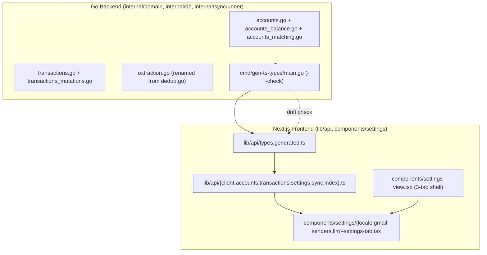

# Maintainability and Codebase Cleanup - Plan

## Goal Capsule

- **Objective:** Keep PortSpenderNote readable, safe to change, and free of accumulating structural debt so future feature work lands cleanly without silent failures or contract drift.
- **Means:** A single coordinated cleanup pass covering monolithic file decomposition, backend database error and SQL hygiene, automated Go-to-TypeScript contract generation, legacy deduplication renaming, README TODO reconciliation, and a tabbed Settings layout (KTD1–KTD5).
- **Product authority:** The Product Contract below governs scope, behavior preservation, and acceptance boundaries; technical design and sequencing live in the Planning Contract and Implementation Units.
- **Execution profile:** Single pull request on a feature branch; no database schema or HTTP wire-format changes.
- **Stop conditions:** Stop if any existing Go test, TypeScript typecheck, lint check, or production build fails after cleanup, or if generated TypeScript contracts drift from Go structs.
- **Open blockers:** None.

---

## Product Contract

*Product Contract preservation: Product Contract unchanged from brainstorm.*

### Summary

Decompose the four oversized backend and frontend files into focused modules, eliminate silent database error swallowing and interpolated SQL in the Go domain layer, add automated Go-to-TypeScript contract generation with drift checking to the build toolchain, rename legacy deduplication code and reconcile stale README TODOs, and organize Settings into a tabbed layout while splitting the settings view.

### Problem Frame

PortSpenderNote has shipped several major capabilities in quick succession—including manual transaction merging, provisional accounts, credit card billing cycle reconciliation, and pipelined local LLM sync—without a dedicated structural cleanup pass. As a result, four files have grown into multi-responsibility monoliths (`internal/domain/accounts.go` at 1,130 lines, `components/settings-view.tsx` at 1,044 lines, `internal/domain/transactions.go` at 904 lines, and `lib/api.ts` at 564 lines).

Inside `internal/domain/`, multiple database reads, writes, and scans ignore `.Error` or discard errors with `_ =`, and balance aggregation interpolates a SQL operator via `fmt.Sprintf`. On the frontend boundary, roughly 20 TypeScript interfaces in `lib/api.ts` are hand-mirrored from Go structs with no automated drift check. Meanwhile, active extraction and transaction-splitting logic still lives in `internal/domain/dedup.go` after automatic deduplication was removed, and `README.md` still lists shipped items as pending. None of these issues have caused a production outage yet, but leaving them unresolved raises the cost and risk of every subsequent change.

### Key Decisions

- **Single coordinated cleanup pass with tabbed Settings UX polish** (session-settled: user-directed — chosen over strictly behavior-preserving split or two sequential plans: eliminate all audited tech debt together while splitting `components/settings-view.tsx`). Governs R1, R3, R10.
- **Automated Go-to-TypeScript type generation in the toolchain** (session-settled: user-directed — chosen over manual domain-split types or deferring contract sync: prevent silent contract drift permanently rather than relying on manual discipline). Governs R6, R7.
- **Preserve all HTTP wire formats, database schema, and non-Settings UI behavior** — keeps the refactor safe to verify against existing behavior while isolating UX changes to Settings tabs. Governs R1, R2, R3, R10.
- **Retain parameterized SQL for complex aggregations while banning interpolated SQL** — avoids distorting conditional SQL aggregations into awkward ORM builders while removing injection/syntax risks and unchecked errors. Governs R4, R5.
- **Relocate and rename active `dedup.go` code rather than deleting it** — merchant normalization, extracted transaction persistence, source recomputation, and source splitting remain live code paths. Governs R8.

### Requirements

**File Decomposition**

- R1. Decompose `internal/domain/accounts.go` and `internal/domain/transactions.go` into cohesive, concern-focused Go files within `internal/domain` while preserving all exported signatures and domain behavior.
- R2. Decompose `lib/api.ts` into domain-aligned client modules for queries and mutations while preserving existing frontend call-site behavior and re-exports where needed.
- R3. Decompose `components/settings-view.tsx` into focused per-section components organized under a tabbed Settings layout.

**Database Error Handling and SQL Hygiene**

- R4. Check and propagate every database error in `internal/domain/`, eliminating all unchecked GORM/SQL calls and discarded `_ = ...Error` assignments.
- R5. Remove all `fmt.Sprintf` SQL string interpolation in `internal/domain/`, using parameterized queries or explicit branching so no SQL fragments are dynamically formatted.

**Go-to-TypeScript Contract Generation**

- R6. Introduce an automated Go-to-TypeScript type generation command that derives shared frontend API and domain types directly from Go structs as the single source of truth.
- R7. Add a verification check that fails when generated TypeScript contract files are out of sync with the Go domain and API definitions.

**Legacy Naming, Docs, and Settings UX**

- R8. Rename and relocate the active functions and tests in `internal/domain/dedup.go` and `internal/domain/dedup_test.go` to reflect their actual responsibilities (extraction persistence, merchant normalization, source recomputation, and transaction splitting) and remove the misleading `dedup` file names.
- R9. Reconcile `README.md` TODO items against shipped work on `main` so completed work (such as pipelined sync and manual merge) is no longer listed as pending or deferred.
- R10. Present the four existing Settings configuration areas (Country/Timezone & Currency, Gmail Connection, Email Senders, and Local LLM Server) in a tabbed Settings UI with all existing controls, validations, and save flows intact.

### Success Criteria

- Zero unchecked database calls, zero `_ = ...Error` discards, and zero `fmt.Sprintf` SQL interpolations remain in `internal/domain/`.
- Running the type-generation command produces a clean diff, and the drift check fails if a Go contract struct is modified without regenerating TypeScript types.
- `go test ./...`, `bun run typecheck`, `bun run lint`, and `bun run build` all pass with zero new warnings or regressions.
- `internal/domain/dedup.go` no longer exists, and all four Settings tabs function identically to the prior single-page Settings controls.

### Scope Boundaries

- **Out of scope — unshipped roadmap features:** Category and Tag CRUD, scheduled transactions, transaction transfer modeling, customizable tracking cycles, and fair/round-robin per-sender sync batching from `README.md`.
- **Out of scope — wire and schema changes:** Changing HTTP routes, JSON field names, SQLite table schemas, or database migrations.
- **Out of scope — unrelated modules:** Refactoring `internal/syncrunner/`, `internal/gmail/`, or non-Settings dashboard views beyond updating imports or generated type references.

### Sources / Research

- Monolithic targets: `internal/domain/accounts.go` (1,130 lines), `internal/domain/transactions.go` (904 lines), `components/settings-view.tsx` (1,044 lines), `lib/api.ts` (564 lines).
- Verified DB/SQL hotspots: `internal/domain/accounts.go:282-289` (`fmt.Sprintf` SQL operator interpolation + unchecked `.Scan`), `internal/domain/accounts.go:1024,1103,1105` and `internal/domain/settings.go:258` (`_ = ...Error`), `internal/domain/dedup.go:49-280` (`RecomputeTransactionFromSources` with no error return), and unchecked `gdb.Raw`/`Count`/`Find` calls in `internal/domain/accounts.go` and `internal/domain/transactions.go`.
- Active callers of `internal/domain/dedup.go`: `internal/syncrunner/runner.go:707,741` and `app/api/transactions/[id]/split/route.go:24`; legacy index drop at `internal/db/db.go:323`.
- Shipped plans informing `README.md` reconciliation: `docs/plans/2026-11-23-0047-feat-local-llm-server-pipelined-sync-plan.md` and `docs/plans/2026-11-22-0051-feat-manual-merge-transactions-page-plan.md`.
- Existing UI and DB conventions to preserve: `docs/solutions/ui-bugs/base-ui-select-items-label-resolution.md`, `docs/solutions/ui-bugs/base-ui-button-render-link-semantics.md`, and `docs/solutions/database-issues/sqlite-table-rebuild-begin-immediate-goroutes.md`.

---

## Planning Contract

### Key Technical Decisions

- KTD1. **Zero-dependency Go reflection generator (`cmd/gen-ts-types/main.go`)** (session-settled: user-directed — chosen over external `tygo` binary: avoids new Go/Node toolchain dependencies while giving exact `encoding/json` fidelity for embedded structs, `json:"-"` exclusions, nullable pointers, and string unions). Implements R6, R7.
- KTD2. **Package-internal Go file splits without sub-packages** — split `accounts.go` and `transactions.go` into sibling files inside `package domain` so all exported symbols and `app/api/` route imports stay unchanged. Implements R1.
- KTD3. **Barrel directory `lib/api/index.ts` replacing `lib/api.ts`** — Next.js and TypeScript resolve `@/lib/api` to `lib/api/index.ts`, allowing domain modules (`accounts.ts`, `transactions.ts`, `settings.ts`, `sync.ts`, `types.generated.ts`) without import churn across unrelated components. Implements R2, R6.
- KTD4. **Three-tab Settings layout with URL sync and OAuth auto-focus** — group Settings into `general` (Country/Timezone & Currency), `gmail` (Gmail Connection + Email Senders), and `llm` (Local LLM Server) using a shadcn wrapper over `@base-ui/react/tabs`, syncing to `?tab=` and defaulting to `gmail` when `gmailParam` or `errorParam` is present. Implements R3, R10.
- KTD5. **Explicit static SQL branches and full error propagation in `internal/domain/`** — replace `fmt.Sprintf` SQL operator formatting with static parameterized SQL branches and propagate every GORM `.Error` (including returning `error` from `RecomputeTransactionFromSources` and balance/summary helpers). Implements R4, R5.

### High-Level Technical Design

### Sequencing

1. `U1` (DB error propagation, SQL hygiene, `dedup.go` → `extraction.go`) lands first so `U2` splits clean, error-checked code.
2. `U2` (Go domain file decomposition) stabilizes Go struct locations before `U3` wires the type generator.
3. `U3` (Go-to-TS generator + `--check`) generates `lib/api/types.generated.ts` before `U4` splits `lib/api.ts`.
4. `U4` (Domain-aligned `lib/api/` modules) provides clean imports for `U5` (tabbed Settings decomposition).
5. `U6` (`README.md` TODO reconciliation) closes out the pass once all refactor items are in place.

---

## Implementation Units

### U1. Backend DB error propagation, SQL hygiene, and legacy `dedup.go` rename

- **Goal:** Eliminate every silent DB error and `fmt.Sprintf` SQL interpolation in `internal/domain/` and rename `dedup.go` / `dedup_test.go` to `extraction.go` / `extraction_test.go`.
- **Requirements:** R4, R5, R8
- **Dependencies:** None
- **Files:**
  - `internal/domain/accounts.go` (modify)
  - `internal/domain/transactions.go` (modify)
  - `internal/domain/settings.go` (modify)
  - `internal/domain/extraction.go` (rename from `internal/domain/dedup.go` and modify)
  - `internal/domain/extraction_test.go` (rename from `internal/domain/dedup_test.go` and modify)
  - `internal/domain/accounts_test.go` (modify)
  - `internal/domain/transactions_test.go` (modify)
- **Approach:**
  1. Per KTD5, replace `gdb.Raw(fmt.Sprintf(...))` in `accounts.go` balance aggregation with two explicit static parameterized SQL queries (one for `>` and one for `>=`).
  2. Audit every GORM/SQL call in `internal/domain/` (`Raw`, `Exec`, `Find`, `First`, `Count`, `Scan`, `Create`, `Save`, `Update`, `Updates`, `Delete`) and check `.Error`; remove all `_ = ...Error` discards (`accounts.go`, `settings.go`).
  3. Update internal helpers (`listIdentifiersForAccount`, `hasAccountLedgerRows`, `computeAccountBalanceAsOf`, `computeAccountBalance`, `computeBillingCycleSummary`, `isAccountTypeLocked`, `buildAccountSummaryAt`, `buildAccountSummary`, `RecomputeTransactionFromSources`, `getLocaleConfig`, `ListExtractionAccountContexts`, `MatchAccountForExtraction`) to return and propagate errors where DB queries can fail (keeping `gorm.ErrRecordNotFound` handled explicitly where absence is valid, e.g., `settings.go`).
  4. Rename `internal/domain/dedup.go` → `internal/domain/extraction.go` and `internal/domain/dedup_test.go` → `internal/domain/extraction_test.go`; update callers of `RecomputeTransactionFromSources` to check its returned error.
- **Patterns to follow:** Existing error propagation in `internal/domain/transactions.go` (`ListTransactions`) and `internal/db/db.go`.
- **Test scenarios:**
  - Happy path: all existing tests in `accounts_test.go`, `transactions_test.go`, `settings_test.go`, `extraction_test.go`, and `internal/syncrunner/runner_test.go` pass with identical behavior.
  - Error path: calling balance/summary or `RecomputeTransactionFromSources` against a closed or missing-table SQLite handle returns a non-nil error instead of silently returning zero values.
  - Hygiene check: zero occurrences of `fmt.Sprintf` in SQL queries and zero `_ = ...Error` discards in `internal/domain/`.
- **Verification:** `go test ./...` passes; grep audit confirms zero unchecked DB calls or `fmt.Sprintf` SQL in `internal/domain/`.

### U2. Decompose `internal/domain/accounts.go` and `internal/domain/transactions.go`

- **Goal:** Split the two largest Go domain files into cohesive, concern-focused files within `package domain` with zero behavior or signature changes.
- **Requirements:** R1
- **Dependencies:** U1
- **Files:**
  - `internal/domain/accounts.go` (modify — types, validation, identifiers, CRUD)
  - `internal/domain/accounts_balance.go` (create — balance computation, billing cycle summary, reconciliations)
  - `internal/domain/accounts_matching.go` (create — extraction contexts, matching, provisional accounts, account merge)
  - `internal/domain/transactions.go` (modify — types, monthly summary, paginated list, detail view)
  - `internal/domain/transactions_mutations.go` (create — manual CRUD, bulk delete, review, duplicate merge, combine)
- **Approach:**
  1. Per KTD2, move functions and private helper types by concern into sibling files in `package domain` without altering any exported function signature, struct field, or JSON tag.
  2. Keep shared helpers and domain types in the primary `accounts.go` and `transactions.go` files so cross-file navigation stays obvious.
- **Patterns to follow:** Existing sibling file layout in `internal/domain/` (`countries.go`, `locale.go`, `settings.go`, `time.go`).
- **Test scenarios:**
  - Happy path: all existing domain and syncrunner tests compile and pass with zero modifications to test assertions.
- **Verification:** `go test ./...` passes and each resulting domain file is focused on a single concern.

### U3. Automated Go-to-TypeScript contract generator and drift check

- **Goal:** Generate shared TypeScript API/domain contract types directly from Go structs and enforce freshness with a `--check` mode wired into `package.json`.
- **Requirements:** R6, R7
- **Dependencies:** U2
- **Files:**
  - `cmd/gen-ts-types/main.go` (create)
  - `cmd/gen-ts-types/main_test.go` (create)
  - `lib/api/types.generated.ts` (create — generated output)
  - `package.json` (modify — add `generate:types` and `check:types` scripts)
- **Approach:**
  1. Per KTD1, implement `cmd/gen-ts-types/main.go` using Go `reflect` over an explicit ordered list of exported API structs (`db.AccountIdentifier`, `db.AccountReconciliation`, `db.Sender`, `db.SyncRun`, `domain.AccountIdentifierInput`, `domain.BillingCycleSpendSummary`, `domain.CreditCardBillingCycleSummary`, `domain.AccountSummary`, `domain.CountryLocaleInfo`, `domain.AppSettingsView`, `domain.GmailStatusView`, `domain.SpendingGroupRow`, `domain.MonthlySpendingSummary`, `domain.TransactionListItem`, `domain.PaginatedTransactionsResponse`, `domain.TransactionSourceView`, `domain.TransactionDetailView`, `syncrunner.SyncStatusView`).
  2. Flatten embedded Go structs (e.g. `AccountSummary` embedding `db.Account`) to match `encoding/json` wire output, omit `json:"-"` fields, map pointers to `T | null`, slices to `T[]`, and emit named string union types (`AccountType`, `AccountIdentifierKind`, `AccountStatus`) with matching TS type aliases (`AccountIdentifierRow`, `ReconciliationRow`, `SenderRecord`, `SyncRunRow`).
  3. Support `--out <path>` (default `lib/api/types.generated.ts`) and `--check` (exits non-zero if file differs from freshly generated output).
  4. Add `"generate:types": "go run ./cmd/gen-ts-types"` and `"check:types": "go run ./cmd/gen-ts-types --check"` to `package.json`.
- **Patterns to follow:** Standard Go `cmd/` CLI convention with table-driven tests.
- **Test scenarios:**
  - Happy path: generator emits deterministic TypeScript containing all expected interfaces, flattened embedded fields, nullable pointer fields, and union types, and skips `json:"-"` fields (`access_token`, `refresh_token`).
  - Drift detection: `--check` exits 0 when `lib/api/types.generated.ts` matches current Go structs and exits non-zero when a field is altered or stale.
- **Verification:** `go test ./cmd/gen-ts-types/...` and `bun run check:types` both pass.

### U4. Decompose `lib/api.ts` into domain-aligned client modules

- **Goal:** Split `lib/api.ts` into focused domain query/mutation modules backed by `lib/api/types.generated.ts` while preserving `@/lib/api` imports via a barrel index.
- **Requirements:** R2, R6
- **Dependencies:** U3
- **Files:**
  - `lib/api/client.ts` (create — shared `fetchJson` helper)
  - `lib/api/accounts.ts` (create — account queries and mutations)
  - `lib/api/transactions.ts` (create — spending summary and transaction queries/mutations)
  - `lib/api/settings.ts` (create — settings, senders, Gmail, and LLM queries/mutations)
  - `lib/api/sync.ts` (create — sync status query and sync mutations)
  - `lib/api/index.ts` (create — barrel re-exporting `types.generated.ts` and all domain modules)
  - `lib/api.ts` (delete)
- **Approach:**
  1. Per KTD3, move `fetchJson` into `lib/api/client.ts` and split query/mutation helpers into `accounts.ts`, `transactions.ts`, `settings.ts`, and `sync.ts`, importing all shared types from `./types.generated`.
  2. Re-export all generated types and domain functions from `lib/api/index.ts` so every existing `@/lib/api` import resolves identically without call-site churn.
- **Patterns to follow:** Existing TanStack Query `queryOptions` and `fetchJson` conventions in `lib/api.ts`.
- **Test scenarios:**
  - Test expectation: none -- pure structural module split over existing client wrappers; verified by `bun run typecheck`, `bun run lint`, and `bun run build`.
- **Verification:** `bun run typecheck`, `bun run lint`, and `bun run build` pass with zero broken imports.

### U5. Decompose `components/settings-view.tsx` into tabbed Settings UI

- **Goal:** Split `components/settings-view.tsx` into focused tab components organized under a 3-tab Settings UI using `@base-ui/react/tabs`.
- **Requirements:** R3, R10
- **Dependencies:** U4
- **Files:**
  - `components/ui/tabs.tsx` (create — shadcn-style wrapper over `@base-ui/react/tabs`)
  - `components/settings/locale-settings-tab.tsx` (create — Country, Timezone & Currency card)
  - `components/settings/gmail-senders-tab.tsx` (create — Gmail Connection + Email Senders cards)
  - `components/settings/llm-settings-tab.tsx` (create — Local LLM Server card)
  - `components/settings-view.tsx` (modify — thin tabbed shell managing active tab and URL sync)
  - `app/settings/page.tsx` (modify — forward optional `tab` search param to `SettingsView`)
- **Approach:**
  1. Per KTD4, create `components/ui/tabs.tsx` wrapping `@base-ui/react/tabs` (`Tabs`, `TabsList`, `TabsTab`, `TabsPanel`) matching the existing Tailwind v4 + shadcn/ui styling in `components/ui/`.
  2. Extract the four existing Settings cards into three focused tab components: `LocaleSettingsTab` (`general`), `GmailSendersTab` (`gmail`), and `LlmSettingsTab` (`llm`), preserving all existing form state, validations, mutations, `<Select items={...}>` patterns (`docs/solutions/ui-bugs/base-ui-select-items-label-resolution.md`), and `<a className={buttonVariants(...)}>` link semantics (`docs/solutions/ui-bugs/base-ui-button-render-link-semantics.md`).
  3. In `SettingsView`, resolve the initial tab from `tabParam` (`general` | `gmail` | `llm`), defaulting to `gmail` when `gmailParam` or `errorParam` is present (so OAuth callback banners are immediately visible), and update `?tab=` in the URL on tab change.
- **Patterns to follow:** Existing `components/ui/` Base UI wrappers and `components/settings-view.tsx` mutation/toast patterns.
- **Test scenarios:**
  - Test expectation: none -- frontend has no unit test runner; verified via `bun run typecheck`, `bun run lint`, `bun run build`, and visual/interactive verification of all 3 tabs.
- **Verification:** `bun run typecheck`, `bun run lint`, and `bun run build` pass; all 3 tabs render and preserve all 4 Settings cards' controls.

### U6. Reconcile `README.md` TODOs

- **Goal:** Update `README.md` TODOs to reflect shipped work on `main` and this cleanup pass.
- **Requirements:** R9
- **Dependencies:** U1, U3, U5
- **Files:**
  - `README.md` (modify)
- **Approach:**
  1. Remove the stale deferral note on P0 #2 (pipelined sync shipped in `docs/plans/2026-11-23-0047-feat-local-llm-server-pipelined-sync-plan.md`).
  2. Mark P2 #11 (tabbed Settings) and P3 #13 (SQL and general cleanup) as completed, and reconcile P1 #4/#5 against shipped manual merge (`docs/plans/2026-11-22-0051-feat-manual-merge-transactions-page-plan.md`).
- **Patterns to follow:** Existing checklist format in `README.md`.
- **Test scenarios:**
  - Test expectation: none -- documentation-only update.
- **Verification:** `README.md` TODOs accurately match shipped state on `main`.

---

## Verification Contract

| Check | Command | Covers |
|---|---|---|
| Go unit & domain tests | `go test ./...` | U1, U2, U3 |
| Go-to-TS contract drift check | `bun run check:types` | U3, U4 |
| TypeScript typecheck | `bun run typecheck` | U3, U4, U5 |
| ESLint | `bun run lint` | U4, U5 |
| Production build | `bun run build` | U4, U5 |
| Domain DB/SQL hygiene audit | grep for `fmt.Sprintf` in SQL and `_ = .*\.Error` in `internal/domain/` | U1 |

---

## Definition of Done

- All six implementation units (U1–U6) are implemented with zero abandoned or experimental dead code left in the diff.
- `internal/domain/dedup.go` and `internal/domain/dedup_test.go` are removed and replaced by `extraction.go` and `extraction_test.go`.
- `go test ./...`, `bun run check:types`, `bun run typecheck`, `bun run lint`, and `bun run build` all pass cleanly.
- All changes are committed on a feature branch and shipped per the `lfg` workflow.
