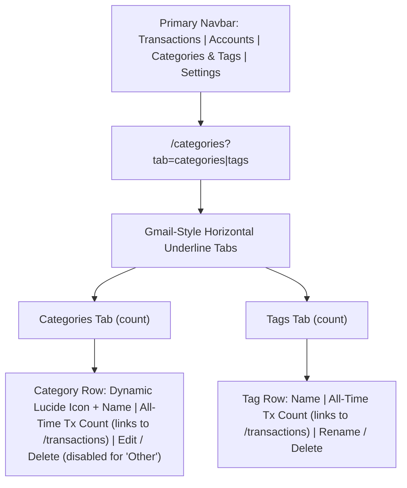
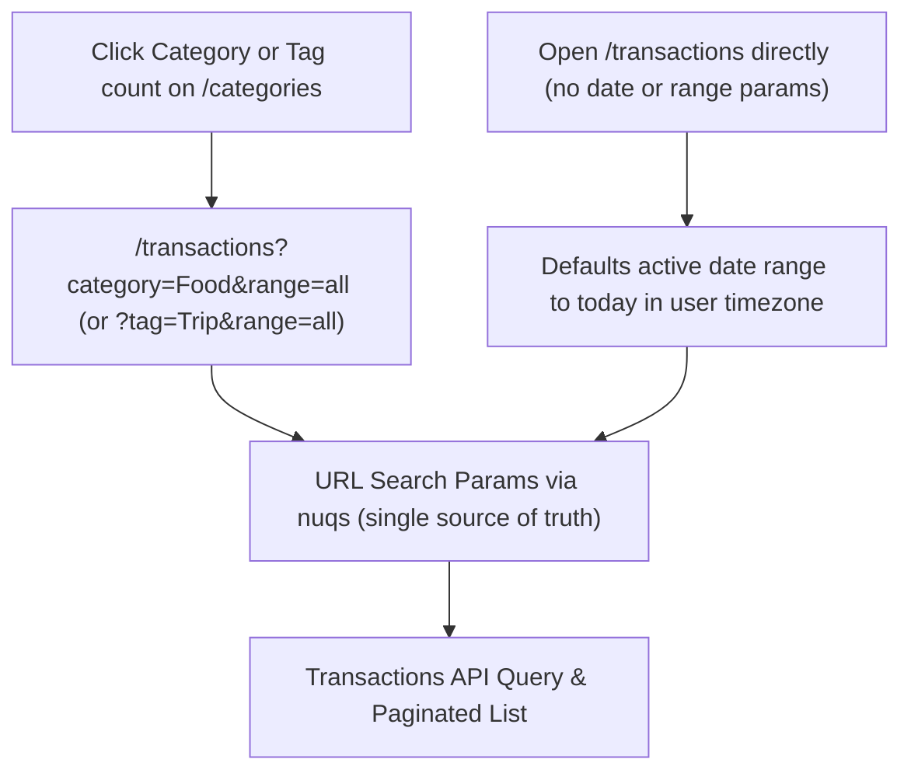
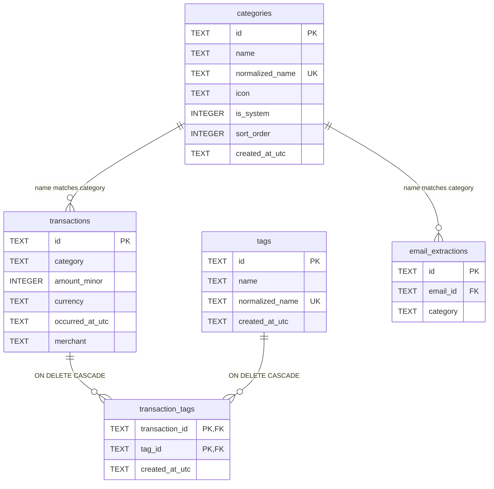
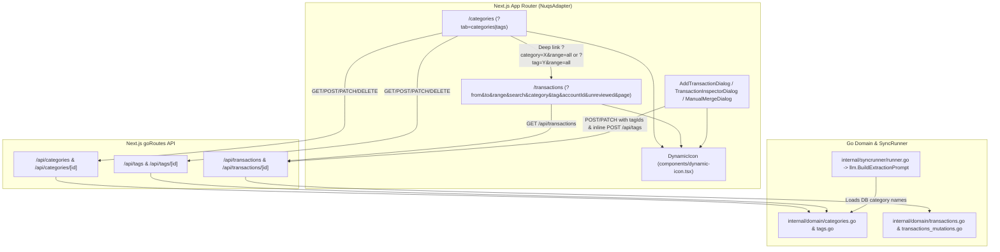
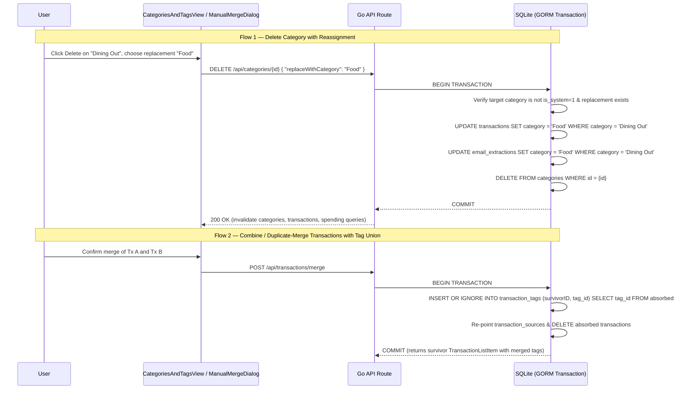

# Categories and Tags CRUD with URL Transaction Filters - Plan

## Goal Capsule

- **Objective:** Users can organize spending with customizable icon-badged categories and multi-tag labels from a Gmail-style tabbed page, and filter transactions with every active filter reflected in the URL.
- **Means:** Persist categories (with dynamic Lucide icon names) and tags in SQLite, load custom categories into Gmail LLM extraction, attach multi-tag associations to transactions across create/edit/merge/split flows, and manage active `/transactions` and `/categories` filters in URL search parameters via `nuqs` (`KTD1`, `KTD2`, `KTD3`, `KTD4`, `KTD5`).
- **Product authority:** Covers Categories and Tags CRUD, dynamic Lucide category icons, multi-tag transaction assignment, and URL-synchronized transaction filters (`product_contract_source: ce-brainstorm`); surrounding areas from the broader request (Dashboard charts) are not active scope.
- **Product Contract preservation:** `changed: R3, R4, R5, R12, R13 — updated seeded default categories to the 10 user-specified categories plus read-only 'Other', and added a dynamic Lucide icon per category`.
- **Execution profile:** Single pull request (`U1` through `U6` in dependency order).
- **Open blockers:** None.
- **Stop conditions:** Stop if existing transaction category values cannot be migrated without data loss, or if `go test ./...`, `bun run check:types`, `bun run typecheck`, `bun run lint`, or `bun run build` fails.
- **Completion owner:** Executor (`ce-work` or implementing engineer) verifies all units against `## Verification Contract` and `## Definition of Done`.

---

## Product Contract

### Summary

Add a top-level **Categories & Tags** page (`/categories?tab=categories|tags`) with Gmail inbox-style horizontal underline tabs for managing database-backed categories (each paired with a dynamic Lucide icon) and manual tags. Support assigning multiple tags to any transaction, feed custom categories into Gmail LLM email extraction, and move all active `/transactions` filters (including a new tag filter and an all-dates mode) into URL search parameters via `nuqs` with no local `useState` filter state.

### Problem Frame

Categories in PortSpenderNote are currently hardcoded to ten string constants in `lib/categories.ts` and `internal/llm/categories.go`. Users cannot add, rename, change icons for, or remove categories to match their personal spending habits without editing source code.

In addition, a single category per transaction cannot capture cross-cutting groupings such as a vacation, a work reimbursement, or a recurring event that spans food, transportation, and shopping. Finally, transaction list filters in `components/transactions-view.tsx` live entirely in local React `useState`, so filtered views cannot be linked from other pages, bookmarked, or restored across browser navigation.

### Key Decisions

- **Scope Categories & Tags CRUD and URL-filtered transactions before Dashboard charts** `(session-settled: user-approved — chosen over combining both areas in one plan or starting with Dashboard charts: establishes the category and tag taxonomy that later charts will consume)`. Governs R1, R12, R17.
- **Top-level `/categories` page with Gmail inbox-style underline tabs, dynamic Lucide icons on Categories, and name-only Tags** `(session-settled: user-directed — chosen over placing taxonomy under Settings or adding color pickers: keeps taxonomy management in primary navigation with visual Lucide icons on categories and lightweight text labels for tags)`. Governs R1, R2, R3, R4, R5, R8.
- **Gmail LLM sync uses database Categories while Tags remain manual labels** `(session-settled: user-approved — chosen over LLM auto-tagging or category prompt descriptions: keeps automated email extraction deterministic while reserving tags for user-curated groupings)`. Governs R7, R11.
- **`"Other"` is a read-only system default category with transaction reassignment on category delete** `(session-settled: user-directed — chosen over blocking deletion of in-use categories or allowing `"Other"` to be modified: guarantees a permanent fallback category while letting users retire any other category)`. Governs R4, R5, R6.
- **Multi-tag assignment with inline creation, single-tag list filter, and tag union on merge** `(session-settled: user-approved — chosen over bulk-action bar tagging and multi-tag filter expressions: matches existing dialog editing and single-select filter bar ergonomics)`. Governs R12, R13, R14, R15, R18.
- **URL search parameters are the single source of truth for active filters** `(session-settled: user-directed — chosen over keeping React `useState` synchronized with URL state: eliminates dual-state drift and enables deep links from the Categories & Tags page)`. Governs R2, R17, R18, R19, R20.
- **Preserve parent tags on both transactions when splitting an attached email** — prevents manual tagging context from being lost when a multi-email transaction is split. Governs R16.

<!-- ce-section: work-relationships -->
### How This Work Fits Together

This plan covers **Categories & Tags CRUD, Multi-Tag Transactions, and URL-Synchronized Filters**. The broader breakdown below reflects the current understanding of the surrounding request, not a committed roadmap.

- **Categories & Tags CRUD, Multi-Tag Transactions, and URL-Synchronized Filters** (this plan)
- **Dashboard Charts** (next candidate area)
  - `Depends on` this plan's custom categories, category icons, and transaction tags if Dashboard charts include tag breakdowns or link chart segments to URL-filtered `/transactions` views.
  - `Can proceed independently of` this plan for visualizations that only chart existing monthly summary fields (`byCategory`, `byMerchant`, `byAccount`).

### Requirements

**Categories & Tags Page and Navigation**

- R1. The primary navigation bar in `components/app-shell.tsx` includes a top-level **Categories & Tags** link pointing to `/categories`.
- R2. The `/categories` page renders a Gmail inbox-style horizontal underline tab bar with two tabs, **Categories** (`?tab=categories`, default when omitted) and **Tags** (`?tab=tags`), where active tab state is read from and written to the URL search parameter without `useState`.
- R3. Each tab header displays its total item count; each Category row displays its dynamic Lucide icon, name, all-time transaction count, and row actions, while each Tag row displays its name, all-time transaction count, and row actions.

**Categories Lifecycle, Dynamic Icons, and LLM Sync**

- R4. The database seeds the ten default categories with their Lucide icon names (`Housing`/`Home`, `Food`/`ShoppingCart`, `Utilities`/`Zap`, `Transportation`/`Car`, `Healthcare`/`HeartPulse`, `Entertainment`/`Ticket`, `Dining Out`/`Utensils`, `Shopping`/`ShoppingBag`, `Education`/`GraduationCap`, `Personal Care`/`Sparkles`) plus `"Other"` (`Ellipsis`) as a read-only system default that cannot be renamed, have its icon modified, or be deleted, and auto-seeds any legacy category names already present on existing transactions with a default icon.
- R5. Users can create and edit non-system categories with a trimmed, non-empty, case-insensitively unique name and a Lucide icon name; renaming a category updates all transactions and email extractions currently assigned to that category name.
- R6. Deleting a non-system category prompts the user to choose a replacement category for any assigned transactions, defaulting to `"Other"`, and reassigns those transactions and email extractions atomically before removing the category.
- R7. Gmail LLM extraction (`internal/llm/prompt.go` and `internal/syncrunner/runner.go`) loads the current list of category names from the database instead of hardcoded constants, falling back to `"Other"` when an extracted category does not match.

**Tags Lifecycle**

- R8. Users can create, rename, and delete tags on the **Tags** tab of `/categories`, where tag names are trimmed, non-empty, and case-insensitively unique.
- R9. Renaming a tag updates its display name across all tagged transactions immediately.
- R10. Deleting a tag removes its association from any tagged transactions without modifying or deleting the transactions themselves.
- R11. Gmail LLM extraction does not extract or auto-assign tags during email sync.

**Multi-Tag Transaction Assignment and Lifecycle**

- R12. A transaction can have zero or more tags, and transaction rows on `/transactions` render the category badge (with its dynamic Lucide icon) alongside badges for all assigned tags.
- R13. The manual **Add transaction** dialog (`components/add-transaction-dialog.tsx`), the **Transaction details** inspector dialog (`components/transaction-inspector-dialog.tsx`), and the **Combine transactions** dialog (`components/manual-merge-dialog.tsx`) load category options (with their dynamic Lucide icons) from the database, and the Add and Inspect dialogs provide a multi-tag picker to attach or remove tags.
- R14. The multi-tag picker in the Add and Inspect dialogs allows users to create a new tag inline by typing a name that does not yet exist and selecting `+ Create "<name>"`, immediately selecting the newly created tag.
- R15. When transactions are duplicate-merged or combined (`internal/domain/transactions_mutations.go`), the surviving transaction retains the deduplicated union of tags from all participating transactions.
- R16. When an attached email source is split into a new transaction (`internal/domain/extraction.go`), both the original transaction and the newly split transaction retain the parent transaction's tags.

**Transactions Page Filtering and URL Search Parameters**

- R17. All active filter and pagination controls on `/transactions` — date range (`from`, `to`, or `range=all`), search query (`search`), category (`category`), tag (`tag`), account (`accountId`), unreviewed-only toggle (`unreviewed`), and page number (`page`) — derive their active state directly from URL search parameters without storing active filter state in `useState`.
- R18. The `/transactions` filter bar includes a single-select **Tag** filter dropdown (`All tags` plus all user tags) that filters the list to transactions carrying the selected tag and updates `?tag=<name>` in the URL.
- R19. Changing any filter criteria (`from`, `to`, `range`, `search`, `category`, `tag`, `accountId`, or `unreviewed`) resets the `page` URL parameter to page 1 and clears the current row selection.
- R20. Clicking a category or tag's transaction count on `/categories` navigates to `/transactions` filtered to that category or tag across all dates (`range=all`), and the `/transactions` date toolbar lets users toggle between `All dates` and a specific date range, whereas visiting `/transactions` with no date parameters defaults to today's date in the user's configured timezone.

### Key Flows

- F1. **Delete an in-use category with reassignment**
  - **Trigger:** User clicks Delete on a non-system category on `/categories?tab=categories`.
  - **Steps:** Dialog displays the number of transactions currently using the category and a replacement category selector pre-filled with `"Other"`; user confirms deletion.
  - **Outcome:** All affected transactions and email extractions are reassigned to the chosen replacement category, the deleted category is removed from the database and filter dropdowns, and monthly spending breakdowns reflect the reassigned category.
  - **Covered by:** R4, R6.

- F2. **Tag a transaction and create an inline tag**
  - **Trigger:** User opens the Add Transaction dialog or Transaction Inspector dialog and interacts with the Tags field.
  - **Steps:** User selects an existing tag, types a new tag name not yet in the list, clicks `+ Create "<name>"`, and saves the transaction.
  - **Outcome:** The new tag is persisted in the database, both tags are attached to the transaction, and the transaction row displays both tag badges.
  - **Covered by:** R8, R12, R13, R14.

- F3. **Deep-link from Categories & Tags to URL-filtered Transactions**
  - **Trigger:** User clicks the transaction count on a Category or Tag row in `/categories`.
  - **Steps:** App navigates to `/transactions` with the selected `category` or `tag` and `range=all` in the URL search parameters; user then refines the view using the search input or account filter.
  - **Outcome:** Each filter interaction updates the URL search parameters directly, resets pagination to page 1, and supports browser Back/Forward navigation without local `useState` filter desynchronization.
  - **Covered by:** R2, R3, R17, R18, R19, R20.

### Acceptance Examples

- AE1. **System category protection**
  - **Covers R4.**
  - **Given:** The user is viewing `/categories?tab=categories`.
  - **When:** The user inspects the `"Other"` row or attempts to call the update/delete API for `"Other"`.
  - **Then:** The UI shows `"Other"` as read-only with no edit or delete actions, and the API rejects any rename, icon change, or delete request for `"Other"`.

- AE2. **Case-insensitive uniqueness for categories and tags**
  - **Covers R5, R8, R14.**
  - **Given:** A category named `"Dining Out"` and a tag named `"Work Trip"` already exist.
  - **When:** The user attempts to create or rename a category to `" dining out "` or create a tag named `"work trip"`.
  - **Then:** The operation is rejected with a duplicate-name validation error (or in the inline tag picker, matches the existing `"Work Trip"` tag instead of offering `+ Create`).

- AE3. **Merging and splitting tagged transactions**
  - **Covers R15, R16.**
  - **Given:** Transaction A has tags `["Japan", "Food"]` and Transaction B has tags `["Japan", "Reimbursable"]`.
  - **When:** The user combines or duplicate-merges Transaction A and Transaction B, and later splits one email source out of the merged transaction.
  - **Then:** The merged transaction has tags `["Japan", "Food", "Reimbursable"]`, and after splitting, both resulting transactions carry `["Japan", "Food", "Reimbursable"]`.

- AE4. **URL search parameter filter synchronization**
  - **Covers R17, R18, R19.**
  - **Given:** The user is on `/transactions?from=2026-11-01&to=2026-11-23&tag=Japan&page=2`.
  - **When:** The user changes the Category dropdown to `"Transportation"`.
  - **Then:** The URL updates to include `category=Transportation` and resets pagination to page 1, the transaction query re-fetches with both `category=Transportation` and `tag=Japan`, and pressing the browser Back button restores page 2 with all categories and `tag=Japan`.

- AE5. **All-dates drill-down from Categories & Tags**
  - **Covers R3, R20.**
  - **Given:** Tag `"Vacation"` is attached to 5 transactions from last month and 0 transactions today.
  - **When:** The user clicks the `"5 transactions"` link on the `"Vacation"` row in `/categories?tab=tags`.
  - **Then:** The app opens `/transactions?tag=Vacation&range=all` and lists all 5 historical transactions rather than an empty today-only list.

### Scope Boundaries

#### Deferred to Follow-Up Work

- **Dashboard charts** — next planned work unit from the user's original request.

#### Non-Goals (Out of Scope and Considered-Not-Built)

- **Category and tag color pickers** — excluded; categories carry a dynamic Lucide icon and name, while tags are name-only.
- **Automated LLM tagging or category prompt hints** — excluded; LLM sync classifies categories by name only, and tags are manual.
- **Bulk-tagging from the transaction list action bar and multi-tag filter expressions** — excluded; tags are edited per transaction in Add/Inspect dialogs and filtered one tag at a time in the `/transactions` filter bar.
- **Retroactive re-extraction of raw `email_extractions.raw_llm_json` blobs on category rename** — considered and not built because `raw_llm_json` is an immutable audit snapshot of what the LLM originally returned; only the structured `transactions.category` and `email_extractions.category` columns are updated on category rename or delete-reassignment.

---

## Planning Contract

### Key Technical Decisions

- KTD1. **Dedicated `categories`, `tags`, and `transaction_tags` SQLite tables while keeping `transactions.category` as the canonical category name** `(session-settled: user-approved — chosen over replacing transactions.category with a foreign-key UUID: preserves backward compatibility across MonthlySpendingSummary, LLM extraction, and existing queries while enforcing case-insensitive uniqueness via normalized_name and storing Lucide icon names in categories)`. Migration `000003_categories_and_tags.up.sql` seeds the ten default categories with their Lucide icons plus read-only `"Other"` (`is_system = 1`, icon `'Ellipsis'`), and backfills any distinct legacy category names already present in `transactions` or `email_extractions` with fallback icon `'Tag'` so no historical row is orphaned. Advances R4, R5, R6, R8, R9, R10.
- KTD2. **Dynamic Lucide icon component backed by a curated Lucide icon registry and searchable icon picker** `(session-settled: user-directed — chosen over static text badges or lazy async chunks via lucide-react/dynamic: synchronous lookup against a curated map of Lucide icons from lucide-react avoids Suspense flicker inside badges, table rows, and Base UI Select triggers while safely falling back to TagIcon/EllipsisIcon for unknown icon names)`. Advances R3, R4, R5, R12, R13.
- KTD3. **Adopt `nuqs` with `NuqsAdapter` and page-level `<Suspense>` boundaries for URL search parameter state** `(session-settled: user-directed — chosen over local React useState or raw router.replace on every keystroke: nuqs updates controlled search inputs synchronously via useSyncExternalStore without dropping characters while throttling URL replacements and omitting default values via clearOnDefault)`. Advances R2, R17, R18, R19, R20.
- KTD4. **Explicit `range=all` URL parameter to distinguish all-time queries from the default today date range** — when `range=all` is present in `/transactions` search params, `startDate` and `endDate` are omitted from `/api/transactions` so all dates are queried; when `range` is omitted and `from`/`to` are absent, the view defaults to today's date in the user's configured timezone. Picking a date range or clicking `Previous`/`Next` sets `from` and `to` and clears `range`. Advances R3, R17, R20.
- KTD5. **Batch tag hydration in `ListTransactions` and transactional tag propagation in merge/split mutations** — `ListTransactions` fetches tags for the current page's transaction IDs in a single `JOIN tags ON tags.id = transaction_tags.tag_id WHERE transaction_tags.transaction_id IN ?` query (matching the existing `transaction_sources` batch pattern in `internal/domain/transactions.go`), and `DuplicateMergeTransactions`, `CombineTransactions`, and `SplitTransactionSource` copy tag associations via `INSERT OR IGNORE INTO transaction_tags` inside their existing database transactions. Advances R12, R15, R16, R18.

### High-Level Technical Design

#### Data Model (SQLite `000003_categories_and_tags`)

#### URL State & API Data Flow

#### Category Delete Reassignment & Transaction Merge Tag Union Sequence

### System-Wide Impact

- **Database migrations under concurrent `goRoutes` startup:** `000003_categories_and_tags.up.sql` runs inside `withMigrationLock` via `golang-migrate` in `internal/db/db.go`, using `CREATE TABLE IF NOT EXISTS` and `INSERT OR IGNORE` so concurrent route process startups and existing database upgrades are idempotent.
- **LLM email extraction (`internal/syncrunner/runner.go`):** Before extracting pending emails in `runExtractionWorker`, the worker queries `domain.ListCategoryNames(gdb)` and passes the slice into `llm.ExtractInput.Categories`. If the LLM returns a category not present in the database, `SaveExtractedTransaction` and `RecomputeTransactionFromSources` normalize it to `"Other"`.
- **Base UI `<Select>` label resolution:** Every `<Select>` for categories or tags must pass a shared `{ value, label }[]` `items` array to `<Select items={...}>` and include a fallback entry whenever a controlled value could arrive before the query resolves, following `docs/solutions/ui-bugs/base-ui-select-items-label-resolution.md`.
- **Base UI link semantics:** Clickable transaction-count links on `/categories` that navigate to `/transactions` must use `<Link className={buttonVariants(...)}>` (or plain styled `<Link>`) and never `<Button render={<Link />}>`, following `docs/solutions/ui-bugs/base-ui-button-render-link-semantics.md`.

### Risks & Dependencies

- **Next.js production build prerender check for `useSearchParams` / `nuqs`:** Calling `useQueryState` / `useQueryStates` in a Client Component causes `bun run build` to fail unless the page wraps the client view in a `<Suspense>` boundary (`node_modules/next/dist/docs/01-app/03-api-reference/04-functions/use-search-params.md`). Mitigation: wrap `<TransactionsView />` in `app/transactions/page.tsx` and `<CategoriesTagsView />` in `app/categories/page.tsx` inside `<Suspense>` boundaries, and mount `<NuqsAdapter>` in `components/providers.tsx`.
- **Legacy categories on existing transactions:** Upgrading an existing `data/spender.db` that already has transactions categorized under the old default names (`Dining`, `Groceries`, `Transport`, `Utilities & Bills`, `Health`, `Travel`, `Subscriptions`) must not leave those categories missing from the `categories` table. Mitigation: `000003_categories_and_tags.up.sql` seeds the 10 new defaults plus `"Other"`, and also runs an `INSERT OR IGNORE INTO categories` query for any distinct non-empty `category` values already present in `transactions` and `email_extractions`.

### Sources / Research

- Grounding dossier: `/tmp/compound-engineering-501/ce-brainstorm/categories-tags-crud/grounding.md`
- Database models & migrations: `internal/db/models.go`, `internal/db/db.go`, `internal/db/migrations/000001_baseline.up.sql`, `docs/solutions/database-issues/sqlite-table-rebuild-begin-immediate-goroutes.md`
- Transaction queries, mutations, and LLM sync: `internal/domain/transactions.go`, `internal/domain/transactions_mutations.go`, `internal/domain/extraction.go`, `internal/llm/categories.go`, `internal/llm/prompt.go`, `internal/syncrunner/runner.go`
- Next.js `useSearchParams` & Suspense requirement: `node_modules/next/dist/docs/01-app/03-api-reference/04-functions/use-search-params.md`
- Base UI Select and Button Link learnings: `docs/solutions/ui-bugs/base-ui-select-items-label-resolution.md`, `docs/solutions/ui-bugs/base-ui-button-render-link-semantics.md`

---

## Implementation Units

### U1. SQLite Migration, GORM Models, and Category/Tag Seeding

- **Goal:** Create the `categories`, `tags`, and `transaction_tags` tables in SQLite, seed the ten default categories with their Lucide icons plus read-only `"Other"`, backfill any pre-existing transaction category names, and add GORM models and default constants.
- **Requirements:** R4, R12, KTD1.
- **Dependencies:** None.
- **Files:**
  - `internal/db/migrations/000003_categories_and_tags.up.sql` (create)
  - `internal/db/migrations/000003_categories_and_tags.down.sql` (create)
  - `internal/db/models.go` (modify)
  - `internal/llm/categories.go` (modify)
  - `lib/categories.ts` (modify)
  - `internal/db/db_test.go` (modify — tests migration application, default category seeding with icons, and legacy transaction category backfill; catches schema/migration regressions, misses higher-level CRUD business rules)
- **Approach:**
  1. Author `000003_categories_and_tags.up.sql` creating `STRICT` tables `categories` (`id`, `name`, `normalized_name UNIQUE`, `icon`, `is_system`, `sort_order`, `created_at_utc`), `tags` (`id`, `name`, `normalized_name UNIQUE`, `created_at_utc`), and `transaction_tags` (`transaction_id`, `tag_id`, `created_at_utc`, composite PK, `ON DELETE CASCADE` foreign keys to `transactions(id)` and `tags(id)`), plus indexes `idx_transaction_tags_tag` and `idx_transactions_category_occurred`.
  2. In `000003_categories_and_tags.up.sql`, seed the ten default categories (`Housing`/`Home`, `Food`/`ShoppingCart`, `Utilities`/`Zap`, `Transportation`/`Car`, `Healthcare`/`HeartPulse`, `Entertainment`/`Ticket`, `Dining Out`/`Utensils`, `Shopping`/`ShoppingBag`, `Education`/`GraduationCap`, `Personal Care`/`Sparkles`) with `is_system = 0` and `"Other"` (`Ellipsis`) with `is_system = 1` per R4, then `INSERT OR IGNORE` any distinct non-empty `category` values from `transactions` and `email_extractions` using fallback icon `'Tag'` per KTD1.
  3. Add `Category`, `Tag`, and `TransactionTag` structs to `internal/db/models.go`, and update `internal/llm/categories.go` and `lib/categories.ts` so their default category and icon definitions match R4.
- **Patterns to follow:** `internal/db/migrations/000001_baseline.up.sql` (`STRICT` table syntax, ISO timestamp `CHECK` constraints, `normalized_value` uniqueness pattern on `account_identifiers`) and `internal/db/db_test.go`.
- **Test scenarios:**
  - Fresh database migration creates `categories`, `tags`, and `transaction_tags` and seeds all 11 default categories (10 user-editable + 1 system read-only `"Other"`) with their expected Lucide icon names and sort order.
  - Existing database containing transactions with legacy category names (e.g., `"Groceries"`, `"Subscriptions"`) migrates to v3 and backfills those legacy categories into `categories` without data loss.
  - Re-opening an already-migrated v3 database is idempotent and does not duplicate seeded categories.
- **Verification:** `go test ./internal/db/...` passes with all v3 migration and backfill assertions green.

### U2. Go Domain Logic for Categories & Tags CRUD and LLM Sync Categories

- **Goal:** Implement domain queries and mutations for listing, creating, updating, and deleting categories (with transaction reassignment and `"Other"` protection) and tags, and wire database categories into the Gmail LLM extraction worker.
- **Requirements:** R3, R4, R5, R6, R7, R8, R9, R10, R11, F1, AE1, AE2, KTD1.
- **Dependencies:** U1.
- **Files:**
  - `internal/domain/categories.go` (create)
  - `internal/domain/tags.go` (create)
  - `internal/domain/categories_tags_test.go` (create — tests category and tag CRUD, case-insensitive uniqueness, `"Other"` immutability, transaction count aggregation, and category delete reassignment; catches domain rule regressions, misses HTTP serialization and UI rendering)
  - `internal/syncrunner/runner.go` (modify)
  - `internal/syncrunner/runner_test.go` (modify — tests that sync extraction receives custom category names from DB)
- **Approach:**
  1. In `internal/domain/categories.go`, implement `CategorySummary` (`id`, `name`, `icon`, `is_system`, `transaction_count`, `created_at_utc`), `ListCategories(gdb)` (joining/subquerying all-time transaction counts across `transactions`), `ListCategoryNames(gdb)`, `CreateCategory(gdb, input)`, `UpdateCategory(gdb, id, input)`, and `DeleteCategory(gdb, id, replaceWithCategory)` per R3–R6.
  2. Enforce trimmed non-empty names, non-empty icon names, case-insensitive uniqueness via `normalized_name = strings.ToLower(strings.TrimSpace(name))`, and read-only protection on `"Other"` (`is_system == 1`) per AE1 and AE2.
  3. In `UpdateCategory`, when a category's name changes, atomically update `transactions.category` and `email_extractions.category` inside the same GORM transaction per R5; in `DeleteCategory`, validate the replacement category exists (defaulting empty replacement to `"Other"`), atomically update `transactions.category` and `email_extractions.category` to the replacement category name, and delete the category row per R6 and F1.
  4. In `internal/domain/tags.go`, implement `TagSummary` (`id`, `name`, `transaction_count`, `created_at_utc`), `ListTags(gdb)` (with all-time `transaction_tags` count), `CreateTag(gdb, input)`, `UpdateTag(gdb, id, input)`, and `DeleteTag(gdb, id)` per R8–R10.
  5. In `internal/syncrunner/runner.go` (`runExtractionWorker`) and `internal/domain/extraction.go` (`SaveExtractedTransaction`, `RecomputeTransactionFromSources`), pass `domain.ListCategoryNames(gdb)` into `llm.ExtractInput.Categories` and validate extracted categories against the database categories list (falling back to `"Other"`) per R7 and R11.
- **Patterns to follow:** `internal/domain/accounts.go` (GORM transaction blocks, input validation, human-readable error strings, summary count queries).
- **Test scenarios:**
  - `Covers AE1.` Attempting to rename, change the icon of, or delete the system `"Other"` category returns a validation error and leaves `"Other"` unchanged.
  - `Covers AE2.` Creating or renaming a category or tag with leading/trailing whitespace or a different casing of an existing name (e.g., `" dining out "` when `"Dining Out"` exists, or `"work trip"` when `"Work Trip"` exists) is rejected with a duplicate-name error.
  - Renaming a category from `"Food"` to `"Groceries & Food"` updates the category record and rewrites matching `transactions.category` and `email_extractions.category` rows while preserving `transaction_count`.
  - `Covers F1.` Deleting an in-use category with an explicit replacement category (or defaulting to `"Other"` when omitted) reassigns all its transactions and email extractions atomically and removes the category.
  - Renaming a tag updates `TagSummary.Name` immediately for linked transactions; deleting a tag removes its `transaction_tags` rows while leaving the tagged transactions intact.
  - Running `syncrunner` passes custom categories created in the database to the LLM extraction prompt and falls back to `"Other"` if an unrecognized category is returned.
- **Verification:** `go test ./internal/domain/... ./internal/syncrunner/... ./internal/llm/...` passes with all category, tag, and LLM sync tests green.

### U3. Go Domain Multi-Tag Transactions, Tag Filtering, and Merge/Split Tag Propagation

- **Goal:** Extend transaction list/detail queries with batch-loaded tags and single-tag filtering, support attaching/updating tags on transaction create and edit, and preserve tag unions on merge/combine and parent tags on email split.
- **Requirements:** R12, R13, R15, R16, R18, AE3, KTD5.
- **Dependencies:** U1, U2.
- **Files:**
  - `internal/domain/transactions.go` (modify)
  - `internal/domain/transactions_mutations.go` (modify)
  - `internal/domain/extraction.go` (modify)
  - `internal/domain/transactions_test.go` (modify — tests multi-tag create/update, tag filter in `ListTransactions`, tag union on duplicate-merge/combine, and tag copy on split; catches query and mutation regressions, misses UI state)
  - `internal/domain/extraction_test.go` (modify — tests `SplitTransactionSource` tag preservation)
- **Approach:**
  1. Add `TransactionTagItem` (`id`, `name`) and `Tags []TransactionTagItem` (`json:"tags"`) to `TransactionListItem` in `internal/domain/transactions.go`, and batch-load tags for all transactions on the page via `transaction_tags JOIN tags` ordered by `LOWER(tags.name) ASC` per KTD5.
  2. Add `Tag string` to `ListTransactionsParams`; when `params.Tag != "" && params.Tag != "all"`, filter transactions via `EXISTS (SELECT 1 FROM transaction_tags tt JOIN tags tg ON tg.id = tt.tag_id WHERE tt.transaction_id = t.id AND (tg.name = ? OR tg.id = ?))` per R18.
  3. Add `TagIDs []string` to `CreateManualTransactionInput` and `TagIDs []string` + `HasTagIDs bool` to `UpdateTransactionInput` in `internal/domain/transactions_mutations.go`; validate that the chosen `Category` exists in `categories` and all `TagIDs` exist in `tags`, then replace `transaction_tags` associations inside the mutation transaction per R12 and R13.
  4. In `DuplicateMergeTransactions` and `CombineTransactions`, copy all `transaction_tags` from absorbed transactions onto the survivor transaction via `INSERT OR IGNORE INTO transaction_tags` before deleting the absorbed transactions per R15 and KTD5.
  5. In `SplitTransactionSource` (`internal/domain/extraction.go`), copy all `transaction_tags` from the parent `transactionID` onto `newTxID` via `INSERT OR IGNORE INTO transaction_tags` inside the split transaction per R16 and KTD5.
- **Patterns to follow:** `internal/domain/transactions.go` (`rolesByTx` batch query for `transaction_sources`) and `internal/domain/transactions_mutations.go` (`HasAccountID` / `HasNote` patch flags and `transaction_sources` re-pointing before delete).
- **Test scenarios:**
  - Creating a manual transaction with multiple `tag_ids` persists the associations and returns `tags` sorted alphabetically on `TransactionListItem` and `TransactionDetailView`.
  - Updating a transaction with a new `tag_ids` slice adds new tags, removes deselected tags, and supports clearing all tags with an empty slice `[]`.
  - Filtering `ListTransactions` with `Tag: "Vacation"` returns only transactions carrying that tag and computes `TotalCount` accurately while keeping `TotalInRangeCount` / `UnreviewedInRangeCount` scoped to the date range.
  - `Covers AE3.` Duplicate-merging or combining two transactions with overlapping tags (`["Japan", "Food"]` and `["Japan", "Reimbursable"]`) produces a surviving transaction with the deduplicated union `["Food", "Japan", "Reimbursable"]`.
  - `Covers AE3.` Splitting an email source from a tagged multi-source transaction copies all parent tags onto the newly split transaction while keeping them on the original transaction.
- **Verification:** `go test ./internal/domain/...` passes with all multi-tag transaction query, filter, merge, and split tests green.

### U4. Go API Routes, TypeScript Codegen, and Frontend Query/Mutation Client

- **Goal:** Expose REST API endpoints for Categories and Tags CRUD, extend transaction API routes for tag filtering and `tag_ids` mutations, regenerate TypeScript types, and add React Query hooks and mutation helpers.
- **Requirements:** R3, R4, R5, R6, R8, R9, R10, R12, R13, R14, R18.
- **Dependencies:** U2, U3.
- **Files:**
  - `app/api/categories/route.go` (create)
  - `app/api/categories/[id]/route.go` (create)
  - `app/api/tags/route.go` (create)
  - `app/api/tags/[id]/route.go` (create)
  - `app/api/transactions/route.go` (modify)
  - `app/api/transactions/[id]/route.go` (modify)
  - `cmd/gen-ts-types/main.go` (modify)
  - `cmd/gen-ts-types/main_test.go` (modify — verifies generated TS interfaces include `CategorySummary`, `TagSummary`, `TransactionTagItem`, and `TransactionListItem.tags`; catches Go-to-TS contract drift, misses UI behavior)
  - `lib/api/types.generated.ts` (modify — generated via `bun run generate:types`)
  - `lib/api/categories.ts` (create)
  - `lib/api/tags.ts` (create)
  - `lib/api/transactions.ts` (modify)
  - `lib/api/index.ts` (modify)
- **Approach:**
  1. Create `app/api/categories/route.go` (`GET` list categories, `POST` create category) and `app/api/categories/[id]/route.go` (`PATCH` update category name/icon, `DELETE` delete category with optional JSON body `{"replaceWithCategory": "..."}`).
  2. Create `app/api/tags/route.go` (`GET` list tags, `POST` create tag) and `app/api/tags/[id]/route.go` (`PATCH` rename tag, `DELETE` delete tag).
  3. Update `app/api/transactions/route.go` to pass `Tag: q.Get("tag")` to `domain.ListTransactions`, and update `app/api/transactions/[id]/route.go` to set `patch.HasTagIDs = true` when `"tag_ids"` is present in the JSON payload.
  4. Register `CategorySummary`, `TagSummary`, and `TransactionTagItem` in `cmd/gen-ts-types/main.go` and run `bun run generate:types`.
  5. Create `lib/api/categories.ts` (`categoriesQuery`, `createCategoryApi`, `updateCategoryApi`, `deleteCategoryApi`) and `lib/api/tags.ts` (`tagsQuery`, `createTagApi`, `updateTagApi`, `deleteTagApi`), re-export them from `lib/api/index.ts`, and update `lib/api/transactions.ts` to accept `tag` in `transactionsQuery` and `tag_ids` in `addManualTransactionApi` and `updateTransactionApi`.
- **Patterns to follow:** `app/api/accounts/route.go`, `app/api/accounts/[id]/route.go`, `app/api/transactions/[id]/route.go` (`rawMap` presence check for optional patch fields), and `lib/api/accounts.ts`.
- **Test scenarios:**
  - `go test ./cmd/gen-ts-types/...` and `bun run check:types` confirm generated TypeScript definitions match the Go domain structs with zero diff.
  - `PATCH /api/transactions/[id]` distinguishes an omitted `tag_ids` key (leaves tags unchanged) from `"tag_ids": []` (clears all tags on the transaction).
  - `DELETE /api/categories/[id]` accepts a JSON body with `replaceWithCategory` or an empty body (defaulting replacement to `"Other"`).
- **Verification:** `go test ./...`, `bun run check:types`, and `bun run typecheck` pass.

### U5. Dynamic Lucide Icon Component and Gmail-Style Categories & Tags Page

- **Goal:** Build the reusable dynamic Lucide icon component and icon picker, add **Categories & Tags** to primary navigation, and implement the `/categories` page with Gmail inbox-style horizontal underline tabs synced to `?tab=categories|tags` via `nuqs`.
- **Requirements:** R1, R2, R3, R4, R5, R6, R8, R9, R10, R20, F1, F3, AE1, AE2, AE5, KTD2, KTD3, KTD4.
- **Dependencies:** U4.
- **Files:**
  - `package.json` and `bun.lock` (modify — install `nuqs`)
  - `components/providers.tsx` (modify — wrap children with `NuqsAdapter` from `nuqs/adapters/next/app`)
  - `components/dynamic-icon.tsx` (create)
  - `components/categories-tags-view.tsx` (create)
  - `app/categories/page.tsx` (create)
  - `components/app-shell.tsx` (modify)
- **Approach:**
  1. Install `nuqs` and wrap `Providers` in `components/providers.tsx` with `<NuqsAdapter>`.
  2. Create `components/dynamic-icon.tsx` exporting `CATEGORY_ICON_NAMES`, `DynamicIcon` (resolving any configured PascalCase Lucide icon name from a curated `lucide-react` icon map including all 10 default icons plus common finance/lifestyle icons, falling back cleanly to `TagIcon` or `EllipsisIcon` per KTD2), and an icon selector control for category dialogs.
  3. Update `NAV_ITEMS` in `components/app-shell.tsx` to include `{ href: "/categories", label: "Categories & Tags" }` per R1.
  4. Create `app/categories/page.tsx` wrapping `<CategoriesTagsView />` in a `<Suspense>` boundary, and implement `components/categories-tags-view.tsx` using `nuqs` `useQueryState("tab", parseAsStringLiteral(["categories", "tags"]).withDefault("categories").withOptions({ clearOnDefault: true }))` with zero `useState` for active tab state per R2 and KTD3.
  5. Style the tab bar in `components/categories-tags-view.tsx` with Gmail inbox-style full-width horizontal underline tabs (`Categories` and `Tags`, each with an icon and total item count badge) atop a unified list card per R2 and R3.
  6. In the **Categories** tab panel, render each category's `<DynamicIcon />`, name, and a clickable transaction count `<Link href="/transactions?category=...&range=all">` (using native `<Link>`, never `<Button render={<Link />}>`), plus Create/Edit dialogs (name + icon picker) and a Delete confirmation dialog with a replacement category `<Select items={...}>` defaulting to `"Other"`, while rendering `"Other"` (`is_system === 1`) as read-only (`System · Read-only` badge, no edit/delete actions) per R3–R6, F1, and AE1.
  7. In the **Tags** tab panel, render each tag's name, clickable transaction count `<Link href="/transactions?tag=...&range=all">`, and Create/Rename/Delete dialogs per R8–R10 and AE5.
- **Patterns to follow:** `components/accounts-view.tsx` (card list and dialog mutation invalidation patterns), `components/ui/tabs.tsx`, `docs/solutions/ui-bugs/base-ui-select-items-label-resolution.md`, and `docs/solutions/ui-bugs/base-ui-button-render-link-semantics.md`.
- **Test scenarios:**
  - `Covers AE1.` On `/categories`, the `"Other"` category row renders its icon, transaction count link, and a `Read-only` badge without edit or delete buttons.
  - Switching between the **Categories** and **Tags** underline tabs updates the URL between `/categories` and `/categories?tab=tags` without `useState`.
  - `Covers F1.` Creating, editing (name + Lucide icon), and deleting a category (with replacement category selection defaulting to `"Other"`) invalidates `["categories"]`, `["transactions"]`, and `["spending"]` queries and updates the list immediately.
  - `Covers F3 / AE5.` Clicking the transaction count on a Category or Tag row navigates to `/transactions?category=<name>&range=all` or `/transactions?tag=<name>&range=all`.
- **Verification:** `/categories` compiles cleanly under `bun run typecheck`, `bun run lint`, and `bun run build`, and supports full CRUD for categories (with dynamic Lucide icons) and tags.

### U6. URL-Backed Transactions Filters (`nuqs`), Multi-Tag Picker, and Dynamic Category Selectors

- **Goal:** Replace all local `useState` filter and pagination state in `TransactionsView` with `nuqs` URL search parameters, add the single-tag filter dropdown and "All dates" toggle, build the multi-tag picker with inline `+ Create "<name>"` tag creation in Add/Inspect dialogs, and switch all transaction category selectors and badges to database categories with dynamic Lucide icons.
- **Requirements:** R12, R13, R14, R17, R18, R19, R20, F2, F3, AE2, AE4, AE5, KTD2, KTD3, KTD4.
- **Dependencies:** U4, U5.
- **Files:**
  - `app/transactions/page.tsx` (modify — wrap `<TransactionsView />` in `<Suspense>`)
  - `components/transactions-view.tsx` (modify)
  - `components/transaction-list.tsx` (modify)
  - `components/tag-multi-select.tsx` (create)
  - `components/add-transaction-dialog.tsx` (modify)
  - `components/transaction-inspector-dialog.tsx` (modify)
  - `components/manual-merge-dialog.tsx` (modify)
- **Approach:**
  1. In `components/transactions-view.tsx`, remove `useState` for `dateRange`, `search`, `category`, `accountId`, `unreviewedOnly`, and `page`, replacing them with `useQueryStates` from `nuqs` (`from`, `to`, `range`, `search`, `category`, `tag`, `accountId`, `unreviewed`, `page`) configured with `clearOnDefault: true` per R17 and KTD3.
  2. Implement the date range resolution per R20 and KTD4: when `range === "all"`, pass `startDate: undefined, endDate: undefined` to `transactionsQuery` and show an active `All dates` state in the date toolbar with a button to return to `Today` or pick a date range; when `range !== "all"` and `from`/`to` are absent from the URL, default the active range to `todayStr` in the user's configured timezone.
  3. Ensure every filter setter (`from`/`to`/`range`, `search`, `category`, `tag`, `accountId`, `unreviewed`) updates its URL search parameters and resets `page` to `1` in a single `setFilterParams(...)` call while clearing `selectedIds` per R19 and AE4.
  4. In `components/transaction-list.tsx`, load database categories (`categoriesQuery()`) and tags (`tagsQuery()`), add the single-select **Tag** filter `<Select items={tagFilterItems}>` (`All tags` + user tags, with fallback entry if `tag` param is not yet in `tags`), and render `<DynamicIcon>` inside each transaction row's category badge plus outline badges for each tag in `tx.tags` per R12 and R18.
  5. Create `components/tag-multi-select.tsx` using Popover + search Input + toggleable tag list: selecting/deselecting tags updates `selectedTagIds`; typing a query that does not case-insensitively match any existing tag shows a `+ Create "<trimmed>"` action button that calls `createTagApi`, invalidates `["tags"]`, and appends the new tag's ID to `selectedTagIds` per R13, R14, F2, and AE2.
  6. Wire `TagMultiSelect` and database-backed category `<Select items={...}>` (with `<DynamicIcon>` in options and a fallback option item if a transaction's current category has not loaded yet) into `components/add-transaction-dialog.tsx` and `components/transaction-inspector-dialog.tsx`, and wire database-backed category `<Select items={...}>` into `components/manual-merge-dialog.tsx` per R13.
- **Patterns to follow:** `docs/solutions/ui-bugs/base-ui-select-items-label-resolution.md` (single `{ value, label }[]` source of truth and fallback items for async values on Base UI `<Select>`) and `components/date-picker.tsx` (`Popover` composition).
- **Test scenarios:**
  - `Covers AE4.` Changing category, tag, account, search text, date range, or `Needs review` on `/transactions` updates the URL query string directly without filter `useState`, resets `page` to 1, and restores prior filter combinations on browser Back/Forward.
  - `Covers AE5.` Navigating to `/transactions?tag=Vacation&range=all` queries `/api/transactions` with `tag=Vacation` and no date bounds, displaying matching transactions across all dates.
  - `Covers F2 / AE2.` In `AddTransactionDialog` and `TransactionInspectorDialog`, typing a new tag name in `TagMultiSelect` creates and selects the tag inline, while typing an existing tag name in different casing matches the existing tag without showing `+ Create`.
  - Every Base UI `<Select>` for Category and Tag displays human-readable labels when closed, including when a deep-linked URL parameter arrives before the categories or tags query finishes loading.
- **Verification:** `bun run typecheck`, `bun run lint`, and `bun run build` succeed with zero errors, and all `/transactions` filters and tag pickers operate end-to-end against the Go API.

---

## Verification Contract

| Verification Command | Applicability | Units Covered | Done Signal |
|---|---|---|---|
| `go test ./internal/db/... ./internal/domain/... ./internal/llm/... ./internal/syncrunner/...` | Required after Go schema or domain edits | U1, U2, U3 | All Go unit and integration tests pass with exit code 0 |
| `bun run generate:types && bun run check:types && go test ./cmd/gen-ts-types/...` | Required after changing Go API/domain response structs | U3, U4 | `lib/api/types.generated.ts` is up to date and codegen tests pass |
| `bun run typecheck` | Required after TypeScript or component edits | U4, U5, U6 | `tsc --noEmit` exits with code 0 |
| `bun run lint` | Required before completion | U4, U5, U6 | `eslint` exits with code 0 and no warnings/errors |
| `bun run build` | Required final build gate | U1–U6 | Next.js production build (including `goRoutes` compilation and Suspense prerender checks) exits with code 0 |

---

## Definition of Done

- All six Implementation Units (`U1`–`U6`) are implemented in dependency order and satisfy requirements `R1`–`R20`, flows `F1`–`F3`, and acceptance examples `AE1`–`AE5`.
- SQLite migration `000003_categories_and_tags` seeds the 10 user-specified default categories with their Lucide icons plus read-only `"Other"`, and preserves any legacy transaction categories.
- Every active filter on `/transactions` and active tab on `/categories` is driven by URL search parameters via `nuqs` with no local React `useState` duplicating active filter state.
- All commands in `## Verification Contract` pass (`go test ./...`, `bun run check:types`, `bun run typecheck`, `bun run lint`, `bun run build`).
- Cleanup criterion: all abandoned-attempt, experimental, or dead-end code from implementation is removed from the diff.
