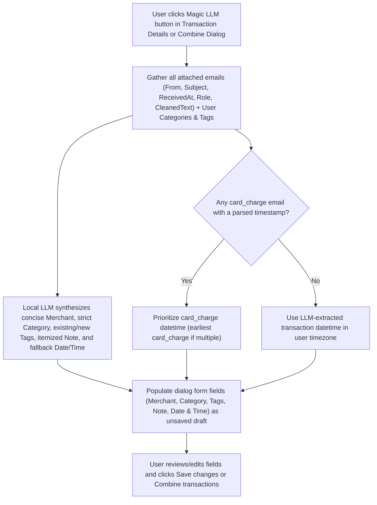
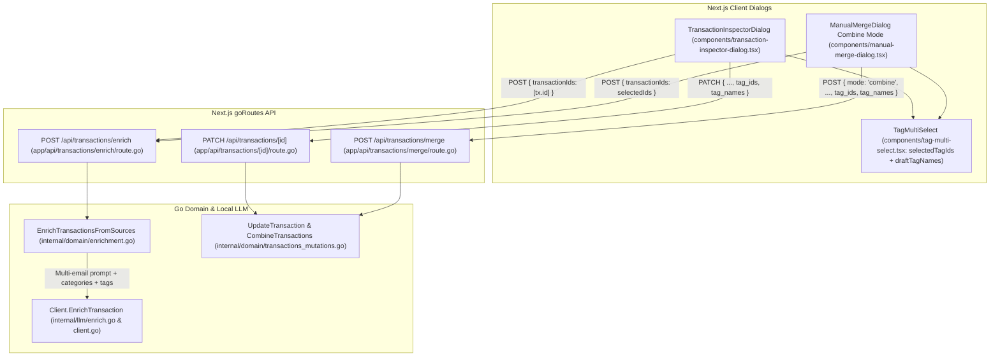

# Magic LLM Transaction Enrichment - Plan

## Goal Capsule

- **Objective:** Users can synthesize all emails attached to a transaction (or a set of transactions being combined) with one click so Merchant, Category, Tags, Note, and Transaction Date/Time are populated in the dialog form for review before saving.
- **Means:** Stateless multi-email LLM preview endpoint (`POST /api/transactions/enrich`) paired with deterministic `card_charge` raw-JSON timestamp resolution and atomic draft-tag persistence on transaction save and combine (`KTD1`, `KTD2`, `KTD3`, `KTD4`).
- **Product authority:** Covers on-demand Magic LLM enrichment in the Transaction Details and Combine Transactions dialogs (`product_contract_source: ce-brainstorm`; Product Contract unchanged).
- **Execution profile:** Single pull request (`U1`–`U4` in dependency order).
- **Stop conditions:** Stop if any Go test, TypeScript codegen check, typecheck, lint, or Next.js production build fails and cannot be resolved within the unit's scope.
- **Open blockers:** None.

---

## Product Contract

### Summary

Add a Magic LLM action button to the **Transaction Details** inspector dialog and the **Combine Transactions** dialog that analyzes all attached source emails together with the user's current categories and tags. Clicking the button populates the dialog's form inputs — a concise vendor name in **Merchant**, an itemized summary in **Note**, a **Category** from the user's existing categories, **Tags** reusing existing tags or suggesting new draft tags, and **Occurred Date/Time** prioritizing `card_charge` emails — without persisting changes until the user confirms Save or Combine.

### Problem Frame

A single real-world purchase in PortSpenderNote often produces up to four separate emails across payment and delivery stages: a bank or card authorization alert (`card_charge`), a digital wallet notification, an order confirmation, and a final itemized merchant receipt (`receipt`). Each email is initially extracted in isolation during Gmail sync.

When the user duplicate-merges or combines those transactions in `components/manual-merge-dialog.tsx` and `internal/domain/transactions_mutations.go`, the surviving transaction attaches all underlying `transaction_sources` rows (`raw_emails`), but its fields only reflect a single kept transaction's initial extraction or a `/` concatenation of previous notes. The card charge email typically has the accurate authorization timestamp but an opaque processor string (such as `GOPAY*GOFOOD`), while the receipt emails contain the real restaurant or store name and the itemized breakdown. Today the user must read each attached email in `components/transaction-inspector-dialog.tsx` and manually type the store name, category, tags, note, and timestamp.

### Key Decisions

- **Place the Magic button in Transaction Details and Combine dialogs, and fill form state for review before saving** `(session-settled: user-approved — chosen over Inspector-only placement, adding a bulk action bar button, or auto-saving immediately: lets users verify and tweak LLM suggestions in context where editable transaction fields exist)`. Governs R1, R2, R3, R5.
- **Keep Duplicate Merge as a fast radio-only step without editable fields or a Magic button** `(session-settled: user-directed — chosen over adding editable form fields and a Magic button to the Duplicate Merge mode: keeps duplicate deduplication fast while leaving multi-email enrichment to Transaction Details after merging or Combine during combining)`. Governs R4.
- **Constrain Category strictly to existing categories while allowing the LLM to suggest new Tags when no existing tag fits** `(session-settled: user-approved — chosen over restricting tags to existing-only or allowing the LLM to invent new categories: keeps the top-level spending taxonomy stable while letting the LLM surface cross-cutting or situational tags from rich receipt text)`. Governs R6, R8, R9, R10.
- **Put the concise store or restaurant name in Merchant and the itemized summary in Note** `(session-settled: user-approved — chosen over formatting Merchant as "Platform - Store" or adding a separate Remark database column: keeps merchant grouping clean while preserving dish, item, and platform context in Note)`. Governs R7, R11.
- **Prioritize `card_charge` email datetimes over other senders for transaction date and time** `(session-settled: user-directed — chosen over letting receipt or order delivery timestamps override bank charge timestamps: reflects the actual payment authorization time when a card charge email is present)`. Governs R12, R13.
- **Defer creation of LLM-suggested new tags until the user saves or combines the transaction** — prevents canceled or discarded Magic runs from polluting the user's tag taxonomy. Governs R10.

<!-- ce-section: work-relationships -->
### How This Work Fits Together

This plan covers **Magic LLM Transaction Enrichment**. The broader breakdown below reflects the current understanding of related work in the repository, not a committed roadmap.

- **Categories & Tags CRUD, Multi-Tag Transactions, and URL-Synchronized Filters** (`docs/plans/2026-11-23-2156-feat-categories-tags-crud-and-url-filters-plan.md`)
  - `Enables` this plan by providing the database-backed `categories` and `tags` tables, multi-tag transaction associations, and the base persisted-ID multi-tag picker in the Add and Inspector dialogs (while this plan owns extending that picker for unsaved draft tags and mounting it alongside a Time input in the Combine dialog).
  - `Shares` the taxonomy boundary that background Gmail sync remains tag-free (`R11` in that plan), while this plan introduces user-triggered tag suggestions via the Magic button.
- **Magic LLM Transaction Enrichment** (this plan)
  - `Depends on` the database-backed categories and tags from `docs/plans/2026-11-23-2156-feat-categories-tags-crud-and-url-filters-plan.md`.

### Requirements

**Dialog Surfaces and Form Population**

- R1. The **Transaction Details** dialog (`components/transaction-inspector-dialog.tsx`) displays a Magic LLM button when the inspected transaction has at least one attached email source (`sources.length >= 1`), and hides or disables the button for manual transactions with zero attached emails.
- R2. The **Combine Transactions** mode of `components/manual-merge-dialog.tsx` includes a **Tags** multi-tag picker (initialized to the deduplicated union of tags across the selected transactions) and a **Time** input alongside **Date**, and displays a Magic LLM button when at least one selected transaction has an attached email source.
- R3. Clicking the Magic LLM button in either dialog requests an LLM synthesis across all attached source emails for the target transaction (or across all attached source emails of all selected transactions in Combine mode) and updates only the in-memory form fields (`Merchant`, `Category`, `Tags`, `Occurred Date`, `Occurred Time`, and `Note`) without mutating database records until submit. Once Magic populates unsaved draft edits in Transaction Details, `Mark reviewed` is disabled or hidden so review completes via `Save changes`, and `Split email` or background query refetches do not overwrite unsaved Magic form edits.
- R4. The **Duplicate Merge** mode of `components/manual-merge-dialog.tsx` remains a radio-selection step without editable field inputs or a Magic LLM button.
- R5. While a Magic LLM request is in flight, the button shows a loading state and prevents duplicate submissions while `Save changes`, `Combine transactions`, `Mark reviewed`, and `Split email` are disabled and `Cancel` / dialog close remain enabled to abort and ignore late responses. If the local LLM server is unreachable or returns a malformed response (excluding an unrecognized category, which falls back per `R8`), the dialog shows an inline error alert and preserves current form values.

**Multi-Email Prompt Context and Taxonomy Rules**

- R6. The Magic LLM prompt includes every attached email's metadata and cleaned text (`from_address`, `subject`, `received_at_utc`, source `role` / sender `role_hint`, and `cleaned_text`), the user's locale settings (`country_code`, `timezone`, `currency`), the user's current list of database categories, and the user's current list of database tags as a starting point.
- R7. The LLM outputs a concise store, restaurant, or vendor name for `merchant` (stripping payment processor prefixes, delivery platform wrappers, and order numbers).
- R8. The LLM selects `category` strictly from the user's existing categories, coercing any unrecognized output to `"Other"` without treating it as an invalid-response error under `R5`.
- R9. The LLM selects zero or more relevant `tags` by matching existing user tags case-insensitively first and suggesting concise new tag names only when no existing tag fits the transaction context. Applying Magic merges suggested tags with pre-existing assigned tags in the form, replacing only prior unsaved Magic draft tags if Magic is re-run before saving.
- R10. New tag names suggested by the LLM appear as selected draft tags in the dialog's multi-tag picker so the user can keep or remove them before submitting, and are persisted to the database `tags` table only when the user saves the transaction or confirms the combine.
- R11. The LLM synthesizes a concise `note` summarizing the purchased items, order details, or platform/delivery context gathered across the attached emails without repeating the raw email boilerplate.

**Transaction Date and Time Resolution (`card_charge` Priority)**

- R12. Attached source emails are classified as `card_charge` when explicit sender `role_hint` is `'card_charge'` (or non-`card_charge` when `'receipt'`), falling back to stored `transaction_sources.role` or `email_extractions.email_kind` when `role_hint` is `'auto'`. When one or more `card_charge` emails have a parsed transaction timestamp, Magic enrichment prioritizes them over `receipt` or other emails and selects the earliest parsed `card_charge` timestamp if multiple exist.
- R13. When no attached email is classified as `card_charge` or no `card_charge` email has a parsed transaction timestamp, Magic enrichment resolves the transaction date and time from the LLM's multi-email extraction normalized into the user's configured timezone. If neither a `card_charge` email nor the LLM provides a valid date or clock time, Magic preserves the dialog's existing `Occurred Date` and `Occurred Time` values.
- R14. Running the Magic LLM button never alters the transaction's `amount_minor`, `currency`, or `account_id` form values.



### Key Flows

- F1. **Enrich a merged 4-email food transaction in Transaction Details**
  - **Trigger:** User opens **Transaction Details** on a transaction that has 4 attached emails (for example, a bank `card_charge` alert, a wallet notification, a food delivery order email, and an itemized restaurant receipt) and clicks the Magic LLM button.
  - **Steps:** The backend gathers all 4 emails plus the user's current categories and tags, runs the multi-email LLM synthesis and `card_charge` timestamp resolution, and returns the suggested fields; the dialog updates its `Merchant`, `Category`, `Tags`, `Occurred date`, `Occurred time`, and `Note` inputs; the user reviews the fields and clicks **Save changes**.
  - **Outcome:** The transaction is saved with the concise restaurant name in `Merchant`, the itemized summary in `Note`, the matched category, the selected tags (creating any kept new tags), and the `card_charge` datetime, and is marked reviewed.
  - **Covered by:** R1, R3, R6, R7, R8, R9, R10, R11, R12, R14.

- F2. **Enrich while combining multiple transactions in the Combine dialog**
  - **Trigger:** User selects 2 or more transactions on `/transactions`, opens **Combine transactions**, and clicks the Magic LLM button.
  - **Steps:** The backend gathers all attached emails across all selected transactions along with the user's categories and tags, runs the enrichment, and populates `Merchant`, `Category`, `Tags`, `Date`, `Time`, and `Note` in the Combine dialog while leaving the summed amount and account unchanged; the user reviews the pre-filled values and clicks **Combine transactions**.
  - **Outcome:** The selected transactions are combined into a single transaction carrying the summed amount, all linked emails, and the reviewed LLM-enriched metadata and tags.
  - **Covered by:** R2, R3, R6, R7, R8, R9, R10, R11, R12, R13, R14.

### Acceptance Examples

- AE1. **Multi-email synthesis separates concise merchant from itemized note**
  - **Covers R3, R7, R11, R14.**
  - **Given:** A transaction has 4 attached emails: a bank charge for `"GOPAY*GOFOOD"`, a GoPay top-up/deduction notice, a GoFood order confirmation, and a receipt from `"Sate Khas Senayan"` for `"10x Sate Ayam, 1x Nasi Putih, 1x Es Teh Manis"`.
  - **When:** The user clicks the Magic LLM button in **Transaction Details**.
  - **Then:** The **Merchant** input updates to `"Sate Khas Senayan"`, the **Note** input updates to a concise summary of the items and channel (such as `"10x Sate Ayam, Nasi Putih, Es Teh Manis via GoFood"`), and **Amount**, **Currency**, and **Account** remain unchanged.

- AE2. **`card_charge` datetime priority over receipt emails**
  - **Covers R12.**
  - **Given:** A transaction has a `card_charge` email whose transaction timestamp is `2026-11-23 12:14` and a merchant `receipt` email delivered at `2026-11-23 12:48` after food delivery completed.
  - **When:** The user clicks the Magic LLM button.
  - **Then:** The dialog's **Occurred date** and **Occurred time** fields are set to `2026-11-23` and `12:14` from the `card_charge` email rather than `12:48` from the receipt email.

- AE3. **Strict category selection and draft new tag suggestions**
  - **Covers R8, R9, R10.**
  - **Given:** The user's database categories are `["Dining", "Groceries", "Transport", "Other"]` and existing tags are `["Work", "Weekend"]`.
  - **When:** The user clicks the Magic LLM button on a weekend dinner order and the LLM suggests category `"Dining"` and tags `["Weekend", "GoFood"]`, and the user closes the dialog without saving.
  - **Then:** While the dialog is open, `"Dining"` is selected in **Category** and both `"Weekend"` and `"GoFood"` appear selected in **Tags**; after closing without saving, `"GoFood"` is not persisted in the `tags` table.

- AE4. **Combine dialog enrichment across multiple selected transactions**
  - **Covers R2, R3, R12.**
  - **Given:** The user selects two transactions on `/transactions` (each with 2 attached emails) and opens **Combine transactions**.
  - **When:** The user clicks the Magic LLM button inside the Combine dialog.
  - **Then:** All 4 emails across both selected transactions are synthesized to populate `Merchant`, `Category`, `Tags`, `Date`, `Time`, and `Note` in the Combine form, using the earliest `card_charge` timestamp across the two transactions.

- AE5. **Local LLM error recovery preserves user edits**
  - **Covers R5.**
  - **Given:** The user has typed a custom draft note in **Transaction Details** and the local LLM server is stopped.
  - **When:** The user clicks the Magic LLM button.
  - **Then:** The dialog displays an error alert explaining that the local LLM server could not be reached, and the user's draft `Merchant`, `Category`, `Tags`, `Date`, `Time`, and `Note` inputs remain intact.

- AE6. **Fallback datetime resolution when no `card_charge` timestamp exists**
  - **Covers R13.**
  - **Given:** A transaction has only a `receipt` email (no `card_charge` email attached) stating purchase time `2026-11-23 19:15`, or a `card_charge` email lacking a parsed clock time while the receipt includes `19:15`.
  - **When:** The user clicks the Magic LLM button.
  - **Then:** The dialog's **Occurred date** and **Occurred time** fields update to `2026-11-23` and `19:15` in the user's configured timezone (or preserve the dialog's existing date and time when neither a `card_charge` email nor the LLM yields a valid date or clock time).

### Scope Boundaries

- **Duplicate Merge dialog form fields or Magic button** — excluded; Duplicate Merge remains a quick radio-selection step.
- **Bulk Magic LLM action on the `/transactions` list action bar** — excluded; Magic enrichment runs inside **Transaction Details** or **Combine Transactions** where the user reviews the populated fields before saving.
- **Modifying amount, currency, or account via the Magic button** — excluded; financial totals and account assignment are never overwritten by Magic metadata enrichment.
- **Creating new categories via the Magic button** — excluded; the LLM must pick from the user's existing categories (or fall back to `"Other"`).
- **Auto-tagging during background Gmail sync** — excluded; background email extraction remains tag-free.

### Dependencies / Assumptions

- Depends on the database-backed `categories`, `tags`, and `transaction_tags` schema and the base persisted-ID multi-tag picker defined in `docs/plans/2026-11-23-2156-feat-categories-tags-crud-and-url-filters-plan.md`; this plan extends that picker to represent unsaved draft tags alongside persisted tag IDs (preserving immediate inline tag creation in Add Transaction) and mounts it in `components/manual-merge-dialog.tsx`.
- Uses the user's configured OpenAI-compatible local LLM server (`app_settings.llm_base_url`, `llm_model`, `llm_timeout_ms`) via `internal/llm/client.go`.

### Sources / Research

- Grounding dossier: `/tmp/compound-engineering-501/ce-brainstorm/magic-llm-tx-enrich/grounding.md`
- Related taxonomy plan: `docs/plans/2026-11-23-2156-feat-categories-tags-crud-and-url-filters-plan.md`
- Single-email LLM prompt, client, and normalization: `internal/llm/prompt.go`, `internal/llm/client.go`, `internal/llm/normalize.go`, `internal/llm/categories.go`
- Transaction source models, recomputation, and merge/combine mutations: `internal/db/models.go`, `internal/domain/extraction.go`, `internal/domain/transactions.go`, `internal/domain/transactions_mutations.go`
- Dialog UI components: `components/transaction-inspector-dialog.tsx`, `components/manual-merge-dialog.tsx`, `components/tag-multi-select.tsx`

---

## Planning Contract

- **Product Contract preservation:** Product Contract unchanged.

### Key Technical Decisions

- KTD1. **Stateless `POST /api/transactions/enrich` preview endpoint accepting `transactionIds`** `(session-settled: user-approved — chosen over mutating the transaction in the database during Magic enrichment or adding separate single-vs-combine endpoints: unified preview endpoint handles both 1-transaction Inspector enrichment and N-transaction Combine enrichment with zero database writes)`. Cites R1, R2, R3, R5, R14.
- KTD2. **Two-tier `card_charge` timestamp resolution via stored `raw_llm_json` then multi-email LLM fallback** `(session-settled: user-approved — chosen over reading `email_extractions.occurred_at_utc` directly: `email_extractions.occurred_at_utc` bakes in `received_at_utc` or `12:00:00` fallbacks during initial sync, so inspecting `raw_llm_json` for a parsed `transaction_date` and `transaction_time` is required to detect missing `card_charge` timestamps and return `null` when neither tier yields a date and clock time)`. Cites R12, R13.
- KTD3. **Atomic draft-tag creation on submit via `tag_names` in `UpdateTransactionInput` and `CombineTransactionsInput`** `(session-settled: user-approved — chosen over calling `POST /api/tags` when Magic runs or firing sequential frontend `createTagApi` requests before saving: resolves or creates kept draft tags inside the same GORM transaction as the transaction update or combine while leaving canceled Magic sessions side-effect-free)`. Cites R2, R9, R10.
- KTD4. **Draft-capable `TagMultiSelect` with dirty-form protection in `TransactionInspectorDialog`** `(session-settled: user-approved — chosen over creating a second tag picker component for Magic dialogs: optional `draftTagNames` and `onDraftTagNamesChange` props on `TagMultiSelect` render removable draft tag badges alongside persisted `selectedTagIds` while keeping `AddTransactionDialog`'s immediate `+ Create` flow intact, and a dirty/Magic flag in `InspectorBody` prevents background refetches and `Mark reviewed` from wiping unsaved Magic fields)`. Cites R1, R2, R3, R5, R9, R10.

### High-Level Technical Design

#### Component & Data-Flow Topology



#### Multi-Email Enrichment Preview & Atomic Save Sequence

```mermaid
sequenceDiagram
  participant User
  participant Dialog as Inspector / Combine Dialog
  participant API as Go API Routes
  participant Domain as internal/domain
  participant LLM as internal/llm (Local Server)

  User->>Dialog: Click "Magic LLM" button
  Dialog->>Dialog: Set isEnriching=true (disable Save/Combine/Mark reviewed/Split; keep Cancel active)
  Dialog->>API: POST /api/transactions/enrich { "transactionIds": [...] }
  API->>Domain: EnrichTransactionsFromSources(gdb, ctx, transactionIds)
  Domain->>Domain: Load attached emails + sender role_hint + raw_llm_json, categories, tags, locale
  Domain->>Domain: Resolve effective role (sender role_hint > source role > extraction kind)
  Domain->>LLM: EnrichTransaction(ctx, model, EnrichInput)
  LLM-->>Domain: EnrichResult (Merchant, Category coerced to Other if unknown, Tags, Note, LLM OccurredAtUtc)
  Domain->>Domain: Pick earliest card_charge raw_llm_json timestamp, else LLM timestamp, else nil
  Domain->>Domain: Split LLM tags into matched existing tags ({id, name}) + new draftTagNames
  Domain-->>API: TransactionEnrichmentPreview (no DB writes)
  API-->>Dialog: 200 OK { merchant, category, note, occurred_at_utc, existing_tags, draft_tag_names }
  Dialog->>Dialog: Populate form inputs, merge existing_tags into selectedTagIds, replace Magic draftTagNames, mark form hasUnsavedMagicEdits
  User->>Dialog: Review/tweak fields and click Save changes or Combine transactions
  Dialog->>API: PATCH /api/transactions/[id] or POST /api/transactions/merge (with tag_ids + tag_names)
  API->>Domain: GORM Transaction: resolve/create tag_names, replace transaction_tags, update/combine transaction
  Domain-->>API: Updated/Combined TransactionListItem
  API-->>Dialog: 200 OK (invalidate transactions, spending, accounts, categories, tags)
```

### System-Wide Impact

- **Base UI `<Select>` label resolution:** When Magic sets `category` in `TransactionInspectorDialog` or `ManualMergeDialog`, `categoryOptions` already includes a dynamic fallback `{ value: category, label: category }` item whenever `category` is not yet in `catListQuery.data`, preserving closed-trigger label rendering per `docs/solutions/ui-bugs/base-ui-select-items-label-resolution.md`.
- **Unsaved Magic state vs. React Query invalidations:** In `components/transaction-inspector-dialog.tsx`, `useEffect` currently resets all form state whenever `detailQuery.data?.transaction` changes. Tracking `hasUnsavedMagicEdits` (set when Magic populates the form, and cleared when `transactionId` changes or `updateMutation` succeeds) prevents background refetches or `Split email` from wiping unsaved Magic fields, and hides/disables `Mark reviewed` while unsaved Magic edits are present (`R3`).
- **In-flight request cancellation:** Both dialogs use an `AbortController` (or track active request generation and ignore late responses on dialog close/Cancel) so closing or canceling during an up-to-60-second local LLM call (`app_settings.llm_timeout_ms`) never blocks the UI or mutates state after close (`R5`).

### Risks & Dependencies

- **Local OpenAI-compatible servers that reject `json_schema`:** `Client.EnrichTransaction` in `internal/llm/enrich.go` must mirror `Client.ExtractTransaction`'s HTTP 400 fallback from `response_format: { type: "json_schema" }` to `{ type: "json_object" }` (`internal/llm/client.go`), and coerce any out-of-list `category` to `"Other"` during normalization (`R8`) rather than throwing an `ExtractionError` during raw JSON parsing.
- **Partial or missing timestamps in `raw_llm_json` and multi-email LLM responses:** `parseRawExtractedDateTimeToUtc` in `internal/llm/normalize.go` falls back to `received_at_utc` or `12:00:00` when `transaction_date` or `transaction_time` is absent. For Magic enrichment (`R12`, `R13`), timestamp resolution must use a strict parser that requires a valid `YYYY-MM-DD` date and `HH:mm(:ss)` clock time — returning `nil` when either is missing so the dialog keeps its current `Occurred Date` and `Occurred Time` values rather than overwriting them with email arrival time or noon.

---

## Implementation Units

### U1. Multi-Email LLM Enrichment Prompt, Schema, and Client Method

- **Goal:** Add multi-email transaction enrichment prompt construction, JSON schema, lenient category normalization (`"Other"` fallback), strict optional timestamp parsing, and `Client.EnrichTransaction` in `internal/llm/`.
- **Requirements:** R5, R6, R7, R8, R9, R11, R12, R13, KTD2.
- **Dependencies:** None.
- **Files:**
  - `internal/llm/enrich.go` (create)
  - `internal/llm/extract_test.go` (modify — tests multi-email prompt building, JSON schema, category coercion to `"Other"`, tag deduplication/trimming, strict date+time parsing vs `nil` fallback, and HTTP 400 `json_object` fallback; catches prompt/normalization regressions, misses DB queries)
- **Approach:**
  1. In `internal/llm/enrich.go`, define `EnrichEmailSource` (`EmailID`, `FromAddress`, `Subject`, `ReceivedAtUtc`, `EffectiveRole`, `CleanedText`), `EnrichInput` (`Emails []EnrichEmailSource`, `UserCountry *string`, `CountryPromptRules []string`, `UserTimezone string`, `UserCurrency *string`, `Categories []string`, `Tags []string`), `RawEnrichment` (`Merchant *string`, `Category *string`, `Tags []string`, `Note *string`, `TransactionDate *string`, `TransactionTime *string`, `TimezoneOffset *string`), and `EnrichResult` (`Merchant string`, `Category string`, `Tags []string`, `Note *string`, `OccurredAtUtc *string`, `RawJSON string`).
  2. Implement `BuildEnrichmentPrompt(input EnrichInput)` and `BuildEnrichmentJSONSchema(categories []string)` per R6–R13: include all attached emails with their effective role (`card_charge` vs `receipt`), user locale/country rules, allowed `Categories`, and existing `Tags` as a starting point; instruct the model to return a concise vendor name in `merchant` (R7), a `category` from `Categories` (R8), zero or more `tags` reusing existing tags case-insensitively first and proposing concise new tags only when none fit (R9), a concise itemized summary in `note` (R11), and `transaction_date` + `transaction_time` + `timezone_offset` prioritizing `card_charge` emails over `receipt` emails (R12, R13).
  3. Implement `ParseAndValidateEnrichment` and `NormalizeEnrichedResult` so that:
     - `StripThinkBlocks` strips `<think>` blocks and markdown code fences.
     - Missing or blank `merchant` returns an `ExtractionError` (triggering R5's error alert).
     - Any unrecognized or null `category` is coerced case-insensitively to a matching entry in `ResolveCategories(input.Categories)` or `"Other"` without returning an `ExtractionError` per R8.
     - `tags` are trimmed, empty strings dropped, and deduplicated case-insensitively while preserving existing tag casing when matched against `input.Tags` per R9.
     - `ParseStrictExtractedDateTimeToUtc(txDate, txTime, tzOffset, userTimezone)` returns a `*string` UTC ISO timestamp only when both `txDate` (`YYYY-MM-DD`) and `txTime` (`HH:mm` or `HH:mm:ss`) are present and valid, returning `nil` when either is missing per R12, R13, and KTD2.
  4. Implement `(c *Client) EnrichTransaction(ctx context.Context, model string, input EnrichInput) (*EnrichResult, error)` using `doChatCompletion` with `json_schema` (`name: "transaction_enrichment"`, `strict: true`) and the HTTP 400 fallback to `json_object`.
- **Patterns to follow:** `internal/llm/prompt.go`, `internal/llm/client.go` (`ExtractTransaction`), and `internal/llm/normalize.go`.
- **Test scenarios:**
  - `Covers AE1.` `BuildEnrichmentPrompt` formats multiple emails (with `EffectiveRole`, `From`, `Subject`, `Received-At-UTC`, and `CleanedText`), user locale, existing categories, and existing tags, and `NormalizeEnrichedResult` extracts concise `Merchant` and `Note`.
  - `Covers R8.` When the LLM returns a category not in `input.Categories` (e.g., `"Fast Food"` under `json_object` fallback), `ParseAndValidateEnrichment` and `NormalizeEnrichedResult` coerce `Category` to `"Other"` instead of returning an error.
  - `Covers R9.` When the LLM returns `tags: ["weekend", "GoFood", "Weekend", "  "]` with `input.Tags: ["Work", "Weekend"]`, normalization returns `["Weekend", "GoFood"]`.
  - `Covers R13 / AE6.` `ParseStrictExtractedDateTimeToUtc` returns a normalized UTC timestamp when both date and time are valid, and returns `nil` when `transaction_date` or `transaction_time` is null or omitted.
  - `Covers R5.` Empty JSON, malformed JSON, or blank `merchant` returns an `ExtractionError`.
- **Verification:** `go test ./internal/llm/...` passes with all multi-email enrichment prompt, schema, normalization, and client tests green.

### U2. Go Domain Enrichment Preview, `card_charge` Timestamp Resolution, and Atomic Draft-Tag Mutations

- **Goal:** Implement `EnrichTransactionsFromSources` in `internal/domain/` (with `senders.role_hint` precedence and `raw_llm_json` `card_charge` timestamp priority) and extend `UpdateTransaction` and `CombineTransactions` to atomically resolve or create `tag_names` alongside `tag_ids`.
- **Requirements:** R1, R2, R3, R5, R6, R8, R9, R10, R12, R13, R14, F1, F2, AE1, AE2, AE3, AE4, AE6, KTD1, KTD2, KTD3.
- **Dependencies:** U1.
- **Files:**
  - `internal/domain/enrichment.go` (create)
  - `internal/domain/transactions_mutations.go` (modify)
  - `internal/domain/transactions_test.go` (modify — tests multi-email enrichment preview for single and combined transactions, `senders.role_hint` precedence, `card_charge` `raw_llm_json` timestamp priority and fallback, zero-DB-mutation guarantee during preview, and atomic `tag_names` + `tag_ids` persistence on `UpdateTransaction` and `CombineTransactions`; catches domain/DB regressions, misses React state)
- **Approach:**
  1. In `internal/domain/enrichment.go`, define `EnrichTransactionsInput` (`TransactionIDs []string`), `TransactionEnrichmentPreview` (`Merchant string` `json:"merchant"`, `Category string` `json:"category"`, `Note *string` `json:"note"`, `OccurredAtUtc *string` `json:"occurred_at_utc"`, `ExistingTags []TransactionTagItem` `json:"existing_tags"`, `DraftTagNames []string` `json:"draft_tag_names"`), and `EnrichTransactionsFromSources(gdb *gorm.DB, ctx context.Context, transactionIDs []string) (*TransactionEnrichmentPreview, error)` instantiating `*llm.Client` directly from `app_settings` (`GetAppSettings` / `llm.NewClient`).
  2. Query all attached `transaction_sources` across deduplicated `transactionIDs` joined with `raw_emails`, `LEFT JOIN senders ON senders.id = raw_emails.sender_id`, and `LEFT JOIN email_extractions ON email_extractions.email_id = raw_emails.id`, ordered by `raw_emails.internal_date_ms ASC, transaction_sources.email_id ASC`. Return a clear validation error if no transactions exist or if zero source emails are attached across `transactionIDs` (R1, R2).
  3. Resolve each source email's effective role per R12: if `senders.role_hint` is `'card_charge'` or `'receipt'`, use `senders.role_hint`; otherwise use `transaction_sources.role` (or `email_extractions.email_kind` if non-empty).
  4. Resolve the `card_charge` timestamp per R12, R13, and KTD2:
     - For every attached email whose effective role is `'card_charge'` and whose `email_extractions.raw_llm_json` is non-empty, unmarshal `llm.RawExtraction` and call `llm.ParseStrictExtractedDateTimeToUtc(raw.TransactionDate, raw.TransactionTime, raw.TimezoneOffset, userTimezone)`.
     - Select the **earliest** non-nil parsed `card_charge` UTC timestamp.
     - If no `card_charge` email yielded a parsed date+time from `raw_llm_json`, fall back to `enrichResult.OccurredAtUtc` from `EnrichTransaction` (which remains `nil` if the LLM also lacked a valid date+time, per R13).
  5. Partition `enrichResult.Tags` case-insensitively against `ListTags(gdb)` into `ExistingTags []TransactionTagItem` and `DraftTagNames []string` without inserting new tags into the database per R9, R10, and KTD1.
  6. In `internal/domain/transactions_mutations.go`, add `TagNames []string` (`json:"tag_names"`) to `UpdateTransactionInput`, and add `HasTagIDs bool` (`json:"-"`), `TagIDs []string` (`json:"tag_ids"`), and `TagNames []string` (`json:"tag_names"`) to `CombineTransactionsInput` per KTD3.
  7. Implement `resolveAndReplaceTransactionTags(tx *gorm.DB, transactionID string, rawTagIDs []string, rawTagNames []string, nowUtc string) error` to look up or create each trimmed name in `rawTagNames` inside `tx`, combine its ID with `rawTagIDs`, and call `replaceTransactionTags`. Invoke it inside `UpdateTransaction` when `patch.HasTagIDs` is true and inside `CombineTransactions` when `input.HasTagIDs` is true (preserving the `INSERT OR IGNORE` tag union when `input.HasTagIDs` is false).
- **Patterns to follow:** `internal/domain/transactions_mutations.go`, `internal/domain/tags.go`, `internal/domain/settings.go`, `internal/syncrunner/runner.go`, and `internal/syncrunner/runner_test.go` (`httptest.NewServer` configured via `app_settings.llm_base_url`).
- **Test scenarios:**
  - `Covers AE1 / AE3.` `EnrichTransactionsFromSources` on a transaction with 4 attached emails returns synthesized `Merchant`, canonical existing `Category` (or `"Other"`), `Note`, `ExistingTags`, and `DraftTagNames` without mutating `transactions` or `tags` in SQLite.
  - `Covers AE2 / R12.` When a transaction has a `card_charge` email with `raw_llm_json` containing `"transaction_date":"2026-11-23","transaction_time":"12:14"` and a `receipt` email at `12:48`, `EnrichTransactionsFromSources` returns the `12:14` `card_charge` UTC timestamp; when `senders.role_hint` is changed to `'receipt'` on the first sender and `'card_charge'` on the second, `senders.role_hint` takes precedence.
  - `Covers AE4 / R12.` Passing multiple `transactionIDs` gathers all emails across all selected transactions and picks the earliest parsed `card_charge` timestamp across them.
  - `Covers AE6 / R13.` When a `card_charge` email's `raw_llm_json` has `"transaction_time": null`, `EnrichTransactionsFromSources` falls back to the multi-email LLM timestamp; when the LLM also returns no clock time, `OccurredAtUtc` is `nil`.
  - `Covers R10 / KTD3.` Calling `UpdateTransaction` or `CombineTransactions` with `TagIDs` and `TagNames: ["GoFood", "Weekend"]` creates new tags once, reuses existing tags case-insensitively, and replaces `transaction_tags` atomically.
- **Verification:** `go test ./internal/domain/...` passes with all enrichment preview and atomic draft-tag mutation tests green.

### U3. Go API Route (`/api/transactions/enrich`), Merge Route Tag Support, and TypeScript Client/Codegen

- **Goal:** Expose `POST /api/transactions/enrich`, wire `tag_ids` and `tag_names` through `PATCH /api/transactions/[id]` and `POST /api/transactions/merge`, regenerate TypeScript types, and add `enrichTransactionsApi` to `lib/api/transactions.ts`.
- **Requirements:** R1, R2, R3, R5, R10, KTD1, KTD3.
- **Dependencies:** U2.
- **Files:**
  - `app/api/transactions/enrich/route.go` (create)
  - `app/api/transactions/[id]/route.go` (modify)
  - `app/api/transactions/merge/route.go` (modify)
  - `cmd/gen-ts-types/main.go` (modify)
  - `cmd/gen-ts-types/main_test.go` (modify — verifies `TransactionEnrichmentPreview` is exported in `lib/api/types.generated.ts`; catches Go-to-TS contract drift, misses runtime HTTP behavior)
  - `lib/api/types.generated.ts` (modify — generated via `bun run generate:types`)
  - `lib/api/transactions.ts` (modify)
- **Approach:**
  1. Create `app/api/transactions/enrich/route.go` handling `POST`: decode `domain.EnrichTransactionsInput` (`transactionIds`), call `domain.EnrichTransactionsFromSources(gdb, r.Context(), input.TransactionIDs)`, and write `200 OK` with `TransactionEnrichmentPreview` or `400`/`502` via `httpx.WriteError`.
  2. In `app/api/transactions/[id]/route.go`, set `patch.HasTagIDs = true` when either `"tag_ids"` or `"tag_names"` is present in `rawMap`.
  3. In `app/api/transactions/merge/route.go` (`case "combine":`), set `input.HasTagIDs = true` when either `"tag_ids"` or `"tag_names"` is present in `rawMap`.
  4. Register `TransactionEnrichmentPreview` in `cmd/gen-ts-types/main.go`, update `cmd/gen-ts-types/main_test.go`, and run `bun run generate:types`.
  5. In `lib/api/transactions.ts`, add `tag_names?: string[]` to `updateTransactionApi`, add `tag_ids?: string[]` and `tag_names?: string[]` to `combineTransactionsApi`, and add `enrichTransactionsApi(input: { transactionIds: string[] }, options?: { signal?: AbortSignal })`.
- **Patterns to follow:** `app/api/transactions/merge/route.go`, `app/api/transactions/[id]/route.go`, `cmd/gen-ts-types/main.go`, and `lib/api/transactions.ts`.
- **Test scenarios:**
  - `go test ./cmd/gen-ts-types/...` and `bun run check:types` confirm `TransactionEnrichmentPreview` is generated in `lib/api/types.generated.ts` with zero drift.
  - `enrichTransactionsApi` forwards `AbortSignal` through `apiFetch` so closing or canceling a dialog aborts the in-flight HTTP request (`R5`).
- **Verification:** `go test ./...`, `bun run check:types`, and `bun run typecheck` pass.

### U4. Draft-Capable `TagMultiSelect` and Magic LLM Enrichment in Transaction Inspector & Combine Dialogs

- **Goal:** Extend `TagMultiSelect` to display and toggle unsaved Magic draft tags, add `Tags`, `Time`, and the Magic LLM button to the **Combine Transactions** dialog, add the Magic LLM button and dirty-form guards to the **Transaction Details** dialog, and keep **Duplicate Merge** radio-only.
- **Requirements:** R1, R2, R3, R4, R5, R9, R10, R12, R13, R14, F1, F2, AE1, AE2, AE3, AE4, AE5, AE6, KTD4.
- **Dependencies:** U3.
- **Files:**
  - `components/tag-multi-select.tsx` (modify)
  - `components/transaction-inspector-dialog.tsx` (modify)
  - `components/manual-merge-dialog.tsx` (modify)
- **Approach:**
  1. In `components/tag-multi-select.tsx`, add optional props `draftTagNames?: string[]` and `onDraftTagNamesChange?: (nextDrafts: string[]) => void`:
     - Keep manual `+ Create "<name>"` immediate persistence via `createTagMutation` into `onSelectedTagIdsChange` across **all** dialogs (`AddTransactionDialog`, `TransactionInspectorDialog`, and `ManualMergeDialog`) so manually created tags sit in `selectedTagIds` and survive Magic runs/re-runs (`R9`), reserving `draftTagNames` exclusively for Magic-suggested unsaved tags (`R10`).
     - Extend `hasExactMatch` to check both persisted `tags` and `draftTagNames` case-insensitively so `+ Create` cannot duplicate an active draft tag.
     - Track a popover-session `knownDraftNames` list seeded from `draftTagNames` while the popover is open so unchecking a draft checkbox row keeps the row visible and re-checkable until the popover closes; render removable draft tag badges distinctly (for example `variant="outline"` with a `"New"` cue and `aria-label={`Remove draft tag ${name}`}`), and include `draftTagNames` in the trigger summary count (`selectedTags.length + draftTagNames.length`) and filtered popover empty-state checks.
  2. In `components/transaction-inspector-dialog.tsx`:
     - Track `draftTagNames` (`string[]`), `hasUnsavedMagicEdits` (`boolean`), `isEnriching` (`boolean`), an `AbortController` ref, and `lastLoadedTxKeyRef` (`"${tx.id}:${tx.updated_at_utc}"`). When `transactionId` changes or on unmount, abort any in-flight Magic request and reset `isEnriching`, `draftTagNames`, and `hasUnsavedMagicEdits`. Guard the form-reset `useEffect` so resets are skipped whenever `tx.id === lastLoadedTxId && (hasUnsavedMagicEdits || isEnriching)` (protecting both pre-Magic manual edits during `isEnriching` per `AE5` and populated Magic edits across background refetches or `Split email` per `R3`).
     - Render the **Magic LLM** button when `detail.sources.length >= 1` (`R1`); while in flight, set `isEnriching = true` and disable `Save changes`, `Mark reviewed`, and `Split email` while keeping dialog close active to abort and ignore late responses (`R5`).
     - On Magic success, update `merchant`, `category`, `note`, and (when `occurred_at_utc` is non-null) `date` + `time`; merge `existing_tags` into `selectedTagIds` and replace `draftTagNames` (`R9`, `R13`, `R14`); set `hasUnsavedMagicEdits = true` (which hides/disables `Mark reviewed` per `R3`).
     - Pass `tag_ids` and `tag_names` to `updateTransactionApi` on Save; in `updateMutation.onSuccess(updatedTx)`, synchronously update `selectedTagIds` from `updatedTx.tags` and patch the `["transactions", "detail", tx.id]` and `["tags"]` React Query caches with `updatedTx` and its newly created tags before clearing `draftTagNames` and `hasUnsavedMagicEdits` alongside `invalidateAll()` and `["tags"]` invalidation.
  3. In `components/manual-merge-dialog.tsx`:
     - Keep `mode === "duplicate"` radio-only (`R4`).
     - In `mode === "combine"`, load `tagsQuery()`, initialize `selectedTagIds` to the deduplicated tag union across `sortedByOccurred`, render `TagMultiSelect` (with `draftTagNames` / `onDraftTagNamesChange`), replace `initialDate`/`initialTime` with controlled `time` state initialized from `sortedByOccurred[0]` and rendered via `<Input type="time" required>` alongside `Date`, require `time.trim()` in `canSubmit`, and always pass the controlled `time` in `handleSubmit`.
     - Track `isEnriching`, `draftTagNames`, and an `AbortController` ref; render the **Magic LLM** button when `transactions.some(tx => tx.sourceCount > 0)` (`R2`, `R3`, `R5`). Disable `Magic LLM` while `isPending` (`combineTransactionsApi`) is true, and disable `Combine transactions` (plus guard `handleSubmit`) while `isEnriching` is true. On Magic click, request `/api/transactions/enrich` with `selectedIds`; on success, apply `TransactionEnrichmentPreview` using the same field, `existing_tags` merge, `draftTagNames` replacement, and nullable `occurred_at_utc` preservation rules as Inspector; on error, show an inline alert preserving form inputs (`R5`). Whenever `selectionKey` becomes `null` or changes (or on unmount), abort the `AbortController` and reset `isEnriching`, `draftTagNames`, and `formError`.
     - Pass `tag_ids` and `tag_names` to `combineTransactionsApi` on submit (`F2`, `AE4`).
- **Patterns to follow:** `components/transaction-inspector-dialog.tsx`, `components/manual-merge-dialog.tsx`, `components/tag-multi-select.tsx`, and `docs/solutions/ui-bugs/base-ui-select-items-label-resolution.md`.
- **Test scenarios:**
  - `Covers R1 / R4.` Transaction Details shows the Magic LLM button when `detail.sources.length >= 1` and hides it when `0`; Duplicate Merge renders only the radio list.
  - `Covers F1 / AE1 / AE2 / AE3.` Clicking Magic LLM in Transaction Details populates `Merchant`, `Category`, `Tags` (merging existing tags and showing removable draft tags), `Occurred date`, `Occurred time`, and `Note` without changing `Amount` or `Account`; closing without saving leaves `tags` untouched.
  - `Covers F2 / AE4.` Opening Combine Transactions initializes `Tags` to the union of selected transactions' tags and shows `Date` and `Time`; clicking Magic LLM synthesizes all attached emails across selected transactions, and confirming Combine persists the combined transaction and kept draft tags atomically.
  - `Covers R3 / R5 / AE5.` While Magic LLM is in flight, `Save changes` / `Combine transactions` / `Mark reviewed` / `Split email` are disabled while `Cancel` / close aborts the request; on LLM failure, an inline error alert renders and current form edits remain intact; once Magic populates fields in Transaction Details, `Mark reviewed` is disabled/hidden and background query refetches do not reset the dirty form.
- **Verification:** `bun run typecheck`, `bun run lint`, and `bun run build` pass with zero errors.

---

## Verification Contract

| Verification Command | Applicability | Units Covered | Done Signal |
|---|---|---|---|
| `go test ./internal/llm/... ./internal/domain/...` | Required after Go LLM or domain edits | U1, U2 | All Go unit and integration tests pass with exit code 0 |
| `bun run generate:types && bun run check:types && go test ./cmd/gen-ts-types/...` | Required after adding or updating Go API response structs | U3 | `lib/api/types.generated.ts` is up to date and codegen tests pass |
| `bun run typecheck` | Required after TypeScript or component edits | U3, U4 | `tsc --noEmit` exits with code 0 |
| `bun run lint` | Required before completion | U3, U4 | `eslint` exits with code 0 and no warnings or errors |
| `bun run build` | Required final build gate | U1–U4 | Next.js production build (including `goRoutes` compilation) exits with code 0 |

---

## Definition of Done

- All four Implementation Units (`U1`–`U4`) are implemented in dependency order and satisfy requirements `R1`–`R14`, flows `F1`–`F2`, acceptance examples `AE1`–`AE6`, and technical decisions `KTD1`–`KTD4`.
- `POST /api/transactions/enrich` synthesizes all attached emails for one or more transactions without mutating the database, prioritizes parsed `card_charge` timestamps from `raw_llm_json` (with `senders.role_hint` precedence) before falling back to multi-email LLM timestamps, and coerces unrecognized categories to `"Other"`.
- `TransactionInspectorDialog` and `ManualMergeDialog` (Combine mode) support Magic LLM form enrichment, removable draft tags in `TagMultiSelect`, atomic draft-tag creation on Save/Combine, and dirty-form / in-flight action protection, while Duplicate Merge remains radio-only.
- All commands in `## Verification Contract` pass (`go test ./...`, `bun run check:types`, `bun run typecheck`, `bun run lint`, `bun run build`).
- Cleanup criterion: all abandoned-attempt, experimental, or dead-end code from implementation is removed from the diff.

---

## Deferred / Open Questions

These entries are review items left for the author and do not block implementation.

### From 2026-11-23 review

- **Magic button placement, copy, and feedback banner state are unspecified in both dialogs** — ## Implementation Units (U4) (P2, design-lens, confidence 75)

  Leaving the Magic LLM trigger placement, loading copy, and feedback banner cleanup unspecified risks inconsistent layout across Transaction Details and Combine dialogs, footer button crowding on narrow viewports, or stale split-confirmation and error banners remaining onscreen after enrichment. Clear the error and status alert banners when Magic runs, place the Magic trigger in a top-of-form bar above the editable field grid with an active loading state, and show a concise post-fill confirmation banner in Transaction Details.

  Change: Place the Magic trigger in a top-of-form bar above the editable field grid in both dialogs, specify the label and loading copy alongside `Enriching...`, clear prior error and status banners when Magic starts, and set a review-and-save status banner in Transaction Details on success.
