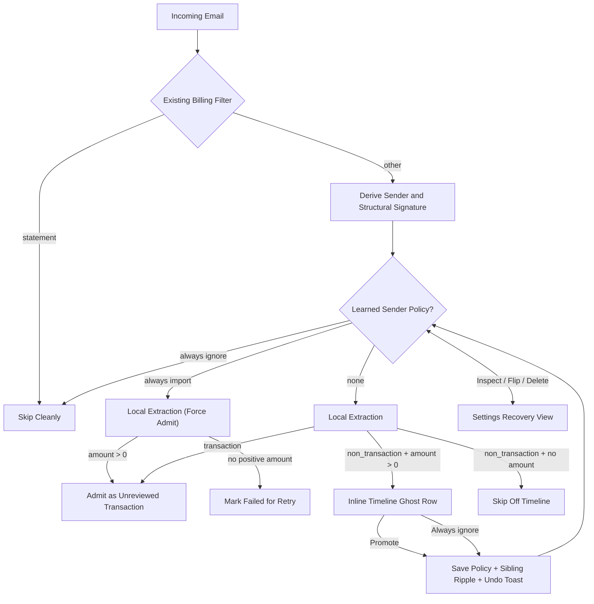
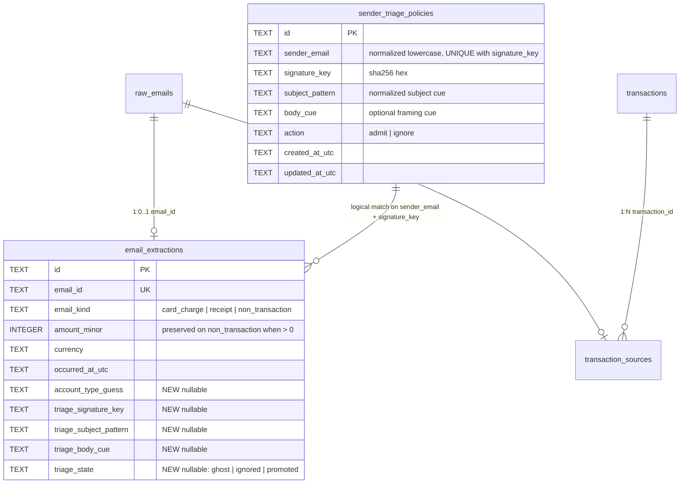
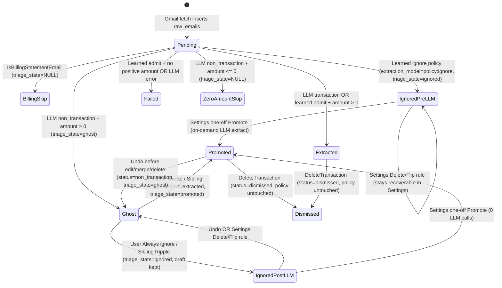
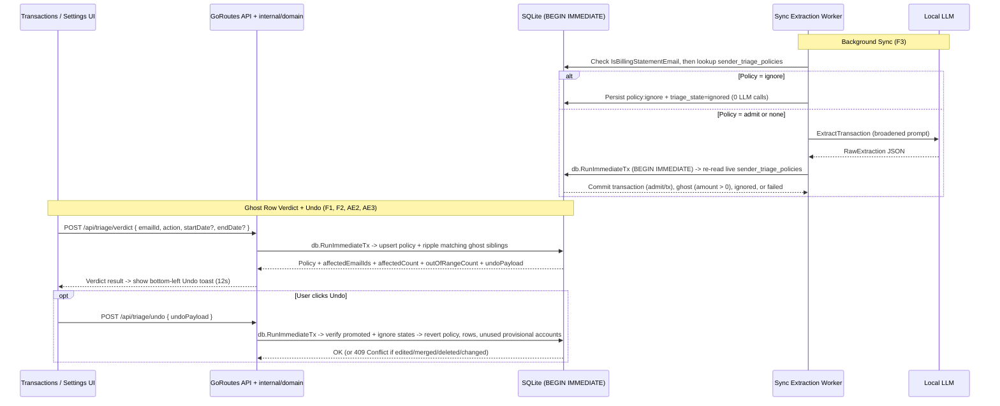

# Per-Sender Email Triage Policy and Timeline Ghost Rows - Plan

## Goal Capsule

- **Objective** — Users never silently lose real expense emails to false skips, and a single correction teaches the app how to handle that sender's recurring email formats for any inbox worldwide.
- **Means** — Deterministic per-sender structural template signatures persisted in additive SQLite tables (`KTD1`, `KTD2`), paired with non-destructive extraction, inline Timeline Ghost Rows, atomic sibling-ripple verdicts with Undo, and a Settings recovery tab (`KTD3`–`KTD5`).
- **Product authority** — The confirmed Product Contract below governs email skip triage, per-sender learned policies, Timeline Ghost Rows, and Settings recovery; broader user-data learning directions from ideation are not active scope.
- **Execution profile** — Ships as a single pull request across six ordered implementation units (`U1`–`U6`); no separate migration PR, feature flag, or staged rollout is needed.
- **Stop conditions** — Stop and re-plan if migration `000006` requires rebuilding an existing `STRICT` table, if live skipped-email JSON rows cannot normalize to canonical UTC timestamps, or if any change conflicts with `R6` or `R11`.
- **Ownership** — `ce-work` implements `U1`–`U6`, verifies all gates in the Verification Contract, and ships the completed pull request.
- **Open blockers** — None.

---

## Product Contract

### Summary

Add a country- and user-agnostic per-sender email triage policy paired with inline Timeline Ghost Rows on the Transactions page. Skipped emails carrying a parsed monetary amount appear chronologically alongside real transactions with zero balance impact and one-click **Promote** and **Always ignore** actions. Each verdict derives a structural pattern from the email's own framing, ripples immediately across matching skipped rows with an Undo toast, governs future matches from that sender automatically, and remains inspectable and reversible in Settings.

### Problem Frame

When local extraction classifies an email as a non-transaction, all parsed fields are discarded and the email disappears behind a bare skipped count with no user-facing recovery path. Live inspection of the user's local database surfaced 5 real expense emails buried this way out of 6 total skipped records: two BCA QRIS payments (`5ac46a86-0d1e-4f29-99ef-cc8f9882cace`, `eb26eaca-ce81-4f8d-bedc-f13d4fa3456d`), a BCA bank transfer (`01b8eb35-fb08-421f-b683-f735db694b6c`), a Jenius bank transfer (`9e83e37c-d03a-4ff2-a1d3-eb3bed1202ed`), and a Grab Tips receipt (`f9e81377-d39a-4bec-a3b5-67366146df45`). In every one of those five cases, the local model had already parsed a valid amount and currency before emitting `non_transaction`, while the sixth skipped email (`4f1ddad2-848c-4597-bea4-fad6813c5078`, a Shopee account-linking security notice) carried no monetary amount.

Today the user only discovers these omissions by noticing missing balances or inspecting the database directly, and retry only re-queues failed extractions. At the same time, senders reuse generic subjects across distinct email formats (such as BCA's `"Internet Transaction Journal"` covering both QRIS payments and transfers, or Grab sending both order receipts and compensation vouchers), while hardcoded country-specific payment categories would only fit one user's inbox rather than learning generally across different banks and regions.

### Key Decisions

- **Derive per-sender triage rules from each email's own structural framing rather than hardcoded payment-type enums** (session-settled: user-directed — chosen over a fixed 5-class enum introducing `purchase_or_qris` and `tip_addon`: hardcoded local payment categories overfit to one user's inbox instead of learning generally for any user). Governs R1, R3, R4.
- **Use deterministic self-discovered email template signatures for learned per-sender policies** (session-settled: user-approved — chosen over dynamic few-shot verdict memory and a two-layer hybrid: deterministic template rules avoid small-model prompt drift on recurring bank formats with the smallest machinery). Governs R3, R4, R5.
- **Surface amount-bearing skipped emails inline as Timeline Ghost Rows on the Transactions page** (session-settled: user-approved — chosen over a pure-ledger list with a separate Skipped tab and a collapsible per-day cluster: chronological placement makes missing expenses unmistakable beside related purchases). Governs R7, R8, R9.
- **Learn immediately on a single Promote or Always ignore click and ripple to matching skipped siblings with an Undo toast** (session-settled: user-approved — chosen over explicit per-verdict opt-in, auto-importing all amount-bearing emails, requiring 2+ verdicts, and single-row-only updates: 1-click learning with immediate sibling ripple and Undo removes repetitive triage). Governs R4, R5, R10.
- **Inspect and reverse learned policies and ignored emails in Settings** (session-settled: user-directed — chosen over displaying ignored rows inline on Transactions or relying on manual database deletion: keeps the daily timeline clean while keeping every ignore rule auditable and reversible). Governs R12, R13.
- **Keep transaction deletion independent of learned ignore policies** — Deleting an imported transaction dismisses only that email so removing a cancelled card charge never suppresses legitimate future charges from the same bank. Governs R6.

### Requirements

**Preserving and classifying skipped emails**

- R1. Broaden baseline extraction guidance generically so confirmed money outflows beyond card alerts and merchant receipts — including transfers, mobile or QR payments, and tips — classify as transactions rather than non-transactions.
- R2. Preserve parsed draft fields (amount, currency, timestamp, merchant, category, and account cues) whenever extraction marks an email as non-transaction while still identifying a positive monetary amount.
- R3. Derive a deterministic structural template signature for each email from its sender, normalized subject (stripping variable amounts, dates, and card masks), and invariant framing or heading cues, without relying on hardcoded country-specific payment categories.

**Per-sender learned triage policy**

- R4. Record a learned per-sender triage policy keyed by sender and template signature immediately upon a single user verdict, setting automatic import on **Promote** and automatic ignore on **Always ignore**.
- R5. Evaluate learned per-sender policies during sync extraction so an ignore policy skips matching emails cleanly and an import policy admits matching emails as unreviewed transactions rather than dropping them as non-transaction.
- R6. Deleting an imported transaction dismisses only that email and never creates, modifies, or deletes a learned **Always ignore** policy.

**Timeline Ghost Rows on Transactions**

- R7. Display unjudged skipped emails that contain a parsed monetary amount (including existing skipped emails already in the local database) inline in chronological order on the Transactions page as visually distinct Ghost Rows excluded from spending totals, account balances, bulk selection, and transaction counts.
- R8. Provide a `Show skipped` filter toggle on the Transactions page to show or hide Ghost Rows, while keeping zero-amount non-transaction alerts (such as security notices and OTPs) off the timeline.
- R9. Provide one-click **Promote** and **Always ignore** actions on each Ghost Row, where promoting creates an unreviewed transaction from preserved draft fields without calling the local model when required fields are complete (falling back to local re-extraction from saved email text only when required fields are missing).
- R10. Clicking **Promote** or **Always ignore** immediately ripples to other unjudged skipped emails matching the same sender and template signature locally without re-fetching from Gmail or modifying sender sync cursors, accompanied by an Undo toast that reverts both the policy change and the affected rows.
- R11. Promoting a historical Ghost Row dated at or before an account's latest reconciliation anchor updates spending history for that date while leaving the reconciled current balance invariant intact.

**Settings inspection and recovery**

- R12. Show learned per-sender triage policies and ignored emails in Settings, displaying the matched pattern cues and letting the user flip or delete any learned rule or promote an ignored email back into the ledger.
- R13. Deleting or flipping an **Always ignore** policy in Settings stops suppressing future matching emails and makes previously ignored emails from that pattern locally recoverable without resetting Gmail sync cursors.

### Key Flows

- F1. First-time rescue of a skipped expense with sibling ripple
  - **Trigger:** User opens Transactions and sees two inline Ghost Rows from the same bank QRIS format (for example, Ayam Keprabon Express and TIONG INDOGROSIR -HO).
  - **Steps:** User clicks **Promote** on one Ghost Row; the app records an import policy for that sender and template signature, converts that Ghost Row and its matching sibling into unreviewed transactions from their preserved draft fields without re-calling the local model, and shows an Undo toast.
  - **Outcome:** Both expenses enter the ledger and spending totals as unreviewed transactions, and future emails matching that sender and template signature import automatically.
  - **Covers:** R2, R3, R4, R7, R9, R10
- F2. Ignoring an amount-bearing non-expense
  - **Trigger:** An amount-bearing promotional voucher or cancellation notice appears inline as a Ghost Row.
  - **Steps:** User clicks **Always ignore**; the app saves an ignore policy for that sender and template signature, removes that Ghost Row and any matching sibling Ghost Rows from the Transactions timeline, and shows an Undo toast.
  - **Outcome:** Matching future emails from that sender skip cleanly off the timeline without affecting legitimate purchase formats from the same sender.
  - **Covers:** R3, R4, R5, R7, R10
- F3. Subsequent Gmail sync with learned policies active
  - **Trigger:** A background sync processes new emails from configured senders.
  - **Steps:** The sync derives each email's template signature, checks learned per-sender policies, auto-skips learned ignore matches, extracts and force-admits learned import matches, extracts novel formats with the broadened baseline prompt, routes novel amount-bearing skips to Ghost Rows, and keeps zero-amount alerts off the timeline.
  - **Outcome:** Previously taught expense formats never regress into skipped rows, ignored noise stays hidden, and genuinely new amount-bearing edge cases surface inline for one-click triage.
  - **Covers:** R1, R2, R3, R5, R7, R8
- F4. Inspecting and reversing a learned ignore rule in Settings
  - **Trigger:** User wants to check hidden emails or undo an **Always ignore** verdict after the Undo toast has dismissed.
  - **Steps:** User opens Settings, reviews the sender's learned policies and ignored emails list, and either deletes or flips the ignore rule or promotes an ignored email directly.
  - **Outcome:** Future matching emails are no longer suppressed, and selected historical ignored emails recover locally without re-fetching from Gmail.
  - **Covers:** R12, R13

### Acceptance Examples

- AE1. **Covers R2, R7, R8.** Given the existing local database containing the five false-negative skipped emails (`01b8eb35-fb08-421f-b683-f735db694b6c`, `5ac46a86-0d1e-4f29-99ef-cc8f9882cace`, `eb26eaca-ce81-4f8d-bedc-f13d4fa3456d`, `9e83e37c-d03a-4ff2-a1d3-eb3bed1202ed`, `f9e81377-d39a-4bec-a3b5-67366146df45`) and the zero-amount Shopee security alert (`4f1ddad2-848c-4597-bea4-fad6813c5078`), opening Transactions with `Show skipped` enabled displays the five amount-bearing emails inline at their timestamps with zero balance impact and does not display the Shopee security alert.
- AE2. **Covers R3, R4, R9, R10.** Given BCA's `"Internet Transaction Journal"` emails for two QRIS payments (`5ac46a86`, `eb26eaca`) and one bank transfer (`01b8eb35`) appearing as Ghost Rows, clicking **Promote** on `5ac46a86` promotes both QRIS payments as unreviewed transactions without re-calling the local model, leaves the bank transfer as a distinct Ghost Row because its structural framing differs, displays an Undo toast, and leaves BCA's Gmail sync cursor unchanged.
- AE3. **Covers R4, R10.** Clicking **Undo** on the toast immediately after AE2 removes the newly created policy and reverts both promoted QRIS transactions back to Ghost Rows.
- AE4. **Covers R3, R4, R5.** Given a user in another country whose bank sends `"You sent $42.00 via Zelle to Alex"` and `"Security alert: new login"`, promoting the Zelle Ghost Row creates a learned policy from that sender's own framing so future Zelle alerts from that bank import automatically without requiring any country-specific configuration or hardcoded payment categories.
- AE5. **Covers R4, R5, R12, R13.** Clicking **Always ignore** on a Grab compensation voucher Ghost Row hides it and suppresses future matching vouchers from that sender while continuing to admit Grab food and tip receipts; deleting that ignore rule in Settings restores future evaluation and lets the user recover the ignored voucher locally if desired.
- AE6. **Covers R6.** Deleting a real imported Jenius credit card charge (such as a cancelled order like `1e4bfdde-38a8-4ae3-aa41-492c5bfb7706`) marks only that email dismissed and creates zero **Always ignore** policies, so subsequent Jenius credit card charges still import normally.
- AE7. **Covers R7, R11.** Promoting a historical Ghost Row dated before an account's latest reconciliation timestamp adds the transaction to that month's spending summary while leaving the account's current reconciled balance unchanged.

### Scope Boundaries

- **Deferred for later:** Broader user-data learning ideas captured in ideation (`docs/ideation/2026-11-24-user-data-learning-ideation.html`), including FTS5 contrastive prompt memory for extraction and Magic LLM, retroactive shadow-diff merchant/category rules, inline Teach & Ripple for transaction edits, background Magic pondering with Learning Silence, and account-collision scoring plus cross-email charge/cancellation or tip-pairing sagas.
- **Deferred for later:** Manual editing of learned pattern expressions or custom regex authoring in Settings (v1 supports viewing matched pattern cues, flipping or deleting learned rules, and promoting ignored emails).
- **Out of scope:** Showing zero-amount non-transaction alerts (security notices, OTPs, account-link emails) inline on the Transactions timeline.
- **Out of scope:** Changing how Gmail fetch cursors or backfill windows work; all promotion, ripple, and recovery actions operate strictly on locally stored email records.
- **Considered and not built:** Creating an ignore rule from transaction deletion or the transaction inspector — conflicts with `R6` and overlaps deferred manual rule authoring; revisit if broadened baseline extraction produces recurring unwanted auto-imports.
- **Considered and not built:** Persistent bulk-rollback history in Settings for rippled promotions after the Undo toast closes — immediate rollback is handled by the pause-on-hover Undo toast showing exact rippled counts, and bulk delete already exists on Transactions; revisit if users report frequent accidental ripples discovered across sessions.
- **Considered and not built:** Post-sync Ghost Row link in SyncToast — `sync_runs.skipped_count` aggregates billing statements, duplicate message IDs, zero-amount alerts, and learned ignores, so triggering a link on `skipped_count > 0` misleads users when zero Ghost Rows exist. Revisit only if `sync_runs` tracks a dedicated ghost count.
- **Considered and not built:** Read-only Ghost Row preview drawer on `/transactions` — inline Ghost Rows already surface merchant/subject, sender, amount, and structural body cue, immediate rollback is covered by the Undo toast (`R10`), and full email bodies remain inspectable in Settings (`R12`), avoiding eager `cleaned_text` payloads on `/api/transactions`. Revisit if users need raw email text inline before triaging.

<!-- ce-section: work-relationships -->
### How This Work Fits Together

This plan covers the first area from `docs/ideation/2026-11-24-user-data-learning-ideation.html` — preventing false skips through a universal per-sender triage policy and inline Timeline Ghost Rows. The surrounding ideation directions below are contextual candidates, not committed scope or a roadmap:

- **Compounding Personal Memory Stack (FTS5 contrastive retrieval + channel-bound remark grammars)** — Can proceed independently of this plan; shares confirmed user-correction signals from local email and transaction records.
- **Retroactive Shadow-Diff Compiler & Personal Rule Store** — Can proceed independently of this plan; shares the Settings rule-inspection concept for deterministic user-owned rules.
- **Inline Teach & Ripple Codemod Preview & Background Magic Pondering** — Can proceed independently of this plan; enables richer post-promotion enrichment once rescued Ghost Rows land in the ledger.
- **Collision-Proof Account Affinity & Cross-Email Lifecycle Sagas** — Can proceed independently of this plan; enables pairing promoted tip receipts (such as `f9e81377`) with parent orders and netting cancelled charge pairs (`1e4bfdde` + `fb13b866`) automatically.

### Dependencies and Assumptions

- **Local email retention:** Cleaned email bodies and raw extraction JSON remain persisted locally in SQLite for previously synced emails, allowing zero-Gmail-fetch promotion, sibling ripple, and Settings recovery.
- **Distinct framing within shared subjects:** Generic bank subjects (such as `"Internet Transaction Journal"` or `"Your Grab E-Receipt"`) contain stable structural heading or label lines in their cleaned text sufficient to separate distinct email types without leaking variable amounts or merchant names into the signature.
- **Reconciled balance invariant:** Existing reconciliation anchor logic already excludes transactions dated at or before the latest reconciliation timestamp from current balance calculation, so historical Ghost Row promotions remain balance-safe.

### Sources and Research

- Upstream ideation artifact: `docs/ideation/2026-11-24-user-data-learning-ideation.html` (Idea #1, adapted during brainstorm to replace hardcoded 5-class enums with self-discovered structural template signatures).
- Verified current extraction, normalization, and sync behavior: `internal/llm/normalize.go`, `internal/llm/prompt.go`, `internal/syncrunner/runner.go`, `internal/syncrunner/statement_filter.go`.
- Verified ledger, deletion, and balance anchor behavior: `internal/domain/transactions.go`, `internal/domain/transactions_mutations.go`, `internal/domain/accounts_balance.go`, `internal/domain/accounts_matching.go`.
- Verified database migration locking and type generation: `internal/db/db.go`, `internal/db/migrations/000001_baseline.up.sql`, `internal/db/db_test.go`, `cmd/gen-ts-types/main.go`.
- Verified UI surfaces: `components/transactions-view.tsx`, `components/transaction-list.tsx`, `components/transaction-inspector-drawer.tsx`, `components/sync-toast.tsx`, `components/settings-view.tsx`, `components/settings/gmail-senders-tab.tsx`, `app/globals.css`.
- Relevant documented learnings: `docs/solutions/database-issues/sqlite-table-rebuild-begin-immediate-goroutes.md`, `docs/solutions/logic-errors/billing-statement-future-date-reconciliation-inflation.md`, `docs/solutions/logic-errors/gmail-sync-sender-cursor-and-timestamp-null.md`, `docs/solutions/workflow-issues/nextjs-goroutes-bracket-dirs-break-go-test-and-vet.md`, `docs/solutions/ui-bugs/base-ui-select-items-label-resolution.md`, `docs/solutions/ui-bugs/base-ui-button-render-link-semantics.md`, `docs/solutions/design-patterns/shared-light-dark-color-roles.md`, `docs/solutions/logic-errors/go-loadlocation-local-pseudo-timezone-breaks-js-intl.md`.

---

## Planning Contract

Product Contract preserved from brainstorm, with one flowchart arrow corrected so learned `always import` routes through local extraction before transaction admission (matching `R5`).

### Key Technical Decisions

- KTD1. **Two-tier deterministic structural template signature engine in `internal/domain/triage_signature.go`** (session-settled: user-approved — chosen over dynamic few-shot verdict memory and a two-layer hybrid: deterministic template signatures avoid small-model prompt drift on recurring bank formats). Instantiates `R3`, `R4`, `R5`. Normalize the sender to lowercase bare email address (extracting angle-bracket addresses when present). Normalize subjects by lowercasing, collapsing ASCII and NBSP whitespace, and replacing masked account/card strings with `{mask}`, currency-prefixed or suffixed amounts with `{amount}`, dates and clock times with `{date}` and `{time}`, and `#`-prefixed or digit-bearing alphanumeric order/reference IDs with `{id}`. When a normalized subject contains `{amount}`, normalize trailing counterparty spans after ` to `, ` at `, or ` from ` only when that preposition follows `{amount}`, `{date}`, or `{time}`, stopping before the next placeholder token, preposition (` for `, ` of `, ` on `, ` via `), or terminal outcome word (`succeeded`, `failed`, `declined`, `cancelled`, `canceled`, `pending`, `reversed`, `refunded`, `completed`) so `{counterparty}` never consumes `{amount}` or outcome status. Derive an optional body framing cue in two passes: Pass A scans the first 20 non-empty trimmed lines for explicit structural type key-value pairs (both inline `Key: Value` and multi-line `Key` / `:` / `Value` layouts where the key matches `type` or `<word> type` for transaction/transfer/payment/order/service/activity/entry and the value is at most 48 characters with no digits), and Pass B scans only the leading header block (first 5 non-empty lines, stopping at the first line containing a digit, currency amount, URL, or `:`), picking the first standalone 2+-word heading line of 3–48 characters without `,` or trailing `.`, `:`, or `;` that does not start with a greeting token (`hi `, `hello `, `hey `, `hai `, `halo `, `dear `), does not duplicate the normalized subject, and does not equal a single-word brand or sender name, leaving `body_cue` empty otherwise. Compute `signature_key` as lowercase hex SHA-256 of `sender_email + "\n" + subject_pattern + "\n" + body_cue`, while persisting `subject_pattern` and `body_cue` verbatim for Settings display (`R12`).
- KTD2. **Additive SQLite migration `000006` keyed by normalized sender email plus lazy idempotent Go backfill via `db.RunImmediateTx`.** Instantiates `R2`, `R4`, `R7`, `R12`, `R13`. Because concurrent Next.js `goRoutes` workers open SQLite simultaneously, avoid rebuilding any existing `STRICT` table (`docs/solutions/database-issues/sqlite-table-rebuild-begin-immediate-goroutes.md`). Migration `000006_sender_triage_policies` creates `STRICT` table `sender_triage_policies` keyed by `UNIQUE (sender_email, signature_key)` with `action CHECK (action IN ('admit', 'ignore'))` — keying on normalized `sender_email` survives sender removal/re-addition and prevents cross-address leakage when a sender's address changes in `domain.UpdateSender`. Add a shared `db.RunImmediateTx(gdb, fn)` helper in `internal/db/tx.go` that pins a connection via `gdb.Connection` and executes explicit `BEGIN IMMEDIATE` / `COMMIT` / `ROLLBACK` (compatible with `sqlDB.SetMaxOpenConns(1)`), avoiding nested GORM DEFERRED transactions inside `gdb.Transaction`. The migration also adds nullable columns to `email_extractions` (`account_type_guess`, `triage_signature_key`, `triage_subject_pattern`, `triage_body_cue`, and `triage_state CHECK (triage_state IS NULL OR triage_state IN ('ghost', 'ignored', 'promoted'))`) plus indexes on `(triage_state, occurred_at_utc DESC)` and `(triage_signature_key, triage_state)`. `email_extractions`'s existing table `CHECK` already allows populated draft columns on `email_kind = 'non_transaction'` rows, and `raw_emails.status` stays unchanged so Gmail `KnownMessageIDs` and `MAX(internal_date_ms)` cursor invariants hold (`docs/solutions/logic-errors/gmail-sync-sender-cursor-and-timestamp-null.md`). To populate existing `non_transaction` rows without creating an import cycle into `internal/db`, `BackfillSkippedEmailTriageData` runs lazily inside `db.RunImmediateTx` gated by an indexed existence check, derives `triage_signature_key`, `triage_subject_pattern`, and `triage_body_cue` unconditionally from `raw_emails` for every non-billing `non_transaction` row so backfill finishes in one idempotent pass, and parses `raw_llm_json` with a lenient backfill decoder (allowing unknown JSON fields, coercing unknown/renamed/deleted categories via `ResolveKnownCategory`, and leaving `triage_state = NULL` when unparseable or lacking a positive amount) rather than strict `llm.ParseAndValidateExtraction`.
- KTD3. **Non-destructive extraction normalization, generic prompt broadening, non-nesting `*InTx` helpers, and post-LLM policy re-check in `internal/syncrunner/`.** Instantiates `R1`, `R2`, `R5`. Broaden `BuildExtractionPrompt` generically to classify outgoing bank/peer transfers, mobile or QR payments, and tips as transactions while keeping billing statements, bill payments, shipping notices, OTPs, security alerts, promotional vouchers, and cancellations as `non_transaction`, update the category rule (`internal/llm/prompt.go:93`) so the model selects a category whenever an email shows a positive amount (returning `null` only when no positive amount exists), and instruct the model to populate draft fields whenever an email shows a positive amount even if classified `non_transaction`. Update `NormalizeExtractedResult` to preserve best-effort parsed fields on `non_transaction` outputs (treating missing or invalid currency and non-positive or unparseable amounts on `non_transaction` as `AmountMinor = 0` without error, and persisting SQL `NULL` (`nil`) into `email_extractions.merchant_raw` when `MerchantRaw` is blank after trimming rather than `""` or premature `"Unknown Merchant"`) and upgrade `parseRawExtractedDateTimeToUtc` to parse RFC3339 and space-separated ISO+offset timestamps like `"2026-11-24 19:42:34+07:00"` into canonical `YYYY-MM-DDTHH:MM:SSZ` strings. Extract `domain.ResolveEffectiveEmailRole(senderRoleHint, emailKind, cardLast4, bankAccountHint)` (always returning `'card_charge'` or `'receipt'`) and refactor `SaveExtractedTransaction` and `CreateProvisionalAccountForExtraction` into non-nesting `*InTx` helpers so `db.RunImmediateTx` callers never nest `gdb.Transaction`. In `runExtractionWorker`, `IsBillingStatementEmail` keeps first precedence (`triage_state = NULL`). Learned `ignore` policies skip the LLM completely (`extraction_model = 'policy:ignore'`, `triage_state = 'ignored'`, `raw_emails.status = 'non_transaction'`), whereas learned `admit` policies still invoke local extraction. Inside the post-LLM `db.RunImmediateTx` commit block, re-read `sender_triage_policies` so mid-sync verdicts cannot race with in-flight LLM calls: force-admit `admit` matches with `AmountMinor > 0` as unreviewed transactions via `ResolveEffectiveEmailRole`, mark `admit` matches with no positive amount as `failed` so retry surfaces the error, and route unmatched `non_transaction` outputs with `AmountMinor > 0` to `triage_state = 'ghost'`.
- KTD4. **Atomic `db.RunImmediateTx` verdict/ripple/Undo mutations and non-destructive Settings recovery.** Instantiates `R4`, `R6`, `R9`, `R10`, `R11`, `R12`, `R13`. Promoting a Ghost Row treats `(amount_minor > 0, valid 3-letter currency)` as the required set for zero-LLM promotion via `ResolveEffectiveEmailRole`, falling back to `received_at_utc` for missing timestamps, trimmed `subject` then `"Unknown Merchant"` for blank or null merchants, and `DefaultCategory` for missing categories — making every `/transactions` promotion and sibling ripple instant, offline-safe, and atomic in `db.RunImmediateTx` via `*InTx` helpers. Sibling ripple and policy-scoped queries filter in SQL on `raw_emails.status = 'non_transaction'`, `triage_signature_key = ?`, `triage_state = 'ghost'`, `extraction_model != 'rule:billing_statement'`, and `amount_minor > 0`, then verify `NormalizeSenderEmail(from_address) == senderEmail` in Go so display-name headers match `sender_triage_policies.sender_email` cleanly without touching `dismissed` emails or `senders.last_internal_date_ms`. Undo (`POST /api/triage/undo`) verifies inside `db.RunImmediateTx` that every `affectedEmailId` still has its expected post-verdict state (`status = 'non_transaction' AND triage_state = 'ignored'` for ignore Undo, or `status = 'extracted' AND triage_state = 'promoted'` for promote Undo), that the target `sender_triage_policies` row still matches the verdict's recorded action, and that every promoted transaction still exists unmodified (`manual_override = 0, reviewed = 0, remark_user_edited = 0`) with its single original `transaction_sources` row (returning `409 Conflict` otherwise), reverts `sender_triage_policies`, restores `raw_emails.status = 'non_transaction'` and `triage_state = 'ghost'`, and deletes a newly created provisional account only when zero rows in `transactions.account_id` or `senders.default_account_id` reference it. In Settings' new `Triage & Rules` tab (`?tab=triage`), deleting or switching an `Always ignore` policy returns post-LLM ignored emails (`amount_minor > 0`) to `ghost` while keeping pre-LLM `policy:ignore` emails in Settings' Ignored Emails list for on-demand recovery. In `PromoteIgnoredEmail`, call `ExtractTransaction` outside any SQLite lock for pre-LLM rows, then acquire `db.RunImmediateTx` to re-verify `status = 'non_transaction' AND triage_state = 'ignored'` (returning `409` on duplicate/race), force-admit any extraction with `AmountMinor > 0` even if `email_kind = 'non_transaction'` via `ResolveEffectiveEmailRole`, and return `422` when no positive amount is extracted (keeping `502` for offline LLM). Switching or deleting `Always import` never deletes existing transactions.
- KTD5. **Window-anchored Ghost Row pagination overlay and bottom-left Undo toast.** (session-settled: user-approved — chosen over a separate Skipped tab and collapsible per-day clusters: chronological placement makes missing expenses unmistakable beside related purchases). Instantiates `R7`, `R8`, `R9`, `R10`. Keep `PaginatedTransactionsResponse.items`, `totalCount`, `totalInRangeCount`, and `unreviewedInRangeCount` strictly over `transactions`, and add `ghostRows` (lightweight inline metadata plus `triage_body_cue`, without `cleaned_text`), `ghostInRangeCount`, `totalGhostCount`, and `ghostRowsTruncated`. Partition matching Ghost Rows cleanly using half-open `[currentPageOldest, previousPageOldest)` bounds on non-final pages (omitting the upper bound on page 1) via pre-coalesced `COALESCE(ee.occurred_at_utc, re.received_at_utc)`, omit the lower timestamp bound on the final transaction page (`offset + len(items) >= totalCount`, including page 1 when `totalCount <= pageSize`, capped at 100 tail rows) so older Ghost Rows are never dropped, return empty `ghostRows` when `totalCount > 0 && page > totalPages`, and return up to 100 matching Ghost Rows with `ghostRowsTruncated` on page 1 when `totalCount == 0`. Filter Ghost Rows consistently by local-timezone date bounds, search (`merchant_raw`, `subject`, `from_address`, `payment_method_raw`), draft `category`, and resolved account preview, hiding them when a `tag` filter is active and keeping them visible when `Needs review` is active. Define `ghostInRangeCount` over date bounds only, persist `Show skipped` in the URL via `nuqs` (`skipped`, default `true`), render a muted `· N skipped` suffix in the review status banner, show `View all dates` only when `!isAllDates && filters.skipped && ghostInRangeCount === 0 && totalGhostCount > 0` (plus a `Show skipped` restore action when `!filters.skipped && totalGhostCount > 0`), surface `triage_body_cue` / `subject` inline on each Ghost Row without a separate preview drawer, and position `TriageUndoToast` with responsive insets (`fixed left-5 right-5 bottom-5 sm:right-auto sm:w-96`, stacking cleanly above `SyncToast` on viewports under `820px`) using a 12-second pause-on-hover timer.

### High-Level Technical Design

#### Schema Additions (`000006_sender_triage_policies`)

#### Email Triage State Lifecycle

#### Sync, Verdict Ripple, and Undo Protocol

#### HTTP API Surface

| Endpoint | Method | Purpose | Request / Query | Response / Status |
|---|---|---|---|---|
| `/api/transactions` | `GET` | Paginated transactions plus window-anchored Ghost Rows | Existing query params + `showSkipped` (default `true`) | `200` `PaginatedTransactionsResponse` with `ghostRows` (lightweight inline metadata + `triage_body_cue`, no `cleaned_text`), `ghostInRangeCount`, `totalGhostCount`, `ghostRowsTruncated` |
| `/api/triage/verdict` | `POST` | Record Promote or Always ignore verdict and ripple siblings | `{ emailId, action: "promote" \| "ignore", startDate?, endDate? }` | `200` `TriageVerdictResult` (includes `affectedCount`, `outOfRangeCount`, `undoPayload`); `400`/`409` on invalid or already-judged email |
| `/api/triage/undo` | `POST` | Atomically revert a verdict batch and prior policy state | `TriageUndoInput` (`undoPayload` from verdict) | `200` `{ ok: true, restoredCount }`; `409` if any promoted row was edited/reviewed/merged/deleted or ignore/policy state changed |
| `/api/triage/policies` | `GET` | List learned per-sender policies with ignored/ghost counts | Optional `senderEmail`, `search` | `200` `SenderTriagePolicyView[]` |
| `/api/triage/policies/[id]` | `PATCH`, `DELETE` | Switch policy action (`admit` ↔ `ignore`) or delete learned rule | `PATCH { action }`; `DELETE` no body | `200` updated `SenderTriagePolicyView` or `{ ok: true, restoredGhostCount }` |
| `/api/triage/ignored` | `GET` | Paginated list of `triage_state = 'ignored'` emails for Settings | `senderEmail`, `search`, `page`, `pageSize` | `200` `PaginatedIgnoredEmailsResponse` (includes `availableSenders`) |
| `/api/triage/ignored/[emailId]/promote` | `POST` | One-off promote of a single ignored email without changing policy | No body | `200` `{ transaction, emailId, usedLlm }` (`409` if already promoted, `422` if pre-LLM extraction lacks positive amount, `502` if offline LLM unreachable) |

### System-Wide Impact

- **SQLite startup and concurrency:** Migration `000006` is purely additive under `withMigrationLock` (`syscall.Flock` in `internal/db/db.go`), avoiding `STRICT` table rebuilds under concurrent Next.js `goRoutes` startup (`docs/solutions/database-issues/sqlite-table-rebuild-begin-immediate-goroutes.md`). Multi-step backfill, verdict ripple, Undo, and post-LLM sync commits run through shared `db.RunImmediateTx` (`BEGIN IMMEDIATE` on a pinned `gdb.Connection` with `sqlDB.SetMaxOpenConns(1)`) and non-nesting `*InTx` domain helpers.
- **Ledger and reconciliation safety:** Ghost Rows stay outside `transactions`, leaving `GetMonthlySpendingSummary`, `computeAccountBalanceAsOf`, `buildAccountSummariesAt`, and account `TypeLocked` untouched until promotion (`R7`). Historical promotions inherit `computeAccountBalanceAsOf`'s `occurred_at_utc > latestRec.RecordedAtUtc` anchor boundary (`R11`).
- **GoRoutes and type contracts:** All new domain DTOs register in `cmd/gen-ts-types/main.go` and regenerate `lib/api/types.generated.ts`. Business logic stays inside `internal/domain/` and `internal/syncrunner/` so Go tests run via `go test -count=1 ./internal/... ./cmd/...` while bracketed route files (`[id]`, `[emailId]`) are vetted individually (`docs/solutions/workflow-issues/nextjs-goroutes-bracket-dirs-break-go-test-and-vet.md`). Adding 6 route files keeps total Go route workers well below the `64` stdout listener cap in `instrumentation-node.ts`.
- **UI component and theme conventions:** Any `<Select>` in Settings' `Triage & Rules` tab must supply explicit `{ value, label }[]` `items` with async fallbacks (`docs/solutions/ui-bugs/base-ui-select-items-label-resolution.md`). Navigation links styled as buttons (such as Settings' `Triage & Rules` recovery banner link to `/transactions?range=all`) must apply `buttonVariants` directly to `<Link>` rather than `<Button render={...}>` (`docs/solutions/ui-bugs/base-ui-button-render-link-semantics.md`). Ghost Rows and recovery cards reuse semantic tokens in `app/globals.css` so light and dark modes keep consistent contrast and role meaning (`docs/solutions/design-patterns/shared-light-dark-color-roles.md`).

### Risks & Dependencies

| Risk | Impact | Mitigation |
|---|---|---|
| Structural signature over-splits variable fields or over-matches distinct formats | Sibling ripple misses valid siblings or groups unrelated sender formats | Cover all 12+ observed real inbox shapes plus international prose alerts in unit tests (`U1`); show matched cues in Settings so users can switch or delete any noisy rule (`U5`) |
| Legacy `raw_llm_json` contains non-UTC timestamps (`"2026-11-24 19:42:34+07:00"`) | Backfill breaks SQLite chronological ordering or `UtcIsoToEpochMs` validation | Upgrade `parseRawExtractedDateTimeToUtc` before running backfill (`U2`) and test against verbatim JSON fixtures from all five live skipped emails (`U3`, `U6`) |
| Active background sync finishes an LLM call after a user clicks a Ghost Row verdict | Stale worker decision re-creates a ghost row or ignores a newly admitted pattern | Re-read `sender_triage_policies` inside `runExtractionWorker`'s post-LLM `db.RunImmediateTx` commit block (`KTD3`, `U2`) |
| User edits, merges, or deletes a promoted transaction before clicking Undo | Naive rollback destroys merged ledger transactions or leaves orphan provisional accounts | Enforce server-side `409 Conflict` guard on modified/merged/deleted rows, auto-dismiss client Undo toast on drawer/merge/bulk mutations, and reference-check provisional accounts in `transactions.account_id` and `senders.default_account_id` before cleanup (`KTD4`, `U3`, `U4`) |
| Pre-LLM-skipped emails have `amount_minor = NULL` when an `Always ignore` rule is deleted | Deleted-rule emails would fail `amount > 0` Ghost Row queries and vanish | Keep pre-LLM-skipped rows in `triage_state = 'ignored'` on rule delete/switch so they remain visible and recoverable on demand in Settings (`KTD4`, `U3`, `U5`) |

### Deferred Implementation Notes

- Exact regex tuning for uncommon currency glyphs or additional non-English greeting prefixes discovered while running table-driven signature fixtures in `U1`.
- Internal file split within `internal/domain/` (`triage.go` vs separate `triage_queries.go` and `triage_mutations.go`) decided by file length during `U3`.
- Exact Tailwind border opacity and spacing tweaks on Ghost Rows and the Settings `Triage & Rules` cards tuned during light/dark visual verification in `U4` and `U5`.

---

## Implementation Units

### U1. Migration 000006, `RunImmediateTx`, DB Models, and Structural Template Signature Engine

- **Goal:** Land additive schema migration `000006`, a shared pinned-connection `BEGIN IMMEDIATE` transaction helper, and the deterministic structural template signature engine.
- **Requirements:** `R3`, `R4`, `R12`; implements `KTD1`, `KTD2`.
- **Dependencies:** None.
- **Files:**
  - Create: `internal/db/migrations/000006_sender_triage_policies.up.sql`
  - Create: `internal/db/migrations/000006_sender_triage_policies.down.sql`
  - Create: `internal/db/tx.go` (`RunImmediateTx` pinned-connection `BEGIN IMMEDIATE` helper)
  - Modify: `internal/db/models.go`
  - Modify: `internal/db/db_test.go` (seam: real temp-file SQLite migration and `RunImmediateTx` rollback/commit tests catch `STRICT`/index/locking issues; misses higher-level domain backfill covered in `U3`)
  - Create: `internal/domain/triage_signature.go`
  - Create: `internal/domain/triage_signature_test.go` (seam: pure Go unit tests catch subject/body normalization and cue-extraction regressions fast with zero DB overhead; misses SQLite storage/query integration covered in `U3`)
- **Approach:**
  1. Write `000006_sender_triage_policies.up.sql` creating `STRICT` table `sender_triage_policies` and adding the five nullable triage/account-type columns and two indexes on `email_extractions` per `KTD2`, alongside the matching reversible `down.sql`.
  2. Implement `db.RunImmediateTx(gdb, fn)` in `internal/db/tx.go` using `gdb.Connection` with explicit `BEGIN IMMEDIATE`, `COMMIT`, and `ROLLBACK`, and add `SenderTriagePolicy` plus the new `EmailExtraction` fields in `internal/db/models.go`.
  3. Update hardcoded version `5` assertions in `internal/db/db_test.go` (`TestOpenDatabase_FreshSchemaDefaultsAndIndexes` and `TestOpenDatabase_AutoBaselinesExistingDatabaseAndAppliesV2`) to `6`, add a file-DB migration test for v5 upgrades, and add a `RunImmediateTx` commit/rollback test under `MaxOpenConns(1)`.
  4. Implement `NormalizeSenderEmail` and `DeriveEmailTemplateSignature(fromAddress, subject, cleanedText)` in `internal/domain/triage_signature.go` following `KTD1`.
- **Execution note:** Implement `DeriveEmailTemplateSignature` test-first using verbatim structural fixtures for observed bank/merchant emails and international prose alerts.
- **Patterns to follow:** `internal/db/migrations/000005_transaction_remarks.up.sql`, `internal/db/migrations/000003_categories_and_tags.up.sql`, `internal/db/db_test.go`.
- **Test scenarios:**
  - Migration `000006` applies cleanly on a fresh database and on an upgraded v5 file-backed database, enforcing `CHECK (action IN ('admit', 'ignore'))`, `UNIQUE (sender_email, signature_key)`, and `email_extractions.triage_state` constraints, while `RunImmediateTx` commits and rolls back cleanly without deadlocking `MaxOpenConns(1)`.
  - **Covers AE2.** Two BCA `"Internet Transaction Journal"` QRIS emails (`Transaction Type\n:\nQRIS Payment`) yield identical `signature_key` and cue `"transaction type: qris payment"`, while BCA's `"Transfer Type\n:\nTransfer to BCA Account"` email yields a distinct `signature_key`.
  - Grab `"Your Grab E-Receipt"` emails separate cleanly into three distinct signatures for Grab Tips (`"grab tips e-receipt"`), GrabFood solo and group orders (`"selamat menikmati makanan anda!"`), and Grab Car (`"grab e-receipt"`), while Grab Ride Cover vouchers normalize variable amounts (`Rp11.000` vs `Rp25.000`) to one voucher signature.
  - Jenius emails normalize masked card numbers (`437896******6039` vs `437896******1111`) to `{mask}` and keep credit card charges, transfers, and cancellations distinct.
  - Shopee order emails normalize `#26112206P1FVP9` and `#261116EV2QVT1B` (including NBSP whitespace) to one signature, distinct from Shopee's account-linking security notice.
  - **Covers AE4.** International bank alerts `"You sent $42.00 via Zelle to Alex"` and `"You sent $15.50 via Zelle to Jordan"` produce the same signature (`you sent {amount} via zelle to {counterparty}`), distinct from `"Security alert: new login"`.
  - **Counterparty and Pass B edge cases:** `"Payment to Starbucks for $12.50"` normalizes to `"payment to {counterparty} for {amount}"` without swallowing `{amount}`, `"Transfer of $50 to Alice succeeded"` and `"Transfer of $50 to Alice failed"` remain distinct signatures, single-word brand lines (`"Grab"`), comma-terminated greetings (`"Hai keynesfariz,"`), `From` headers with display names (`"BCA <BCA@BCA.CO.ID>"`), empty body text, and subjects without amounts (`"You've transferred money from your Jenius account"`) preserve clean signatures.
- **Verification:** Migration, `RunImmediateTx`, and signature normalization tests pass deterministically on file-backed SQLite DBs with zero external dependencies.

### U2. Non-Destructive Extraction Normalization, Broadened Prompt, `*InTx` Helpers, and Policy-Aware Sync Runner

- **Goal:** Broaden baseline extraction generically, preserve parsed draft fields on `non_transaction` extractions, expose non-nesting `*InTx` transaction helpers, and enforce learned per-sender policies during sync without mid-sync races.
- **Requirements:** `R1`, `R2`, `R3`, `R5`; implements `KTD1`, `KTD2`, `KTD3`.
- **Dependencies:** `U1`.
- **Files:**
  - Modify: `internal/llm/prompt.go`
  - Modify: `internal/llm/normalize.go`
  - Modify: `internal/llm/extract_test.go` (seam: DB-free tests catch prompt wording, non-destructive `non_transaction` field retention, and non-standard ISO timestamp parsing; misses SQLite sync orchestration covered in `runner_test.go`)
  - Modify: `internal/domain/extraction.go` (`ResolveEffectiveEmailRole` + non-nesting `SaveExtractedTransactionInTx`)
  - Modify: `internal/domain/accounts_matching.go` (non-nesting `CreateProvisionalAccountForExtractionInTx`)
  - Modify: `internal/syncrunner/runner.go`
  - Modify: `internal/syncrunner/runner_test.go` (seam: SQLite + `httptest` mock LLM tests catch policy precedence, pre-LLM ignore skips, forced admission on `non_transaction`, post-LLM policy re-check, and missing-amount failure handling; misses HTTP routes covered in `U3`)
- **Approach:**
  1. Update `BuildExtractionPrompt` in `internal/llm/prompt.go` per `KTD3` without adding country-specific or brand-specific rules, updating line 93 so positive-amount emails pick a category from the allowed list rather than `null`.
  2. Update `NormalizeExtractedResult` and `parseRawExtractedDateTimeToUtc` in `internal/llm/normalize.go` per `KTD3` so positive amounts, currencies, RFC3339 or space-separated timestamps, merchants, categories, and account cues survive on `non_transaction` results, while missing/invalid currency or non-positive/unparseable amounts never error on a `non_transaction` response.
  3. Extract `domain.ResolveEffectiveEmailRole` and non-nesting `SaveExtractedTransactionInTx` / `CreateProvisionalAccountForExtractionInTx` helpers, persisting SQL `NULL` (`nil`) into `email_extractions.merchant_raw` when `MerchantRaw` is blank after trimming.
  4. Update `runExtractionWorker` in `internal/syncrunner/runner.go` per `KTD3`: preserve `IsBillingStatementEmail` first, evaluate learned `ignore` pre-LLM, persist `account_type_guess` and `triage_signature_*` columns on extractions, re-check `sender_triage_policies` inside a `db.RunImmediateTx` commit block calling the `*InTx` helpers, handle `admit` forced imports via `ResolveEffectiveEmailRole` (marking missing-amount matches `failed`), and set `triage_state = 'ghost'` for unmatched `non_transaction` rows with `AmountMinor > 0`.
- **Patterns to follow:** `IsBillingStatementEmail` handling in `internal/syncrunner/runner.go`, `startEnrichTestServer` / `httptest.NewServer` mock patterns in `internal/syncrunner/runner_test.go`, table-driven normalization tests in `internal/llm/extract_test.go`.
- **Test scenarios:**
  - `BuildExtractionPrompt` includes generic outflow guidance for transfers, mobile/QR payments, and tips while preserving billing-statement and non-expense exclusions, with zero country-specific terms, and requests a category whenever an amount is present.
  - `NormalizeExtractedResult` on `non_transaction` preserves `AmountMinor`, `Currency`, `OccurredAtUtc`, `MerchantRaw`, `Category`, `CardLast4`, `BankAccountHint`, `MatchedAccountID`, `AccountTypeGuess`, and `PaymentMethodRaw` when positive amount exists, and returns zero `AmountMinor` without error when `amount_decimal` is null/non-positive or `currency` is missing/invalid.
  - `parseRawExtractedDateTimeToUtc` converts `"2026-11-24 19:42:34+07:00"` -> `"2026-11-24T12:42:34Z"` and `"2026-11-23T20:14:00+07:00"` -> `"2026-11-23T13:14:00Z"`, and rejects `"Local"` timezone safely (`docs/solutions/logic-errors/go-loadlocation-local-pseudo-timezone-breaks-js-intl.md`).
  - **Covers AE5.** Syncing an email matching a learned `ignore` policy makes zero LLM calls, writes `extraction_model = 'policy:ignore'` and `triage_state = 'ignored'`, leaves `raw_emails.status = 'non_transaction'`, and advances `skipped_count` while admitting non-matching formats from the same sender.
  - **Covers AE4.** Syncing an email matching a learned `admit` policy calls the LLM and force-admits an unreviewed transaction (`reviewed = 0`) inside `db.RunImmediateTx` even when the mock LLM emits `email_kind: "non_transaction"` with a valid amount, resolving `effectiveRole` cleanly when `sender.role_hint == "auto"` without nesting transactions.
  - Syncing an `admit`-matched email whose mock LLM returns `non_transaction` with `amount_decimal: null` marks `raw_emails.status = 'failed'` with a clear error message instead of inserting an invalid zero-amount transaction.
  - Unmatched `non_transaction` with positive amount saves `triage_state = 'ghost'` and draft columns (persisting `NULL` when `merchant_raw` is blank); unmatched `non_transaction` without amount saves `triage_state = NULL`; billing statements keep `extraction_model = 'rule:billing_statement'` and `triage_state = NULL` even if a policy exists.
  - Concurrency race test: inserting an `ignore` or `admit` policy while the mock LLM HTTP handler is paused mid-request causes the post-LLM commit transaction to honor the newly saved policy.
- **Verification:** Extraction, `*InTx`, and sync worker tests pass with deterministic mock HTTP responses confirming zero LLM calls on learned ignores and zero race leaks or SQLite nested-transaction failures on mid-sync verdicts.

### U3. Triage Backfill, Atomic Verdict/Ripple/Undo, Settings Recovery Domain, GoRoutes API, and Type Generation

- **Goal:** Implement existing-DB backfill, Ghost Row listing on `/api/transactions`, atomic verdict/ripple/Undo mutations, Settings policy/ignored-email endpoints, and generated TypeScript API contracts.
- **Requirements:** `R2`, `R4`, `R6`, `R7`, `R9`, `R10`, `R11`, `R12`, `R13`; implements `KTD2`, `KTD4`, `KTD5`.
- **Dependencies:** `U1`, `U2`.
- **Files:**
  - Create: `internal/domain/triage.go`
  - Modify: `internal/domain/transactions.go`
  - Create: `internal/domain/triage_test.go` (seam: SQLite domain integration tests catch backfill accuracy, atomic sibling ripple, Undo conflict/provisional-account rollback, reconciliation anchor balance safety, deletion independence, and Settings recovery; misses React rendering covered in `U4`/`U5`)
  - Modify: `internal/domain/transactions_test.go`
  - Modify: `internal/domain/transactions_filters_test.go`
  - Modify: `app/api/transactions/route.go`
  - Create: `app/api/triage/verdict/route.go`
  - Create: `app/api/triage/undo/route.go`
  - Create: `app/api/triage/policies/route.go`
  - Create: `app/api/triage/policies/[id]/route.go`
  - Create: `app/api/triage/ignored/route.go`
  - Create: `app/api/triage/ignored/[emailId]/promote/route.go`
  - Modify: `cmd/gen-ts-types/main.go`
  - Modify: `lib/api/types.generated.ts` (regenerated via `bun run generate:types`)
  - Create: `lib/api/triage.ts`
  - Modify: `lib/api/transactions.ts`
  - Modify: `lib/api/index.ts`
- **Approach:**
  1. Implement `BackfillSkippedEmailTriageData(gdb)` in `internal/domain/triage.go` per `KTD2` inside `db.RunImmediateTx`: derive `triage_signature_key`, `triage_subject_pattern`, and `triage_body_cue` unconditionally from `raw_emails` for every non-billing `non_transaction` row, and decode stored `raw_llm_json` with a lenient backfill struct (allowing unknown fields, coercing unknown categories via `ResolveKnownCategory`, and leaving `triage_state = NULL` on malformed/zero-amount payloads rather than failing `ListTransactions`).
  2. Extend `ListTransactions` and `PaginatedTransactionsResponse` in `internal/domain/transactions.go` per `KTD5`: call `BackfillSkippedEmailTriageData` lazily, omit `cleaned_text` and per-signature `siblingCount` queries, include lightweight `triage_body_cue` and pre-coalesced `occurred_at_utc` on `GhostRowItem`, compute `ghostInRangeCount` over date bounds only, omit the lower timestamp bound on the final transaction page (`offset + len(items) >= totalCount`), return empty `ghostRows` when `totalCount > 0 && page > totalPages`, and set `ghostRowsTruncated` when `totalCount == 0` exceeds 100 matching Ghost Rows.
  3. Implement `ApplyTriageVerdict`, `UndoTriageVerdict`, `ListTriagePolicies`, `UpdateTriagePolicy`, `DeleteTriagePolicy`, `ListIgnoredEmails`, and `PromoteIgnoredEmail` in `internal/domain/triage.go` per `KTD4`: use `db.RunImmediateTx`, `*InTx` helpers, and `ResolveEffectiveEmailRole`, accept optional `startDate`/`endDate` on `ApplyTriageVerdict` to return exact `affectedCount` and `outOfRangeCount`, match siblings by `triage_signature_key = ?` plus Go-side `NormalizeSenderEmail(from_address)`, enforce ignore-row/policy and `senders.default_account_id` checks in `UndoTriageVerdict`, run pre-LLM `ExtractTransaction` outside SQLite locks in `PromoteIgnoredEmail` (re-checking `status = 'non_transaction' AND triage_state = 'ignored'` inside `db.RunImmediateTx`, force-admitting `AmountMinor > 0`, returning `422` if `<= 0` and `409` on concurrent promotion), and populate `availableSenders` on `PaginatedIgnoredEmailsResponse`.
  4. Add thin `package main` GoRoutes handlers under `app/api/triage/**/route.go` and update `app/api/transactions/route.go` to forward `showSkipped`.
  5. Register all new DTOs (`GhostRowItem`, `TriageUndoPayload`, `TriageVerdictResult`, `SenderTriagePolicyView`, `IgnoredEmailItem`, `PaginatedIgnoredEmailsResponse`, `PromoteIgnoredEmailResult`) in `cmd/gen-ts-types/main.go`, run type generation, and add TanStack Query factories/mutations in `lib/api/triage.ts` and `lib/api/transactions.ts`.
- **Patterns to follow:** `app/api/transactions/enrich/route.go` (typed `ValidationError` -> `400`, LLM error -> `502`), `app/api/senders/[id]/route.go`, `internal/domain/transactions_mutations.go`, `lib/api/transactions.ts` (`invalidateTransactionRelatedQueries`).
- **Test scenarios:**
  - **Covers AE1.** Backfill converts verbatim live JSON records for the five false-negative skipped emails (`01b8eb35`, `5ac46a86`, `eb26eaca`, `9e83e37c`, `f9e81377`) into `triage_state = 'ghost'` with canonical UTC timestamps while leaving the zero-amount Shopee notice (`4f1ddad2`) and `rule:billing_statement` rows off the Ghost Row list, and `GetMonthlySpendingSummary` + `computeAccountBalanceAsOf` remain unchanged. Legacy `raw_llm_json` carrying unknown fields or deleted categories also backfills cleanly without breaking `ListTransactions`.
  - **Covers AE2.** `ApplyTriageVerdict(promote)` on one BCA QRIS Ghost Row with a display-name `From` header (`"BCA <BCA@BCA.CO.ID>"`) creates an `admit` policy, promotes both matching QRIS rows as unreviewed transactions (`reviewed = 0`) with zero LLM calls, computes `affectedCount` and `outOfRangeCount` against `startDate`/`endDate`, leaves the BCA bank transfer as a separate Ghost Row, excludes `dismissed` emails, and leaves `senders.last_internal_date_ms` untouched.
  - Promoting a Ghost Row with null `merchant_raw` (like Jenius `9e83e37c`) succeeds with zero LLM calls using the subject fallback and lands as unreviewed.
  - **Covers AE3.** `UndoTriageVerdict` immediately after promotion deletes the created policy (or restores a prior policy action), removes promoted transactions and `transaction_sources`, restores `raw_emails.status = 'non_transaction'` and `triage_state = 'ghost'`, and deletes an unreferenced provisional account created by that batch.
  - `UndoTriageVerdict` returns a `409` conflict error and leaves database state untouched when any promoted transaction has been edited (`manual_override = 1`), marked reviewed, combined/merged, or deleted, when an ignore-affected email or policy was modified in Settings before Undo, and leaves a newly created provisional account intact if referenced by either `transactions.account_id` or `senders.default_account_id`.
  - **Covers AE5.** `ApplyTriageVerdict(ignore)` hides matching Ghost Rows (`triage_state = 'ignored'`); `DeleteTriagePolicy` returns post-LLM ignored emails to `ghost` while keeping pre-LLM `policy:ignore` emails in `ListIgnoredEmails`; `PromoteIgnoredEmail` promotes a post-LLM ignored row with zero LLM calls, force-admits a pre-LLM ignored Grab voucher via mock LLM (even when returning `email_kind = 'non_transaction'` + `AmountMinor > 0`) without altering the `Always ignore` policy, returns `422` when mock LLM yields no positive amount, and returns `409` on concurrent duplicate calls.
  - **Covers AE6.** `DeleteTransaction` marks the linked email `dismissed`, writes zero `sender_triage_policies` rows, and keeps that email absent from both Ghost Rows and `ListIgnoredEmails`.
  - **Covers AE7.** Promoting a historical Ghost Row dated before an account's latest `account_reconciliations.recorded_at_utc` increases `GetMonthlySpendingSummary` for that historical month while leaving `ComputedBalanceMinor` unchanged.
  - Window-anchored pagination tests: across 3 pages of transactions with Ghost Rows newer than page 1, between page 1 and page 2, and older than page 3 (plus a 1-page timeline with Ghost Rows older than the last transaction), each Ghost Row appears on exactly one page with zero gaps/duplicates; when `totalCount == 0`, page 1 returns Ghost Rows with `ghostRowsTruncated`; filters (`search`, `category`, `tag`, `accountId`, `unreviewedOnly`, `showSkipped=false`) and `availableSenders` match `KTD5`.
- **Verification:** Domain tests cover every verdict, ripple, Undo conflict, lenient backfill, final-page pagination, Settings recovery, and reconciliation scenario, per-route `go vet` succeeds on all new route files, and `bun run check:types` confirms generated TS types are in sync.

### U4. Transactions Timeline Ghost Rows, `Show skipped` Toggle, and Responsive Undo Toast

- **Goal:** Render inline chronological Ghost Rows on `/transactions` with `Show skipped` filtering and a non-overlapping bottom-left Undo toast.
- **Requirements:** `R7`, `R8`, `R9`, `R10`; implements `KTD4`, `KTD5`.
- **Dependencies:** `U3`.
- **Files:**
  - Create: `components/triage-undo-toast.tsx`
  - Modify: `components/transactions-view.tsx`
  - Modify: `components/transaction-inspector-drawer.tsx` (add `onTransactionMutated` callback)
  - Modify: `components/transaction-list.tsx`
  - Modify: `components/sync-toast.tsx` (invalidate `["triage"]` query key on sync completion)
- **Approach:**
  1. Add `skipped: parseAsBoolean.withDefault(true)` to `useQueryStates` in `components/transactions-view.tsx`, pass `showSkipped: filters.skipped` to `transactionsQuery`, wire `applyTriageVerdictApi` (passing active `startDate`/`endDate`) and `undoTriageVerdictApi` mutations that call `invalidateTransactionRelatedQueries` plus invalidate `["triage"]`, and add `void queryClient.invalidateQueries({ queryKey: ["triage"] })` to `components/sync-toast.tsx` on sync completion.
  2. Add an `onTransactionMutated` callback on `TransactionInspectorDrawer` invoked after successful update, split, mark-reviewed, or single-delete mutations, and wire it alongside `ManualMergeDialog.onSuccess` and bulk `TransactionsView` mutations to auto-clear any active Undo toast (replacing rather than stacking on subsequent Ghost Row verdicts).
  3. Update the review status banner in `components/transactions-view.tsx` from `h-12` to `min-h-12 flex-wrap`, preserving transaction counts while appending a muted `· N skipped` suffix when `ghostInRangeCount > 0`, rendering `View all dates` only when `!isAllDates && filters.skipped && ghostInRangeCount === 0 && totalGhostCount > 0`, and rendering a `Show skipped` restore action when `!filters.skipped && totalGhostCount > 0`.
  4. Update `components/transaction-list.tsx` to add the `Show skipped` Checkbox toggle (including `&& showSkipped` in the `Reset filters` disabled condition and fixing the existing `gap-y-` class typo in the filter bar grid), merge `transactions` and `ghostRows` chronologically by descending timestamp, render Ghost Rows with a `"Skipped"` outline badge, `border-dashed border-input bg-muted/35` styling, inline `triage_body_cue` / `subject` subtitle, blank-safe fallback title (`merchant_raw?.trim() || subject || sender_email`), foreign-currency label, and non-nested sibling `size="xs"` **Promote** / **Always ignore** buttons in a wrapping container disabled while pending, display an inline verdict error `Alert`, render a muted truncation hint when `ghostRowsTruncated` is true, and avoid the empty-state message when `transactions.length === 0` while `ghostRows.length > 0`.
  5. Build `components/triage-undo-toast.tsx` with responsive positioning (`fixed left-5 right-5 bottom-5 sm:right-auto sm:w-96`, stacking cleanly above `SyncToast` on viewports under `820px`) and a 12-second pause-on-hover/focus timer reporting server-returned `affectedCount` and `outOfRangeCount`.
- **Patterns to follow:** `components/transaction-list.tsx`, `components/transaction-inspector-drawer.tsx`, `components/sync-toast.tsx`, `docs/solutions/design-patterns/shared-light-dark-color-roles.md`.
- **Test scenarios:**
  - Test expectation: none (automated) -- repository has no frontend JS test runner configured in `package.json`; verify via TypeScript/ESLint/production build plus interactive browser verification of the concrete user checks below:
  - **Covers AE1.** Opening `/transactions` (switching to `All dates` via the out-of-range skipped hint if Today is empty) renders the five amount-bearing skipped emails inline at their chronological positions with `"Skipped"` badges and structural pattern subtitles without selection checkboxes, excludes them from pagination totals and `Select all on page`, hides them when `Show skipped` is unchecked (enabling `Reset filters`), and never displays the zero-amount Shopee notice.
  - **Covers F1 / AE2 / AE3.** Clicking **Promote** on one inline Ghost Row transitions matching siblings into unreviewed transactions and displays the bottom-left Undo toast reporting `affectedCount` and `outOfRangeCount` without overlapping `SyncToast` across desktop, tablet (`768px`), and mobile (`375px`) viewports; clicking **Undo** reverts both rows back to Ghost Rows, while mutating a transaction via the inspector drawer dismisses the Undo toast.
  - **Covers F2.** Clicking **Always ignore** removes matching Ghost Rows immediately and shows the Undo toast; verify visual contrast, filter-bar wrapping, and semantic role clarity in both light and dark themes.
- **Verification:** `bun run typecheck`, `bun run lint`, and `bun run build` pass cleanly, and light/dark interactive walkthrough across desktop, `768px`, and `375px` confirms zero overlap with `SyncToast`, accurate chronological placement, and zero selection/count leakage.

### U5. Settings `Triage & Rules` Recovery Tab

- **Goal:** Give users a dedicated Settings tab to audit learned per-sender pattern cues, switch or delete policies, and recover ignored emails locally.
- **Requirements:** `R12`, `R13`; implements `KTD4`.
- **Dependencies:** `U3`.
- **Files:**
  - Create: `components/settings/triage-rules-tab.tsx`
  - Modify: `components/settings-view.tsx`
- **Approach:**
  1. Extend `SettingsTabValue` in `components/settings-view.tsx` with `"triage"` (`?tab=triage`), update the page subtitle to reflect triage rules alongside Gmail sync/LLM settings, and register a `Triage & Rules` tab and panel rendering `TriageRulesTab`.
  2. Build `components/settings/triage-rules-tab.tsx` with two Cards matching `GmailSendersTab` styling, explicit empty states for zero rules and zero ignored emails, and a transition status banner linking via `buttonVariants`-styled `<Link href="/transactions?range=all">` whenever deleting/switching an `Always ignore` rule restores parsed Ghost Rows (`restoredGhostCount > 0`):
     - **Learned Sender Policies** card displaying each rule's `sender_email`, `subject_pattern`, optional `body_cue`, current `Always import` / `Always ignore` badge, matching ignored-email count (hidden when zero on `Always import` rules), explicit **Switch to Always import** / **Switch to Always ignore** action button, and a **Delete** button with confirmation copy explaining that existing imported transactions are never deleted.
     - **Ignored Emails** card with a sender filter `<Select items={...}>` populated from `availableSenders` (single `{ value, label }[]` source of truth with async fallback per `docs/solutions/ui-bugs/base-ui-select-items-label-resolution.md`), search input, 25-row pagination, expandable `
` cleaned email body, draft amount or `"Skipped before extraction"` badge for pre-LLM rows, matched pattern cue summary, per-row loading state during on-demand LLM extraction, and a one-click **Promote** button displaying clear error alerts on `409`, `422`, or offline `502`.
  3. Invalidate `["triage"]` and call `invalidateTransactionRelatedQueries` on every Settings policy mutation or single-email recovery.
- **Patterns to follow:** `components/settings/gmail-senders-tab.tsx`, `components/settings-view.tsx`, `components/transaction-inspector-drawer.tsx` (`
` email preview), `docs/solutions/ui-bugs/base-ui-select-items-label-resolution.md`, `docs/solutions/ui-bugs/base-ui-button-render-link-semantics.md`.
- **Test scenarios:**
  - Test expectation: none (automated) -- repository has no frontend JS test runner configured in `package.json`; verify via TypeScript/ESLint/production build plus interactive browser verification of the concrete user checks below:
  - **Covers F4 / AE5.** Navigating to `/settings?tab=triage` displays learned rules with readable subject/body pattern cues, and switching or deleting an `Always ignore` rule refreshes both cards and shows the recovery status link when parsed ignored rows return to `/transactions?range=all`. Promoting an ignored email directly adds one unreviewed transaction while keeping the rule intact, displays per-row loading feedback, and renders human-readable sender `<Select>` labels in both light and dark modes.
- **Verification:** `bun run typecheck`, `bun run lint`, and `bun run build` pass cleanly, and `/settings?tab=triage` renders and mutates rules and ignored emails accurately in light and dark modes.

### U6. End-to-End Integration & Regression Verification Across AE1–AE7

- **Goal:** Prove the full cross-package pipeline (`db` + `llm` + `syncrunner` + `domain`) satisfies every Acceptance Example end to end and guards against concurrent startup and cursor regressions.
- **Requirements:** `R1`–`R13`, `F1`–`F4`, `AE1`–`AE7`.
- **Dependencies:** `U1`, `U2`, `U3`.
- **Files:**
  - Create: `internal/syncrunner/triage_integration_test.go` (seam: cross-package SQLite + mock LLM integration tests prove `db`, `llm`, `domain`, and `syncrunner` interact cleanly across multi-step user journeys; misses browser DOM rendering verified in `U4`/`U5`)
- **Approach:**
  1. Write end-to-end Go integration tests on temp file-backed SQLite databases covering full multi-step lifecycles combining sync runs, Ghost Row queries, verdicts, Undo, Settings rule mutations, deletion, and reconciliation balance checks.
  2. Assert Gmail sender `last_internal_date_ms` stays invariant across all promote, sibling ripple, ignore, Undo, and Settings recovery actions.
- **Patterns to follow:** `internal/syncrunner/runner_test.go`, `internal/domain/transactions_test.go`, `internal/domain/accounts_test.go`.
- **Test scenarios:**
  - **Covers F1 / AE1 / AE2 / AE3.** Seed v5 schema + the six verbatim skipped email fixtures, upgrade via `db.OpenDatabase`, verify `ListTransactions` surfaces the 5 Ghost Rows (excluding Shopee security notice) with zero spending/balance impact, promote one BCA QRIS row (asserting both QRIS rows import with 0 LLM calls, BCA transfer stays a Ghost Row, and `senders.last_internal_date_ms` is unchanged), then invoke Undo and verify policy removal and restoration of both Ghost Rows.
  - **Covers F3 / AE4.** Promote an international Zelle Ghost Row (`"You sent $42.00 via Zelle to Alex"`), run a subsequent mock-LLM sync with `"You sent $15.00 via Zelle to Jordan"` returning `non_transaction` + positive amount and `"Security alert: new login"` returning `non_transaction` + null amount, and verify the Zelle alert auto-imports as unreviewed while the security alert stays off the timeline.
  - **Covers F2 / F4 / AE5.** Ignore a Grab voucher Ghost Row, sync a new Grab voucher (verifying 0 LLM calls and `policy:ignore` skip) alongside a Grab Food receipt and Grab Tips receipt (both admitted), delete the ignore rule in Settings, promote the pre-LLM ignored voucher via mock LLM, and verify the new voucher enters the ledger as unreviewed without altering Grab's sync cursor.
  - **Covers AE6.** Delete an imported Jenius credit card transaction, verify `raw_emails.status = 'dismissed'` and zero ignore policies created, then sync a new Jenius credit card charge and verify it imports normally.
  - **Covers AE7.** Reconcile an account at timestamp `T`, promote a Ghost Row dated before `T`, and verify historical monthly spending increases while `ComputedBalanceMinor` stays equal to the reconciled balance.
- **Verification:** All cross-package end-to-end integration tests pass under `go test -count=1 ./internal/... ./cmd/...` with deterministic fixtures and zero flakiness.

---

## Verification Contract

| Gate | Command | Required Outcome | Applies To |
|---|---|---|---|
| Go unit & integration tests | `go test -count=1 ./internal/... ./cmd/...` | All packages pass with zero skipped assertions (never run bare `go test ./...` at repo root) | `U1`–`U6` |
| Per-route Go vet | `while IFS= read -r f; do go vet "$f" \|\| exit 1; done < <(find app/api -name 'route.go' \| sort)` | Every `app/api/**/route.go` passes `go vet` cleanly | `U3`, `U6` |
| Generated TS types parity | `bun run check:types` | Exit 0 (`lib/api/types.generated.ts` matches `cmd/gen-ts-types`) | `U3`–`U6` |
| TypeScript typecheck | `bun run typecheck` | Exit 0 with zero TS errors (verifies Base UI `Select` `items` contracts) | `U3`–`U5` |
| ESLint | `bun run lint` | Exit 0 with zero lint errors | `U4`, `U5` |
| Next.js production build | `bun run build` | Exit 0 with zero Edge Runtime instrumentation warnings | `U3`–`U6` |
| Light & dark UI check | Manual/browser check on `/transactions` and `/settings?tab=triage` across desktop, `768px`, and `375px` | Ghost Rows, `Show skipped` filter bar, Undo toast (no overlap with `SyncToast`), and `Triage & Rules` tab preserve semantic contrast and layout in both themes | `U4`, `U5` |

---

## Definition of Done

- All implementation units `U1`–`U6` are complete and preserve every Product Contract requirement (`R1`–`R13`) and session-settled decision verbatim.
- All seven Acceptance Examples (`AE1`–`AE7`) are proven by passing automated tests in `internal/domain/` and `internal/syncrunner/`.
- Every gate in the Verification Contract passes cleanly after the final edit, including per-route `go vet`, `bun run check:types`, `bun run typecheck`, `bun run lint`, and `bun run build`.
- Light and dark mode rendering on `/transactions` and `/settings?tab=triage` has been verified across desktop, `768px`, and `375px` viewports with no overlapping toasts, broken Base UI `Select` labels, or `Button`/`Link` semantic errors.
- Cleanup check passed: no dead-end attempts, temporary debug logging, scratch artifacts, or unused helpers remain in the diff.
