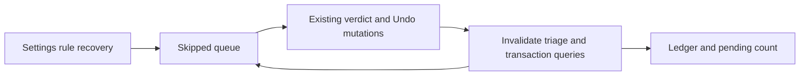

# Skipped Transactions Tab - Plan

## Goal Capsule

- **Objective** — Keep the transaction history easy to scan while giving users a clear place to review skipped emails that might represent missing purchases.
- **Means** — A dedicated **Skipped** tab on the Transactions page.
- **Product authority** — This follow-up supersedes the inline placement and Show skipped toggle in R7–R8 of the [sender triage plan](2026-11-24-2351-feat-sender-triage-policy-ghost-rows-plan.md).
- **Open blockers** — None.

## Product Contract

### Summary

The Transactions page opens on the ledger. The **Skipped** tab gives ghost rows their own review queue with the existing verdict actions.

### Key Decisions

- **Separate the ghost queue from the ledger** (session-settled: user-directed). The user revised the original decision to show ghost rows inline. Governs R1.
- **Default the queue to all dates.** This is a working assumption so a ledger date filter cannot hide older items awaiting triage. Governs R2.

### Requirements

**Navigation and queue**

- R1. Show ghost rows only in the **Skipped** tab on the Transactions page. Remove the Show skipped toggle.
- R2. Open **Skipped** with all dates selected by default. Give the queue its own pagination so every eligible row is reachable even when the ledger has no rows in the selected period.
- R3. Keep the ledger's filters and page when the user visits **Skipped** and returns. Show the number of items awaiting triage on the tab and show an empty state after the queue is cleared.

**Triage and ledger**

- R4. List the same eligible amount-bearing skipped emails and retain **Promote**, **Always ignore**, matching-email updates, and **Undo**.
- R5. Keep ghost rows outside transaction counts, balances, spending totals, and bulk selection. Promoted items appear in the ledger as needing review.

### Acceptance Examples

- AE1. With the ledger filtered to this month and a ghost row from last month, opening **Skipped** shows the older row. Returning to the ledger restores its previous filter and page. Covers R1–R3.
- AE2. Promoting a ghost row updates the queue and adds a transaction that needs review. Undo restores the ghost row and removes the promoted transaction. Covers R3–R5.

### Scope Boundaries

- The change covers the Transactions page. Email classification, sender rules, and recovery of already ignored emails in Settings retain their existing behavior.

## Planning Contract

**Product Contract unchanged.** The implementation fits in one change based on `main`, which already contains sender triage. The separate remark-review fixes are independent.

### Key Technical Decisions

- KTD1. **Give the queue its own read endpoint.** Add `GET /api/triage/skipped?page=&pageSize=` with `items`, `totalCount`, `page`, and `pageSize`. Reuse the current ghost eligibility predicate and row mapping, including account previews and currency labels. Read the count and page in one SQLite snapshot before resolving account previews. Keep the payload limited to existing ghost row fields. Order by effective timestamp, Gmail internal timestamp, and email ID descending so ties are stable. Keep the existing transactions API response compatible and have the ledger UI request `showSkipped=false`. Covers R1, R2, R4, R5.
- KTD2. **Separate the navigation state.** Use the existing URL-backed tab convention with `tab=skipped` and a separate `skippedPage` key. The first release shows all dates in Skipped. Ledger query parameters belong to the ledger, including `page`. Clamp that page only when the ledger is visible and a successful response shows it exceeds the last page. Use the ledger response's global `totalGhostCount` on the ledger and the Skipped response's `totalCount` on Skipped. Leave the count unknown until query data arrives. Covers R1–R3.
- KTD3. **Keep verdict and Undo state above the tabs.** Use the existing mutation handlers and cache invalidation. Key the new read query under `triage` so sync, Settings policy recovery, verdicts, and Undo refresh it. Send verdicts without ledger date bounds because the queue covers all dates. Route the Settings restored-email link to `/transactions?tab=skipped`. Covers R3–R5.

### High-Level Technical Design

| Active tab | Read | State it uses |
| --- | --- | --- |
| Transactions, the default | Existing transaction list with ghost rows suppressed | Existing ledger date, filters, and page |
| Skipped | Dedicated paginated ghost queue | All dates and the Skipped page number |

## Implementation Units

### U1. Add the paginated Skipped read API

- **Goal** — Make eligible skipped rows independently reachable. Covers R2, R4, R5.
- **Dependencies** — None.
- **Files** — `internal/domain/triage.go`, `internal/domain/triage_test.go`, `internal/domain/transactions.go`, new `app/api/triage/skipped/route.go`, `cmd/gen-ts-types/main.go`, `lib/api/types.generated.ts`, `lib/api/triage.ts`.
- **Approach** — Share the existing eligible query and row mapping with the legacy overlay path. Run lazy triage backfill on direct queue entry and use locale readiness behavior from the transaction list. Use the existing 25 default and 100 maximum page sizes. Use the count to return an empty page for out-of-range requests before computing the SQL offset. Skip previous ledger-page boundary lookup when overlay rows are disabled.
- **Test scenarios** — Traverse a queue larger than two pages with timestamp ties and zero ledger rows. Every eligible email appears once across unchanged pages. Check received-time fallback, invalid or missing currency, zero-amount alerts, billing statements, dismissed or judged emails, empty and out-of-range pages, and the ledger response with `showSkipped=false`.
- **Verification** — Run domain tests and regenerate and check the API types.

### U2. Move ghost rows into the Skipped tab

- **Goal** — Give each view its own list and page state while keeping triage actions usable across tab switches. Covers R1–R5 and AE1–AE2.
- **Dependencies** — U1.
- **Files** — `components/transactions-view.tsx`, `components/transaction-list.tsx`, new `components/skipped-transactions-list.tsx`, `components/settings/triage-rules-tab.tsx`.
- **Approach** — Follow the existing Settings tab pattern with an accessible label. Move ghost row rendering, verdict controls, and queue pagination into the Skipped list. Remove the inline chronological merge, truncation warning, Show skipped toggle, and ghost-only ledger banner controls. Keep the existing ghost row context and semantic theme roles. Report loading and fetch errors separately from an empty queue. After a successful refetch, clamp Skipped to the last valid page if a verdict or sibling ripple empties the current page. Preserve the Undo toast across tab switches and update the Settings recovery link and label.
- **Test scenarios** — Switch from a filtered ledger on page two to Skipped and back. Deep-link to Skipped from Settings. Promote and ignore matching rows, confirm badge and ledger changes, then Undo from either tab. Remove the last row on a later page and check the clamp. Check the initial count, zero state, error state, and keyboard tab navigation.
- **Verification** — Run frontend checks and exercise the scenarios above against a seeded local ledger.

## Verification Contract

- Run `go test ./internal/... ./cmd/...` and `go test ./app/api/triage/skipped`. This repo's [goRoutes tooling note](../solutions/workflow-issues/nextjs-goroutes-bracket-dirs-break-go-test-and-vet.md) explains the scoped Go commands.
- Run `bun run generate:types`, `bun run check:types`, `bun test`, `bun run typecheck`, lint on changed frontend files, and `bun run build`.
- Use a disposable database for browser checks that change verdicts. Verify the all-dates queue, the ledger's restored state, both verdicts, Undo, the Settings deep link, and ledger and balance invariants.

## Definition of Done

- The first view is a transaction-only ledger, and every eligible skipped email is reachable from the Skipped queue.
- Verdicts, Undo, badge counts, and page clamping work from the queue. Promoted items enter the ledger as needing review.
- Inline overlay controls are removed from the Transactions UI. The existing API response remains compatible and the verification contract passes.
