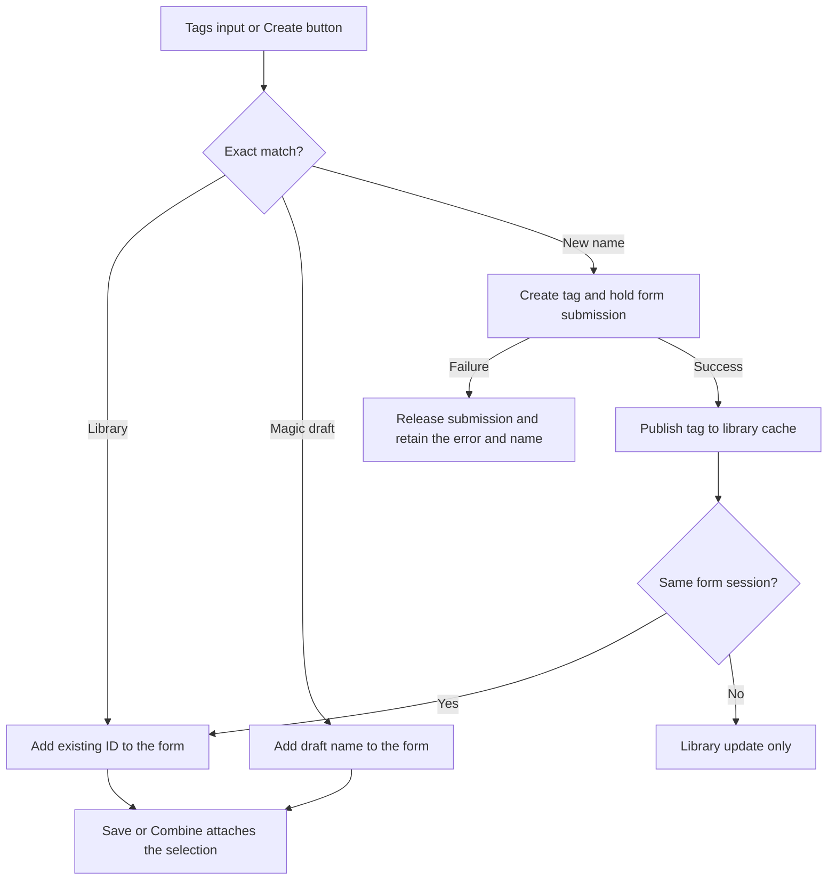

# Form Drawers and Keyboard Tag Entry - Plan

## Goal Capsule

- **Objective** — Give users a consistent way to create entries, enter as many account identifiers as they need, and assign transaction tags from the keyboard.
- **Means** — Use the Transaction details drawer pattern for creation forms, with a dedicated Identifiers tab in Add account and Enter to select or create tags.
- **Product authority** — The requirements and acceptance examples below.
- **Open blockers** — None.
- **Execution profile** — Four implementation units for one pull request. The implementer verifies the affected flows before handing off the change.

---

## Product Contract

### Summary

Use the Transaction details drawer pattern for Add manual transaction, Add account, New category, and New tag. Give Add account a separate Identifiers tab with editable rows. Let users enter transaction tags one after another with Enter.

### Problem Frame

The four creation forms open in centered dialogs, while Transaction details uses a side drawer. As an account's identifier list grows, the inline row competes for width and the submit action moves down the form. Transaction tag entry also requires a separate click to create each typed name.

### Key Decisions

- **Editable identifier rows** (session-settled: user-directed — chosen over a compact list with a single editor because entries are faster to add and correct in place). Governs R6, R7.
- **Separate account details from identifiers with tabs.** The account fields stay together and the optional list has room to grow. Governs R5, R8, R15.
- **Keep the current save behavior for typed tags.** A user can reuse a newly created tag elsewhere as soon as its creation succeeds. Governs R12.

### Requirements

**Creation drawers**

- R1. Open Add manual transaction, Add account, New category, and New tag in the right-side, full-height drawer pattern used by Transaction details.
- R2. Give each drawer a title and close control, a scrollable form body, and a footer that keeps its primary create action reachable while the form scrolls.
- R3. Use the Transaction details field layout for Add manual transaction, with an editable amount field.
- R4. Preserve the current fields, defaults, validation, and save and cancel behavior of each creation form.

**Account identifiers**

- R5. Open Add account on the **Details** tab with the main account fields. The optional **Identifiers** tab starts with no rows, and switching tabs retains both drafts.
- R6. Let **Add identifier** append an editable row for a type and value, with a remove action on each row.
- R7. Keep the current identifier types and validation, and stack row controls on narrow screens so each row fits the drawer.
- R8. Scroll the Identifiers tab content with the drawer body as the list grows. Keep **Create account** and **Cancel** available from either tab.
- R15. **Create account** saves one account with both tabs' values. If a field fails validation, reveal its tab and focus the field so the user can correct it.

**Transaction tag entry**

- R9. Use the same tag entry behavior in Add manual transaction, Transaction details, and Combine. One click or keyboard activation of **Tags** focuses the search-or-create input.
- R10. When the input contains a name, pressing Enter selects a case-insensitive exact match or creates and selects the trimmed name if it is new.
- R11. After successful selection, clear the input and keep it focused for the next tag. Enter in this field never submits the surrounding form. Blank Enter leaves the selection as it was, and re-entering a selected name leaves it selected once.
- R12. Register a newly typed tag in the tag library on successful creation and persist its attachment when the user saves or combines the transaction.
- R13. If creation fails, show the error with the typed name still available for retry.
- R14. Allow users to choose existing suggestions and create a typed tag with the pointer.

### Key Flows

- F1. **Create an account with identifiers.** Open Add account, fill in **Details**, switch to **Identifiers**, add and fill one row per identifier, and choose **Create account** from either tab. Covers R1, R2, R4–R8, R15.
- F2. **Assign several tags.** Activate **Tags**, type a name and press Enter, repeat while the input has focus, then save or combine the transaction. Covers R9–R14.

### Acceptance Examples

- AE1. Open each of the four creation entry points. The form appears in the right-side drawer. Add manual transaction can save a valid entry with an amount, and canceling a creation returns to the originating page. Covers R1–R4.
- AE2. Create an account from **Details** with zero identifiers. At narrow width, add several identifiers to another account, remove a middle row, and switch to **Details** and back. The remaining rows are retained and saved from **Identifiers**, and the footer remains reachable while the list scrolls. Covers R5–R8, R15.
- AE3. With an existing **Groceries** tag, enter ` groceries ` twice, then enter `Weekly shop`. The selected list shows **Groceries** once and the new **Weekly shop** tag. The field is ready for another name, and the transaction still needs to be saved. Covers R9–R12.
- AE4. Create a new tag in the transaction form and cancel the transaction. The tag is available in the tag library, and the canceled transaction has no new tag attachment. Covers R12.
- AE5. If creating a typed tag fails, the user sees the error, can retry the same name, and can still use the picker to select an existing tag. Covers R13, R14.
- AE6. With an invalid card last-four value, submit from **Details**. The drawer opens **Identifiers** and focuses the invalid row. With a missing account name, submit from **Identifiers**. The drawer opens **Details** and focuses the name field. Each attempt preserves both tabs' values and sends no create request. Covers R4, R7, R15.

### Scope Boundaries

- R1 defines the drawer changes. Combine participates in the shared tag entry behavior in R9.
- Magic-suggested tags continue to become library tags on a successful transaction save or Combine, as defined by the [Magic enrichment plan](2026-11-23-2222-feat-magic-llm-transaction-enrichment-plan.md).

### Sources

- Existing drawer reference. [Transaction details](../../components/transaction-inspector-drawer.tsx#L932) and [drawer layout](../../components/detail-drawer-content.tsx#L24).
- Current identifier fields and shared tag behavior. [Account identifiers](../../components/account-form-dialog.tsx#L367), [Tags picker](../../components/tag-multi-select.tsx#L118), and [Categories and Tags plan](2026-11-23-2156-feat-categories-tags-crud-and-url-filters-plan.md).

---

## Planning Contract

**Product Contract revision.** Add account uses separate **Details** and **Identifiers** tabs per the requested change to R5 and R8. R15 specifies the shared submit and validation behavior.

### Key Technical Decisions

- KTD1. **Add a footer slot to the existing drawer content.** Place it alongside the scrolling body and connect its native submit button to the body form with a unique form ID. This keeps field validation and the existing submit handler intact. Use the drawer primitive for focus and dismissal. Covers R1–R4, R8.
- KTD2. **Choose the overlay when the form opens.** Use the drawer for create mode and the existing dialogs for edit and rename modes. Keep the mode stable through dismissal and share the current field rendering and mutation handlers. The manual transaction form uses the inspector's layout and common controls with its own create state and payload. Covers R1, R3–R7.
- KTD3. **Resolve tag names in the shared picker.** Normalize the input once. Prefer the exact library match, then an exact Magic draft available in the picker, then a new typed name. Enter adds a match idempotently. Pointer suggestions keep their toggle behavior. If a library tag takes the place of a matching selected draft, remove that draft so deleting the stored tag chip cannot leave a hidden attachment. Covers R9–R11, R14.
- KTD4. **Separate library updates from form updates.** The existing create request publishes a successful tag to the shared query cache. Apply the returned ID with a functional update to the latest selection in the initiating form session. Keep that session's submit actions pending until creation settles because the payload needs the returned ID. Cancel stays available. Covers R11–R13.
- KTD5. **Keep one account form across both tabs.** Use controlled project Tabs around the two field groups and retain the existing account state and submit handler. Keep both panels mounted so native constraints still participate from either tab. On native invalid events from an inactive panel, activate that panel before focusing the invalid control and reporting validation. Route identifier validation errors through the same tab and focus behavior. Covers R4–R8, R15.

### High-Level Technical Design

The picker and its host share the pending state for one tag creation. A form session ends when the host closes or changes the transaction or Combine target. Dismissing only the popover keeps the form session alive.

---

## Implementation Units

### U1. Reuse the drawer shell for manual transaction creation

- **Goal** — Give Add manual transaction the Transaction details drawer layout and a reachable create action.
- **Requirements** — R1–R4, AE1. Follow KTD1 and KTD2.
- **Dependencies** — Independent of the other units.
- **Files** — `components/detail-drawer-content.tsx`, `components/add-transaction-dialog.tsx`, `components/transactions-view.tsx`. Existing persistence coverage in `internal/domain/transactions_test.go`. Verify the DOM behavior with the browser scenarios below.
- **Approach** — Add an optional, non-scrolling footer using the existing drawer footer primitive. Use a native form-linked submit button with validation. Forward popup focus options only as needed to focus the form and restore the actual opener. Move manual creation onto that shell and align the grid with the inspector, including the full-width Tags field. Preserve the editable amount, date-only input, current defaults and payload, and the existing lazy-loading and preload hooks.
- **Patterns to follow** — `components/transaction-inspector-drawer.tsx` for fields, layout, and form-associated submission. `components/ui/drawer.tsx` for dismissal and focus.
- **Test scenarios**
  - Covers AE1. Open Add manual transaction from Transactions. Save a valid amount, merchant, and date with the footer button, then confirm the transaction appears in the ledger.
  - Clear a required field and activate the footer submit. The form shows validation and sends no create request. Cancel or Escape restores focus to the opener, and reopening restores the creation defaults.
  - Open a date, account, category, or Tags picker over the drawer. Interact with the picker and dismiss it from the keyboard without closing the drawer.
- **Verification** — The drawer uses the existing right-side layout. On a narrow viewport, its footer remains reachable as fields scroll. Transaction details and the account detail drawers still render without a footer slot.

### U2. Move account creation and give identifiers their own tab

- **Goal** — Give account details and variable-length identifier editing their own tabs in the creation drawer.
- **Requirements** — R1, R2, R4–R8, R15, F1, AE2, AE6. Follow KTD1, KTD2, and KTD5.
- **Dependencies** — U1.
- **Files** — `components/account-form-dialog.tsx`, `components/accounts-view.tsx`. Existing account validation coverage in `internal/domain/accounts_test.go`. Verify row layout, focus, and edit behavior with the browser scenarios below.
- **Approach**
  1. Reuse the account Details and Identifiers field groups in the tabbed create drawer and the existing single-page edit dialog. Retain the opening mode through dismissal.
  2. Keep one form ID and submit handler for the drawer. Reset the active tab to **Details** at the start of each create session. Keep form-level API errors visible from either tab.
  3. Retain stable row keys, kind defaults, and option labels. Stack row controls at narrow widths. For a row validation failure, use its stable key to locate and focus the value control after revealing **Identifiers**.
- **Patterns to follow** — `components/ui/tabs.tsx` and the tabs in `components/transaction-inspector-drawer.tsx`. Use `components/account-form-dialog.tsx` for existing validation and draft state, and `docs/solutions/ui-bugs/base-ui-select-items-label-resolution.md` for the Select `items` prop.
- **Test scenarios**
  - Covers F1 and AE2. Save an account from **Details** without visiting **Identifiers**. At narrow width, add several rows to another account, remove a middle row, switch tabs by keyboard, and submit from **Identifiers**. Both tabs retain values and the footer remains reachable as the list grows.
  - Covers AE6. Submit a missing required Details field from **Identifiers** and an invalid identifier from **Details**. Verify the correct tab opens, the visible field receives focus, and no request is sent until corrected.
  - Cancel from **Identifiers**, then reopen the drawer. **Details** is the active tab and the draft starts fresh.
  - Edit an account with existing identifiers, including the legacy last-four fallback where applicable. Verify the existing edit dialog retains its prefill and type-lock behavior, then close it and open a clean Add account drawer.
- **Verification** — Either tab submits the same account payload containing the expected surviving identifiers. A long identifier list scrolls in the drawer body above the shared footer.

### U3. Move category and tag creation

- **Goal** — Apply the drawer layout to category and tag creation while preserving the existing validation, icon picker, and refresh paths.
- **Requirements** — R1, R2, R4, AE1. Follow KTD1 and KTD2.
- **Dependencies** — U1.
- **Files** — `components/categories-tags-view.tsx`. Existing category and tag persistence coverage in `internal/domain/categories_tags_test.go`. Verify modal integration with the browser scenarios below.
- **Approach** — Wrap the existing category and tag fields and submit handlers in the appropriate overlay for the opening action. Keep search and selection in the existing category icon picker. Keep focus return tied to the opening control, including both header and empty-state New tag actions. Keep edit, rename, and delete on their current overlay paths.
- **Patterns to follow** — Existing create and edit open handlers in `components/categories-tags-view.tsx`. Use the shell pattern from U1.
- **Test scenarios**
  - Covers AE1. Create a category with a chosen icon and a tag with a unique name. Each drawer closes after success and its list shows the new item.
  - Submit a duplicate name. The error is visible in the drawer and the draft remains available for correction. Pressing Enter in the category icon search leaves the form open.
  - Open and cancel from both New tag launchers. Focus returns to the launcher used. Check that category editing, tag renaming, and the delete confirmations still use their existing dialogs.
- **Verification** — Both create paths work with keyboard navigation and the footer action. The list refresh and validation match the existing behavior.

### U4. Implement Enter in the shared Tags picker

- **Goal** — Assign tags from one focused field in all three transaction forms.
- **Requirements** — R9–R14, F2, AE3–AE5. Follow KTD3 and KTD4.
- **Dependencies** — Independent of U1–U3. Verify again against the new manual transaction drawer after U1.
- **Files** — `components/tag-multi-select.tsx`, `components/add-transaction-dialog.tsx`, `components/transaction-inspector-drawer.tsx`, `components/manual-merge-dialog.tsx`. Existing backend scenarios in `internal/domain/categories_tags_test.go` and `internal/domain/transactions_test.go`. The browser scenarios below verify key events and the pending-request behavior that the backend tests cannot exercise.
- **Approach**
  1. Use the popover's input focus target on open. Handle Enter inside the input and prevent form submission, including on blank input. Respect native IME composition and the Safari composing-key fallback so confirming a character does not dispatch a tag action.
  2. Share the named-tag action between Enter and pointer Create. Keep the draft and ID selections distinct and use the host's existing edit path to mark Details tags dirty.
  3. Allow one create request at a time per form. Leave focus where the user put it and clear the submitted text only when the same input session is still active. Use a functional selection update on success so intervening chip changes are preserved.
  4. Update the library cache even if the initiating form has closed. Apply the selection and release pending state only for the initiating form session. Guard every transaction submit path during creation, including Details' Note tab. Restore Save on failure and preserve the failed name and error for retry, including when the user reopens the popover within the same form. Refresh the tag list after a failed create so a retry can match a tag created elsewhere.
- **Patterns to follow** — `components/ui/popover.tsx` for initial focus, the current `createTagApi` and tags cache updates, and the existing Magic draft and transaction save paths in the callers.
- **Test scenarios**
  - Covers F2 and AE3. In each host, open Tags by pointer and by keyboard. Enter ` groceries ` twice, then `Weekly shop`. Verify one of each chip, input focus, one tag POST, and no transaction request until explicit save.
  - Press Enter on blank input and while confirming an IME candidate. Verify no tag or transaction request. Select a known Magic draft and verify it persists only when Details or Combine succeeds.
  - Delay a creation response, change another selected chip, and attempt to save from a submit button and by keyboard. After the response, the latest selection includes the new ID once and can be saved. Include the Details Note tab.
  - Covers AE4. Close the transaction form during a delayed create, then reopen it or switch targets. The completed tag appears in the library while the new draft receives no selection or error from the old request.
  - Covers AE5. Fail a create after dismissing only the popover. Reopen it and verify the name and error remain, then retry. Click a suggestion and use the pointer Create action to check both pointer paths.
- **Verification** — Requests and visible chips confirm that library creation and transaction attachment occur at the correct moments in Add manual transaction, Details, and Combine.

---

## Verification Contract

- Run `bun run typecheck` and `bun run lint` for the frontend changes. Run `bun test` for the existing TypeScript suite and `go test ./internal/domain` for the existing account, category, tag, and transaction persistence cases.
- Perform the U1–U4 browser scenarios against a disposable local dataset. Check desktop and a narrow viewport. Browser verification is the seam for native validation, modal and popover focus, drawer scroll and footer reachability, and delayed requests.
- Inspect the network requests for U4 to distinguish library creation from transaction submission. Use a controlled response delay for the save and cancellation scenarios.

## Definition of Done

- AE1–AE6 pass with the existing form defaults, validation, and persistence paths.
- Creation drawers and existing edit and detail flows pass the affected browser checks, including the Tags picker in all three transaction hosts.
- The listed checks pass, and temporary instrumentation or abandoned approaches are removed.
