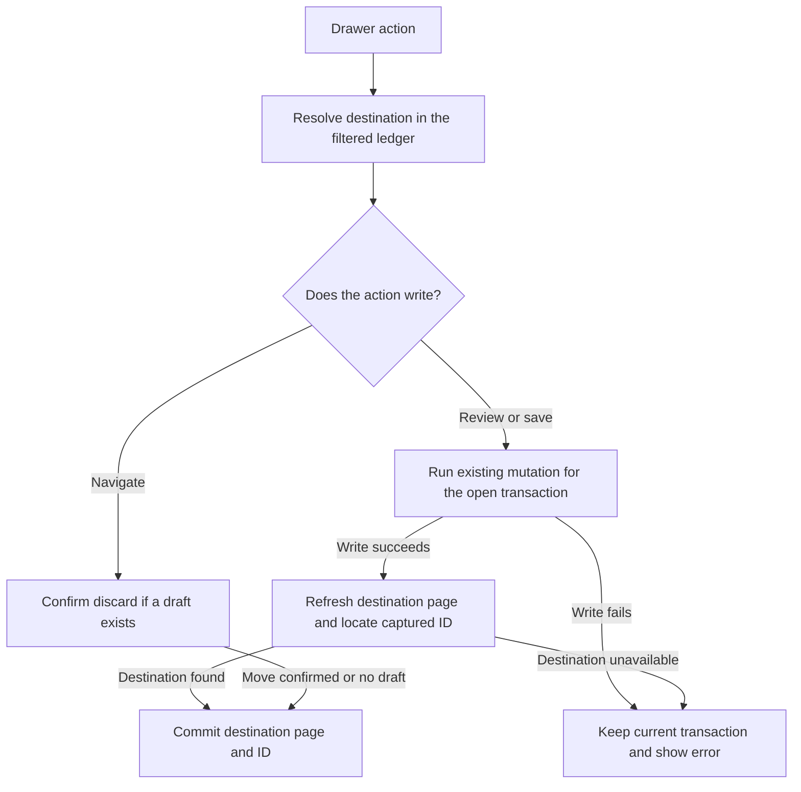

# Sequential Transaction Review - Plan

## Goal Capsule

- **Objective** — Review one transaction at a time and move to the next in one action.
- **Means** — Navigate within Transaction details and reuse the existing review and save actions (KTD1–KTD3).
- **Authority** — User direction governs the Product Contract. The Planning Contract governs implementation within that scope.
- **Stop conditions** — The Definition of Done is met, or a conflict with the Product Contract needs a product decision.
- **Execution profile** — Two implementation units for one pull request. The implementer verifies the ledger and drawer flows before handing off the change.

## Product Contract

### Summary

Add **Previous** and **Next** to Transaction details. Give the reviewer one action that completes the current review and opens the next transaction, with a label that reflects whether there are edits to save.

### Problem Frame

Reviewers can inspect source emails and edit one transaction at a time. Moving to another currently requires closing the drawer, finding the row, and opening a new drawer. The interruption repeats for every transaction in a review session.

### Key Decisions

- **Complete the review and advance together** (session-settled: user-approved — chosen over navigation alone: reviewing an unchanged transaction and moving on can be one action). Governs R3.
- **Save the draft before advancing** (session-settled: user-approved — chosen over marking the edited transaction reviewed and leaving its draft behind: the combined action should keep the user's changes). Governs R4, R6.

### Requirements

**Move through the ledger**

- R1. **Previous** and **Next** move one row in the active Transactions list's order, using its filters and continuing across page boundaries with the drawer open. Each control stops when there is no neighbor in that direction.
- R2. If a write removes the open transaction from the filtered list or changes its sort position, use its position before the write to find its neighbors. Continue from the destination's current position after a move.

**Review and save**

- R3. For an unchanged transaction that needs review, **Mark reviewed & next** marks it reviewed and advances after success. At the end of the list, use **Mark reviewed** to finish in place.
- R4. When the transaction has a draft, **Save changes & next** saves the draft, marks it reviewed through the existing save behavior, and advances after success. At the end of the list, use **Save changes**.
- R5. **Previous** and **Next** move without changing review status. A reviewer can save edits and stay on the current transaction with **Save changes**.
- R6. If validation or the write fails, keep the current transaction and its draft open and show the error.

### Acceptance Examples

- AE1. Open the last row on page 1 and choose **Next**. The first row on page 2 opens within the same drawer. **Previous** returns to the starting row using the same filters. Covers R1, R5.
- AE2. Turn on **Needs review** with 26 matching transactions. Open row 25 and choose **Mark reviewed & next**. The original row 26 opens, now on page 1. Covers R1–R3.
- AE3. Edit a note and choose **Save changes & next**. On success the note is saved and the transaction is reviewed before its successor opens. On a rejected save, the same note is available to correct and retry. Covers R4, R6.

## Planning Contract

### Assumptions

- Keep the combined action and **Save changes** available from the editing tabs. **Previous** and **Next** remain accessible while reading source emails.
- When **Previous** or **Next** would leave a draft, ask the reviewer to keep editing or explicitly discard the draft and move. Existing drawer dismissal keeps its current behavior.

### Key Technical Decisions

- KTD1. **Let the Transactions view own the review position.** Reuse the list's query parameters, order, and page size for drawer navigation. Resolve within-page neighbors from the active page and read at most the neighboring page when resolving an edge. Keep the drawer mounted and key its body by transaction ID so the new transaction gets its own draft and tabs. Apply the destination page when the move commits. Governs R1, R5.
- KTD2. **Capture neighboring IDs before a write.** For review or save, retain the current position and the neighboring IDs needed to resume if the row leaves its position. At a page edge, resolve the neighbor by ID before the write using the same filtered query. After success, validate the destination against refreshed data around its expected page. A single write can move another row by at most one slot, so look on the adjacent page only if the target shifted across the boundary. If the selected row stays in place, resume ordinary navigation from the fresh page. If the candidate disappears or its read fails, keep the drawer open, distinguish the navigation failure from any successful write, and let **Next** retry navigation independently. Governs R1–R4, R6.
- KTD3. **Route save intent through the existing form and mutations.** Derive the action from the current form draft, review status, and forward availability. Cover the dirty fields already recorded by the form, including Note, tags from Magic, and currency conversion. Use the submitter to distinguish save-and-advance from save-in-place and preserve the native validation behavior of the originating tab. Run the existing success and cache updates before applying a deferred move. Scope pending navigation to the initiating transaction and filter context, so a late response cannot reopen a closed drawer or replace a different transaction. Governs R3–R6.

### High-Level Technical Design

When the forward boundary is known at the time of submission, the standalone action uses the normal mutation path and stays in the drawer. If a destination query fails before a combined write starts, keep the draft and allow the reviewer to retry the combined action or save in place. Late responses can update shared caches but can change the open transaction only while the originating drawer, selection, and filters are still active.

## Implementation Units

### U1. Add drawer navigation

**Goal** — Move to the adjacent filtered row from any drawer tab.

**Requirements** — R1, R2, R5.

**Dependencies** — None.

**Files** — `components/transactions-view.tsx`, `components/transaction-inspector-drawer.tsx`, `components/detail-drawer-content.tsx`, and a small `lib/transaction-review.ts` with `lib/transaction-review.test.ts` for page-boundary calculations.

**Approach**

1. Extract the list's shared parameter construction in `TransactionsView` and use it for the page query and on-demand neighbor reads. Keep the existing pagination and page-scoped row selection behavior when committing a move (KTD1).
2. Show the navigation controls in the inspector header using the existing drawer content and labeled buttons. Keep the controls in the mounted shell so they remain available across tabs and detail loading states.
3. Implement the destination lookup and pre-write position handoff for U2 (KTD2). Resolve a click against the active result set and ignore completions from an outdated drawer or filter context (KTD3).

**Patterns to follow** — `TransactionList` opens rows by ID. `TransactionInspectorDrawer` already remounts its body on an ID change. `transactionsQuery` provides the filter-aware query key and accepts an abort signal.

**Test scenarios**

- Covers AE1. Navigate forward and backward within a filtered page and across its boundary. Verify the open row and the underlying ledger page agree. The pure test covers page and row selection. Verify drawer focus and page updates through the UI.
- With a single matching row, both directions stop. At the first and last results, only the available direction can change the current transaction.
- Covers AE2. Test the pre-write position with a 25-row page and an intended successor at the start of the next page. After one row leaves the result, the captured ID resolves on the earlier page. Repeat backward with a row whose sort position changed.
- Fail a boundary read, then close or reopen while a delayed read is in flight. The error is actionable on the original transaction, and no late response changes the new selection.

**Verification** — Keyboard and pointer use leave focus within the drawer on movement, with the destination identifiable and its own form state loaded.

### U2. Save or mark reviewed before advancing

**Goal** — Complete a review and move forward in one action, with the correct behavior for a draft.

**Requirements** — R2–R6.

**Dependencies** — U1.

**Files** — `components/transaction-inspector-drawer.tsx`, `components/transactions-view.tsx`, `lib/transaction-review.ts`, and `lib/transaction-review.test.ts` for the action choice by draft, review state, and forward availability.

**Approach**

1. Use the current inspector form for both save intents. Make the existing edited-field tracking visible to the action controls and keep implicit form submission on the normal save path (KTD3).
2. Capture the navigation intent before starting either mutation and forward it to the view on success (KTD2). Keep the existing cache invalidations, tag cache patching, and undo clearing. Prevent repeat submissions or conflicting moves during the combined action.
3. Route dirty **Previous** and **Next** through the existing alert-dialog pattern. Tie confirmation and the reviewed or saved state to the initiating transaction ID.

**Patterns to follow** — `InspectorForm` uses one patch payload for Details and Note, and `UpdateTransaction` sets `reviewed = 1`. Follow the existing guard around Magic and pending tag creation.

**Test scenarios**

- Covers AE2. For a clean unreviewed transaction, choose **Mark reviewed & next**. Verify the review write runs once and the intended successor opens after success. Use the fallback **Mark reviewed** on the last row.
- Covers AE3. Save a dirty Details field and a changed Note through **Save changes & next**. Check each is persisted when the original transaction is reopened. Repeat with a Magic tag draft and check the intended tag attachment.
- Force invalid input and a rejected request. In each case the drawer stays on the transaction, preserves the draft, and displays the error. During a delayed successful save, a second activation does not submit another write.
- With a dirty transaction, choose **Next** and cancel the discard prompt. The draft survives. Confirming discard on a second attempt opens the destination without recording a review or saving the draft.
- Save in place under **Needs review** and then choose **Next**. Open the original successor even after the current row has left the list. If a successful combined write is followed by a destination failure, retrying **Next** sends no second write.

**Verification** — Unit checks cover action choices and position handling. Exercise the real drawer, forms, and mutation responses with a ledger containing more than one page of matches.

## Verification Contract

- Run `bun test lib/transaction-review.test.ts`, `bun run typecheck`, and lint the touched TypeScript files using `bun run lint`.
- Exercise AE1–AE3 through the Transactions page. Include Note and Sources tabs, the final item, a delayed write, a failed write, and a narrow viewport. Check that saving a date which reorders the current row still advances from its original position.
- Sources for the regression checks. [Ledger ordering](../../internal/domain/transactions.go), [transaction saves](../../internal/domain/transactions_mutations.go), [inspector form](../../components/transaction-inspector-drawer.tsx), and [Magic draft and pending-tag interaction](../solutions/ui-bugs/magic-enrichment-drops-pending-tag-selection.md).

## Definition of Done

- U1 and U2 meet their verification criteria. The reviewer can finish multiple consecutive reviews across a page boundary without closing the drawer.
- Filtered navigation selects the intended row when the current transaction disappears or moves. Failed writes preserve the current draft and the error is visible.
- Verification checks pass and any abandoned implementation code is removed.
