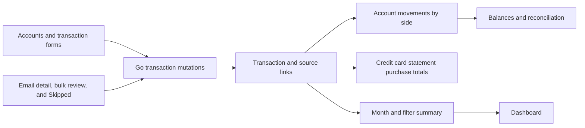
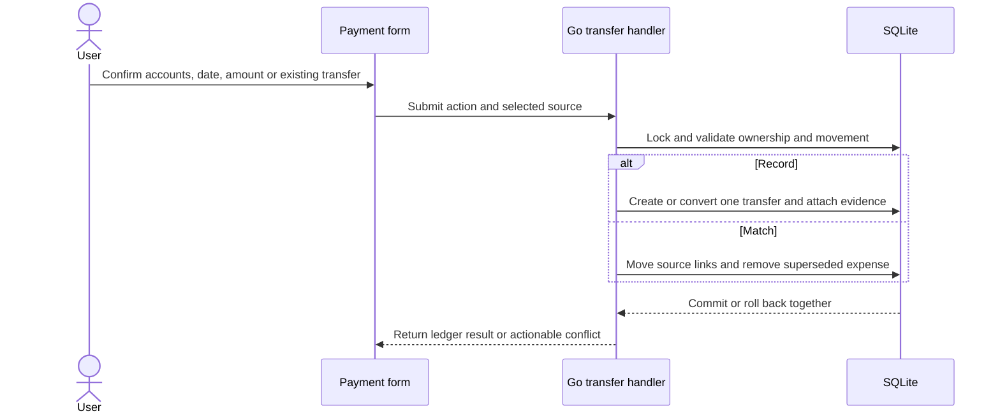
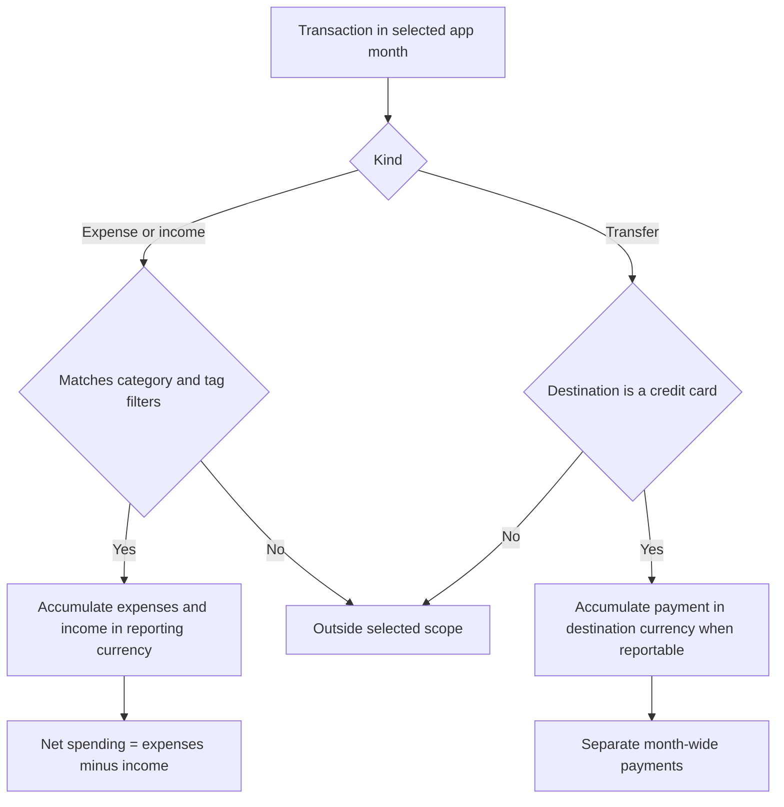

# Monthly Spending, Income, and Transfers - Plan

## Goal Capsule

- **Objective** — Know how much personal spending belongs to an app month, including your share of tagged or categorized expenses, while keeping account balances accurate.
- **Product authority** — The Product Contract below.
- **Open blockers** — None.
- **Means** — One typed ledger entry with two balance movements for a transfer (KTD1, KTD2).
- **Execution profile** — One implementation PR after the user authorizes implementation and shipping. The implementer owns verification and handoff.

---

## Product Contract

### Summary

Record income and account transfers alongside expenses. Show monthly expenses minus income with or without category and tag filters, and show card payments separately.

### Problem Frame

The expense-only dashboard overstates what the user spent when bank transfers or card payments are filed as purchases. Money the user receives also needs to be reflected in monthly net spending and account balances.

### Key Decisions

- **Calendar-month spending cycle** (session-settled: user-directed — chosen over salary-date or card-statement periods: the first through last day already matches the user's work cycle). Governs R1.
- **Record the card payment directly** (session-settled: user-directed — chosen over selecting a statement: recording the payment should be enough). Governs R11, R12.
- **Prioritize email payment confirmations** (session-settled: user-directed — chosen over an action to save statement notices: notices can be marked `non_transaction`). Governs R13, R14.
- **Use filters for shared expenses** (session-settled: user-directed — chosen over combining or linking income and expenses: the user will assign matching tags or categories). Governs R3, R4, R5.

### Requirements

**Monthly spending**

- R1. The dashboard uses the app's calendar month in the configured timezone and assigns each entry to the month of its transaction date.
- R2. The unfiltered headline shows total expenses minus total income, with both inputs visible and card payments shown separately.
- R3. The dashboard supports filtering the selected month by category, tag, or both. When both are set, an entry must match both.
- R4. With a category or tag filter active, show net spending as matching expenses minus matching income, with both inputs visible.
- R5. Count each qualifying entry once and exclude transfers and card payments from both unfiltered and filtered net spending.

**Income and transfers**

- R6. The user can manually record an income transaction with an amount, date, and receiving account, and classify it with a category and tags.
- R7. An income entry credits the receiving account, increasing available funds on a debit account or wallet and reducing the amount owed on a credit card.
- R8. From Accounts → Transfer, the user can record a dated transfer between two distinct accounts across supported account types.
- R9. A transfer applies the outgoing movement to the source and incoming movement to the destination as one operation, with the signs reflecting each account's balance or amount owed.
- R10. From bulk transaction review, the user can mark imported transfer entries and confirm the movement before recording it or matching it to an existing transfer.

**Card payments and reconciliation**

- R11. The user can record a card payment as a transfer to a credit card without selecting a statement.
- R12. The app automatically explains that a card payment may cover purchases from earlier periods. Any claim about a specific period or amount requires evidence beyond the payment and current-month spending totals.
- R13. The user can mark an email-backed entry as a card payment from transaction detail or from Skipped, then record or match the movement.
- R14. The user can mark statement notices as `non_transaction`, so the notice contributes no spending or balance movement.
- R15. Reclassifying or matching an imported transfer or card payment retains its source and replaces any original expense effect. An existing movement counts once.
- R16. Reconciliation records the actual bank balance or amount owed as of the selected time. A movement at or before that reconciliation is already covered by the reported balance.

### Key Flows

- F1. **Inspect shared spending.** Categorize or tag the expense and incoming repayments, open the relevant dashboard month, and apply the matching filter. Covers R1–R7.
- F2. **Move money.** Open Transfer from Accounts, choose the source and destination, enter the amount and date, and save. If an email later appears in bulk review, match it to the existing movement. Covers R8–R10, R15.
- F3. **Record a card payment.** Transfer to the card from Accounts, or open the email-backed entry and mark it as a card payment. Confirm the funding account, card, amount, and date, then record or match the movement. Reconcile against the actual bank balance when needed. Covers R11–R16.

### Acceptance Examples

- AE1. **Split dinner across accounts.** A Rp1,000,000 expense on one account and Rp750,000 of income on another both carry `#dinner` in November. Filtering November by `#dinner` shows Rp250,000 net spending. With no other transactions that month, clearing the filter still shows Rp250,000 net spending. Covers R1–R7.
- AE2. **Repayment in a later month.** A November dinner and a December repayment with the same tag each appear in their own app month. Filtering December can show negative net spending when matching income exceeds expenses. Covers R1, R3–R5.
- AE3. **Wallet top-up.** Moving Rp500,000 from debit to a wallet reduces debit by Rp500,000 and increases the wallet by Rp500,000. If an imported top-up was counted as an expense, matching it to the transfer removes that expense effect without moving the balance a second time. Covers R2, R8–R10, R15.
- AE4. **Pay a card with spending this month.** With Rp4,000,000 in current-month purchases, no income, and a Rp9,000,000 card payment, the dashboard shows Rp4,000,000 spent and Rp9,000,000 paid separately. The transfer decreases the funding balance and the card's amount owed by Rp9,000,000. The explanation leaves the earlier-period amount unspecified. Covers R2, R9, R11–R13.
- AE5. **Reconcile and then log a historical payment.** The user reconciles the card to Rp4,000,000 owed after a Rp9,000,000 payment, then adds the payment with its earlier transaction date. The payment is visible in history and the reconciled amount owed stays Rp4,000,000, before any later activity. Covers R11, R16.

### Scope Boundaries

- Dedicated reimbursement linking, cross-month reimbursement attribution, and combining income with expenses are deferred.
- Statement records, automatic statement matching, and exact payment allocation to specific statements are deferred.

### Dependencies and Assumptions

- Filtered spending follows each entry's transaction month. The user maintains the tags or categories that identify shared spending.
- Dashboard amounts use the configured reporting currency. Automatic currency conversion for reporting is outside this scope.

### Sources

- [Calendar-month dashboard summary](../../internal/domain/transactions.go#L106)
- [Account reconciliation and balance calculation](../../internal/domain/accounts_balance.go#L57)
- [Gmail extraction classifications](../../internal/llm/prompt.go#L84)
- [Existing credit card billing-cycle plan](2026-11-22-2244-feat-credit-card-billing-cycle-reconciliation-plan.md)

---

## Planning Contract

### Key Technical Decisions

- KTD1. **Store one row per transaction or transfer.** Add an expense/income/transfer discriminator independent of source type. Existing rows default to expense. Keep positive integer amounts and the existing primary account fields. A transfer uses those fields for its source and adds a destination account, destination amount, and destination currency. Use the transaction date for both sides by default and capture distinct posting timestamps when the accounts posted at different times. Same-currency sides must have equal amounts. For different currencies, the user supplies each amount in its account's currency. Use the system Other category by default for transfers to preserve the existing required category. Governs R6–R11, R15.
- KTD2. **Project balance movements consistently.** Both account summary paths consume the same movement rules. On a debit account or wallet, an outgoing amount decreases the balance and an incoming amount increases it. On a card, outgoing increases debt and incoming decreases it. Use each side's own account, currency, posting timestamp, and reconciliation anchor. Keep the statement-cycle spend calculation expense-only. Governs R7, R9, R11, R16.
- KTD3. **Commit email reclassification in one write transaction.** Resolve the current source owner and the chosen transfer under the write lock. For a new movement, convert the selected expense in place when it represents the payment alone, or create a transfer from the skipped email. For a match, preserve the chosen transfer's date, accounts, and amounts, move the source links, and remove the superseded expense. Use the existing one-owner email constraint and stable raw email IDs for every request, including ledger and bulk actions. On retry, resolve the current source owners before reading a superseded transaction ID and return the committed result when the requested state already exists. Require review when the same email already belongs to a different movement. Governs R10, R13–R15.
- KTD4. **Apply report filters before computing net spend.** Use the same server-side month, category, and tag vocabulary as the transaction list. Filter by the category's existing identifier convention and use a tag membership subquery so a tagged row appears once. Return gross expenses, income, net spending, and a separately labeled month-wide card payment total. Keep `totalSpentMinor` as the gross compatibility field and migrate the headline to `netSpentMinor`. Label category, merchant, and account breakdowns as expense breakdowns because they describe gross expenses. Governs R1–R5, R12.
- KTD5. **Keep payment recovery separate from sender policies.** An explicit payment action classifies only the chosen entry or email. Keep statement detection ahead of any payment action. Preserve normal Skipped and ledger ghost admission. Give Skipped a secondary listing for terminal non-transaction emails without drafts so the user can locate a confirmation and supply missing details manually. Omit known statements, ignored emails, and emails already attached to a transaction. Return only candidate metadata in that list. Recheck eligibility for both on-demand plain-text preview and the confirmation write. Pending or failed extraction rows stay in the sync workflow. Governs R10, R13–R15.

### High-Level Technical Design

### Implementation Constraints

- Use the embedded SQLite migration runner and its per-file startup lock. Keep existing row IDs, sources, tags, account assignments, and reconciliation history intact during upgrade. Runtime protection must cover both transfer accounts, including deletion of the source account whose existing foreign key uses `ON DELETE SET NULL`.
- Protect existing imports from reinterpretation. Sync continues to create expenses by default. A user-confirmed kind is fixed against source recomputation and auto-matching. Ordinary income is entered explicitly. Statement notices record neither expenses nor payment movements.
- Keep the new and expanded evidence routes on the app's supported loopback hosts. Check browser mutation Origin against the request's supported local origin and require JSON media type on JSON writes. Use the existing plain-text evidence pattern.
- Use existing form, date, category, and tag patterns. Keep raw email evidence and user-entered values separate. A referenced amount, date, or account from the email is a draft hint and remains editable before recording.
- Keep current account initial-balance inclusivity and strict reconciliation cutoff. A transfer dated the same instant as one account's reconciliation can still affect the other account if its anchor is earlier.

### Risks and Dependencies

- **Balance disagreement.** Account list and single-account operations currently calculate separately. Prove parity against the same fixture, including future transactions and different account anchors.
- **Backward database compatibility.** A build that only embeds schema version 7 cannot open a version 8 database. Take a consistent SQLite backup before opening the database with the new build. Use that verified backup for rollback and retain the upgraded database for recovery.
- **Accidental duplicate payment.** Two bank emails can describe one movement. Offer matching by explicit selection and never auto-match on amount alone. Apply stale-selection checks and use an idempotent creation key for retried Accounts submissions.
- **Editing combined history.** A transaction can contain multiple sources. For conversion or suppression, require that the selected entry represents just the selected movement. If evidence is mixed, use the existing expense source split where it can isolate the movement safely before conversion. A previously combined or overridden amount is eligible for split and conversion only when the remainder can be verified and preserved. Source count alone does not establish that, since Combine can fold in a manual entry.

### Repository Evidence

- `internal/domain/accounts_balance.go` computes list and single-account summaries separately. `internal/domain/accounts_matching.go` currently reassigns only the primary account during merge.
- `internal/domain/transactions_mutations.go` and `internal/domain/extraction.go` own existing source transfer, deletion, Combine, split, and extraction recomputation behavior. `internal/domain/triage.go` gates Skipped on draft-bearing ghosts.
- [SQLite migration learning](../solutions/database-issues/sqlite-table-rebuild-begin-immediate-goroutes.md) documents why startup migrations must serialize. Follow the current versioned implementation in `internal/db/db.go` and `internal/db/migrate_driver.go`.
- [Billing statement learning](../solutions/logic-errors/billing-statement-future-date-reconciliation-inflation.md) documents the statement prefilter and balance cutoffs.
- [Discard prompt learning](../solutions/ui-bugs/transaction-discard-prompt-reopens-after-navigation.md) establishes the inspector's draft and navigation behavior.

---

## Implementation Units

### U1. Persist transaction kinds and transfer details

- **Goal** — Upgrade existing databases and round-trip all three entry kinds through ledger reads.
- **Requirements** — R6–R9, R11, R15.
- **Dependencies** — None.
- **Files** — Create `internal/db/migrations/000008_transaction_kinds.up.sql`. Modify `internal/db/models.go`, `internal/domain/transactions.go`, `app/api/transactions/route.go`, `cmd/gen-ts-types/main.go`, and `lib/api/types.generated.ts`. Test in `internal/db/db_test.go` and `internal/domain/transactions_test.go`.
- **Approach** — Use additive fields and constraints per KTD1. Add a destination account index and guard endpoint completeness and distinctness. Extend ledger list and detail with kind, optional destination fields, and each side's optional posting timestamp. An account filter finds a transfer from either side and returns just one row. An optional kind filter supports the transfer picker. Keep legacy GET and POST expense fields valid. Generate TypeScript from the Go contracts after each unit changes them.
- **Test scenarios**
  - Upgrade a real baseline fixture with sourced and tagged expenses. Reopen concurrently and verify IDs, links, expense defaults, and foreign keys.
  - Reject a transfer with identical accounts, a missing side, or an invalid amount. Read back both account sides and find the row under either account filter.
- **Verification** — Migration and domain tests cover persistence and historical rows. The generated-type check catches Go-to-TypeScript drift.

### U2. Apply income and both transfer sides to balances

- **Goal** — Keep Accounts, card cycles, and reconciliation in agreement.
- **Requirements** — R7, R9, R11, R16.
- **Dependencies** — U1.
- **Files** — `internal/domain/accounts_balance.go`, `internal/domain/accounts.go`, `internal/domain/accounts_matching.go`, `internal/domain/triage.go`, and `internal/domain/accounts_test.go`.
- **Approach** — Use a shared account movement projection for single-account and batch reads per KTD2. Project two sides only for a transfer and retain an expense-kind flag for account billing totals. Keep the batched read free of per-account queries. Treat either side as ledger history for account type and currency changes and provisional cleanup. Prevent deleting an account that would orphan a transfer or an income entry that requires a receiving account. Merge compatible accounts by reassigning either side atomically. Reject a merge that would collapse both sides of the same transfer and explain which transfer must be resolved first.
- **Test scenarios**
  - Covers AE3 and AE4. The wallet and card cases produce the correct signs. Income posted to an asset account raises its balance. A credit-card-source transfer raises amount owed.
  - Covers AE5. Single-account and list reads agree when both accounts have different anchors, including equality at the reconciliation boundary and a future-dated transfer.
  - The funding side posts at 09:00, both accounts reconcile at noon, and the card side posts at 15:00. The later credit applies only to the card.
  - A cross-currency transfer projects the source amount in the source currency and the destination amount in the destination currency.
  - Account deletion and collapsing merges fail without changing either side. A compatible merge moves destination-side history too.
- **Verification** — Compare both balance paths using the same fixtures. Preserve current statement spend and foreign-currency diagnostics for legacy purchases.

### U3. Add atomic manual income and transfer mutations

- **Goal** — Save a valid income or transfer through the normal app routes and preserve ledger invariants through later edits.
- **Requirements** — R6–R9, R11, R15.
- **Dependencies** — U1, U2.
- **Files** — `internal/domain/transactions_mutations.go`, new `internal/domain/transfers.go`, `internal/domain/extraction.go`, `app/api/transactions/route.go`, `app/api/transactions/[id]/route.go`, new `app/api/transactions/transfers/route.go`, and `lib/api/transactions.ts`. Test in `internal/domain/transactions_test.go` and new `internal/domain/transfers_test.go`.
- **Approach** — Add income to manual create/update and persist the receiving account's currency. Use an Income display label if the user leaves the existing merchant field empty. Implement transfers through the dedicated operation with validated dates, sides, amounts, and stable creation keys. Reuse a key for the same submission and reject a conflicting payload with the same key. Edit or delete the complete transfer atomically. Reject generic expense PATCH requests against transfer rows server-side, including stale drawers opened before a conversion. Preserve expense Combine, duplicate merge, and source split for expenses. Guard those operations server-side for transfers and income where their current semantics cannot preserve the selected movements.
- **Test scenarios**
  - Income retains a chosen category and tags and applies the receiving account's incoming movement rule.
  - Legacy manual expense payloads behave as before.
  - A repeated transfer submission creates one row. A rejected account, mismatched amount, or write failure leaves both sides untouched.
  - Edit and delete affect the whole transfer. Combine, duplicate merge, and source split cannot turn income or either transfer side into an expense.
- **Verification** — Domain tests exercise success, rollback, and retries. The normal Go route build and generated client contracts verify the integration boundary.

### U4. Recover transfer and payment emails safely

- **Goal** — Convert or match email-backed entries from the ledger and Skipped without duplicate spending or balance changes.
- **Requirements** — R10, R13–R15.
- **Dependencies** — U1–U3.
- **Files** — `internal/domain/transfers.go`, `internal/domain/triage.go`, `internal/domain/extraction.go`, `internal/syncrunner/runner.go`, `app/api/transactions/transfers/route.go`, `app/api/transactions/[id]/route.go`, `app/api/triage/skipped/route.go`, new `app/api/triage/skipped/[emailId]/route.go`, new `internal/httpx/request_boundary.go`, and `lib/api/triage.ts`. Test in `internal/domain/transfers_test.go`, `internal/domain/triage_test.go`, `internal/syncrunner/triage_integration_test.go`, and new `internal/httpx/request_boundary_test.go`.
- **Approach** — Implement KTD3 and KTD5 as explicit actions. Use stable raw email IDs for the selected evidence and include the expected transaction owner when the action starts from a ledger row. Discriminate recording from matching. For a bulk action, apply an explicit choice per selected row and validate the set before writing. Use source association to make retries converge. On success, set raw email and extraction state consistently so the email leaves Skipped and stays available as evidence. Reuse current source roles and manual override. Exclude user-classified rows from sync matching and recomputation. For a confirmed statement, record the existing non-transaction disposition and remove the mistaken expense in the same operation. Leave the original deterministic statement filter intact.
- **Test scenarios**
  - Covers AE3. Match an imported top-up to a manual movement and verify exactly one transfer plus preserved source evidence.
  - Covers AE4. Convert a payment once from the transaction inspector and once from Skipped in separate cases, including an email without a usable draft. Its text is available by explicit preview while the email is eligible, and a stale or unrelated preview ID returns no text.
  - Retry a match by email ID after the old expense row was removed and verify the original transfer and response.
  - Attempt to classify a known statement as a payment, reassign already-matched evidence, or submit mixed sources. A rejected action preserves current ownership and balances.
  - A request with an unsupported host receives no email evidence. Cross-origin browser writes and non-JSON bodies leave the ledger unchanged.
  - Mark a misfiled statement as non-transaction and verify it does not return as a promotable ghost. Sync retry preserves a confirmed transfer and the existing billing statement behavior.
- **Verification** — Domain tests exercise stale state, bulk rollback, and source ownership. Sync integration tests prove the importer respects explicit classification.

### U5. Expose income, transfers, and email actions in the app

- **Goal** — Make recording and correcting entries possible from each agreed surface.
- **Requirements** — R6, R8, R10–R11, R13–R15.
- **Dependencies** — U3, U4.
- **Files** — `components/add-transaction-dialog.tsx`, `components/transaction-form.tsx`, `components/accounts-view.tsx`, new `components/transfer-form-dialog.tsx`, `components/transactions-view.tsx`, `components/transaction-list.tsx`, `components/transaction-inspector-drawer.tsx`, `components/skipped-transactions-list.tsx`, `lib/api/accounts.ts`, `lib/api/transactions.ts`, and `lib/api/triage.ts`. Extend `lib/transaction-review.test.ts` only if the review selection logic changes.
- **Approach** — Reuse the ordinary transaction form for income with a receiving account and existing category and tag controls. Open the shared transfer form from Accounts, bulk review, or the email payment action. In the email-backed inspector, offer a separate confirmed Mark as non-transaction action for a misfiled statement. Record from the form or match through a paginated transfer-only query independent of the ledger's current filters and page. Show the ordered account pair, amounts, and posting dates in match results. Label the transaction kind in the list and inspector, including accessible row names. Show amounts per side for cross-currency transfers and allow distinct posting timestamps when known. Display one transfer row with both accounts. Route transfer edits through the transfer form and disable unsupported expense-only actions. Invalidate accounts, transaction lists and details, spending summaries, and triage queries after committed state changes. Preserve form drafts when validation fails and existing discard handling when navigation is needed.
- **Test scenarios**
  - Covers F1, F2, and F3. Record income and a wallet transfer, then record or match a card confirmation from email detail and from Skipped.
  - A failed payment conversion leaves the form editable with the selected accounts and amounts. An earlier transfer outside the active review date range is still selectable in Match. A successful match updates the ledger and balances and does not reopen an old discard prompt when returning to the list.
  - The user can mark a misfiled statement as non-transaction from the inspector. The expense leaves the ledger and the statement stays out of the promotable Skipped list.
  - Transfer rows show both accounts. Equal positive income and expense amounts can be distinguished by kind, and mixed selections cannot invoke an expense-only operation.
- **Verification** — Exercise the normal routes in a local browser with disposable data during implementation. Type checks and the build cover client/server integration. Manual smoke covers drawers and navigation.

### U6. Show monthly net spending and category and tag filters

- **Goal** — Show expenses minus income for the selected month, with payment activity separately visible.
- **Requirements** — R1–R5, R12.
- **Dependencies** — U1, U2.
- **Files** — `internal/domain/transactions.go`, `app/api/spending/summary/route.go`, `lib/api/transactions.ts`, `cmd/gen-ts-types/main.go`, `lib/api/types.generated.ts`, `components/dashboard-view.tsx`, `components/monthly-summary.tsx`, `components/categories-tags-view.tsx`, and `internal/domain/transactions_filters_test.go`.
- **Approach** — Add optional category and tag query parameters and include both in the frontend query key. Apply KTD4 using a consistent read of the month and reportable currencies. Display the gross expenses and income alongside the signed net and show card payments with the prior-period explanation from R12. Card payment totals use the destination side for the reporting currency. Keep unmatched-currency counts visible where amounts are omitted. Invalidate both filtered and unfiltered summaries when edits, reclassifications, or taxonomy changes affect them.
- **Test scenarios**
  - Covers AE1. Rp1,000,000 tagged expense and Rp750,000 matching income yield Rp250,000 with the tag selected. Add Rp500,000 of untagged income and verify that the filtered result stays Rp250,000 and the unfiltered result becomes −Rp250,000.
  - Covers AE2. A late-month expense and next-month repayment stay in their respective months and show a negative net when income exceeds expenses.
  - A transaction with multiple tags contributes once. Category and tag are intersected. An empty filtered set has zero gross expenses, income, and net. The separately labeled month-wide payment total remains visible.
  - Covers AE4. Card payment stays out of net and appears once in the payment subtotal. A foreign-currency row is omitted from the reporting-currency amount and surfaced in the applicable count.
- **Verification** — Summary tests prove query semantics and timing, and a dashboard smoke check proves labels, numbers, filter changes, and cache refresh.

---

## Verification Contract

- **Database and Go domain** — `go test -count=1 ./internal/... ./cmd/...`. Include the baseline upgrade, concurrent startup, and atomic movement tests.
- **Go routes** — Vet affected `route.go` files individually and run `bun run build` for Next.js and Go route compilation. Use the pinned Go conventions in `node_modules/next/dist/docs/01-app/03-api-reference/03-file-conventions/route-go.md`. [Repo guidance](../solutions/workflow-issues/nextjs-goroutes-bracket-dirs-break-go-test-and-vet.md)
- **Client and API contracts** — Regenerate with `bun run generate:types` and verify with `bun run check:types`, `bun run typecheck`, `bun run lint`, and `bun test`.
- **End-to-end smoke** — In a disposable local database, use the actual Accounts, Transactions, Skipped, and Dashboard surfaces for AE1–AE5. Check the unfiltered spending total, card explanation, transfer on both account filters, and reconciliation result after a reload.

---

## Definition of Done

- U1–U6 satisfy their verification conditions and AE1–AE5 pass through their normal entry points.
- Existing expense history, source emails, tags, and reconciliation anchors survive upgrade. Imported duplicates, conflicting requests, and failed writes leave one valid account movement or the original state.
- The dashboard exposes gross expenses, income, and signed net for its current month and filters. Transfer and card payment amounts have no contribution to net spending.
- Generated contracts match Go. Temporary implementation artifacts and abandoned code are removed.

