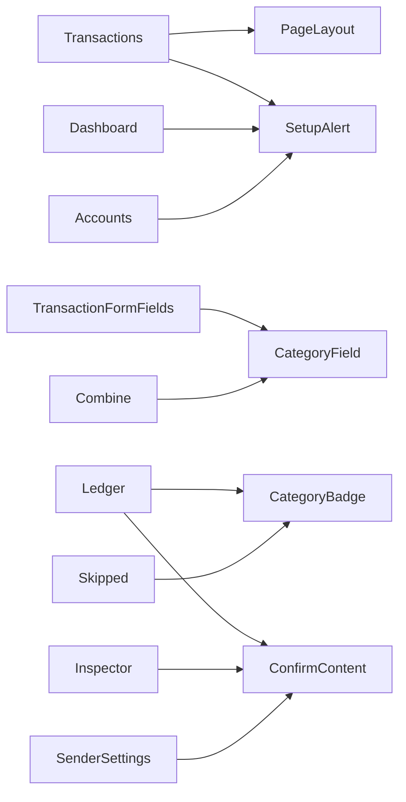

# Reuse Feature UI Composition - Plan

## Goal Capsule

- **Objective** — Keep page headings, setup prompts, category controls, and delete confirmations consistent across the affected screens. Make Add transaction available once locale setup is complete.
- **Means** — Adopt the existing page layout and extract shared feature components with caller-owned behavior (KTD1–KTD3).
- **Authority** — The five source review findings define scope. Current callers define behavior where this plan leaves it unspecified. R1 specifies the intended change to Add transaction visibility.
- **Execution** — Implement as one local change set on top of the current working tree. The implementer verifies each unit and hands back the change for review. This plan authorizes planning only.
- **Stop condition** — All five requirements are verified through their existing entry points, and each migrated UI pattern has one implementation.

## Product Contract

### Summary

Apply the five reuse findings from the conversation to Transactions, Dashboard, Accounts, Combine, and Gmail sender settings.

### Problem Frame

The same UI patterns are rendered in separate callers, so changes to labels, icons, and layout need to be repeated. The Transactions header also offers Add transaction before the locale settings required for creation are available.

### Requirements

| ID | Requirement |
| --- | --- |
| R1 | Render the Transactions heading and action with `PageLayout`. Show Add transaction only when the existing locale readiness check passes. Keep it in the header on both configured tabs and retain pointer and focus preloading. |
| R2 | Share the Category field across manual creation, transaction editing, and Combine. Preserve icons, labels, the currently selected legacy value, and the `Other` fallback when the Select callback receives a nullish value. |
| R3 | Share the locale setup alert across Dashboard, Transactions, and Accounts. Preserve each screen's existing copy, title presence, Settings link, and visibility condition. |
| R4 | Share the destructive confirmation content for single and bulk transaction deletion and trusted sender removal. Preserve the copy, focus behavior, disabled states, mutation arguments, and existing close behavior in each flow. |
| R5 | Share the category badge across ledger and skipped rows. Preserve the icon lookup and omit the badge when a skipped row has no category. |

### Scope Boundaries

The plan covers the five reviewed patterns and their identified consumers. Account selectors, email previews, other confirmation flows, and changes to shadcn primitives or backend contracts are outside this change.

## Planning Contract

### Key Technical Decisions

- KTD1. **Use the existing layout and readiness check.** `TransactionsView` supplies the action to `PageLayout` only when its existing timezone and currency check passes. The view currently passes a fallback currency to the drawer while settings load, and creation rejects an absent configured currency. Keep the header placement and the existing lazy-load handlers. See `internal/domain/transactions_mutations.go` for the currency requirement.
- KTD2. **Share only the category presentation.** The field owns option and icon composition around the existing helpers in `lib/categories.ts`. Continue passing Base UI's `items` metadata and rendering the same options. The badge receives a category name and the icon already resolved by each list.
- KTD3. **Keep readiness and mutations with callers.** The setup alert owns its responsive layout and Settings CTA. The destructive confirmation component owns the alert content and footer. Its callers supply labels, the action, and any distinct disabled states while continuing to own the dialog root and trigger.

### High-Level Technical Design

The arrows show which screens render each shared component. Add and Edit already reach the proposed Category field through `TransactionFormFields`.

### Sequencing

Complete the header first, then the category components, setup alert, and confirmation content. These units have no runtime dependency on each other. Apply edits to `transactions-view.tsx` and `transaction-list.tsx` sequentially because multiple units touch them.

## Implementation Units

### U1. Adopt the shared Transactions header

- **Goal** — Remove the duplicate header and align Add transaction visibility with locale readiness. Covers R1 and KTD1.
- **Files** — `components/transactions-view.tsx`. Reuse `components/PageLayout.tsx`.
- **Approach** — Move the existing title, subtitle, and button into the shared layout. Supply the action only when `isConfigured` is true. Keep the action outside tab content and leave dialog state and lazy loading with the view.
- **Test scenarios** — The action is absent while settings load and when timezone or currency is missing. On both configured tabs the action appears, preloads on hover and keyboard focus, and opens the drawer on activation. At narrow widths the action wraps without obscuring the heading.
- **Verification** — Check the loading, unconfigured, and configured states and confirm the rendered page has one main heading.

### U2. Share the Category field and badge

- **Goal** — Give category selection and category display each a shared component. Covers R2, R5, and KTD2.
- **Files** — Add `components/category-field.tsx` and `components/category-badge.tsx`. Update `components/transaction-form.tsx`, `components/manual-merge-dialog.tsx`, `components/transaction-list.tsx`, and `components/skipped-transactions-list.tsx`. Reuse `lib/categories.ts`.
- **Approach** — Give the field the available categories, current value, and change callback. Move the repeated option building, trigger and item icons, and fallback into it. Use the field inside `TransactionFormFields` and directly in Combine. Keep Combine's draft callbacks and field placement. Move the ledger and skipped-row badge markup into the shared badge and retain the skipped-row presence guard.
- **Test scenarios** — Add, Edit, and Combine show readable labels and the expected category icons. A current category missing from the options stays visible. Selecting an option, including `Other`, updates the caller's draft. A categorized skipped row renders the same badge as a ledger row, and an uncategorized skipped row renders none.
- **Verification** — Exercise all three form entry points and compare a ledger row with categorized and uncategorized skipped rows. Inspect the shared change handler separately to confirm a nullish value still maps to `Other`.

### U3. Share the locale setup alert

- **Goal** — Give the setup prompt and Settings CTA one owner. Covers R3 and KTD3.
- **Files** — Add `components/locale-setup-alert.tsx`. Update `components/dashboard-view.tsx`, `components/transactions-view.tsx`, and `components/accounts-view.tsx`.
- **Approach** — Use the existing Alert primitives and link styling. Accept page-specific description text and omit the title for Accounts. Preserve the spacing in the titled and untitled variants. Keep Dashboard's summary configuration check, Transactions' locale check, and Accounts' currency check at their existing call sites.
- **Test scenarios** — Each affected page shows its current setup message when its own check calls for it. The first two show the title and Accounts renders the description alone. Every CTA opens `/settings`. Loading skeletons and configured content retain their current behavior.
- **Verification** — Compare the three setup states, including a narrow viewport.

### U4. Share destructive confirmation content

- **Goal** — Centralize the repeated title, description, Cancel button, and destructive action. Covers R4 and KTD3.
- **Files** — Add `components/destructive-confirmation-content.tsx`. Update `components/transaction-list.tsx`, `components/transaction-inspector-drawer.tsx`, and `components/settings/gmail-senders-tab.tsx`. Compose the existing primitives in `components/ui/alert-dialog.tsx`.
- **Approach** — Migrate bulk delete, inspector delete, and trusted sender removal. Accept the existing title, description, confirm label, callback, and independent action and cancel disabled states. Keep the root, trigger, pending labels, dismiss guards, error display, and mutation completion handlers with the callers.
- **Test scenarios** — Cancel or Escape before confirming leaves data intact and focus follows the existing dialog behavior. Confirm uses the current single transaction ID, selected transaction IDs, or sender ID. Check bulk singular and plural copy, the pending button state, blocked dismissal while the request runs, and close when the request settles. Success clears the selection and failure leaves the existing error visible.
- **Verification** — Exercise cancellation and successful confirmation in all three flows using disposable data. Exercise bulk failure and pending behavior without altering production data.

## Verification Contract

- Run `bun run typecheck`, `bun run lint`, and `git diff --check` after implementation.
- Exercise the unit scenarios through the application using a local data set with configured and unconfigured locale states. Use disposable records for destructive checks.
- Read the applicable guide under `node_modules/next/dist/docs/` before editing. Apply the documented Base UI label and render semantics when migrating the callers.
- Reference the repo guidance in [reusable feature composition](../solutions/design-patterns/reuse-feature-ui-composition.md), [Base UI Select labels](../solutions/ui-bugs/base-ui-select-items-label-resolution.md), and [Base UI render semantics](../solutions/ui-bugs/base-ui-button-render-link-semantics.md).

## Definition of Done

- U1–U4 satisfy R1–R5 and the normal entry points pass the scenarios above.
- Migrated callers use the shared components without duplicate implementations, obsolete imports, or abandoned extraction code.
- The implementation diff preserves existing workspace edits and stays within the five findings.
