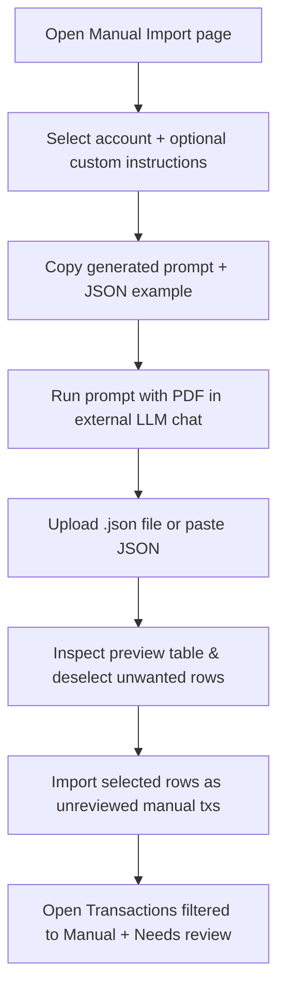
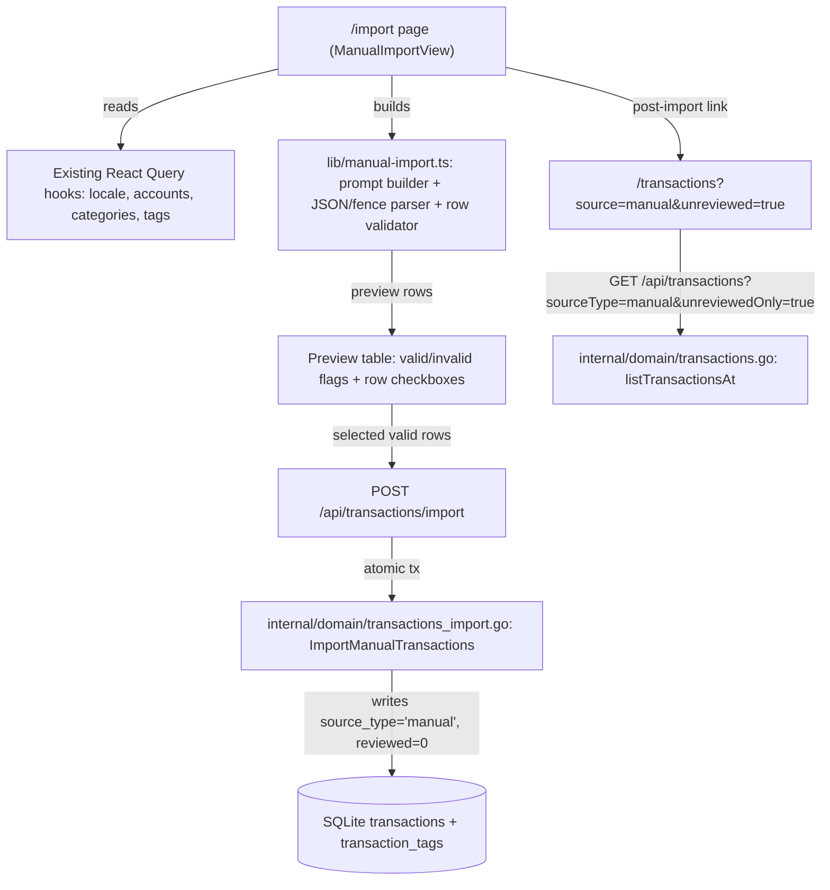

# Manual Transaction Import and Source Filter - Plan

## Goal Capsule

- **Objective:** Eliminate tedious one-by-one manual entry of bank statement PDFs by letting the user generate a tailored external-LLM extraction prompt, preview and selectively import the returned JSON as unreviewed manual transactions, and filter the Transactions ledger by source (`gmail` or `manual`).
- **Means:** Add a client-side prompt builder and JSON preview on a new `/import` page backed by an atomic Go batch-import endpoint, plus a `sourceType` filter on `/api/transactions` and `/transactions` (KTD1, KTD2, KTD5).
- **Product authority:** The Product Contract below is the sole source of user-facing behavior, scope boundaries, and acceptance criteria for this work.
- **Execution profile:** Single pull request (`U1` through `U5` in dependency order); no database migration required.
- **Stop conditions:** Stop if `go run ./cmd/gen-ts-types` introduces unexpected unrelated type diffs or if a required transaction invariant in `internal/domain/transactions_mutations.go` conflicts with `R9`–`R13`.
- **Open blockers:** None.

---

## Product Contract

### Summary

Add a dedicated Manual Import page in the main navigation that constructs a copy-ready extraction prompt (seeded with the user's categories, tags, currency, timezone, selected account, and optional custom instructions) alongside an expected JSON example. When the user uploads or pastes the resulting JSON from an external LLM chat, a preview table lets them catch parsing issues and deselect unwanted rows before saving the rest as unreviewed manual transactions. Add a source filter (`All`, `Gmail`, `Manual`) to the Transactions page so imported rows can be isolated and reviewed in the existing review flow.

### Problem Frame

Manual transaction statements typically arrive as PDFs from a single bank or card account. Because this app relies on a local LLM that cannot parse PDF files directly, the user currently has to type each statement line one by one or leave those transactions unrecorded. Offloading PDF parsing to an external chat model (such as Gemini or ChatGPT) is fast, but without an app-generated prompt, a strict JSON contract, a preview step, and a way to isolate manual rows on the Transactions page, importing and reviewing batches remains error-prone.

### Key Decisions

- **Preview before saving, review in Transactions:** Show a preview table on the import page to catch malformed rows and deselect unwanted entries, then save selected rows as unreviewed manual transactions for the existing Transactions review flow rather than reviewing in-place. Governs R7, R8, R9.
- **No duplicate detection in v1:** Rely on manual deselection in the preview table rather than automated overlap matching against Gmail-synced or previously imported rows. Governs R8.
- **Match existing categories and tags only:** Map recognized category and tag names to the user's existing library, fall back to the default `Other` category when unmatched or omitted, and drop unmatched tags so external LLM hallucinations do not pollute the library. Governs R10, R11.
- **Expense and income kinds only:** Limit manual import to `expense` and `income` transactions; transfers and credit card payments are converted manually during review. Governs R4, R12.
- **Accept both file upload and direct JSON paste:** Support uploading a `.json` file and pasting raw JSON text so users do not need to save a temporary file from an external chat window. Governs R6.

### Requirements

**Prompt builder and guidance**

- R1. A dedicated Manual Import page is accessible from the main navigation and briefly explains why PDF parsing is delegated to an external chat model.
- R2. The user selects one existing account for the import batch, and all transactions imported in that batch are assigned to that account.
- R3. The app dynamically generates a copy-ready extraction prompt incorporating the user's configured currency, configured timezone, existing category names, existing tag names, and the selected account context.
- R4. The generated prompt instructs the external LLM to extract, for each transaction, the amount, currency (defaulting to the user's configured currency), timestamp (handling date-only statements gracefully), merchant or remark, optional note, `kind` (`expense` or `income` only), guessed category from the provided list, and guessed tags from the provided list.
- R5. The user can enter optional additional extraction instructions (for example, ignoring specific labelled transactions), and those instructions are included verbatim in the generated prompt alongside a concrete example of the expected JSON payload.

**JSON import and preview**

- R6. The Manual Import page accepts the external LLM's JSON output via either `.json` file upload or direct text paste.
- R7. Parsing the JSON displays a preview table of extracted transactions before anything is saved, clearly flagging any malformed or invalid rows and preventing invalid rows from being imported.
- R8. Each valid row in the preview table can be selected or deselected before import; no automated duplicate detection is performed.
- R9. Confirming the import creates one manual transaction (`source_type = 'manual'`) per selected valid row, marked as needing review (`reviewed = 0`), and provides a direct link to view those unreviewed manual transactions on the Transactions page.
- R10. Category matching resolves case-insensitively against existing categories; unmatched or omitted categories fall back to the default `Other` category.
- R11. Tag matching resolves case-insensitively against existing tags; unmatched tag names are silently dropped rather than creating new tags.
- R12. Imported rows support `expense` and `income` kinds only; rows with any other kind are rejected or defaulted per validation rules rather than creating transfers.
- R13. Date-only transaction timestamps are normalized to a consistent time in the user's configured timezone before converting to UTC so they land on the intended calendar day of the user's spending cycle.

**Transactions source filter**

- R14. The Transactions page filter bar includes a source filter (`All`, `Gmail`, `Manual`) persisted in the URL query state alongside existing filters.
- R15. Filtering by `Gmail` returns only `source_type = 'gmail'` transactions, filtering by `Manual` returns only `source_type = 'manual'` transactions, and `All` imposes no source restriction.
- R16. The source filter composes with all existing Transactions filters (including `Needs review`) and with the existing sequential review drawer.

### Key Flows



- F1. End-to-end manual PDF import
  - **Trigger:** User opens Manual Import from the main navigation.
  - **Steps:** User picks one account, optionally adds custom extraction instructions, copies the generated prompt and JSON example, runs them with their PDF in an external LLM chat, and uploads or pastes the returned JSON back into the page. The preview table renders valid and invalid rows; the user unchecks any unwanted rows and confirms import.
  - **Outcome:** Selected valid rows are saved as unreviewed manual transactions on the chosen account, and the user can jump straight to the Transactions page filtered to `Manual` and `Needs review`.
  - **Covered by:** R1, R2, R3, R4, R5, R6, R7, R8, R9, R10, R11, R12, R13.

- F2. Filter and review imported manual transactions
  - **Trigger:** User navigates to Transactions (directly or from the post-import link) and selects `Manual` in the source filter.
  - **Steps:** User combines the `Manual` source filter with `Needs review` and opens the first row in the transaction details drawer to step through items with sequential review.
  - **Outcome:** Only manual transactions matching the active filters are shown and stepped through.
  - **Covered by:** R14, R15, R16.

### Acceptance Examples

- AE1. Unmatched category and tags on import
  - **Covers:** R10, R11.
  - **Given:** The user has categories `Food`, `Transport`, and `Other`, and tags `work` and `reimbursable`.
  - **When:** The imported JSON includes a valid expense with category `"Dining Out"` and tags `["Work", "invented-tag"]`.
  - **Then:** The saved transaction is assigned category `Other` and only the existing `work` tag; `"invented-tag"` is not created in the tag library.

- AE2. Date-only statement timestamp
  - **Covers:** R13.
  - **Given:** The user's configured timezone is `Asia/Jakarta` (`UTC+7`).
  - **When:** The imported JSON includes a transaction with date `2026-11-15` and no time component.
  - **Then:** The transaction is saved with a UTC timestamp that falls on `2026-11-15` in `Asia/Jakarta` rather than shifting to `2026-11-14`.

- AE3. Partial invalid rows and manual deselection
  - **Covers:** R7, R8, R9.
  - **Given:** The user pastes JSON containing 5 rows where 1 row has a missing or non-positive amount and the user unchecks 1 of the 4 valid rows.
  - **Then:** The invalid row is flagged and excluded from import, and confirming imports exactly 3 manual transactions marked `reviewed = 0`.

- AE4. Source filter combined with Needs review
  - **Covers:** R14, R15, R16.
  - **Given:** The ledger contains unreviewed Gmail transactions and newly imported unreviewed Manual transactions.
  - **When:** The user selects `Manual` in the source filter and enables `Needs review`.
  - **Then:** Only the unreviewed manual transactions appear, and reloading the page preserves the filter selection from the URL.

### Scope Boundaries

- **In-app PDF parsing:** Local LLM PDF parsing is out of scope; the workflow intentionally delegates parsing to an external chat model.
- **Duplicate detection:** Automated overlap or duplicate detection against Gmail-synced or prior manual transactions is deferred.
- **Library auto-creation:** Automatically creating new categories or tags from LLM output is excluded to keep the library curated.
- **Transfer and credit card payment kinds:** Importing `transfer` or `credit_card_payment` kinds directly is out of scope; users convert those during normal review.
- **In-place review editing:** Editing categories, tags, or remarks inside the import preview table is deferred; editing happens in the existing Transactions review flow.
- **Multi-account batches:** Splitting a single JSON import across multiple accounts is out of scope; one import targets one account.

### Dependencies and Assumptions

- The app's configured currency and timezone in settings are populated before generating a prompt (or the page clearly indicates if settings are incomplete).
- External LLM outputs are valid JSON (or fenced JSON blocks) conforming to the example schema; malformed JSON produces a clear parse error without partial writes.

### Sources and Research

- `CONCEPTS.md` — canonical definitions for Tag, Spending cycle, and Net spending.
- `internal/db/migrations/000001_baseline.up.sql` — `transactions` table (`source_type IN ('gmail', 'manual')`, `reviewed IN (0, 1)`, `category_id NOT NULL`, `kind IN ('expense', 'income', 'transfer')`), `app_settings`, `accounts`, `categories`, and `tags`.
- `internal/domain/transactions_mutations.go` — `CreateManualTransaction` enforces `expense`/`income` kinds, defaults category to `DefaultCategory` (`Other`), and currently sets `Reviewed: 1`.
- `internal/domain/transactions.go` and `app/api/transactions/route.go` — `ListTransactions` filter parameters (no `source_type` filter yet).
- `components/transactions-view.tsx` and `components/transaction-list.tsx` — URL-driven `nuqs` filter bar and `Needs review` / `Manual` badge rendering.
- `components/app-shell.tsx` — main navigation items (`Transactions`, `Accounts`, `Categories & Tags`, `Settings`).
- `docs/plans/2026-11-25-1717-feat-sequential-transaction-review-plan.md` — sequential review drawer iterates the active filtered Transactions list.

---

## Planning Contract

Product Contract preservation: Product Contract unchanged.

### Key Technical Decisions

- KTD1. **No database migration — reuse existing `source_type` and `reviewed` columns:** `transactions.source_type` already enforces `('gmail', 'manual')` and `transactions.reviewed` already enforces `(0, 1)`, so batch import and source filtering require zero schema changes. Governs R9, R15.
- KTD2. **Dedicated atomic batch-import endpoint (`POST /api/transactions/import`):** Creating imported rows in a single GORM transaction prevents partial imports on validation or database errors while keeping `CreateManualTransaction` (which defaults `Reviewed: 1`) untouched for single-entry manual forms. Governs R9, R10, R11, R12, R13.
- KTD3. **Client-side prompt assembly and preview parsing with server-side enforcement:** Building the prompt and parsing/validating JSON (including stripping optional markdown code fences) in pure TypeScript helpers under `lib/` gives instant feedback in the preview table without round-trips, while the Go domain function re-validates every submitted row before persisting. Governs R3, R4, R5, R6, R7, R8.
- KTD4. **Date-only timestamp normalization to `12:00:00` local time:** Normalizing `YYYY-MM-DD` entries to noon (`12:00:00`) in the user's configured IANA timezone before converting to UTC avoids midnight DST edge cases and guarantees the transaction lands on the intended calendar day in the user's spending cycle. Governs R13.
- KTD5. **URL-persisted `source` filter via `nuqs` on `/transactions`:** Adding `source` (`all` | `gmail` | `manual`) to the existing `useQueryStates` hook in `components/transactions-view.tsx` and wiring `sourceType` through `lib/api/transactions.ts`, `app/api/transactions/route.go`, and `internal/domain/transactions.go` makes post-import deep links (`/transactions?source=manual&unreviewed=true`) work on first load and reload. Governs R9, R14, R15, R16.

### High-Level Technical Design



**Directional JSON payload contract** (expected from external LLM and accepted by the parser; exact field names may be refined during implementation):

```json
{
  "transactions": [
    {
      "date": "2026-11-15",
      "time": "14:30:00",
      "amount": 45000,
      "currency": "IDR",
      "kind": "expense",
      "merchant": "Kopi Kenangan",
      "category": "Food & Drink",
      "tags": ["coffee"],
      "note": "Iced latte"
    }
  ]
}
```

- `date` (`YYYY-MM-DD`, required) and optional `time` (`HH:MM` or `HH:MM:SS`) are combined in the user's configured timezone (defaulting to `12:00:00` when `time` is omitted, per KTD4).
- `amount` is a positive decimal number in major currency units (converted to `amount_minor` using `CurrencyExponent` for the transaction currency).
- `currency` is optional and defaults to the user's configured currency.
- `kind` is `"expense"` or `"income"` (defaults to `"expense"` if omitted; any other value marks the row invalid in preview and is rejected by the backend).

### Risks and Dependencies

- **Base UI Select label resolution:** Any new `Select` controls (Account picker on `/import`, Source filter on `/transactions`) must pass `items` to Base UI `Select.Root` so labels render instead of raw IDs (see `docs/solutions/ui-bugs/base-ui-select-items-label-resolution.md`).
- **Go test command scope:** Next.js bracket directories under `app/api/[id]` break `go test ./...`; always scope Go tests to `./internal/...` (see `docs/solutions/workflow-issues/nextjs-goroutes-bracket-dirs-break-go-test-and-vet.md`).
- **TypeScript type generation:** Adding new Go request/response structs in `internal/domain` requires running `bun run generate:types` so `lib/api/types.generated.ts` stays in sync.

### Deferred Implementation Notes

- Exact prompt wording and formatting of the JSON example block (tuned during U3 so external LLMs reliably emit valid JSON).
- Exact visual layout of the 3-step cards on `/import` (following existing `PageLayout` and shadcn `Card`/`Table`/`Select`/`Textarea` patterns).

---

## Implementation Units

### U1. Backend `source_type` filter on `ListTransactions`

- **Goal:** Support filtering transactions by `source_type` (`gmail` or `manual`) in the Go domain query and HTTP API.
- **Requirements:** R14, R15, R16.
- **Dependencies:** None.
- **Files:**
  - Modify: `internal/domain/transactions.go`
  - Modify: `app/api/transactions/route.go`
  - Test: `internal/domain/transactions_filters_test.go` (catches SQL filter semantics and composition with `unreviewedOnly`; does not cover URL query state)
- **Approach:**
  1. Add `SourceType string` to `ListTransactionsParams` in `internal/domain/transactions.go`.
  2. In `listTransactionsAt`, trim and normalize `params.SourceType`; when `"gmail"` or `"manual"`, append `t.source_type = ?`; ignore empty or `"all"`; reject invalid non-empty values with a clear error.
  3. Parse `q.Get("sourceType")` in `app/api/transactions/route.go` and pass it into `domain.ListTransactionsParams`.
- **Patterns to follow:** Existing `Kind` and `UnreviewedOnly` filters in `internal/domain/transactions.go` and `app/api/transactions/route.go`.
- **Test scenarios:**
  - Filtering with `SourceType: "manual"` returns only manual transactions and excludes Gmail transactions.
  - Filtering with `SourceType: "gmail"` returns only Gmail transactions and excludes manual transactions.
  - Filtering with `SourceType: ""` or `"all"` returns both Gmail and manual transactions.
  - Covers AE4: Combining `SourceType: "manual"` with `UnreviewedOnly: true` returns only unreviewed manual transactions.
  - Passing an invalid `SourceType` (e.g., `"csv"`) returns a validation error.
- **Verification:** `go test ./internal/domain -run TestListTransactions` passes with all new filter cases green.

### U2. Backend atomic batch manual-import domain logic and API route

- **Goal:** Provide `ImportManualTransactions` in `internal/domain` and expose it at `POST /api/transactions/import`, creating unreviewed manual transactions (`reviewed = 0`) with existing-only category/tag matching.
- **Requirements:** R2, R9, R10, R11, R12, R13.
- **Dependencies:** None.
- **Files:**
  - Create: `internal/domain/transactions_import.go`
  - Create: `app/api/transactions/import/route.go`
  - Modify: `lib/api/types.generated.ts` (regenerated via `bun run generate:types`)
  - Test: `internal/domain/transactions_import_test.go` (catches atomicity, category fallback, tag dropping, timezone normalization, and validation; does not cover HTTP routing)
- **Approach:**
  1. Define `ImportManualTransactionsInput` (single `AccountID`, slice of `ImportManualTransactionRow` items) and `ImportManualTransactionsResult` (count + created IDs) in `internal/domain/transactions_import.go`.
  2. Validate configured locale (`timezone`, `currency`) and verify `AccountID` exists.
  3. Inside a single GORM transaction, load existing categories (by `normalized_name`) and existing tags (by `normalized_name`) once.
  4. For each row: validate `kind` in `("expense", "income")` (R12), positive `amount_minor`, non-empty `merchant` (defaulting to `"Income"` for income rows, matching `CreateManualTransaction`), and valid `occurred_at_utc` (or normalize date-only strings to `12:00:00` in the user's configured IANA timezone per KTD4/R13).
  5. Resolve category case-insensitively against existing categories, falling back to `DefaultCategory` (`"Other"`) when unmatched or empty (R10). Resolve tags case-insensitively against existing tags and silently drop unmatched names (R11).
  6. Insert each row with `SourceType: "manual"` and `Reviewed: 0` (R9) and attach matched `transaction_tags`.
  7. Expose `POST /api/transactions/import` in `app/api/transactions/import/route.go` using `httpx.DecodeJSON` and `httpx.AllowLocalRequest(w, r, true)`.
- **Patterns to follow:** `CreateManualTransaction` in `internal/domain/transactions_mutations.go` and `POST` handler in `app/api/transactions/route.go`.
- **Test scenarios:**
  - Happy path: Importing a batch of mixed `expense` and `income` rows creates all rows on the target account with `source_type = "manual"` and `reviewed = 0`.
  - Covers AE1: Unmatched category name falls back to `Other`; matched tag (case-insensitive) is attached; unmatched tag name is dropped and not inserted into `tags`.
  - Covers AE2: Date-only input `"2026-11-15"` with `Asia/Jakarta` timezone normalizes to `2026-11-15T05:00:00Z` (landing on `2026-11-15` local time).
  - Error path: Any row with `kind: "transfer"`, non-positive amount, or empty batch fails validation and rolls back the entire batch (zero rows persisted).
  - Error path: Missing or nonexistent `AccountID` fails without writing any rows.
- **Verification:** `go test ./internal/domain -run TestImportManualTransactions` passes and `bun run check:types` succeeds.

### U3. Frontend prompt builder, JSON parser, and API client

- **Goal:** Implement pure TypeScript helpers for building the external-LLM extraction prompt + JSON example and parsing/validating returned JSON (including markdown code fences), plus the API client functions for `sourceType` filtering and batch import.
- **Requirements:** R3, R4, R5, R6, R7, R10, R11, R12, R13.
- **Dependencies:** U1, U2.
- **Files:**
  - Create: `lib/manual-import.ts`
  - Modify: `lib/api/transactions.ts`
  - Test: `lib/manual-import.test.ts` (catches prompt interpolation, code-fence stripping, row validation, minor-unit conversion, and date-only timezone conversion; does not cover React rendering)
- **Approach:**
  1. In `lib/manual-import.ts`, implement `buildManualImportPrompt` taking locale (`currency`, `timezone`), selected account name/type, existing category names, existing tag names, and optional custom instructions, returning the full copy-ready prompt including the concrete JSON example.
  2. Implement `parseManualImportJson` that strips optional ```` ```json ```` / ```` ``` ```` fences, parses JSON (accepting either `{ "transactions": [...] }` or a top-level array `[...]`), validates each row (`amount > 0`, valid `date`, `kind` in `expense`/`income`, non-empty `merchant` for expenses), maps category/tags against the provided library (marking unmatched category as falling back to `Other` and listing dropped tags for preview transparency), and converts major-unit amounts to minor units and local date/time to UTC ISO strings.
  3. In `lib/api/transactions.ts`, add optional `sourceType` to `TransactionsQueryParams` / `transactionsQuery`, and add `importManualTransactionsApi` calling `POST /api/transactions/import`.
- **Patterns to follow:** `lib/format.ts` (`parseDecimalToMinorClient`, `dateTimeInputToUtcIso`) and `lib/api/transactions.ts`.
- **Test scenarios:**
  - Prompt builder includes the selected account, configured currency, timezone, all category and tag names, custom instructions when provided, and a valid parseable JSON example.
  - Parser accepts both raw JSON and markdown-fenced JSON (` ```json ... ``` `) and both `{ transactions: [...] }` and bare array `[...]` shapes.
  - Covers AE3: Given 5 rows where 1 has a non-positive amount, parser returns 4 valid rows and 1 invalid row with a clear error message.
  - Covers AE1: Unmatched category resolves to `Other` in preview metadata and unmatched tags are filtered out of matched tags.
  - Covers AE2: Date-only `"2026-11-15"` in `Asia/Jakarta` converts to the expected UTC timestamp on `2026-11-15` local time.
  - Invalid JSON syntax returns a top-level parse error without throwing.
- **Verification:** `bun test lib/manual-import.test.ts` passes.

### U4. Dedicated Manual Import page and navigation entry

- **Goal:** Build the `/import` page with the 3-step workflow (account + custom instructions + copyable prompt, JSON file upload or paste, preview table with row selection and import confirmation) and add it to the main navigation.
- **Requirements:** R1, R2, R3, R4, R5, R6, R7, R8, R9.
- **Dependencies:** U3.
- **Files:**
  - Create: `app/import/page.tsx`
  - Create: `components/manual-import-view.tsx`
  - Modify: `components/app-shell.tsx`
- **Approach:**
  1. Add `{ href: "/import", label: "Import" }` to `NAV_ITEMS` in `components/app-shell.tsx` and prefetch `localeQuery`, `accountsQuery`, `categoriesQuery`, and `tagsQuery` on hover.
  2. Create `app/import/page.tsx` rendering `ManualImportView` inside `PageLayout`.
  3. In `components/manual-import-view.tsx`:
     - Step 1 card: Brief explanation of why PDFs are parsed with an external chat LLM; Account `Select` (with `items` passed to Base UI `Select.Root`); optional custom instructions `Textarea`; read-only generated prompt preview with one-click Copy button and feedback.
     - Step 2 card: File input accepting `.json` files plus a `Textarea` for direct JSON paste, with a clear Parse error alert when malformed.
     - Step 3 card: Preview table listing parsed rows with checkboxes (all valid rows checked by default; invalid rows unchecked, disabled, and highlighted with their validation reason), summary counts (selected valid / invalid), and an `Import X transactions` button.
     - Post-import success state: Confirmation banner showing how many manual transactions were imported and a direct link to `/transactions?source=manual&unreviewed=true`, plus query invalidation for `["transactions"]` and `["monthly-summary"]`.
- **Patterns to follow:** `components/transactions-view.tsx`, `components/add-transaction-dialog.tsx`, `docs/solutions/ui-bugs/base-ui-select-items-label-resolution.md`, and `docs/solutions/design-patterns/reuse-shadcn-controls-in-feature-forms.md`.
- **Test scenarios:**
  - Pure UI composition over `lib/manual-import.ts` and `importManualTransactionsApi`; verified via TypeScript typecheck, ESLint, Next.js production build, and manual/browser walkthrough of F1 (select account -> copy prompt -> upload/paste JSON -> deselect row -> import -> click link to `/transactions?source=manual&unreviewed=true`).
- **Verification:** `bun run typecheck`, `bun run lint`, and `bun run build` succeed cleanly.

### U5. Transactions page source filter (`All` / `Gmail` / `Manual`)

- **Goal:** Add the URL-persisted `source` filter to the Transactions filter bar so users can filter by `All`, `Gmail`, or `Manual` and step through filtered rows in sequential review.
- **Requirements:** R14, R15, R16.
- **Dependencies:** U1, U3.
- **Files:**
  - Modify: `components/transactions-view.tsx`
  - Modify: `components/transaction-list.tsx`
- **Approach:**
  1. Add `source: parseAsStringLiteral(["all", "gmail", "manual"] as const).withDefault("all")` to `useQueryStates` in `components/transactions-view.tsx`.
  2. Pass `sourceType: filters.source === "all" ? undefined : filters.source` into `transactionsQuery(...)` and reset `source: "all"` in `Reset filters` and `hasActiveFilters`.
  3. Add a Source `Select` (`All sources`, `Gmail`, `Manual`) with `items` passed to Base UI `Select.Root` in `components/transaction-list.tsx`'s filter bar.
- **Patterns to follow:** Existing `accountId` and `category` filters in `components/transactions-view.tsx` and `components/transaction-list.tsx`.
- **Test scenarios:**
  - Covers AE4: Selecting `Manual` + `Needs review` updates the URL to `?source=manual&unreviewed=true`, fetches `/api/transactions?sourceType=manual&unreviewedOnly=true`, preserves state across page reload, and resets cleanly when clicking `Reset filters`.
- **Verification:** `bun run typecheck`, `bun run lint`, and `bun run build` succeed cleanly.

---

## Verification Contract

| Check | Command | What it proves |
|---|---|---|
| Go domain unit & integration tests | `go test ./internal/...` | `ListTransactions` `source_type` filter (U1) and atomic `ImportManualTransactions` batch import (U2) |
| Generated TS types parity | `bun run check:types` | Go domain structs and `lib/api/types.generated.ts` are in sync |
| Frontend unit tests | `bun test` | Prompt builder, JSON/fence parser, row validator, and date-only timezone conversion (U3) |
| TypeScript typecheck | `bun run typecheck` | Type safety across `/import`, `lib/manual-import.ts`, `lib/api/transactions.ts`, and `/transactions` (U3–U5) |
| Lint | `bun run lint` | Code style and React/Next.js lint rules |
| Production build | `bun run build` | Next.js App Router compiles `/import` and `/transactions` with zero build errors |

---

## Definition of Done

- All implementation units (`U1`–`U5`) are implemented and satisfy `R1`–`R16`, `F1`–`F2`, and `AE1`–`AE4`.
- All checks in the Verification Contract pass with zero errors.
- No abandoned experimental code or dead-end files remain in the diff.
- `lib/api/types.generated.ts` matches `go run ./cmd/gen-ts-types --check`.
